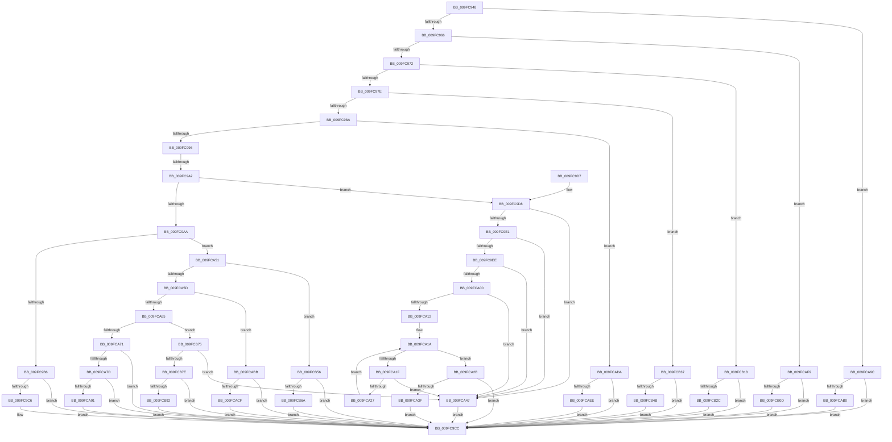

# EtwpAllocateFilter

- RVA: `0x009FC948`–`0x009FCB9D` (길이 `597` bytes)
- VA: `0x00000001409FC948`
- 실행 섹션: `PAGE`
- PDB 이름 있음: `예`; PDB Function 태그: `예`
- unwind 정보 RVA: `0x000A71F0`
- 디코드: `140`개 명령, `597/597` bytes 표시
- 미해석 바이트: `0` (있으면 어셈블리에 `.byte`로 보존)

> 이 문서는 커널 이미지의 기계어와 PDB 기호를 분석해 생성했습니다. 4번과 5번은 함수 원형과 자료형을 바이너리 사용 방식에서 추정한 C 해석이며 원본 소스 복구 결과는 아닙니다.

## 1. Dependencies

- 직접 호출 지점: **11**; 고유 호출 대상: **7**
- 직접 호출자로 확인된 함수: **2**
- RIP 상대 이미지 참조: **0**

### Outgoing calls
- `0x009FC9BD` → [EtwpAllocateEventNameFilter](EtwpAllocateEventNameFilter_function_009FCBA4.md) (function, `0x009FCBA4`)
- `0x009FCA36` → [EtwpCreatePerfectHashFunction](EtwpCreatePerfectHashFunction_function_009FD6CC.md) (function, `0x009FD6CC`)
- `0x009FCA84` → [EtwpAllocateSchematizedFilter](../7C/EtwpAllocateSchematizedFilter_function_007C318C.md) (function, `0x007C318C`)
- `0x009FCAA3` → [EtwpAllocatePidFilter](EtwpAllocatePidFilter_function_009FDACC.md) (function, `0x009FDACC`)
- `0x009FCAC2` → [EtwpAllocateLevelKwFilter](../70/EtwpAllocateLevelKwFilter_function_00702E64.md) (function, `0x00702E64`)
- `0x009FCAE1` → [EtwpAllocateStringFilterData](../70/EtwpAllocateStringFilterData_function_00704154.md) (function, `0x00704154`)
- `0x009FCB00` → [EtwpAllocateStringFilterData](../70/EtwpAllocateStringFilterData_function_00704154.md) (function, `0x00704154`)
- `0x009FCB1F` → [EtwpAllocateStringFilterData](../70/EtwpAllocateStringFilterData_function_00704154.md) (function, `0x00704154`)
- `0x009FCB3E` → [EtwpAllocateStringFilterData](../70/EtwpAllocateStringFilterData_function_00704154.md) (function, `0x00704154`)
- `0x009FCB5D` → [EtwpAllocateEventNameFilter](EtwpAllocateEventNameFilter_function_009FCBA4.md) (function, `0x009FCBA4`)
- `0x009FCB85` → [EtwpAllocatePayloadFilterData](../7C/EtwpAllocatePayloadFilterData_function_007C30F4.md) (function, `0x007C30F4`)

### Direct callers
- [EtwpValidateTraceControlFilterDescriptors](../7C/EtwpValidateTraceControlFilterDescriptors_function_007C321C.md) at `0x007C32E7`
- [EtwpValidateFilterDescriptors](EtwpValidateFilterDescriptors_function_009FC7E4.md) at `0x009FC8AB`

### Static image references
- 디코드된 RIP-relative 메모리 참조가 없습니다.

## 2. Other-region calls and transfers

- 다른 실행 섹션으로 향하는 call: **0**
- call이 아닌 외부 분기/꼬리 이동: **1**
  - `0x009FC99C` → [sub_00B32592](../B3/Unknown_function_00B32592.md) (`tail-transfer`)

## 3. Assembly (complete function range)

```asm
009FC948  48 89 5C 24 08                  mov qword ptr [rsp + 8], rbx
009FC94D  57                              push rdi
009FC94E  48 83 EC 20                     sub rsp, 0x20
009FC952  33 C0                           xor eax, eax
009FC954  49 8B D8                        mov rbx, r8
009FC957  4C 8B D2                        mov r10, rdx
009FC95A  81 F9 04 00 00 80               cmp ecx, 0x80000004
009FC960  0F 84 36 01 00 00               je 0x1409fca9c
009FC966  81 F9 08 00 00 80               cmp ecx, 0x80000008
009FC96C  0F 84 87 01 00 00               je 0x1409fcaf9
009FC972  81 F9 10 00 00 80               cmp ecx, 0x80000010
009FC978  0F 84 9A 01 00 00               je 0x1409fcb18
009FC97E  81 F9 20 00 00 80               cmp ecx, 0x80000020
009FC984  0F 84 AD 01 00 00               je 0x1409fcb37
009FC98A  81 F9 00 80 00 80               cmp ecx, 0x80008000
009FC990  0F 84 44 01 00 00               je 0x1409fcada
009FC996  81 F9 00 10 00 80               cmp ecx, 0x80001000
009FC99C  0F 84 F0 5B 13 00               je 0x140b32592
009FC9A2  81 F9 00 02 00 80               cmp ecx, 0x80000200
009FC9A8  74 2E                           je 0x1409fc9d8
009FC9AA  81 F9 00 04 00 80               cmp ecx, 0x80000400
009FC9B0  0F 85 9B 00 00 00               jne 0x1409fca51
009FC9B6  49 8D 50 60                     lea rdx, [r8 + 0x60]
009FC9BA  49 8B CA                        mov rcx, r10
009FC9BD  E8 E2 01 00 00                  call 0x1409fcba4
009FC9C2  85 C0                           test eax, eax
009FC9C4  78 06                           js 0x1409fc9cc
009FC9C6  81 0B 00 04 00 80               or dword ptr [rbx], 0x80000400
009FC9CC  48 8B 5C 24 30                  mov rbx, qword ptr [rsp + 0x30]
009FC9D1  48 83 C4 20                     add rsp, 0x20
009FC9D5  5F                              pop rdi
009FC9D6  C3                              ret
009FC9D7  CC                              int3
009FC9D8  4C 8B 1A                        mov r11, qword ptr [rdx]
009FC9DB  49 39 40 48                     cmp qword ptr [r8 + 0x48], rax
009FC9DF  75 66                           jne 0x1409fca47
009FC9E1  8B 52 08                        mov edx, dword ptr [rdx + 8]
009FC9E4  8D 42 FA                        lea eax, [rdx - 6]
009FC9E7  3D FA 03 00 00                  cmp eax, 0x3fa
009FC9EC  77 59                           ja 0x1409fca47
009FC9EE  45 0F B7 43 02                  movzx r8d, word ptr [r11 + 2]
009FC9F3  4A 8D 0C 45 04 00 00 00         lea rcx, [r8*2 + 4]
009FC9FB  48 3B D1                        cmp rdx, rcx
009FC9FE  75 47                           jne 0x1409fca47
009FCA00  41 0F B7 C0                     movzx eax, r8w
009FCA04  B9 01 00 00 00                  mov ecx, 1
009FCA09  66 2B C1                        sub ax, cx
009FCA0C  66 83 F8 3F                     cmp ax, 0x3f
009FCA10  77 35                           ja 0x1409fca47
009FCA12  33 D2                           xor edx, edx
009FCA14  41 B9 FF FF 00 00               mov r9d, 0xffff
009FCA1A  41 3B D0                        cmp edx, r8d
009FCA1D  73 0C                           jae 0x1409fca2b
009FCA1F  66 45 39 4C 53 04               cmp word ptr [r11 + rdx*2 + 4], r9w
009FCA25  74 20                           je 0x1409fca47
009FCA27  03 D1                           add edx, ecx
009FCA29  EB EF                           jmp 0x1409fca1a
009FCA2B  41 8A 0B                        mov cl, byte ptr [r11]
009FCA2E  49 8D 53 04                     lea rdx, [r11 + 4]
009FCA32  4C 8D 4B 48                     lea r9, [rbx + 0x48]
009FCA36  E8 91 0C 00 00                  call 0x1409fd6cc
009FCA3B  85 C0                           test eax, eax
009FCA3D  78 8D                           js 0x1409fc9cc
009FCA3F  81 0B 00 02 00 80               or dword ptr [rbx], 0x80000200
009FCA45  EB 85                           jmp 0x1409fc9cc
009FCA47  B8 0D 00 00 C0                  mov eax, 0xc000000d
009FCA4C  E9 7B FF FF FF                  jmp 0x1409fc9cc
009FCA51  81 F9 00 20 00 80               cmp ecx, 0x80002000
009FCA57  0F 84 F9 00 00 00               je 0x1409fcb56
009FCA5D  81 F9 00 40 00 80               cmp ecx, 0x80004000
009FCA63  74 56                           je 0x1409fcabb
009FCA65  81 F9 00 01 00 80               cmp ecx, 0x80000100
009FCA6B  0F 84 04 01 00 00               je 0x1409fcb75
009FCA71  81 F9 00 00 00 80               cmp ecx, 0x80000000
009FCA77  0F 85 4F FF FF FF               jne 0x1409fc9cc
009FCA7D  49 8D 50 58                     lea rdx, [r8 + 0x58]
009FCA81  49 8B CA                        mov rcx, r10
009FCA84  E8 03 67 DC FF                  call 0x1407c318c
009FCA89  85 C0                           test eax, eax
009FCA8B  0F 88 3B FF FF FF               js 0x1409fc9cc
009FCA91  81 0B 00 00 00 80               or dword ptr [rbx], 0x80000000
009FCA97  E9 30 FF FF FF                  jmp 0x1409fc9cc
009FCA9C  49 8D 50 08                     lea rdx, [r8 + 8]
009FCAA0  49 8B CA                        mov rcx, r10
009FCAA3  E8 24 10 00 00                  call 0x1409fdacc
009FCAA8  85 C0                           test eax, eax
009FCAAA  0F 88 1C FF FF FF               js 0x1409fc9cc
009FCAB0  81 0B 04 00 00 80               or dword ptr [rbx], 0x80000004
009FCAB6  E9 11 FF FF FF                  jmp 0x1409fc9cc
009FCABB  49 8D 50 40                     lea rdx, [r8 + 0x40]
009FCABF  49 8B CA                        mov rcx, r10
009FCAC2  E8 9D 63 D0 FF                  call 0x140702e64
009FCAC7  85 C0                           test eax, eax
009FCAC9  0F 88 FD FE FF FF               js 0x1409fc9cc
009FCACF  81 0B 00 40 00 80               or dword ptr [rbx], 0x80004000
009FCAD5  E9 F2 FE FF FF                  jmp 0x1409fc9cc
009FCADA  49 8D 50 28                     lea rdx, [r8 + 0x28]
009FCADE  49 8B CA                        mov rcx, r10
009FCAE1  E8 6E 76 D0 FF                  call 0x140704154
009FCAE6  85 C0                           test eax, eax
009FCAE8  0F 88 DE FE FF FF               js 0x1409fc9cc
009FCAEE  81 0B 00 80 00 80               or dword ptr [rbx], 0x80008000
009FCAF4  E9 D3 FE FF FF                  jmp 0x1409fc9cc
009FCAF9  49 8D 50 10                     lea rdx, [r8 + 0x10]
009FCAFD  49 8B CA                        mov rcx, r10
009FCB00  E8 4F 76 D0 FF                  call 0x140704154
009FCB05  85 C0                           test eax, eax
009FCB07  0F 88 BF FE FF FF               js 0x1409fc9cc
009FCB0D  81 0B 08 00 00 80               or dword ptr [rbx], 0x80000008
009FCB13  E9 B4 FE FF FF                  jmp 0x1409fc9cc
009FCB18  49 8D 50 18                     lea rdx, [r8 + 0x18]
009FCB1C  49 8B CA                        mov rcx, r10
009FCB1F  E8 30 76 D0 FF                  call 0x140704154
009FCB24  85 C0                           test eax, eax
009FCB26  0F 88 A0 FE FF FF               js 0x1409fc9cc
009FCB2C  81 0B 10 00 00 80               or dword ptr [rbx], 0x80000010
009FCB32  E9 95 FE FF FF                  jmp 0x1409fc9cc
009FCB37  49 8D 50 20                     lea rdx, [r8 + 0x20]
009FCB3B  49 8B CA                        mov rcx, r10
009FCB3E  E8 11 76 D0 FF                  call 0x140704154
009FCB43  85 C0                           test eax, eax
009FCB45  0F 88 81 FE FF FF               js 0x1409fc9cc
009FCB4B  81 0B 20 00 00 80               or dword ptr [rbx], 0x80000020
009FCB51  E9 76 FE FF FF                  jmp 0x1409fc9cc
009FCB56  49 8D 50 38                     lea rdx, [r8 + 0x38]
009FCB5A  49 8B CA                        mov rcx, r10
009FCB5D  E8 42 00 00 00                  call 0x1409fcba4
009FCB62  85 C0                           test eax, eax
009FCB64  0F 88 62 FE FF FF               js 0x1409fc9cc
009FCB6A  81 0B 00 20 00 80               or dword ptr [rbx], 0x80002000
009FCB70  E9 57 FE FF FF                  jmp 0x1409fc9cc
009FCB75  4D 85 C9                        test r9, r9
009FCB78  0F 84 C9 FE FF FF               je 0x1409fca47
009FCB7E  49 83 C0 50                     add r8, 0x50
009FCB82  49 8B C9                        mov rcx, r9
009FCB85  E8 6A 65 DC FF                  call 0x1407c30f4
009FCB8A  85 C0                           test eax, eax
009FCB8C  0F 88 3A FE FF FF               js 0x1409fc9cc
009FCB92  81 0B 00 01 00 80               or dword ptr [rbx], 0x80000100
009FCB98  E9 2F FE FF FF                  jmp 0x1409fc9cc
```

## 4. C-style interpretation (structured pseudocode)

```c
__int64 __fastcall EtwpAllocateFilter(int a1, __int64 a2, __int64 a3)
{
    __int64 result;
    __int64 v_rsp;
    unsigned __int64 v_stack_p8;

    v_stack_p8 = v_rbx;
    v_rsp = (v_rsp) - (32);
    result = 0;
    if (a1 == 0x80000004ULL) goto loc_009FCA9C;
    if (a1 == 0x80000008ULL) goto loc_009FCAF9;
    if (a1 == 0x80000010ULL) goto loc_009FCB18;
    if (a1 == 0x80000020ULL) goto loc_009FCB37;
    if (a1 == 0x80008000ULL) goto loc_009FCADA;
    if (a1 == 0x80000200ULL) goto loc_009FC9D8;
    if (a1 != 0x80000400ULL) goto loc_009FCA51;
    result = EtwpAllocateEventNameFilter(a2, a3 + 96, a3, a4);
    if (!(sign_flag)) {
    }
    v_rsp = (v_rsp) + (32);
    return result;
loc_009FC9D8:
    if ((*(unsigned __int64 *)(a3 + 72)) != result) goto loc_009FCA47;
    if (((unsigned int)((unsigned int)(*(unsigned int *)(a3 + 96 + 8)) - 6)) > 0x3FAULL) goto loc_009FCA47;
    if (((unsigned int)(*(unsigned int *)(a3 + 96 + 8))) != (*(unsigned __int16 *)(*(unsigned __int64 *)(a3 + 96) + 2) * 2 + 4)) goto loc_009FCA47;
    result = (unsigned __int16)(((unsigned __int16)(*(unsigned __int16 *)(*(unsigned __int64 *)(a3 + 96) + 2))) - (1));
    if (((unsigned __int16)(result)) > 63) goto loc_009FCA47;
    a2 = 0;
loc_009FCA1A:
    if (0 >= ((unsigned int)(*(unsigned __int16 *)(*(unsigned __int64 *)(a3 + 96) + 2)))) goto loc_009FCA2B;
    if ((*(unsigned __int16 *)(*(unsigned __int64 *)(a3 + 96) + a2 * 2 + 4)) == ((unsigned __int16)((unsigned int)(0xFFFFULL)))) goto loc_009FCA47;
    a2 = (unsigned int)((a2) + (1));
    goto loc_009FCA1A;
loc_009FCA2B:
    result = EtwpCreatePerfectHashFunction(*(unsigned __int8 *)(*(unsigned __int64 *)(a3 + 96)), *(unsigned __int64 *)(a3 + 96) + 4, *(unsigned __int16 *)(*(unsigned __int64 *)(a3 + 96) + 2), v_stack_p8 + 72);
    if (sign_flag) goto loc_009FC9CC;
    goto loc_009FC9CC;
loc_009FCA47:
    goto loc_009FC9CC;
loc_009FCA51:
    if (((unsigned int)(*(unsigned __int8 *)(*(unsigned __int64 *)(a3 + 96)))) == 0x80002000ULL) goto loc_009FCB56;
    if (((unsigned int)(*(unsigned __int8 *)(*(unsigned __int64 *)(a3 + 96)))) == 0x80004000ULL) goto loc_009FCABB;
    if (((unsigned int)(*(unsigned __int8 *)(*(unsigned __int64 *)(a3 + 96)))) == 0x80000100ULL) goto loc_009FCB75;
    if (((unsigned int)(*(unsigned __int8 *)(*(unsigned __int64 *)(a3 + 96)))) != 0x80000000ULL) goto loc_009FC9CC;
    result = EtwpAllocateSchematizedFilter(a2, *(unsigned __int16 *)(*(unsigned __int64 *)(a3 + 96) + 2) + 88, *(unsigned __int16 *)(*(unsigned __int64 *)(a3 + 96) + 2), v_stack_p8 + 72);
    if (sign_flag) goto loc_009FC9CC;
    goto loc_009FC9CC;
loc_009FCA9C:
    result = EtwpAllocatePidFilter(a2, *(unsigned __int16 *)(*(unsigned __int64 *)(a3 + 96) + 2) + 8, *(unsigned __int16 *)(*(unsigned __int64 *)(a3 + 96) + 2), v_stack_p8 + 72);
    if (sign_flag) goto loc_009FC9CC;
    goto loc_009FC9CC;
loc_009FCABB:
    result = EtwpAllocateLevelKwFilter(a2, *(unsigned __int16 *)(*(unsigned __int64 *)(a3 + 96) + 2) + 64, *(unsigned __int16 *)(*(unsigned __int64 *)(a3 + 96) + 2), v_stack_p8 + 72);
    if (sign_flag) goto loc_009FC9CC;
    goto loc_009FC9CC;
loc_009FCADA:
    result = EtwpAllocateStringFilterData(a2, *(unsigned __int16 *)(*(unsigned __int64 *)(a3 + 96) + 2) + 40, *(unsigned __int16 *)(*(unsigned __int64 *)(a3 + 96) + 2), v_stack_p8 + 72);
    if (sign_flag) goto loc_009FC9CC;
    goto loc_009FC9CC;
loc_009FCAF9:
    result = EtwpAllocateStringFilterData(a2, *(unsigned __int16 *)(*(unsigned __int64 *)(a3 + 96) + 2) + 16, *(unsigned __int16 *)(*(unsigned __int64 *)(a3 + 96) + 2), v_stack_p8 + 72);
    if (sign_flag) goto loc_009FC9CC;
    goto loc_009FC9CC;
loc_009FCB18:
    result = EtwpAllocateStringFilterData(a2, *(unsigned __int16 *)(*(unsigned __int64 *)(a3 + 96) + 2) + 24, *(unsigned __int16 *)(*(unsigned __int64 *)(a3 + 96) + 2), v_stack_p8 + 72);
    if (sign_flag) goto loc_009FC9CC;
    goto loc_009FC9CC;
loc_009FCB37:
    result = EtwpAllocateStringFilterData(a2, *(unsigned __int16 *)(*(unsigned __int64 *)(a3 + 96) + 2) + 32, *(unsigned __int16 *)(*(unsigned __int64 *)(a3 + 96) + 2), v_stack_p8 + 72);
    if (sign_flag) goto loc_009FC9CC;
    goto loc_009FC9CC;
loc_009FCB56:
    result = EtwpAllocateEventNameFilter(a2, *(unsigned __int16 *)(*(unsigned __int64 *)(a3 + 96) + 2) + 56, *(unsigned __int16 *)(*(unsigned __int64 *)(a3 + 96) + 2), v_stack_p8 + 72);
    if (sign_flag) goto loc_009FC9CC;
    goto loc_009FC9CC;
loc_009FCB75:
    if (v_stack_p8 + 72 == 0) goto loc_009FCA47;
    a3 = (*(unsigned __int16 *)(*(unsigned __int64 *)(a3 + 96) + 2)) + (80);
    result = EtwpAllocatePayloadFilterData(v_stack_p8 + 72, *(unsigned __int16 *)(*(unsigned __int64 *)(a3 + 96) + 2) + 56, a3, v_stack_p8 + 72);
    if (sign_flag) goto loc_009FC9CC;
    goto loc_009FC9CC;
}
```

## 5. (Beta) C Style

```c
int64_t EtwpAllocateFilter(int32_t Arg1, void *Arg2, void *Arg3)
{
    uint8_t *arg2 = (uint8_t *)Arg2;
    uint8_t *arg3 = (uint8_t *)Arg3;

    int64_t result;
    int64_t local_rsp;
    uint64_t v_stack_p8;

    v_stack_p8 = local_rbx;
    local_rsp = (local_rsp) - (32);
    result = 0;
    if (Arg1 == 0x80000004ULL) goto loc_009FCA9C;
    if (Arg1 == 0x80000008ULL) goto loc_009FCAF9;
    if (Arg1 == 0x80000010ULL) goto loc_009FCB18;
    if (Arg1 == 0x80000020ULL) goto loc_009FCB37;
    if (Arg1 == 0x80008000ULL) goto loc_009FCADA;
    if (Arg1 == 0x80000200ULL) goto loc_009FC9D8;
    if (Arg1 != 0x80000400ULL) goto loc_009FCA51;
    result = EtwpAllocateEventNameFilter(Arg2, Arg3 + 96, Arg3, a4);
    if (!(sign_flag)) {
    }
    local_rsp = (local_rsp) + (32);
    return result;
loc_009FC9D8:
    if ((*(uint64_t *)(arg3 + 0x48)) != result) goto loc_009FCA47;
    if (((uint32_t)((uint32_t)(*(uint32_t *)(arg3 + 0x60 + 0x8)) - 6)) > 0x3FAULL) goto loc_009FCA47;
    if (((uint32_t)(*(uint32_t *)(arg3 + 0x60 + 0x8))) != (*(uint16_t *)(*(uint64_t *)(arg3 + 0x60) + 0x2) * 2 + 4)) goto loc_009FCA47;
    result = (uint16_t)(((uint16_t)(*(uint16_t *)(*(uint64_t *)(arg3 + 0x60) + 0x2))) - (1));
    if (((uint16_t)(result)) > 63) goto loc_009FCA47;
    Arg2 = 0;
loc_009FCA1A:
    if (0 >= ((uint32_t)(*(uint16_t *)(*(uint64_t *)(arg3 + 0x60) + 0x2)))) goto loc_009FCA2B;
    if ((*(uint16_t *)(*(uint64_t *)(arg3 + 0x60) + arg2 * 2 + 0x4)) == ((uint16_t)((uint32_t)(0xFFFFULL)))) goto loc_009FCA47;
    Arg2 = (uint32_t)((Arg2) + (1));
    goto loc_009FCA1A;
loc_009FCA2B:
    result = EtwpCreatePerfectHashFunction(*(uint8_t *)(*(uint64_t *)(arg3 + 0x60)), *(uint64_t *)(arg3 + 0x60) + 4, *(uint16_t *)(*(uint64_t *)(arg3 + 0x60) + 0x2), v_stack_p8 + 72);
    if (sign_flag) goto loc_009FC9CC;
    goto loc_009FC9CC;
loc_009FCA47:
    goto loc_009FC9CC;
loc_009FCA51:
    if (((uint32_t)(*(uint8_t *)(*(uint64_t *)(arg3 + 0x60)))) == 0x80002000ULL) goto loc_009FCB56;
    if (((uint32_t)(*(uint8_t *)(*(uint64_t *)(arg3 + 0x60)))) == 0x80004000ULL) goto loc_009FCABB;
    if (((uint32_t)(*(uint8_t *)(*(uint64_t *)(arg3 + 0x60)))) == 0x80000100ULL) goto loc_009FCB75;
    if (((uint32_t)(*(uint8_t *)(*(uint64_t *)(arg3 + 0x60)))) != 0x80000000ULL) goto loc_009FC9CC;
    result = EtwpAllocateSchematizedFilter(Arg2, *(uint16_t *)(*(uint64_t *)(arg3 + 0x60) + 0x2) + 88, *(uint16_t *)(*(uint64_t *)(arg3 + 0x60) + 0x2), v_stack_p8 + 72);
    if (sign_flag) goto loc_009FC9CC;
    goto loc_009FC9CC;
loc_009FCA9C:
    result = EtwpAllocatePidFilter(Arg2, *(uint16_t *)(*(uint64_t *)(arg3 + 0x60) + 0x2) + 8, *(uint16_t *)(*(uint64_t *)(arg3 + 0x60) + 0x2), v_stack_p8 + 72);
    if (sign_flag) goto loc_009FC9CC;
    goto loc_009FC9CC;
loc_009FCABB:
    result = EtwpAllocateLevelKwFilter(Arg2, *(uint16_t *)(*(uint64_t *)(arg3 + 0x60) + 0x2) + 64, *(uint16_t *)(*(uint64_t *)(arg3 + 0x60) + 0x2), v_stack_p8 + 72);
    if (sign_flag) goto loc_009FC9CC;
    goto loc_009FC9CC;
loc_009FCADA:
    result = EtwpAllocateStringFilterData(Arg2, *(uint16_t *)(*(uint64_t *)(arg3 + 0x60) + 0x2) + 40, *(uint16_t *)(*(uint64_t *)(arg3 + 0x60) + 0x2), v_stack_p8 + 72);
    if (sign_flag) goto loc_009FC9CC;
    goto loc_009FC9CC;
loc_009FCAF9:
    result = EtwpAllocateStringFilterData(Arg2, *(uint16_t *)(*(uint64_t *)(arg3 + 0x60) + 0x2) + 16, *(uint16_t *)(*(uint64_t *)(arg3 + 0x60) + 0x2), v_stack_p8 + 72);
    if (sign_flag) goto loc_009FC9CC;
    goto loc_009FC9CC;
loc_009FCB18:
    result = EtwpAllocateStringFilterData(Arg2, *(uint16_t *)(*(uint64_t *)(arg3 + 0x60) + 0x2) + 24, *(uint16_t *)(*(uint64_t *)(arg3 + 0x60) + 0x2), v_stack_p8 + 72);
    if (sign_flag) goto loc_009FC9CC;
    goto loc_009FC9CC;
loc_009FCB37:
    result = EtwpAllocateStringFilterData(Arg2, *(uint16_t *)(*(uint64_t *)(arg3 + 0x60) + 0x2) + 32, *(uint16_t *)(*(uint64_t *)(arg3 + 0x60) + 0x2), v_stack_p8 + 72);
    if (sign_flag) goto loc_009FC9CC;
    goto loc_009FC9CC;
loc_009FCB56:
    result = EtwpAllocateEventNameFilter(Arg2, *(uint16_t *)(*(uint64_t *)(arg3 + 0x60) + 0x2) + 56, *(uint16_t *)(*(uint64_t *)(arg3 + 0x60) + 0x2), v_stack_p8 + 72);
    if (sign_flag) goto loc_009FC9CC;
    goto loc_009FC9CC;
loc_009FCB75:
    if (v_stack_p8 + 72 == 0) goto loc_009FCA47;
    Arg3 = (*(uint16_t *)(*(uint64_t *)(arg3 + 0x60) + 0x2)) + (80);
    result = EtwpAllocatePayloadFilterData(v_stack_p8 + 72, *(uint16_t *)(*(uint64_t *)(arg3 + 0x60) + 0x2) + 56, Arg3, v_stack_p8 + 72);
    if (sign_flag) goto loc_009FC9CC;
    goto loc_009FC9CC;
}
```

### 관측된 메모리 오프셋

구조체 형식이 확인되지 않은 접근은 인자 기준의 오프셋으로만 기록했습니다.

| 기준 인자 | 오프셋 표현 | 폭 (bit) | 접근 |
|---|---:|---:|---|
| `Arg2` | `+ 0x0` | `64` | `R` |
| `Arg2` | `+ 0x8` | `32` | `R` |
| `Arg3` | `+ 0x0` | `32` | `R/W` |
| `Arg3` | `+ 0x8` | `64` | `R` |
| `Arg3` | `+ 0x10` | `64` | `R` |
| `Arg3` | `+ 0x18` | `64` | `R` |
| `Arg3` | `+ 0x20` | `64` | `R` |
| `Arg3` | `+ 0x28` | `64` | `R` |
| `Arg3` | `+ 0x38` | `64` | `R` |
| `Arg3` | `+ 0x40` | `64` | `R` |
| `Arg3` | `+ 0x48` | `64` | `R` |
| `Arg3` | `+ 0x58` | `64` | `R` |
| `Arg3` | `+ 0x60` | `64` | `R` |

## 6. Execution-region graph

[열기: 2D/3D 그래프와 함수 탐색 컨트롤 패널](../../../control-panel.html?section=page&rva=0x009FC948&view=graph)

- 2D 그래프는 위에서 아래로 흐르고, 3D 그래프는 빈 공간을 드래그해 회전합니다. Shift+드래그는 이동, 휠은 확대·축소, 함수 노드 선택은 대상 보고서 이동입니다.

### Static fallback


