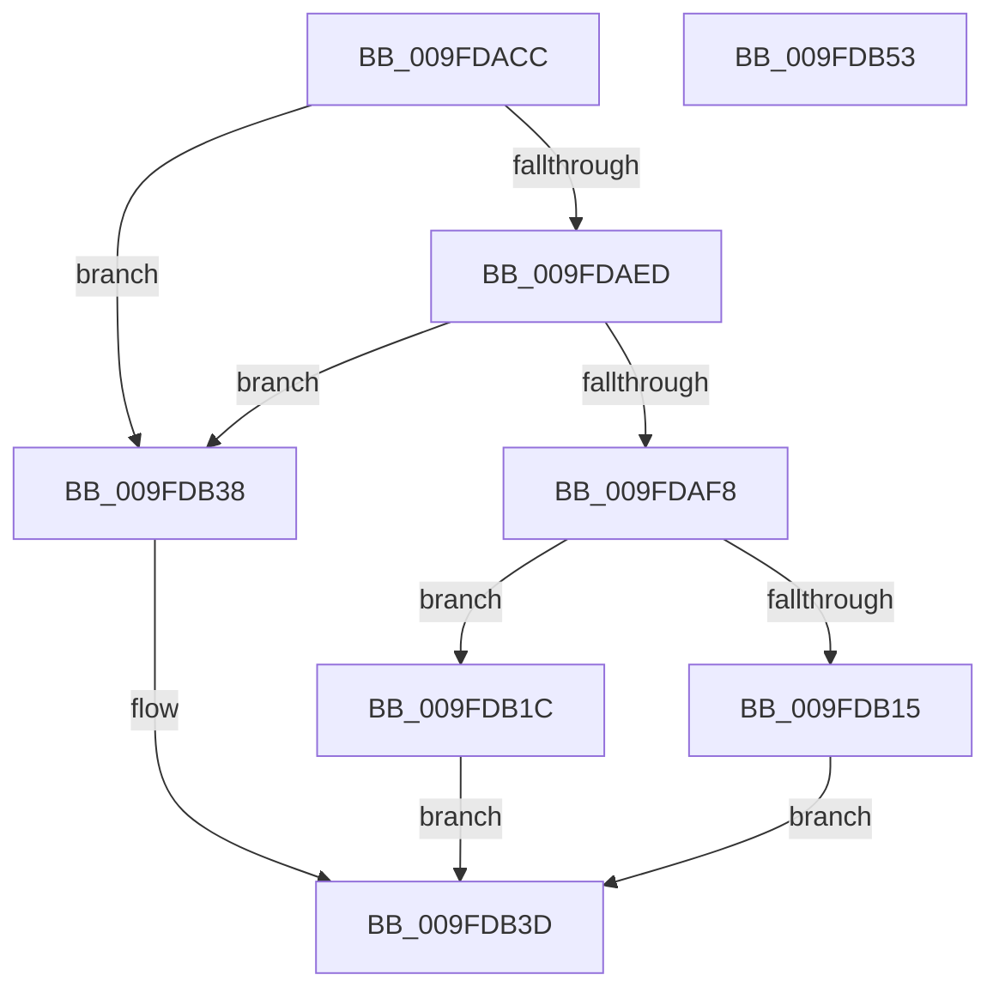

# EtwpAllocatePidFilter

- RVA: `0x009FDACC`–`0x009FDB54` (길이 `136` bytes)
- VA: `0x00000001409FDACC`
- 실행 섹션: `PAGE`
- PDB 이름 있음: `예`; PDB Function 태그: `아니요`
- unwind 정보 RVA: `0x0006F978`
- 디코드: `39`개 명령, `136/136` bytes 표시
- 미해석 바이트: `0` (있으면 어셈블리에 `.byte`로 보존)

> 이 문서는 커널 이미지의 기계어와 PDB 기호를 분석해 생성했습니다. 4번과 5번은 함수 원형과 자료형을 바이너리 사용 방식에서 추정한 C 해석이며 원본 소스 복구 결과는 아닙니다.

## 1. Dependencies

- 직접 호출 지점: **2**; 고유 호출 대상: **2**
- 직접 호출자로 확인된 함수: **1**
- RIP 상대 이미지 참조: **0**

### Outgoing calls
- `0x009FDB08` → [ExAllocatePool2](../../poolcode/B8/ExAllocatePool2_function_00B820F0.md) (function, `0x00B820F0`)
- `0x009FDB2C` → [memcpy](../../text/6C/memcpy_function_006C6840.md) (function, `0x006C6840`)

### Direct callers
- [EtwpAllocateFilter](EtwpAllocateFilter_function_009FC948.md) at `0x009FCAA3`

### Static image references
- 디코드된 RIP-relative 메모리 참조가 없습니다.

## 2. Other-region calls and transfers

- 다른 실행 섹션으로 향하는 call: **2**
  - `0x009FDB08` → [ExAllocatePool2](../../poolcode/B8/ExAllocatePool2_function_00B820F0.md) (`PAGE` → `POOLCODE`)
  - `0x009FDB2C` → [memcpy](../../text/6C/memcpy_function_006C6840.md) (`PAGE` → `.text`)
- 별도 외부 분기/꼬리 이동을 확인하지 못했습니다.

## 3. Assembly (complete function range)

```asm
009FDACC  48 89 5C 24 08                  mov qword ptr [rsp + 8], rbx
009FDAD1  48 89 74 24 10                  mov qword ptr [rsp + 0x10], rsi
009FDAD6  48 89 7C 24 18                  mov qword ptr [rsp + 0x18], rdi
009FDADB  41 56                           push r14
009FDADD  48 83 EC 20                     sub rsp, 0x20
009FDAE1  48 83 3A 00                     cmp qword ptr [rdx], 0
009FDAE5  4C 8B F2                        mov r14, rdx
009FDAE8  48 8B F1                        mov rsi, rcx
009FDAEB  75 4B                           jne 0x1409fdb38
009FDAED  8B 59 08                        mov ebx, dword ptr [rcx + 8]
009FDAF0  C1 EB 02                        shr ebx, 2
009FDAF3  83 FB 08                        cmp ebx, 8
009FDAF6  77 40                           ja 0x1409fdb38
009FDAF8  BA 24 00 00 00                  mov edx, 0x24
009FDAFD  B9 00 01 00 00                  mov ecx, 0x100
009FDB02  41 B8 45 74 77 46               mov r8d, 0x46777445
009FDB08  E8 E3 45 18 00                  call 0x140b820f0
009FDB0D  48 8B F8                        mov rdi, rax
009FDB10  48 85 C0                        test rax, rax
009FDB13  75 07                           jne 0x1409fdb1c
009FDB15  B8 17 00 00 C0                  mov eax, 0xc0000017
009FDB1A  EB 21                           jmp 0x1409fdb3d
009FDB1C  48 8B 16                        mov rdx, qword ptr [rsi]
009FDB1F  48 8D 48 04                     lea rcx, [rax + 4]
009FDB23  44 8B C3                        mov r8d, ebx
009FDB26  49 C1 E0 02                     shl r8, 2
009FDB2A  89 18                           mov dword ptr [rax], ebx
009FDB2C  E8 0F 8D CC FF                  call 0x1406c6840
009FDB31  33 C0                           xor eax, eax
009FDB33  49 89 3E                        mov qword ptr [r14], rdi
009FDB36  EB 05                           jmp 0x1409fdb3d
009FDB38  B8 0D 00 00 C0                  mov eax, 0xc000000d
009FDB3D  48 8B 5C 24 30                  mov rbx, qword ptr [rsp + 0x30]
009FDB42  48 8B 74 24 38                  mov rsi, qword ptr [rsp + 0x38]
009FDB47  48 8B 7C 24 40                  mov rdi, qword ptr [rsp + 0x40]
009FDB4C  48 83 C4 20                     add rsp, 0x20
009FDB50  41 5E                           pop r14
009FDB52  C3                              ret
009FDB53  CC                              int3
```

## 4. C-style interpretation (structured pseudocode)

```c
__int64 __fastcall EtwpAllocatePidFilter(__int64 a1, __int64 a2)
{
    __int64 result;
    __int64 v_rbx;
    __int64 v_rsp;
    unsigned __int64 v_stack_p10;
    unsigned __int64 v_stack_p18;
    unsigned __int64 v_stack_p8;

    v_stack_p8 = v_rbx;
    v_stack_p10 = v_rsi;
    v_stack_p18 = v_rdi;
    v_rsp = (v_rsp) - (32);
    if ((*(unsigned __int64 *)(a2)) != 0) goto loc_009FDB38;
    v_rbx = (unsigned int)(((unsigned int)(*(unsigned int *)(a1 + 8))) >> (2));
    if (((unsigned int)(v_rbx)) > 8) goto loc_009FDB38;
    result = ExAllocatePool2(256, 36, (unsigned int)(0x46777445ULL), a4);
    if (result != 0) goto loc_009FDB1C;
    goto loc_009FDB3D;
loc_009FDB1C:
    a3 = ((unsigned int)((unsigned int)(v_rbx))) << (2);
    *(unsigned int *)((unsigned int)(0xC0000017ULL)) = (unsigned int)(v_rbx);
    result = memcpy((unsigned int)(0xC0000017ULL) + 4, *(unsigned __int64 *)(a1), a3, a4);
    result = 0;
    *(unsigned __int64 *)(a2) = 0;
    goto loc_009FDB3D;
loc_009FDB38:
loc_009FDB3D:
    v_rsp = (v_rsp) + (32);
    return (unsigned int)(0xC000000DULL);
}
```

## 5. (Beta) C Style

```c
int64_t EtwpAllocatePidFilter(void *Arg1, void *Arg2)
{
    uint8_t *arg1 = (uint8_t *)Arg1;
    uint8_t *arg2 = (uint8_t *)Arg2;

    int64_t result;
    int64_t local_rbx;
    int64_t local_rsp;
    uint64_t v_stack_p10;
    uint64_t v_stack_p18;
    uint64_t v_stack_p8;

    v_stack_p8 = local_rbx;
    v_stack_p10 = local_rsi;
    v_stack_p18 = local_rdi;
    local_rsp = (local_rsp) - (32);
    if ((*(uint64_t *)(arg2)) != 0) goto loc_009FDB38;
    local_rbx = (uint32_t)(((uint32_t)(*(uint32_t *)(arg1 + 0x8))) >> (2));
    if (((uint32_t)(local_rbx)) > 8) goto loc_009FDB38;
    result = ExAllocatePool2(256, 36, (uint32_t)(0x46777445ULL), a4);
    if (result != 0) goto loc_009FDB1C;
    goto loc_009FDB3D;
loc_009FDB1C:
    a3 = ((uint32_t)((uint32_t)(local_rbx))) << (2);
    *(uint32_t *)((uint32_t)(0xC0000017ULL)) = (uint32_t)(local_rbx);
    result = memcpy((uint32_t)(0xC0000017ULL) + 4, *(uint64_t *)(arg1), a3, a4);
    result = 0;
    *(uint64_t *)(arg2) = 0;
    goto loc_009FDB3D;
loc_009FDB38:
loc_009FDB3D:
    local_rsp = (local_rsp) + (32);
    return (uint32_t)(0xC000000DULL);
}
```

### 관측된 메모리 오프셋

구조체 형식이 확인되지 않은 접근은 인자 기준의 오프셋으로만 기록했습니다.

| 기준 인자 | 오프셋 표현 | 폭 (bit) | 접근 |
|---|---:|---:|---|
| `Arg1` | `+ 0x0` | `64` | `R` |
| `Arg1` | `+ 0x8` | `32` | `R` |
| `Arg2` | `+ 0x0` | `64` | `R` |
| `Arg2` | `+ 0x0` | `64` | `W` |

## 6. Execution-region graph

[열기: 2D/3D 그래프와 함수 탐색 컨트롤 패널](../../../control-panel.html?section=page&rva=0x009FDACC&view=graph)

- 2D 그래프는 위에서 아래로 흐르고, 3D 그래프는 빈 공간을 드래그해 회전합니다. Shift+드래그는 이동, 휠은 확대·축소, 함수 노드 선택은 대상 보고서 이동입니다.

### Static fallback


