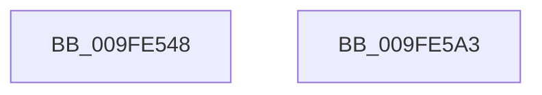

# EtwpCoverageUserIsAdmin

- RVA: `0x009FE548`–`0x009FE5A4` (길이 `92` bytes)
- VA: `0x00000001409FE548`
- 실행 섹션: `PAGE`
- PDB 이름 있음: `예`; PDB Function 태그: `아니요`
- unwind 정보 RVA: `0x000697A4`
- 디코드: `24`개 명령, `92/92` bytes 표시
- 미해석 바이트: `0` (있으면 어셈블리에 `.byte`로 보존)

> 이 문서는 커널 이미지의 기계어와 PDB 기호를 분석해 생성했습니다. 4번과 5번은 함수 원형과 자료형을 바이너리 사용 방식에서 추정한 C 해석이며 원본 소스 복구 결과는 아닙니다.

## 1. Dependencies

- 직접 호출 지점: **5**; 고유 호출 대상: **5**
- 직접 호출자로 확인된 함수: **6**
- RIP 상대 이미지 참조: **0**

### Outgoing calls
- `0x009FE560` → [SeCaptureSubjectContext](../86/SeCaptureSubjectContext_function_0086B820.md) (function, `0x0086B820`)
- `0x009FE56A` → [SeLockSubjectContext](../8C/SeLockSubjectContext_function_008C64C0.md) (function, `0x008C64C0`)
- `0x009FE580` → [SeTokenIsAdmin](SeTokenIsAdmin_function_009FE650.md) (function, `0x009FE650`)
- `0x009FE58C` → [SeUnlockSubjectContext](../8C/SeUnlockSubjectContext_function_008C6520.md) (function, `0x008C6520`)
- `0x009FE596` → [SeReleaseSubjectContext](../86/SeReleaseSubjectContext_function_0086B710.md) (function, `0x0086B710`)

### Direct callers
- [EtwQueryProcessTelemetryCoverage](../70/EtwQueryProcessTelemetryCoverage_function_00701B8C.md) at `0x00701BF0`
- [NtPowerInformation](../95/NtPowerInformation_function_00955D80.md) at `0x00955FA8`
- [NtPowerInformation](../95/NtPowerInformation_function_00955D80.md) at `0x00956048`
- [NtSetInformationJobObject](NtSetInformationJobObject_function_009F84C0.md) at `0x009FA9E9`
- [PspSetEnergyTrackingStateJobTree](PspSetEnergyTrackingStateJobTree_function_009FE5AC.md) at `0x009FE5D6`
- [PopPowerInformationInternal](../A8/PopPowerInformationInternal_function_00A8B7C0.md) at `0x00A8B8B5`
- [PopPowerInformationInternal](../A8/PopPowerInformationInternal_function_00A8B7C0.md) at `0x00A8B939`
- [PopPowerInformationInternal](../A8/PopPowerInformationInternal_function_00A8B7C0.md) at `0x00A8B9B2`
- [sub_00B2A52C](../B2/Unknown_function_00B2A52C.md) at `0x00B2A553`

### Static image references
- 디코드된 RIP-relative 메모리 참조가 없습니다.

## 2. Other-region calls and transfers

- 다른 실행 섹션으로 향하는 call: **0**
- 별도 외부 분기/꼬리 이동을 확인하지 못했습니다.

## 3. Assembly (complete function range)

```asm
009FE548  40 53                           push rbx
009FE54A  48 83 EC 40                     sub rsp, 0x40
009FE54E  0F 57 C0                        xorps xmm0, xmm0
009FE551  48 8D 4C 24 20                  lea rcx, [rsp + 0x20]
009FE556  0F 11 44 24 20                  movups xmmword ptr [rsp + 0x20], xmm0
009FE55B  0F 11 44 24 30                  movups xmmword ptr [rsp + 0x30], xmm0
009FE560  E8 BB D2 E6 FF                  call 0x14086b820
009FE565  48 8D 4C 24 20                  lea rcx, [rsp + 0x20]
009FE56A  E8 51 7F EC FF                  call 0x1408c64c0
009FE56F  48 8B 44 24 20                  mov rax, qword ptr [rsp + 0x20]
009FE574  48 8B 4C 24 30                  mov rcx, qword ptr [rsp + 0x30]
009FE579  48 85 C0                        test rax, rax
009FE57C  48 0F 45 C8                     cmovne rcx, rax
009FE580  E8 CB 00 00 00                  call 0x1409fe650
009FE585  48 8D 4C 24 20                  lea rcx, [rsp + 0x20]
009FE58A  8A D8                           mov bl, al
009FE58C  E8 8F 7F EC FF                  call 0x1408c6520
009FE591  48 8D 4C 24 20                  lea rcx, [rsp + 0x20]
009FE596  E8 75 D1 E6 FF                  call 0x14086b710
009FE59B  8A C3                           mov al, bl
009FE59D  48 83 C4 40                     add rsp, 0x40
009FE5A1  5B                              pop rbx
009FE5A2  C3                              ret
009FE5A3  CC                              int3
```

## 4. C-style interpretation (structured pseudocode)

```c
__int64 __fastcall EtwpCoverageUserIsAdmin(void)
{
    __int64 result;
    __int64 v_rsp;
    unsigned __int64 v_stack_m18;
    unsigned __int64 v_stack_m28;

    v_rsp = (v_rsp) - (64);
    v_stack_m28 = v_xmm0;
    v_stack_m18 = v_xmm0;
    result = SeCaptureSubjectContext(v_stack_m28, a2, a3, a4);
    result = SeLockSubjectContext(v_stack_m28, a2, a3, a4);
    a1 = v_stack_m18;
    if (v_stack_m28 != 0) { a1 = v_stack_m28; }
    result = SeTokenIsAdmin(a1, a2, a3, a4);
    result = SeUnlockSubjectContext(v_stack_m28, a2, a3, a4);
    result = SeReleaseSubjectContext(v_stack_m28, a2, a3, a4);
    v_rsp = (v_rsp) + (64);
    return (unsigned __int8)((unsigned __int8)(result));
}
```

## 5. (Beta) C Style

```c
void EtwpCoverageUserIsAdmin(void)
{
    int64_t result;
    int64_t local_rsp;
    uint64_t v_stack_m18;
    uint64_t v_stack_m28;

    local_rsp = (local_rsp) - (64);
    v_stack_m28 = v_xmm0;
    v_stack_m18 = v_xmm0;
    result = SeCaptureSubjectContext(v_stack_m28, a2, a3, a4);
    result = SeLockSubjectContext(v_stack_m28, a2, a3, a4);
    a1 = v_stack_m18;
    if (v_stack_m28 != 0) { a1 = v_stack_m28; }
    result = SeTokenIsAdmin(a1, a2, a3, a4);
    result = SeUnlockSubjectContext(v_stack_m28, a2, a3, a4);
    result = SeReleaseSubjectContext(v_stack_m28, a2, a3, a4);
    local_rsp = (local_rsp) + (64);
    return (uint8_t)((uint8_t)(result));
}
```

## 6. Execution-region graph

[열기: 2D/3D 그래프와 함수 탐색 컨트롤 패널](../../../control-panel.html?section=page&rva=0x009FE548&view=graph)

- 2D 그래프는 위에서 아래로 흐르고, 3D 그래프는 빈 공간을 드래그해 회전합니다. Shift+드래그는 이동, 휠은 확대·축소, 함수 노드 선택은 대상 보고서 이동입니다.

### Static fallback


