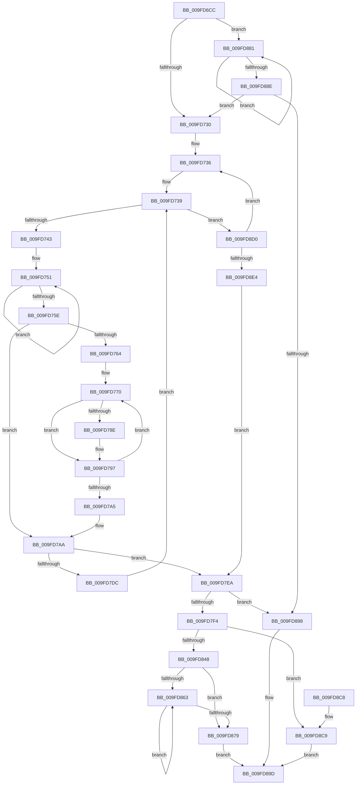

# EtwpCreatePerfectHashFunction

- RVA: `0x009FD6CC`–`0x009FD8E9` (길이 `541` bytes)
- VA: `0x00000001409FD6CC`
- 실행 섹션: `PAGE`
- PDB 이름 있음: `예`; PDB Function 태그: `아니요`
- unwind 정보 RVA: `0x000A7290`
- 디코드: `146`개 명령, `541/541` bytes 표시
- 미해석 바이트: `0` (있으면 어셈블리에 `.byte`로 보존)

> 이 문서는 커널 이미지의 기계어와 PDB 기호를 분석해 생성했습니다. 4번과 5번은 함수 원형과 자료형을 바이너리 사용 방식에서 추정한 C 해석이며 원본 소스 복구 결과는 아닙니다.

## 1. Dependencies

- 직접 호출 지점: **3**; 고유 호출 대상: **3**
- 직접 호출자로 확인된 함수: **2**
- RIP 상대 이미지 참조: **1**

### Outgoing calls
- `0x009FD816` → [EtwpFillPerfectHashTable](EtwpFillPerfectHashTable_function_009FD8F0.md) (function, `0x009FD8F0`)
- `0x009FD837` → [ExAllocatePool2](../../poolcode/B8/ExAllocatePool2_function_00B820F0.md) (function, `0x00B820F0`)
- `0x009FD8A8` → [_security_check_cookie](../../text/6A/_security_check_cookie_function_006AC640.md) (function, `0x006AC640`)

### Direct callers
- [EtwpAllocateFilter](EtwpAllocateFilter_function_009FC948.md) at `0x009FCA36`
- [sub_00B32592](../B3/Unknown_function_00B32592.md) at `0x00B32604`

### Static image references
- `0x009FD6E3` → RVA `0x00E0A740` (`.data`; read)

## 2. Other-region calls and transfers

- 다른 실행 섹션으로 향하는 call: **2**
  - `0x009FD837` → [ExAllocatePool2](../../poolcode/B8/ExAllocatePool2_function_00B820F0.md) (`PAGE` → `POOLCODE`)
  - `0x009FD8A8` → [_security_check_cookie](../../text/6A/_security_check_cookie_function_006AC640.md) (`PAGE` → `.text`)
- 별도 외부 분기/꼬리 이동을 확인하지 못했습니다.

## 3. Assembly (complete function range)

```asm
009FD6CC  48 89 5C 24 08                  mov qword ptr [rsp + 8], rbx
009FD6D1  55                              push rbp
009FD6D2  56                              push rsi
009FD6D3  57                              push rdi
009FD6D4  41 54                           push r12
009FD6D6  41 55                           push r13
009FD6D8  41 56                           push r14
009FD6DA  41 57                           push r15
009FD6DC  48 81 EC 50 02 00 00            sub rsp, 0x250
009FD6E3  48 8B 05 56 D0 40 00            mov rax, qword ptr [rip + 0x40d056]
009FD6EA  48 33 C4                        xor rax, rsp
009FD6ED  48 89 84 24 40 02 00 00         mov qword ptr [rsp + 0x240], rax
009FD6F5  33 DB                           xor ebx, ebx
009FD6F7  45 0F B7 F0                     movzx r14d, r8w
009FD6FB  88 4C 24 30                     mov byte ptr [rsp + 0x30], cl
009FD6FF  4D 8B E9                        mov r13, r9
009FD702  4C 89 4C 24 38                  mov qword ptr [rsp + 0x38], r9
009FD707  4C 8B E2                        mov r12, rdx
009FD70A  44 0F B7 DB                     movzx r11d, bx
009FD70E  66 89 5C 24 34                  mov word ptr [rsp + 0x34], bx
009FD713  8D 6B 01                        lea ebp, [rbx + 1]
009FD716  40 8A F3                        mov sil, bl
009FD719  41 8D 4E FF                     lea ecx, [r14 - 1]
009FD71D  0F B7 D5                        movzx edx, bp
009FD720  44 8D 7B 3F                     lea r15d, [rbx + 0x3f]
009FD724  44 8D 4B 40                     lea r9d, [rbx + 0x40]
009FD728  3B CD                           cmp ecx, ebp
009FD72A  0F 8F 51 01 00 00               jg 0x1409fd881
009FD730  41 B9 FF FF 00 00               mov r9d, 0xffff
009FD736  44 8A C3                        mov r8b, bl
009FD739  41 80 F8 10                     cmp r8b, 0x10
009FD73D  0F 83 8D 01 00 00               jae 0x1409fd8d0
009FD743  44 0F B7 D3                     movzx r10d, bx
009FD747  48 8D 44 24 42                  lea rax, [rsp + 0x42]
009FD74C  B9 80 00 00 00                  mov ecx, 0x80
009FD751  66 44 89 08                     mov word ptr [rax], r9w
009FD755  48 8D 40 04                     lea rax, [rax + 4]
009FD759  48 2B CD                        sub rcx, rbp
009FD75C  75 F3                           jne 0x1409fd751
009FD75E  66 41 3B DE                     cmp bx, r14w
009FD762  73 46                           jae 0x1409fd7aa
009FD764  4D 8B CC                        mov r9, r12
009FD767  49 8B FE                        mov rdi, r14
009FD76A  41 BD FF FF 00 00               mov r13d, 0xffff
009FD770  41 0F B7 29                     movzx ebp, word ptr [r9]
009FD774  41 8A C8                        mov cl, r8b
009FD777  0F B7 C5                        movzx eax, bp
009FD77A  66 D3 C8                        ror ax, cl
009FD77D  0F B7 C8                        movzx ecx, ax
009FD780  0F B7 C2                        movzx eax, dx
009FD783  48 23 C8                        and rcx, rax
009FD786  66 44 39 6C 8C 42               cmp word ptr [rsp + rcx*4 + 0x42], r13w
009FD78C  75 09                           jne 0x1409fd797
009FD78E  66 41 FF C2                     inc r10w
009FD792  66 89 6C 8C 42                  mov word ptr [rsp + rcx*4 + 0x42], bp
009FD797  49 83 C1 02                     add r9, 2
009FD79B  BD 01 00 00 00                  mov ebp, 1
009FD7A0  48 2B FD                        sub rdi, rbp
009FD7A3  75 CB                           jne 0x1409fd770
009FD7A5  4C 8B 6C 24 38                  mov r13, qword ptr [rsp + 0x38]
009FD7AA  66 45 3B D3                     cmp r10w, r11w
009FD7AE  40 0F B6 C6                     movzx eax, sil
009FD7B2  41 0F B6 C8                     movzx ecx, r8b
009FD7B6  44 0F B7 CA                     movzx r9d, dx
009FD7BA  0F 46 C8                        cmovbe ecx, eax
009FD7BD  66 45 0F 46 CF                  cmovbe r9w, r15w
009FD7C2  41 0F B7 C2                     movzx eax, r10w
009FD7C6  40 8A F1                        mov sil, cl
009FD7C9  66 41 0F 46 C3                  cmovbe ax, r11w
009FD7CE  45 0F B7 F9                     movzx r15d, r9w
009FD7D2  44 0F B7 D8                     movzx r11d, ax
009FD7D6  66 45 3B D6                     cmp r10w, r14w
009FD7DA  74 0E                           je 0x1409fd7ea
009FD7DC  44 02 C5                        add r8b, bpl
009FD7DF  41 B9 FF FF 00 00               mov r9d, 0xffff
009FD7E5  E9 4F FF FF FF                  jmp 0x1409fd739
009FD7EA  66 45 85 DB                     test r11w, r11w
009FD7EE  0F 84 A4 00 00 00               je 0x1409fd898
009FD7F4  48 8D 44 24 34                  lea rax, [rsp + 0x34]
009FD7F9  45 0F B7 CF                     movzx r9d, r15w
009FD7FD  48 89 44 24 28                  mov qword ptr [rsp + 0x28], rax
009FD802  44 8A C6                        mov r8b, sil
009FD805  48 8D 44 24 40                  lea rax, [rsp + 0x40]
009FD80A  41 0F B7 D6                     movzx edx, r14w
009FD80E  49 8B CC                        mov rcx, r12
009FD811  48 89 44 24 20                  mov qword ptr [rsp + 0x20], rax
009FD816  E8 D5 00 00 00                  call 0x1409fd8f0
009FD81B  0F B7 D0                        movzx edx, ax
009FD81E  B9 40 00 00 00                  mov ecx, 0x40
009FD823  66 C1 E2 02                     shl dx, 2
009FD827  41 B8 45 74 77 46               mov r8d, 0x46777445
009FD82D  66 83 C2 0A                     add dx, 0xa
009FD831  0F B7 F8                        movzx edi, ax
009FD834  0F B7 D2                        movzx edx, dx
009FD837  E8 B4 48 18 00                  call 0x140b820f0
009FD83C  48 8B D0                        mov rdx, rax
009FD83F  48 85 C0                        test rax, rax
009FD842  0F 84 81 00 00 00               je 0x1409fd8c9
009FD848  38 5C 24 30                     cmp byte ptr [rsp + 0x30], bl
009FD84C  40 88 70 01                     mov byte ptr [rax + 1], sil
009FD850  66 44 89 78 02                  mov word ptr [rax + 2], r15w
009FD855  66 89 78 04                     mov word ptr [rax + 4], di
009FD859  0F 95 C0                        setne al
009FD85C  88 02                           mov byte ptr [rdx], al
009FD85E  66 3B DF                        cmp bx, di
009FD861  73 16                           jae 0x1409fd879
009FD863  0F B6 CB                        movzx ecx, bl
009FD866  40 02 DD                        add bl, bpl
009FD869  8B 44 8C 40                     mov eax, dword ptr [rsp + rcx*4 + 0x40]
009FD86D  89 44 8A 06                     mov dword ptr [rdx + rcx*4 + 6], eax
009FD871  0F B6 C3                        movzx eax, bl
009FD874  66 3B C7                        cmp ax, di
009FD877  72 EA                           jb 0x1409fd863
009FD879  49 89 55 00                     mov qword ptr [r13], rdx
009FD87D  33 C0                           xor eax, eax
009FD87F  EB 1C                           jmp 0x1409fd89d
009FD881  66 03 D2                        add dx, dx
009FD884  66 0B D5                        or dx, bp
009FD887  0F B7 C2                        movzx eax, dx
009FD88A  3B C1                           cmp eax, ecx
009FD88C  7C F3                           jl 0x1409fd881
009FD88E  66 41 3B D1                     cmp dx, r9w
009FD892  0F 86 98 FE FF FF               jbe 0x1409fd730
009FD898  B8 01 00 00 C0                  mov eax, 0xc0000001
009FD89D  48 8B 8C 24 40 02 00 00         mov rcx, qword ptr [rsp + 0x240]
009FD8A5  48 33 CC                        xor rcx, rsp
009FD8A8  E8 93 ED CA FF                  call 0x1406ac640
009FD8AD  48 8B 9C 24 90 02 00 00         mov rbx, qword ptr [rsp + 0x290]
009FD8B5  48 81 C4 50 02 00 00            add rsp, 0x250
009FD8BC  41 5F                           pop r15
009FD8BE  41 5E                           pop r14
009FD8C0  41 5D                           pop r13
009FD8C2  41 5C                           pop r12
009FD8C4  5F                              pop rdi
009FD8C5  5E                              pop rsi
009FD8C6  5D                              pop rbp
009FD8C7  C3                              ret
009FD8C8  CC                              int3
009FD8C9  B8 17 00 00 C0                  mov eax, 0xc0000017
009FD8CE  EB CD                           jmp 0x1409fd89d
009FD8D0  66 03 D2                        add dx, dx
009FD8D3  B8 40 00 00 00                  mov eax, 0x40
009FD8D8  66 0B D5                        or dx, bp
009FD8DB  66 3B D0                        cmp dx, ax
009FD8DE  0F 86 52 FE FF FF               jbe 0x1409fd736
009FD8E4  E9 01 FF FF FF                  jmp 0x1409fd7ea
```

## 4. C-style interpretation (structured pseudocode)

```c
__int64 __fastcall EtwpCreatePerfectHashFunction(unsigned __int8 a1, __int64 a2, unsigned __int16 a3, __int64 a4)
{
    __int64 result;
    __int64 v_r10;
    __int64 v_rbx;
    __int64 v_rdi;
    __int64 v_rsp;
    unsigned __int64 v_stack_m246;
    unsigned __int64 v_stack_m248;
    unsigned __int64 v_stack_m250;
    unsigned __int16 v_stack_m254;
    unsigned __int8 v_stack_m258;
    unsigned __int64 v_stack_m260;
    unsigned __int64 v_stack_m268;
    unsigned __int64 v_stack_m48;
    unsigned __int64 v_stack_p8;

    v_stack_p8 = v_rbx;
    v_rsp = (v_rsp) - (592);
    result = (*(unsigned __int64 *)(v_rip + 4247638)) ^ (v_rsp);
    v_stack_m48 = result;
    v_rbx = 0;
    v_stack_m258 = a1;
    v_stack_m250 = a4;
    v_stack_m254 = 0;
    if (((unsigned int)(a3 - 1)) > ((unsigned int)(v_rbx + 1))) goto loc_009FD881;
loc_009FD730:
loc_009FD736:
loc_009FD739:
    if (0 >= 16) goto loc_009FD8D0;
loc_009FD751:
    *(unsigned __int16 *)(v_stack_m246) = (unsigned __int16)((unsigned int)(0xFFFFULL));
    a1 = (128) - (v_rbx + 1);
    if (condition_is_not_equal) goto loc_009FD751;
    if (0 >= a3) goto loc_009FD7AA;
loc_009FD770:
    a1 = ((unsigned __int16)((unsigned __int16)(*(unsigned __int16 *)(a2)))) & ((unsigned __int16)((unsigned __int16)(v_rbx + 1)));
    v_r10 = 0;
    if ((*(unsigned __int16 *)(v_rsp + a1 * 4 + 66)) == ((unsigned __int16)((unsigned int)(0xFFFFULL)))) {
        v_r10 = (unsigned __int16)((0) + 1);
        *(unsigned __int16 *)(v_rsp + a1 * 4 + 66) = (unsigned __int16)(*(unsigned __int16 *)(a2));
    }
    a4 = (a2) + (2);
    v_rdi = (a3) - (1);
    if (condition_is_not_equal) goto loc_009FD770;
loc_009FD7AA:
    a1 = 0;
    if (((unsigned __int16)(v_r10)) <= 0) { a1 = 0; }
    a4 = (unsigned __int16)((unsigned __int16)(v_rbx + 1));
    if (((unsigned __int16)(v_r10)) <= 0) { a4 = (unsigned __int16)(v_rbx + 63); }
    result = (unsigned __int16)(v_r10);
    if (((unsigned __int16)(v_r10)) <= 0) { result = 0; }
    if (((unsigned __int16)(v_r10)) == a3) goto loc_009FD7EA;
    a3 = (unsigned __int8)((0) + (1));
    goto loc_009FD739;
loc_009FD7EA:
    if ((unsigned __int16)((unsigned __int16)(result)) == 0) goto loc_009FD898;
    v_stack_m260 = v_stack_m254;
    v_stack_m268 = v_stack_m248;
    result = EtwpFillPerfectHashTable(a2, a3, a1, (unsigned __int16)((unsigned __int16)(a4)));
    a2 = (unsigned __int16)(((unsigned __int16)(result)) << (2));
    a2 = (unsigned __int16)((a2) + (10));
    result = ExAllocatePool2(64, (unsigned __int16)(a2), (unsigned int)(0x46777445ULL), (unsigned __int16)((unsigned __int16)(a4)));
    if (result == 0) goto loc_009FD8C9;
    *(unsigned __int8 *)(result + 1) = a1;
    *(unsigned __int16 *)(result + 2) = (unsigned __int16)((unsigned __int16)(a4));
    *(unsigned __int16 *)(result + 4) = (unsigned __int16)((unsigned __int16)(result));
    result = (v_stack_m258 != 0) ? 1 : 0;
    *(unsigned __int8 *)(result) = (unsigned __int8)(result);
    if (0 >= ((unsigned __int16)((unsigned __int16)(result)))) goto loc_009FD879;
loc_009FD863:
    v_rbx = (unsigned __int8)((v_rbx) + (1));
    *(unsigned int *)(result + 0 * 4 + 6) = (unsigned int)((unsigned int)(*(unsigned int *)(v_rsp + 0 * 4 + 64)));
    if (((unsigned __int16)((unsigned __int8)(v_rbx))) < ((unsigned __int16)((unsigned __int16)(result)))) goto loc_009FD863;
loc_009FD879:
    *(unsigned __int64 *)(v_stack_m250) = result;
    result = 0;
    goto loc_009FD89D;
loc_009FD881:
    a2 = (unsigned __int16)((result) + (0));
    a2 = (unsigned __int16)((a2) | (1));
    if (((unsigned int)((unsigned __int16)(a2))) < 0) goto loc_009FD881;
    if (((unsigned __int16)(a2)) <= ((unsigned __int16)((unsigned __int16)((unsigned __int16)(a4))))) goto loc_009FD730;
loc_009FD898:
loc_009FD89D:
    a1 = (v_stack_m48) ^ (v_rsp);
    result = _security_check_cookie(a1, a2, (unsigned int)(0x46777445ULL), (unsigned __int16)((unsigned __int16)(a4)));
    v_rsp = (v_rsp) + (592);
    return result;
loc_009FD8C9:
    goto loc_009FD89D;
loc_009FD8D0:
    a2 = (unsigned __int16)((a2) + ((unsigned __int16)(a2)));
    a2 = (unsigned __int16)((a2) | (1));
    if (((unsigned __int16)(a2)) <= 64) goto loc_009FD736;
    goto loc_009FD7EA;
}
```

## 5. (Beta) C Style

```c
int64_t EtwpCreatePerfectHashFunction(uint8_t Arg1, void *Arg2, void *Arg3, int64_t Arg4)
{
    uint8_t *arg2 = (uint8_t *)Arg2;
    uint8_t *arg3 = (uint8_t *)Arg3;

    int64_t result;
    int64_t local_r10;
    int64_t local_rbx;
    int64_t local_rdi;
    int64_t local_rsp;
    uint64_t v_stack_m246;
    uint64_t v_stack_m248;
    uint64_t v_stack_m250;
    uint16_t v_stack_m254;
    uint8_t v_stack_m258;
    uint64_t v_stack_m260;
    uint64_t v_stack_m268;
    uint64_t v_stack_m48;
    uint64_t v_stack_p8;

    v_stack_p8 = local_rbx;
    local_rsp = (local_rsp) - (592);
    result = (*(uint64_t *)(v_rip + 0x40D056)) ^ (local_rsp);
    v_stack_m48 = result;
    local_rbx = 0;
    v_stack_m258 = Arg1;
    v_stack_m250 = Arg4;
    v_stack_m254 = 0;
    if (((uint32_t)(Arg3 - 1)) > ((uint32_t)(local_rbx + 1))) goto loc_009FD881;
loc_009FD730:
loc_009FD736:
loc_009FD739:
    if (0 >= 16) goto loc_009FD8D0;
loc_009FD751:
    *(uint16_t *)(v_stack_m246) = (uint16_t)((uint32_t)(0xFFFFULL));
    Arg1 = (128) - (local_rbx + 1);
    if (condition_is_not_equal) goto loc_009FD751;
    if (0 >= Arg3) goto loc_009FD7AA;
loc_009FD770:
    Arg1 = ((uint16_t)((uint16_t)(*(uint16_t *)(arg2)))) & ((uint16_t)((uint16_t)(local_rbx + 1)));
    local_r10 = 0;
    if ((*(uint16_t *)(local_rsp + Arg1 * 4 + 0x42)) == ((uint16_t)((uint32_t)(0xFFFFULL)))) {
        local_r10 = (uint16_t)((0) + 1);
        *(uint16_t *)(local_rsp + Arg1 * 4 + 0x42) = (uint16_t)(*(uint16_t *)(arg2));
    }
    Arg4 = (Arg2) + (2);
    local_rdi = (Arg3) - (1);
    if (condition_is_not_equal) goto loc_009FD770;
loc_009FD7AA:
    Arg1 = 0;
    if (((uint16_t)(local_r10)) <= 0) { Arg1 = 0; }
    Arg4 = (uint16_t)((uint16_t)(local_rbx + 1));
    if (((uint16_t)(local_r10)) <= 0) { Arg4 = (uint16_t)(local_rbx + 63); }
    result = (uint16_t)(local_r10);
    if (((uint16_t)(local_r10)) <= 0) { result = 0; }
    if (((uint16_t)(local_r10)) == Arg3) goto loc_009FD7EA;
    Arg3 = (uint8_t)((0) + (1));
    goto loc_009FD739;
loc_009FD7EA:
    if ((uint16_t)((uint16_t)(result)) == 0) goto loc_009FD898;
    v_stack_m260 = v_stack_m254;
    v_stack_m268 = v_stack_m248;
    result = EtwpFillPerfectHashTable(Arg2, Arg3, Arg1, (uint16_t)((uint16_t)(Arg4)));
    Arg2 = (uint16_t)(((uint16_t)(result)) << (2));
    Arg2 = (uint16_t)((Arg2) + (10));
    result = ExAllocatePool2(64, (uint16_t)(Arg2), (uint32_t)(0x46777445ULL), (uint16_t)((uint16_t)(Arg4)));
    if (result == 0) goto loc_009FD8C9;
    *(uint8_t *)(result + 0x1) = Arg1;
    *(uint16_t *)(result + 0x2) = (uint16_t)((uint16_t)(Arg4));
    *(uint16_t *)(result + 0x4) = (uint16_t)((uint16_t)(result));
    result = (v_stack_m258 != 0) ? 1 : 0;
    *(uint8_t *)(result) = (uint8_t)(result);
    if (0 >= ((uint16_t)((uint16_t)(result)))) goto loc_009FD879;
loc_009FD863:
    local_rbx = (uint8_t)((local_rbx) + (1));
    *(uint32_t *)(result + 0x0 * 4 + 0x6) = (uint32_t)((uint32_t)(*(uint32_t *)(local_rsp + 0x0 * 4 + 0x40)));
    if (((uint16_t)((uint8_t)(local_rbx))) < ((uint16_t)((uint16_t)(result)))) goto loc_009FD863;
loc_009FD879:
    *(uint64_t *)(v_stack_m250) = result;
    result = 0;
    goto loc_009FD89D;
loc_009FD881:
    Arg2 = (uint16_t)((result) + (0));
    Arg2 = (uint16_t)((Arg2) | (1));
    if (((uint32_t)((uint16_t)(Arg2))) < 0) goto loc_009FD881;
    if (((uint16_t)(Arg2)) <= ((uint16_t)((uint16_t)((uint16_t)(Arg4))))) goto loc_009FD730;
loc_009FD898:
loc_009FD89D:
    Arg1 = (v_stack_m48) ^ (local_rsp);
    result = _security_check_cookie(Arg1, Arg2, (uint32_t)(0x46777445ULL), (uint16_t)((uint16_t)(Arg4)));
    local_rsp = (local_rsp) + (592);
    return result;
loc_009FD8C9:
    goto loc_009FD89D;
loc_009FD8D0:
    Arg2 = (uint16_t)((Arg2) + ((uint16_t)(Arg2)));
    Arg2 = (uint16_t)((Arg2) | (1));
    if (((uint16_t)(Arg2)) <= 64) goto loc_009FD736;
    goto loc_009FD7EA;
}
```

### 관측된 메모리 오프셋

구조체 형식이 확인되지 않은 접근은 인자 기준의 오프셋으로만 기록했습니다.

| 기준 인자 | 오프셋 표현 | 폭 (bit) | 접근 |
|---|---:|---:|---|
| `Arg2` | `+ 0x0` | `16` | `R` |
| `Arg3` | `- 0x1` | `32` | `R` |

## 6. Execution-region graph

[열기: 2D/3D 그래프와 함수 탐색 컨트롤 패널](../../../control-panel.html?section=page&rva=0x009FD6CC&view=graph)

- 2D 그래프는 위에서 아래로 흐르고, 3D 그래프는 빈 공간을 드래그해 회전합니다. Shift+드래그는 이동, 휠은 확대·축소, 함수 노드 선택은 대상 보고서 이동입니다.

### Static fallback


