# EtwpFillPerfectHashTable

- RVA: `0x009FD8F0`–`0x009FDAC6` (길이 `470` bytes)
- VA: `0x00000001409FD8F0`
- 실행 섹션: `PAGE`
- PDB 이름 있음: `예`; PDB Function 태그: `예`
- unwind 정보 RVA: `0x000A72B8`
- 디코드: `132`개 명령, `470/470` bytes 표시
- 미해석 바이트: `0` (있으면 어셈블리에 `.byte`로 보존)

> 이 문서는 커널 이미지의 기계어와 PDB 기호를 분석해 생성했습니다. 4번과 5번은 함수 원형과 자료형을 바이너리 사용 방식에서 추정한 C 해석이며 원본 소스 복구 결과는 아닙니다.

## 1. Dependencies

- 직접 호출 지점: **0**; 고유 호출 대상: **0**
- 직접 호출자로 확인된 함수: **1**
- RIP 상대 이미지 참조: **0**

### Outgoing calls
- 직접 디코드된 call 명령이 없습니다.

### Direct callers
- [EtwpCreatePerfectHashFunction](EtwpCreatePerfectHashFunction_function_009FD6CC.md) at `0x009FD816`

### Static image references
- 디코드된 RIP-relative 메모리 참조가 없습니다.

## 2. Other-region calls and transfers

- 다른 실행 섹션으로 향하는 call: **0**
- call이 아닌 외부 분기/꼬리 이동: **1**
  - `0x009FDABB` → [sub_00B326DC](../B3/Unknown_function_00B326DC.md) (`tail-transfer`)

## 3. Assembly (complete function range)

```asm
009FD8F0  48 89 5C 24 08                  mov qword ptr [rsp + 8], rbx
009FD8F5  48 89 6C 24 18                  mov qword ptr [rsp + 0x18], rbp
009FD8FA  48 89 74 24 20                  mov qword ptr [rsp + 0x20], rsi
009FD8FF  57                              push rdi
009FD900  41 54                           push r12
009FD902  41 55                           push r13
009FD904  41 56                           push r14
009FD906  41 57                           push r15
009FD908  4C 8B 74 24 58                  mov r14, qword ptr [rsp + 0x58]
009FD90D  41 BC 01 00 00 00               mov r12d, 1
009FD913  4C 8B 54 24 50                  mov r10, qword ptr [rsp + 0x50]
009FD918  48 8B F1                        mov rsi, rcx
009FD91B  45 0F B7 F9                     movzx r15d, r9w
009FD91F  33 C9                           xor ecx, ecx
009FD921  41 8A E8                        mov bpl, r8b
009FD924  49 8B C2                        mov rax, r10
009FD927  66 41 89 0E                     mov word ptr [r14], cx
009FD92B  45 8D 44 24 7F                  lea r8d, [r12 + 0x7f]
009FD930  41 BD FF FF 00 00               mov r13d, 0xffff
009FD936  47 8D 1C 3C                     lea r11d, [r12 + r15]
009FD93A  66 44 89 5C 24 38               mov word ptr [rsp + 0x38], r11w
009FD940  41 0F B7 DB                     movzx ebx, r11w
009FD944  66 44 89 68 02                  mov word ptr [rax + 2], r13w
009FD949  C6 00 FF                        mov byte ptr [rax], 0xff
009FD94C  48 8D 40 04                     lea rax, [rax + 4]
009FD950  4D 2B C4                        sub r8, r12
009FD953  75 EF                           jne 0x1409fd944
009FD955  66 3B CA                        cmp cx, dx
009FD958  73 40                           jae 0x1409fd99a
009FD95A  44 0F B7 CA                     movzx r9d, dx
009FD95E  45 33 DB                        xor r11d, r11d
009FD961  0F B7 3E                        movzx edi, word ptr [rsi]
009FD964  40 8A CD                        mov cl, bpl
009FD967  0F B7 D7                        movzx edx, di
009FD96A  45 0F B7 C3                     movzx r8d, r11w
009FD96E  66 D3 CA                        ror dx, cl
009FD971  66 41 23 D7                     and dx, r15w
009FD975  0F B7 C2                        movzx eax, dx
009FD978  66 45 39 6C 82 02               cmp word ptr [r10 + rax*4 + 2], r13w
009FD97E  75 61                           jne 0x1409fd9e1
009FD980  0F B7 C2                        movzx eax, dx
009FD983  48 83 C6 02                     add rsi, 2
009FD987  66 41 89 7C 82 02               mov word ptr [r10 + rax*4 + 2], di
009FD98D  4D 2B CC                        sub r9, r12
009FD990  75 CF                           jne 0x1409fd961
009FD992  44 0F B7 5C 24 38               movzx r11d, word ptr [rsp + 0x38]
009FD998  33 C9                           xor ecx, ecx
009FD99A  44 0F B7 C3                     movzx r8d, bx
009FD99E  41 8D 6F 01                     lea ebp, [r15 + 1]
009FD9A2  66 45 2B C4                     sub r8w, r12w
009FD9A6  0F B7 D1                        movzx edx, cx
009FD9A9  45 0F B7 C8                     movzx r9d, r8w
009FD9AD  44 3B CD                        cmp r9d, ebp
009FD9B0  77 72                           ja 0x1409fda24
009FD9B2  0F B7 D3                        movzx edx, bx
009FD9B5  66 41 2B D4                     sub dx, r12w
009FD9B9  0F B7 C2                        movzx eax, dx
009FD9BC  3B C5                           cmp eax, ebp
009FD9BE  0F 87 F3 00 00 00               ja 0x1409fdab7
009FD9C4  48 8B 6C 24 40                  mov rbp, qword ptr [rsp + 0x40]
009FD9C9  0F B7 C3                        movzx eax, bx
009FD9CC  48 8B 5C 24 30                  mov rbx, qword ptr [rsp + 0x30]
009FD9D1  48 8B 74 24 48                  mov rsi, qword ptr [rsp + 0x48]
009FD9D6  41 5F                           pop r15
009FD9D8  41 5E                           pop r14
009FD9DA  41 5D                           pop r13
009FD9DC  41 5C                           pop r12
009FD9DE  5F                              pop rdi
009FD9DF  C3                              ret
009FD9E0  CC                              int3
009FD9E1  B9 FF 00 00 00                  mov ecx, 0xff
009FD9E6  0F B7 C2                        movzx eax, dx
009FD9E9  66 41 39 7C 82 02               cmp word ptr [r10 + rax*4 + 2], di
009FD9EF  74 8F                           je 0x1409fd980
009FD9F1  41 0F B6 14 82                  movzx edx, byte ptr [r10 + rax*4]
009FD9F6  66 45 03 C4                     add r8w, r12w
009FD9FA  66 3B D1                        cmp dx, cx
009FD9FD  75 0B                           jne 0x1409fda0a
009FD9FF  0F B7 D3                        movzx edx, bx
009FDA02  66 41 03 DC                     add bx, r12w
009FDA06  41 88 14 82                     mov byte ptr [r10 + rax*4], dl
009FDA0A  66 45 3B 06                     cmp r8w, word ptr [r14]
009FDA0E  76 04                           jbe 0x1409fda14
009FDA10  66 45 89 06                     mov word ptr [r14], r8w
009FDA14  0F B7 C2                        movzx eax, dx
009FDA17  66 45 39 6C 82 02               cmp word ptr [r10 + rax*4 + 2], r13w
009FDA1D  75 C7                           jne 0x1409fd9e6
009FDA1F  E9 5C FF FF FF                  jmp 0x1409fd980
009FDA24  45 33 F6                        xor r14d, r14d
009FDA27  41 BB FF 00 00 00               mov r11d, 0xff
009FDA2D  66 41 3B D7                     cmp dx, r15w
009FDA31  73 77                           jae 0x1409fdaaa
009FDA33  41 0F B7 F8                     movzx edi, r8w
009FDA37  45 38 1C BA                     cmp byte ptr [r10 + rdi*4], r11b
009FDA3B  75 50                           jne 0x1409fda8d
009FDA3D  0F B7 C2                        movzx eax, dx
009FDA40  66 45 39 6C 82 02               cmp word ptr [r10 + rax*4 + 2], r13w
009FDA46  75 58                           jne 0x1409fdaa0
009FDA48  41 0F B7 44 BA 02               movzx eax, word ptr [r10 + rdi*4 + 2]
009FDA4E  0F B7 CA                        movzx ecx, dx
009FDA51  66 41 89 44 8A 02               mov word ptr [r10 + rcx*4 + 2], ax
009FDA57  41 0F B7 CE                     movzx ecx, r14w
009FDA5B  66 3B CB                        cmp cx, bx
009FDA5E  73 18                           jae 0x1409fda78
009FDA60  0F B7 F1                        movzx esi, cx
009FDA63  41 0F B6 04 B2                  movzx eax, byte ptr [r10 + rsi*4]
009FDA68  66 41 3B C0                     cmp ax, r8w
009FDA6C  74 06                           je 0x1409fda74
009FDA6E  66 41 03 CC                     add cx, r12w
009FDA72  EB E7                           jmp 0x1409fda5b
009FDA74  41 88 14 B2                     mov byte ptr [r10 + rsi*4], dl
009FDA78  0F B7 C3                        movzx eax, bx
009FDA7B  41 2B C4                        sub eax, r12d
009FDA7E  66 45 89 6C BA 02               mov word ptr [r10 + rdi*4 + 2], r13w
009FDA84  44 3B C8                        cmp r9d, eax
009FDA87  75 04                           jne 0x1409fda8d
009FDA89  66 41 03 DD                     add bx, r13w
009FDA8D  66 45 03 C5                     add r8w, r13w
009FDA91  66 41 03 D4                     add dx, r12w
009FDA95  45 0F B7 C8                     movzx r9d, r8w
009FDA99  44 3B CD                        cmp r9d, ebp
009FDA9C  77 8F                           ja 0x1409fda2d
009FDA9E  EB 0A                           jmp 0x1409fdaaa
009FDAA0  66 41 03 D4                     add dx, r12w
009FDAA4  66 41 3B D7                     cmp dx, r15w
009FDAA8  72 93                           jb 0x1409fda3d
009FDAAA  44 0F B7 5C 24 38               movzx r11d, word ptr [rsp + 0x38]
009FDAB0  33 C9                           xor ecx, ecx
009FDAB2  E9 FB FE FF FF                  jmp 0x1409fd9b2
009FDAB7  66 44 3B DA                     cmp r11w, dx
009FDABB  0F 82 1B 4C 13 00               jb 0x140b326dc
009FDAC1  E9 FE FE FF FF                  jmp 0x1409fd9c4
```

## 4. C-style interpretation (structured pseudocode)

```c
__int64 __fastcall EtwpFillPerfectHashTable(__int64 a1, unsigned __int16 a2, unsigned __int8 a3, unsigned __int16 a4, __int64 a5, __int64 a6)
{
    __int64 result;
    __int64 v_r11;
    __int64 v_r14;
    __int64 v_rbx;
    __int64 v_rsi;
    unsigned __int16 v_stack_p10;
    unsigned __int64 v_stack_p18;
    unsigned __int64 v_stack_p20;
    unsigned __int16 v_stack_p38;
    unsigned __int64 v_stack_p8;

    v_stack_p8 = v_rbx;
    v_stack_p18 = v_rbp;
    v_stack_p20 = v_rsi;
    a1 = 0;
    *(unsigned __int16 *)(a6) = 0;
    v_stack_p10 = (unsigned __int16)(1 + a4 * 1);
loc_009FD944:
    *(unsigned __int16 *)(a5 + 2) = (unsigned __int16)((unsigned int)(0xFFFFULL));
    *(unsigned __int8 *)(a5) = 255;
    a3 = (1 + 127) - (1);
    if (condition_is_not_equal) goto loc_009FD944;
    if (0 >= a2) goto loc_009FD99A;
    v_r11 = 0;
loc_009FD961:
    a2 = (unsigned __int16)(((unsigned __int16)(*(unsigned __int16 *)(a1))) & (a4));
    if ((*(unsigned __int16 *)(a5 + a2 * 4 + 2)) != ((unsigned __int16)((unsigned int)(0xFFFFULL)))) goto loc_009FD9E1;
loc_009FD980:
    v_rsi = (a1) + (2);
    *(unsigned __int16 *)(a5 + a2 * 4 + 2) = (unsigned __int16)(*(unsigned __int16 *)(a1));
    a4 = (a2) - (1);
    if (condition_is_not_equal) goto loc_009FD961;
    a1 = 0;
loc_009FD99A:
    a3 = (unsigned __int16)(((unsigned __int16)((unsigned __int16)(1 + a4 * 1))) - (1));
    if (a3 > ((unsigned int)(a4 + 1))) goto loc_009FDA24;
loc_009FD9B2:
    a2 = (unsigned __int16)(((unsigned __int16)((unsigned __int16)(1 + a4 * 1))) - (1));
    if (a2 > ((unsigned int)(a4 + 1))) goto loc_009FDAB7;
loc_009FD9C4:
    return (unsigned __int16)((unsigned __int16)(1 + a4 * 1));
loc_009FD9E1:
loc_009FD9E6:
    if ((*(unsigned __int16 *)(a5 + a2 * 4 + 2)) == ((unsigned __int16)(*(unsigned __int16 *)(a1)))) goto loc_009FD980;
    a3 = (unsigned __int16)((a3) + (1));
    v_rbx = v_stack_p8;
    if (((unsigned __int16)(*(unsigned __int8 *)(a5 + a2 * 4))) == 255) {
        a2 = (unsigned __int16)(v_stack_p8);
        v_rbx = (unsigned __int16)((v_stack_p8) + (1));
        *(unsigned __int8 *)(a5 + a2 * 4) = (unsigned __int8)(a2);
    }
    if (a3 >= = (*(unsigned __int16 *)(a6))) {
        *(unsigned __int16 *)(a6) = a3;
    }
    if ((*(unsigned __int16 *)(a5 + a2 * 4 + 2)) != ((unsigned __int16)((unsigned int)(0xFFFFULL)))) goto loc_009FD9E6;
    goto loc_009FD980;
loc_009FDA24:
    v_r14 = 0;
loc_009FDA2D:
    if (a2 >= a4) goto loc_009FDAAA;
    if ((*(unsigned __int8 *)(a5 + a3 * 4)) != 255) goto loc_009FDA8D;
loc_009FDA3D:
    if ((*(unsigned __int16 *)(a5 + a2 * 4 + 2)) != ((unsigned __int16)((unsigned int)(0xFFFFULL)))) goto loc_009FDAA0;
    *(unsigned __int16 *)(a5 + a2 * 4 + 2) = (unsigned __int16)(*(unsigned __int16 *)(a5 + a3 * 4 + 2));
loc_009FDA5B:
    if (0 >= ((unsigned __int16)(v_rbx))) goto loc_009FDA78;
    if (((unsigned __int16)(*(unsigned __int8 *)(a5 + 0 * 4))) == a3) goto loc_009FDA74;
    a1 = (unsigned __int16)((0) + (1));
    goto loc_009FDA5B;
loc_009FDA74:
    *(unsigned __int8 *)(a5 + 0 * 4) = (unsigned __int8)(a2);
loc_009FDA78:
    result = (unsigned int)(((unsigned __int16)(v_rbx)) - (1));
    *(unsigned __int16 *)(a5 + a3 * 4 + 2) = (unsigned __int16)((unsigned int)(0xFFFFULL));
    if (a3 == ((unsigned int)(result))) {
        v_rbx = (unsigned __int16)((v_rbx) + ((unsigned __int16)((unsigned int)(0xFFFFULL))));
    }
    a3 = (unsigned __int16)((a3) + ((unsigned __int16)((unsigned int)(0xFFFFULL))));
    a2 = (unsigned __int16)((a2) + (1));
    if (a3 > ((unsigned int)(v_stack_p18))) goto loc_009FDA2D;
    goto loc_009FDAAA;
loc_009FDAA0:
    a2 = (unsigned __int16)((a2) + (1));
    if (a2 < a4) goto loc_009FDA3D;
loc_009FDAAA:
    a1 = 0;
    goto loc_009FD9B2;
loc_009FDAB7:
    goto loc_009FD9C4;
}
```

## 5. (Beta) C Style

```c
int64_t EtwpFillPerfectHashTable(void *Arg1, uint16_t Arg2, uint8_t Arg3, void *Arg4, void *Arg5, void *Arg6)
{
    uint8_t *arg1 = (uint8_t *)Arg1;
    uint8_t *arg4 = (uint8_t *)Arg4;
    uint8_t *arg5 = (uint8_t *)Arg5;
    uint8_t *arg6 = (uint8_t *)Arg6;

    int64_t result;
    int64_t local_r11;
    int64_t local_r14;
    int64_t local_rbx;
    int64_t local_rsi;
    uint16_t v_stack_p10;
    uint64_t v_stack_p18;
    uint64_t v_stack_p20;
    uint16_t v_stack_p38;
    uint64_t v_stack_p8;

    v_stack_p8 = local_rbx;
    v_stack_p18 = local_rbp;
    v_stack_p20 = local_rsi;
    Arg1 = 0;
    *(uint16_t *)(arg6) = 0;
    v_stack_p10 = (uint16_t)(1 + Arg4 * 1);
loc_009FD944:
    *(uint16_t *)(arg5 + 0x2) = (uint16_t)((uint32_t)(0xFFFFULL));
    *(uint8_t *)(arg5) = 255;
    Arg3 = (1 + 127) - (1);
    if (condition_is_not_equal) goto loc_009FD944;
    if (0 >= Arg2) goto loc_009FD99A;
    local_r11 = 0;
loc_009FD961:
    Arg2 = (uint16_t)(((uint16_t)(*(uint16_t *)(arg1))) & (Arg4));
    if ((*(uint16_t *)(arg5 + Arg2 * 4 + 0x2)) != ((uint16_t)((uint32_t)(0xFFFFULL)))) goto loc_009FD9E1;
loc_009FD980:
    local_rsi = (Arg1) + (2);
    *(uint16_t *)(arg5 + Arg2 * 4 + 0x2) = (uint16_t)(*(uint16_t *)(arg1));
    Arg4 = (Arg2) - (1);
    if (condition_is_not_equal) goto loc_009FD961;
    Arg1 = 0;
loc_009FD99A:
    Arg3 = (uint16_t)(((uint16_t)((uint16_t)(1 + Arg4 * 1))) - (1));
    if (Arg3 > ((uint32_t)(Arg4 + 1))) goto loc_009FDA24;
loc_009FD9B2:
    Arg2 = (uint16_t)(((uint16_t)((uint16_t)(1 + Arg4 * 1))) - (1));
    if (Arg2 > ((uint32_t)(Arg4 + 1))) goto loc_009FDAB7;
loc_009FD9C4:
    return (uint16_t)((uint16_t)(1 + Arg4 * 1));
loc_009FD9E1:
loc_009FD9E6:
    if ((*(uint16_t *)(arg5 + Arg2 * 4 + 0x2)) == ((uint16_t)(*(uint16_t *)(arg1)))) goto loc_009FD980;
    Arg3 = (uint16_t)((Arg3) + (1));
    local_rbx = v_stack_p8;
    if (((uint16_t)(*(uint8_t *)(arg5 + Arg2 * 4))) == 255) {
        Arg2 = (uint16_t)(v_stack_p8);
        local_rbx = (uint16_t)((v_stack_p8) + (1));
        *(uint8_t *)(arg5 + Arg2 * 4) = (uint8_t)(Arg2);
    }
    if (Arg3 >= = (*(uint16_t *)(arg6))) {
        *(uint16_t *)(arg6) = Arg3;
    }
    if ((*(uint16_t *)(arg5 + Arg2 * 4 + 0x2)) != ((uint16_t)((uint32_t)(0xFFFFULL)))) goto loc_009FD9E6;
    goto loc_009FD980;
loc_009FDA24:
    local_r14 = 0;
loc_009FDA2D:
    if (Arg2 >= Arg4) goto loc_009FDAAA;
    if ((*(uint8_t *)(arg5 + Arg3 * 4)) != 255) goto loc_009FDA8D;
loc_009FDA3D:
    if ((*(uint16_t *)(arg5 + Arg2 * 4 + 0x2)) != ((uint16_t)((uint32_t)(0xFFFFULL)))) goto loc_009FDAA0;
    *(uint16_t *)(arg5 + Arg2 * 4 + 0x2) = (uint16_t)(*(uint16_t *)(arg5 + Arg3 * 4 + 0x2));
loc_009FDA5B:
    if (0 >= ((uint16_t)(local_rbx))) goto loc_009FDA78;
    if (((uint16_t)(*(uint8_t *)(arg5 + 0x0 * 4))) == Arg3) goto loc_009FDA74;
    Arg1 = (uint16_t)((0) + (1));
    goto loc_009FDA5B;
loc_009FDA74:
    *(uint8_t *)(arg5 + 0x0 * 4) = (uint8_t)(Arg2);
loc_009FDA78:
    result = (uint32_t)(((uint16_t)(local_rbx)) - (1));
    *(uint16_t *)(arg5 + Arg3 * 4 + 0x2) = (uint16_t)((uint32_t)(0xFFFFULL));
    if (Arg3 == ((uint32_t)(result))) {
        local_rbx = (uint16_t)((local_rbx) + ((uint16_t)((uint32_t)(0xFFFFULL))));
    }
    Arg3 = (uint16_t)((Arg3) + ((uint16_t)((uint32_t)(0xFFFFULL))));
    Arg2 = (uint16_t)((Arg2) + (1));
    if (Arg3 > ((uint32_t)(v_stack_p18))) goto loc_009FDA2D;
    goto loc_009FDAAA;
loc_009FDAA0:
    Arg2 = (uint16_t)((Arg2) + (1));
    if (Arg2 < Arg4) goto loc_009FDA3D;
loc_009FDAAA:
    Arg1 = 0;
    goto loc_009FD9B2;
loc_009FDAB7:
    goto loc_009FD9C4;
}
```

### 관측된 메모리 오프셋

구조체 형식이 확인되지 않은 접근은 인자 기준의 오프셋으로만 기록했습니다.

| 기준 인자 | 오프셋 표현 | 폭 (bit) | 접근 |
|---|---:|---:|---|
| `Arg1` | `+ 0x0` | `16` | `R` |
| `Arg4` | `+ 0x1` | `32` | `R` |
| `Arg5` | `+ 0x0` | `8` | `W` |
| `Arg5` | `+ 0x0 + rax*4` | `8` | `R` |
| `Arg5` | `+ 0x0 + rax*4` | `8` | `W` |
| `Arg5` | `+ 0x0 + rdi*4` | `8` | `R` |
| `Arg5` | `+ 0x0 + rsi*4` | `8` | `R` |
| `Arg5` | `+ 0x0 + rsi*4` | `8` | `W` |
| `Arg5` | `+ 0x2` | `16` | `W` |
| `Arg5` | `+ 0x2 + rax*4` | `16` | `R` |
| `Arg5` | `+ 0x2 + rax*4` | `16` | `W` |
| `Arg5` | `+ 0x2 + rcx*4` | `16` | `W` |
| `Arg5` | `+ 0x2 + rdi*4` | `16` | `R` |
| `Arg5` | `+ 0x2 + rdi*4` | `16` | `W` |
| `Arg5` | `+ 0x4` | `64` | `R` |
| `Arg6` | `+ 0x0` | `16` | `R` |
| `Arg6` | `+ 0x0` | `16` | `W` |

## 6. Execution-region graph

[열기: 2D/3D 그래프와 함수 탐색 컨트롤 패널](../../../control-panel.html?section=page&rva=0x009FD8F0&view=graph)

- 2D 그래프는 위에서 아래로 흐르고, 3D 그래프는 빈 공간을 드래그해 회전합니다. Shift+드래그는 이동, 휠은 확대·축소, 함수 노드 선택은 대상 보고서 이동입니다.

### Static fallback

```mermaid
flowchart TD
  bb_009FD8F0[BB_009FD8F0]
  bb_009FD944[BB_009FD944]
  bb_009FD955[BB_009FD955]
  bb_009FD95A[BB_009FD95A]
  bb_009FD961[BB_009FD961]
  bb_009FD980[BB_009FD980]
  bb_009FD992[BB_009FD992]
  bb_009FD99A[BB_009FD99A]
  bb_009FD9B2[BB_009FD9B2]
  bb_009FD9C4[BB_009FD9C4]
  bb_009FD9E0[BB_009FD9E0]
  bb_009FD9E1[BB_009FD9E1]
  bb_009FD9E6[BB_009FD9E6]
  bb_009FD9F1[BB_009FD9F1]
  bb_009FD9FF[BB_009FD9FF]
  bb_009FDA0A[BB_009FDA0A]
  bb_009FDA10[BB_009FDA10]
  bb_009FDA14[BB_009FDA14]
  bb_009FDA1F[BB_009FDA1F]
  bb_009FDA24[BB_009FDA24]
  bb_009FDA2D[BB_009FDA2D]
  bb_009FDA33[BB_009FDA33]
  bb_009FDA3D[BB_009FDA3D]
  bb_009FDA48[BB_009FDA48]
  bb_009FDA5B[BB_009FDA5B]
  bb_009FDA60[BB_009FDA60]
  bb_009FDA6E[BB_009FDA6E]
  bb_009FDA74[BB_009FDA74]
  bb_009FDA78[BB_009FDA78]
  bb_009FDA89[BB_009FDA89]
  bb_009FDA8D[BB_009FDA8D]
  bb_009FDA9E[BB_009FDA9E]
  bb_009FDAA0[BB_009FDAA0]
  bb_009FDAAA[BB_009FDAAA]
  bb_009FDAB7[BB_009FDAB7]
  bb_009FDAC1[BB_009FDAC1]
  bb_009FD8F0 -->|flow| bb_009FD944
  bb_009FD944 -->|branch| bb_009FD944
  bb_009FD944 -->|fallthrough| bb_009FD955
  bb_009FD955 -->|branch| bb_009FD99A
  bb_009FD955 -->|fallthrough| bb_009FD95A
  bb_009FD95A -->|flow| bb_009FD961
  bb_009FD961 -->|branch| bb_009FD9E1
  bb_009FD961 -->|fallthrough| bb_009FD980
  bb_009FD980 -->|branch| bb_009FD961
  bb_009FD980 -->|fallthrough| bb_009FD992
  bb_009FD992 -->|flow| bb_009FD99A
  bb_009FD99A -->|branch| bb_009FDA24
  bb_009FD99A -->|fallthrough| bb_009FD9B2
  bb_009FD9B2 -->|branch| bb_009FDAB7
  bb_009FD9B2 -->|fallthrough| bb_009FD9C4
  bb_009FD9E0 -->|flow| bb_009FD9E1
  bb_009FD9E1 -->|flow| bb_009FD9E6
  bb_009FD9E6 -->|branch| bb_009FD980
  bb_009FD9E6 -->|fallthrough| bb_009FD9F1
  bb_009FD9F1 -->|branch| bb_009FDA0A
  bb_009FD9F1 -->|fallthrough| bb_009FD9FF
  bb_009FD9FF -->|flow| bb_009FDA0A
  bb_009FDA0A -->|branch| bb_009FDA14
  bb_009FDA0A -->|fallthrough| bb_009FDA10
  bb_009FDA10 -->|flow| bb_009FDA14
  bb_009FDA14 -->|branch| bb_009FD9E6
  bb_009FDA14 -->|fallthrough| bb_009FDA1F
  bb_009FDA1F -->|branch| bb_009FD980
  bb_009FDA24 -->|flow| bb_009FDA2D
  bb_009FDA2D -->|branch| bb_009FDAAA
  bb_009FDA2D -->|fallthrough| bb_009FDA33
  bb_009FDA33 -->|branch| bb_009FDA8D
  bb_009FDA33 -->|fallthrough| bb_009FDA3D
  bb_009FDA3D -->|branch| bb_009FDAA0
  bb_009FDA3D -->|fallthrough| bb_009FDA48
  bb_009FDA48 -->|flow| bb_009FDA5B
  bb_009FDA5B -->|branch| bb_009FDA78
  bb_009FDA5B -->|fallthrough| bb_009FDA60
  bb_009FDA60 -->|branch| bb_009FDA74
  bb_009FDA60 -->|fallthrough| bb_009FDA6E
  bb_009FDA6E -->|branch| bb_009FDA5B
  bb_009FDA74 -->|flow| bb_009FDA78
  bb_009FDA78 -->|branch| bb_009FDA8D
  bb_009FDA78 -->|fallthrough| bb_009FDA89
  bb_009FDA89 -->|flow| bb_009FDA8D
  bb_009FDA8D -->|branch| bb_009FDA2D
  bb_009FDA8D -->|fallthrough| bb_009FDA9E
  bb_009FDA9E -->|branch| bb_009FDAAA
  bb_009FDAA0 -->|branch| bb_009FDA3D
  bb_009FDAA0 -->|fallthrough| bb_009FDAAA
  bb_009FDAAA -->|branch| bb_009FD9B2
  bb_009FDAB7 -->|fallthrough| bb_009FDAC1
  bb_009FDAC1 -->|branch| bb_009FD9C4
```


