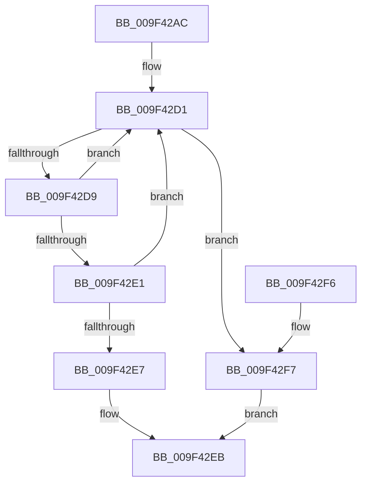

# EtwpGetProviderGroupFromTraits

- RVA: `0x009F42AC`–`0x009F42FB` (길이 `79` bytes)
- VA: `0x00000001409F42AC`
- 실행 섹션: `PAGE`
- PDB 이름 있음: `예`; PDB Function 태그: `예`
- unwind 정보 RVA: `0x00065BB8`
- 디코드: `26`개 명령, `79/79` bytes 표시
- 미해석 바이트: `0` (있으면 어셈블리에 `.byte`로 보존)

> 이 문서는 커널 이미지의 기계어와 PDB 기호를 분석해 생성했습니다. 4번과 5번은 함수 원형과 자료형을 바이너리 사용 방식에서 추정한 C 해석이며 원본 소스 복구 결과는 아닙니다.

## 1. Dependencies

- 직접 호출 지점: **1**; 고유 호출 대상: **1**
- 직접 호출자로 확인된 함수: **1**
- RIP 상대 이미지 참조: **0**

### Outgoing calls
- `0x009F42C8` → [strnlen](../../text/50/strnlen_function_00501590.md) (function, `0x00501590`)

### Direct callers
- [EtwpSetProviderTraitsCommon](EtwpSetProviderTraitsCommon_function_009F36EC.md) at `0x009F3883`

### Static image references
- 디코드된 RIP-relative 메모리 참조가 없습니다.

## 2. Other-region calls and transfers

- 다른 실행 섹션으로 향하는 call: **1**
  - `0x009F42C8` → [strnlen](../../text/50/strnlen_function_00501590.md) (`PAGE` → `.text`)
- 별도 외부 분기/꼬리 이동을 확인하지 못했습니다.

## 3. Assembly (complete function range)

```asm
009F42AC  48 89 5C 24 08                  mov qword ptr [rsp + 8], rbx
009F42B1  57                              push rdi
009F42B2  48 83 EC 20                     sub rsp, 0x20
009F42B6  0F B7 11                        movzx edx, word ptr [rcx]
009F42B9  48 8D 59 02                     lea rbx, [rcx + 2]
009F42BD  48 8D 3C 0A                     lea rdi, [rdx + rcx]
009F42C1  48 83 C2 FD                     add rdx, -3
009F42C5  48 8B CB                        mov rcx, rbx
009F42C8  E8 C3 D2 B0 FF                  call 0x140501590
009F42CD  48 8D 4B 01                     lea rcx, [rbx + 1]
009F42D1  48 03 C8                        add rcx, rax
009F42D4  48 3B CF                        cmp rcx, rdi
009F42D7  73 1E                           jae 0x1409f42f7
009F42D9  0F B7 01                        movzx eax, word ptr [rcx]
009F42DC  83 F8 13                        cmp eax, 0x13
009F42DF  75 F0                           jne 0x1409f42d1
009F42E1  80 79 02 01                     cmp byte ptr [rcx + 2], 1
009F42E5  75 EA                           jne 0x1409f42d1
009F42E7  48 8D 41 03                     lea rax, [rcx + 3]
009F42EB  48 8B 5C 24 30                  mov rbx, qword ptr [rsp + 0x30]
009F42F0  48 83 C4 20                     add rsp, 0x20
009F42F4  5F                              pop rdi
009F42F5  C3                              ret
009F42F6  CC                              int3
009F42F7  33 C0                           xor eax, eax
009F42F9  EB F0                           jmp 0x1409f42eb
```

## 4. C-style interpretation (structured pseudocode)

```c
__int64 __fastcall EtwpGetProviderGroupFromTraits(__int64 a1)
{
    __int64 result;
    __int64 v_rsp;
    unsigned __int64 v_stack_p8;

    v_stack_p8 = v_rbx;
    v_rsp = (v_rsp) - (32);
    a2 = (*(unsigned __int16 *)(a1)) + (-3);
    result = strnlen(a1 + 2, a2, a3, a4);
loc_009F42D1:
    a1 = (a1 + 2 + 1) + (result);
    if (a1 >= (*(unsigned __int16 *)(a1) + a1 * 1)) goto loc_009F42F7;
    if (((unsigned int)(*(unsigned __int16 *)(a1))) != 19) goto loc_009F42D1;
    if ((*(unsigned __int8 *)(a1 + 2)) != 1) goto loc_009F42D1;
loc_009F42EB:
    v_rsp = (v_rsp) + (32);
    return a1 + 3;
loc_009F42F7:
    result = 0;
    goto loc_009F42EB;
}
```

## 5. (Beta) C Style

```c
void *EtwpGetProviderGroupFromTraits(void *Arg1)
{
    uint8_t *arg1 = (uint8_t *)Arg1;

    int64_t result;
    int64_t local_rsp;
    uint64_t v_stack_p8;

    v_stack_p8 = local_rbx;
    local_rsp = (local_rsp) - (32);
    a2 = (*(uint16_t *)(arg1)) + (-3);
    result = strnlen(Arg1 + 2, a2, a3, a4);
loc_009F42D1:
    Arg1 = (Arg1 + 2 + 1) + (result);
    if (Arg1 >= (*(uint16_t *)(arg1) + Arg1 * 1)) goto loc_009F42F7;
    if (((uint32_t)(*(uint16_t *)(arg1))) != 19) goto loc_009F42D1;
    if ((*(uint8_t *)(arg1 + 0x2)) != 1) goto loc_009F42D1;
loc_009F42EB:
    local_rsp = (local_rsp) + (32);
    return Arg1 + 3;
loc_009F42F7:
    result = 0;
    goto loc_009F42EB;
}
```

### 관측된 메모리 오프셋

구조체 형식이 확인되지 않은 접근은 인자 기준의 오프셋으로만 기록했습니다.

| 기준 인자 | 오프셋 표현 | 폭 (bit) | 접근 |
|---|---:|---:|---|
| `Arg1` | `+ 0x0` | `16` | `R` |
| `Arg1` | `+ 0x1` | `64` | `R` |
| `Arg1` | `+ 0x2` | `64` | `R` |

## 6. Execution-region graph

[열기: 2D/3D 그래프와 함수 탐색 컨트롤 패널](../../../control-panel.html?section=page&rva=0x009F42AC&view=graph)

- 2D 그래프는 위에서 아래로 흐르고, 3D 그래프는 빈 공간을 드래그해 회전합니다. Shift+드래그는 이동, 휠은 확대·축소, 함수 노드 선택은 대상 보고서 이동입니다.

### Static fallback


