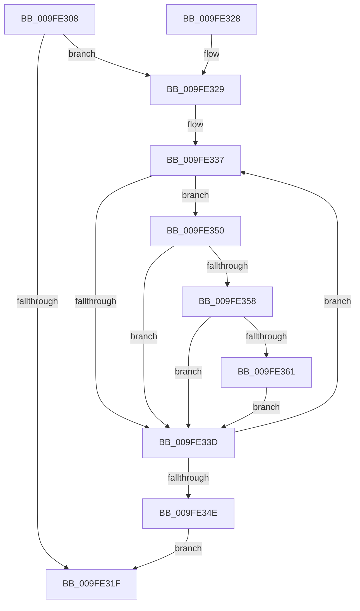

# EtwpGetSchematizedFilterSize

- RVA: `0x009FE308`–`0x009FE36F` (길이 `103` bytes)
- VA: `0x00000001409FE308`
- 실행 섹션: `PAGE`
- PDB 이름 있음: `예`; PDB Function 태그: `아니요`
- unwind 정보 RVA: `0x000A753C`
- 디코드: `32`개 명령, `103/103` bytes 표시
- 미해석 바이트: `0` (있으면 어셈블리에 `.byte`로 보존)

> 이 문서는 커널 이미지의 기계어와 PDB 기호를 분석해 생성했습니다. 4번과 5번은 함수 원형과 자료형을 바이너리 사용 방식에서 추정한 C 해석이며 원본 소스 복구 결과는 아닙니다.

## 1. Dependencies

- 직접 호출 지점: **0**; 고유 호출 대상: **0**
- 직접 호출자로 확인된 함수: **3**
- RIP 상대 이미지 참조: **0**

### Outgoing calls
- 직접 디코드된 call 명령이 없습니다.

### Direct callers
- [EtwpClearSessionAndUnreferenceEntry](../8C/EtwpClearSessionAndUnreferenceEntry_function_008C1438.md) at `0x008C1797`
- [EtwpAddRegEntryToGroup](EtwpAddRegEntryToGroup_function_009F39D4.md) at `0x009F3B3E`
- [EtwpAddRegEntryToGroup](EtwpAddRegEntryToGroup_function_009F39D4.md) at `0x009F411F`
- [sub_00B225A4](../B2/Unknown_function_00B225A4.md) at `0x00B225ED`

### Static image references
- 디코드된 RIP-relative 메모리 참조가 없습니다.

## 2. Other-region calls and transfers

- 다른 실행 섹션으로 향하는 call: **0**
- 별도 외부 분기/꼬리 이동을 확인하지 못했습니다.

## 3. Assembly (complete function range)

```asm
009FE308  48 89 5C 24 08                  mov qword ptr [rsp + 8], rbx
009FE30D  4C 8B 91 80 02 00 00            mov r10, qword ptr [rcx + 0x280]
009FE314  45 33 DB                        xor r11d, r11d
009FE317  0F B7 DA                        movzx ebx, dx
009FE31A  4D 85 D2                        test r10, r10
009FE31D  75 0A                           jne 0x1409fe329
009FE31F  48 8B 5C 24 08                  mov rbx, qword ptr [rsp + 8]
009FE324  41 8B C3                        mov eax, r11d
009FE327  C3                              ret
009FE328  CC                              int3
009FE329  45 33 C0                        xor r8d, r8d
009FE32C  4C 8D 89 80 00 00 00            lea r9, [rcx + 0x80]
009FE333  49 83 C2 58                     add r10, 0x58
009FE337  41 83 39 00                     cmp dword ptr [r9], 0
009FE33B  75 13                           jne 0x1409fe350
009FE33D  41 FF C0                        inc r8d
009FE340  49 83 C1 20                     add r9, 0x20
009FE344  49 83 C2 68                     add r10, 0x68
009FE348  41 83 F8 10                     cmp r8d, 0x10
009FE34C  72 E9                           jb 0x1409fe337
009FE34E  EB CF                           jmp 0x1409fe31f
009FE350  49 8B 12                        mov rdx, qword ptr [r10]
009FE353  48 85 D2                        test rdx, rdx
009FE356  74 E5                           je 0x1409fe33d
009FE358  41 0F B6 C8                     movzx ecx, r8b
009FE35C  0F A3 CB                        bt ebx, ecx
009FE35F  73 DC                           jae 0x1409fe33d
009FE361  8B 4A 10                        mov ecx, dword ptr [rdx + 0x10]
009FE364  83 C1 07                        add ecx, 7
009FE367  83 E1 F8                        and ecx, 0xfffffff8
009FE36A  44 03 D9                        add r11d, ecx
009FE36D  EB CE                           jmp 0x1409fe33d
```

## 4. C-style interpretation (structured pseudocode)

```c
__int64 __fastcall EtwpGetSchematizedFilterSize(__int64 a1, unsigned __int16 a2, int a3)
{
    __int64 v_r10;
    __int64 v_r11;
    unsigned __int64 v_stack_p8;

    v_stack_p8 = v_rbx;
    v_r11 = 0;
    if (*(unsigned __int64 *)(a1 + 640) != 0) goto loc_009FE329;
loc_009FE31F:
    return 0;
loc_009FE329:
    a3 = 0;
    v_r10 = (*(unsigned __int64 *)(a1 + 640)) + (88);
loc_009FE337:
    if ((*(unsigned int *)(a1 + 128)) != 0) goto loc_009FE350;
loc_009FE33D:
    a3 = (unsigned int)((a3) + 1);
    a4 = (a1 + 128) + (32);
    v_r10 = (v_r10) + (104);
    if (a3 < 16) goto loc_009FE337;
    goto loc_009FE31F;
loc_009FE350:
    if (*(unsigned __int64 *)(v_r10) == 0) goto loc_009FE33D;
    if (condition_is_above_or_equal) goto loc_009FE33D;
    a1 = (unsigned int)(((unsigned int)(*(unsigned int *)(*(unsigned __int64 *)(v_r10) + 16))) + (7));
    a1 = (unsigned int)((a1) & (0xFFFFFFF8ULL));
    v_r11 = (unsigned int)((v_r11) + ((unsigned int)(a1)));
    goto loc_009FE33D;
}
```

## 5. (Beta) C Style

```c
int64_t EtwpGetSchematizedFilterSize(void *Arg1, uint16_t Arg2, int32_t Arg3)
{
    uint8_t *arg1 = (uint8_t *)Arg1;

    int64_t local_r10;
    int64_t local_r11;
    uint64_t v_stack_p8;

    v_stack_p8 = local_rbx;
    local_r11 = 0;
    if (*(uint64_t *)(arg1 + 0x280) != 0) goto loc_009FE329;
loc_009FE31F:
    return 0;
loc_009FE329:
    Arg3 = 0;
    local_r10 = (*(uint64_t *)(arg1 + 0x280)) + (88);
loc_009FE337:
    if ((*(uint32_t *)(arg1 + 0x80)) != 0) goto loc_009FE350;
loc_009FE33D:
    Arg3 = (uint32_t)((Arg3) + 1);
    a4 = (Arg1 + 128) + (32);
    local_r10 = (local_r10) + (104);
    if (Arg3 < 16) goto loc_009FE337;
    goto loc_009FE31F;
loc_009FE350:
    if (*(uint64_t *)(local_r10) == 0) goto loc_009FE33D;
    if (condition_is_above_or_equal) goto loc_009FE33D;
    Arg1 = (uint32_t)(((uint32_t)(*(uint32_t *)(*(uint64_t *)(local_r10) + 0x10))) + (7));
    Arg1 = (uint32_t)((Arg1) & (0xFFFFFFF8ULL));
    local_r11 = (uint32_t)((local_r11) + ((uint32_t)(Arg1)));
    goto loc_009FE33D;
}
```

### 관측된 메모리 오프셋

구조체 형식이 확인되지 않은 접근은 인자 기준의 오프셋으로만 기록했습니다.

| 기준 인자 | 오프셋 표현 | 폭 (bit) | 접근 |
|---|---:|---:|---|
| `Arg1` | `+ 0x0` | `32` | `R` |
| `Arg1` | `+ 0x80` | `64` | `R` |
| `Arg1` | `+ 0x280` | `64` | `R` |

## 6. Execution-region graph

[열기: 2D/3D 그래프와 함수 탐색 컨트롤 패널](../../../control-panel.html?section=page&rva=0x009FE308&view=graph)

- 2D 그래프는 위에서 아래로 흐르고, 3D 그래프는 빈 공간을 드래그해 회전합니다. Shift+드래그는 이동, 휠은 확대·축소, 함수 노드 선택은 대상 보고서 이동입니다.

### Static fallback


