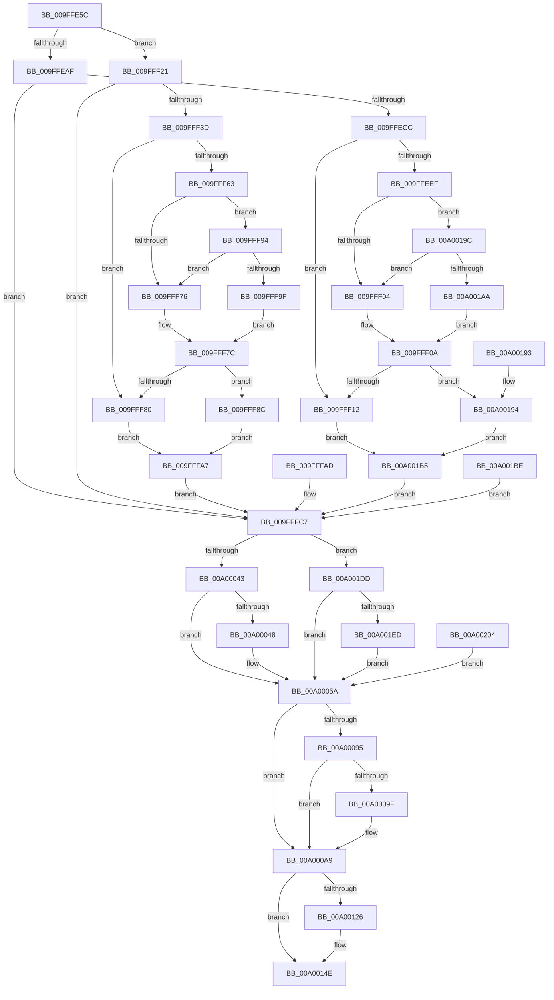

# EtwpPsProvTraceThread

- RVA: `0x009FFE5C`–`0x00A0021E` (길이 `962` bytes)
- VA: `0x00000001409FFE5C`
- 실행 섹션: `PAGE`
- PDB 이름 있음: `예`; PDB Function 태그: `아니요`
- unwind 정보 RVA: `0x000A7CCC`
- 디코드: `186`개 명령, `962/962` bytes 표시
- 미해석 바이트: `0` (있으면 어셈블리에 `.byte`로 보존)

> 이 문서는 커널 이미지의 기계어와 PDB 기호를 분석해 생성했습니다. 4번과 5번은 함수 원형과 자료형을 바이너리 사용 방식에서 추정한 C 해석이며 원본 소스 복구 결과는 아닙니다.

## 1. Dependencies

- 직접 호출 지점: **3**; 고유 호출 대상: **3**
- 직접 호출자로 확인된 함수: **1**
- RIP 상대 이미지 참조: **4**

### Outgoing calls
- `0x009FFEBB` → [PsGetCurrentThreadTeb](../../text/47/PsGetCurrentThreadTeb_function_004745C0.md) (function, `0x004745C0`)
- `0x00A0016A` → [EtwWrite](../../text/41/EtwWrite_function_0041C720.md) (function, `0x0041C720`)
- `0x00A0017A` → [_security_check_cookie](../../text/6A/_security_check_cookie_function_006AC640.md) (function, `0x006AC640`)

### Direct callers
- [EtwTraceThread](../90/EtwTraceThread_function_00905700.md) at `0x00905766`

### Static image references
- `0x009FFE7A` → RVA `0x00E0A740` (`.data`; read)
- `0x009FFEAF` → RVA `0x000121E8` (`.rdata`; read)
- `0x009FFF21` → RVA `0x00014A68` (`.rdata`; read)
- `0x00A00163` → RVA `0x00EFF9E8` (`.data`; read)

## 2. Other-region calls and transfers

- 다른 실행 섹션으로 향하는 call: **3**
  - `0x009FFEBB` → [PsGetCurrentThreadTeb](../../text/47/PsGetCurrentThreadTeb_function_004745C0.md) (`PAGE` → `.text`)
  - `0x00A0016A` → [EtwWrite](../../text/41/EtwWrite_function_0041C720.md) (`PAGE` → `.text`)
  - `0x00A0017A` → [_security_check_cookie](../../text/6A/_security_check_cookie_function_006AC640.md) (`PAGE` → `.text`)
- 별도 외부 분기/꼬리 이동을 확인하지 못했습니다.

## 3. Assembly (complete function range)

```asm
009FFE5C  48 8B C4                        mov rax, rsp
009FFE5F  48 89 58 20                     mov qword ptr [rax + 0x20], rbx
009FFE63  44 88 40 18                     mov byte ptr [rax + 0x18], r8b
009FFE67  48 89 50 10                     mov qword ptr [rax + 0x10], rdx
009FFE6B  48 89 48 08                     mov qword ptr [rax + 8], rcx
009FFE6F  56                              push rsi
009FFE70  57                              push rdi
009FFE71  41 56                           push r14
009FFE73  48 81 EC 50 01 00 00            sub rsp, 0x150
009FFE7A  48 8B 05 BF A8 40 00            mov rax, qword ptr [rip + 0x40a8bf]
009FFE81  48 33 C4                        xor rax, rsp
009FFE84  48 89 84 24 40 01 00 00         mov qword ptr [rsp + 0x140], rax
009FFE8C  45 8A F0                        mov r14b, r8b
009FFE8F  48 8B F2                        mov rsi, rdx
009FFE92  48 8B F9                        mov rdi, rcx
009FFE95  33 DB                           xor ebx, ebx
009FFE97  48 89 5C 24 58                  mov qword ptr [rsp + 0x58], rbx
009FFE9C  48 89 5C 24 40                  mov qword ptr [rsp + 0x40], rbx
009FFEA1  48 89 5C 24 48                  mov qword ptr [rsp + 0x48], rbx
009FFEA6  89 5C 24 34                     mov dword ptr [rsp + 0x34], ebx
009FFEAA  45 84 C0                        test r8b, r8b
009FFEAD  74 72                           je 0x1409fff21
009FFEAF  48 8D 05 32 23 61 FF            lea rax, [rip - 0x9edcce]
009FFEB6  48 89 44 24 60                  mov qword ptr [rsp + 0x60], rax
009FFEBB  E8 00 47 A7 FF                  call 0x1404745c0
009FFEC0  48 8B D0                        mov rdx, rax
009FFEC3  48 85 C0                        test rax, rax
009FFEC6  0F 84 FB 00 00 00               je 0x1409fffc7
009FFECC  65 48 8B 0C 25 88 01 00 00      mov rcx, qword ptr gs:[0x188]
009FFED5  48 89 4C 24 78                  mov qword ptr [rsp + 0x78], rcx
009FFEDA  48 8B 81 20 02 00 00            mov rax, qword ptr [rcx + 0x220]
009FFEE1  48 89 44 24 70                  mov qword ptr [rsp + 0x70], rax
009FFEE6  48 39 98 10 03 00 00            cmp qword ptr [rax + 0x310], rbx
009FFEED  74 23                           je 0x1409fff12
009FFEEF  0F B7 88 EC 06 00 00            movzx ecx, word ptr [rax + 0x6ec]
009FFEF6  B8 4C 01 00 00                  mov eax, 0x14c
009FFEFB  66 3B C8                        cmp cx, ax
009FFEFE  0F 85 98 02 00 00               jne 0x140a0019c
009FFF04  B0 01                           mov al, 1
009FFF06  88 44 24 30                     mov byte ptr [rsp + 0x30], al
009FFF0A  84 C0                           test al, al
009FFF0C  0F 85 82 02 00 00               jne 0x140a00194
009FFF12  8B 82 20 17 00 00               mov eax, dword ptr [rdx + 0x1720]
009FFF18  89 44 24 68                     mov dword ptr [rsp + 0x68], eax
009FFF1C  E9 94 02 00 00                  jmp 0x140a001b5
009FFF21  48 8D 05 40 4B 61 FF            lea rax, [rip - 0x9eb4c0]
009FFF28  48 89 44 24 60                  mov qword ptr [rsp + 0x60], rax
009FFF2D  48 8B 89 F0 00 00 00            mov rcx, qword ptr [rcx + 0xf0]
009FFF34  48 85 C9                        test rcx, rcx
009FFF37  0F 84 8A 00 00 00               je 0x1409fffc7
009FFF3D  65 48 8B 04 25 88 01 00 00      mov rax, qword ptr gs:[0x188]
009FFF46  48 89 84 24 80 00 00 00         mov qword ptr [rsp + 0x80], rax
009FFF4E  48 8B 90 20 02 00 00            mov rdx, qword ptr [rax + 0x220]
009FFF55  48 89 54 24 70                  mov qword ptr [rsp + 0x70], rdx
009FFF5A  48 39 9A 10 03 00 00            cmp qword ptr [rdx + 0x310], rbx
009FFF61  74 1D                           je 0x1409fff80
009FFF63  44 0F B7 82 EC 06 00 00         movzx r8d, word ptr [rdx + 0x6ec]
009FFF6B  B8 4C 01 00 00                  mov eax, 0x14c
009FFF70  66 44 3B C0                     cmp r8w, ax
009FFF74  75 1E                           jne 0x1409fff94
009FFF76  B0 01                           mov al, 1
009FFF78  88 44 24 31                     mov byte ptr [rsp + 0x31], al
009FFF7C  84 C0                           test al, al
009FFF7E  75 0C                           jne 0x1409fff8c
009FFF80  8B 81 20 17 00 00               mov eax, dword ptr [rcx + 0x1720]
009FFF86  89 44 24 6C                     mov dword ptr [rsp + 0x6c], eax
009FFF8A  EB 1B                           jmp 0x1409fffa7
009FFF8C  8B 81 60 2F 00 00               mov eax, dword ptr [rcx + 0x2f60]
009FFF92  EB 13                           jmp 0x1409fffa7
009FFF94  B8 C4 01 00 00                  mov eax, 0x1c4
009FFF99  66 44 3B C0                     cmp r8w, ax
009FFF9D  74 D7                           je 0x1409fff76
009FFF9F  8A C3                           mov al, bl
009FFFA1  88 5C 24 31                     mov byte ptr [rsp + 0x31], bl
009FFFA5  EB D5                           jmp 0x1409fff7c
009FFFA7  89 44 24 34                     mov dword ptr [rsp + 0x34], eax
009FFFAB  EB 1A                           jmp 0x1409fffc7
009FFFAD  33 DB                           xor ebx, ebx
009FFFAF  44 8A B4 24 80 01 00 00         mov r14b, byte ptr [rsp + 0x180]
009FFFB7  48 8B B4 24 78 01 00 00         mov rsi, qword ptr [rsp + 0x178]
009FFFBF  48 8B BC 24 70 01 00 00         mov rdi, qword ptr [rsp + 0x170]
009FFFC7  8B 87 08 05 00 00               mov eax, dword ptr [rdi + 0x508]
009FFFCD  89 44 24 38                     mov dword ptr [rsp + 0x38], eax
009FFFD1  48 8D 44 24 38                  lea rax, [rsp + 0x38]
009FFFD6  48 89 84 24 90 00 00 00         mov qword ptr [rsp + 0x90], rax
009FFFDE  48 C7 84 24 98 00 00 00 04 00 00 00  mov qword ptr [rsp + 0x98], 4
009FFFEA  8B 87 10 05 00 00               mov eax, dword ptr [rdi + 0x510]
009FFFF0  89 44 24 3C                     mov dword ptr [rsp + 0x3c], eax
009FFFF4  48 8D 44 24 3C                  lea rax, [rsp + 0x3c]
009FFFF9  48 89 84 24 A0 00 00 00         mov qword ptr [rsp + 0xa0], rax
00A00001  48 C7 84 24 A8 00 00 00 04 00 00 00  mov qword ptr [rsp + 0xa8], 4
00A0000D  48 8D 47 38                     lea rax, [rdi + 0x38]
00A00011  48 89 84 24 B0 00 00 00         mov qword ptr [rsp + 0xb0], rax
00A00019  B9 08 00 00 00                  mov ecx, 8
00A0001E  48 89 8C 24 B8 00 00 00         mov qword ptr [rsp + 0xb8], rcx
00A00026  48 8D 47 30                     lea rax, [rdi + 0x30]
00A0002A  48 89 84 24 C0 00 00 00         mov qword ptr [rsp + 0xc0], rax
00A00032  48 89 8C 24 C8 00 00 00         mov qword ptr [rsp + 0xc8], rcx
00A0003A  45 84 F6                        test r14b, r14b
00A0003D  0F 84 9A 01 00 00               je 0x140a001dd
00A00043  48 85 F6                        test rsi, rsi
00A00046  74 12                           je 0x140a0005a
00A00048  48 8B 46 10                     mov rax, qword ptr [rsi + 0x10]
00A0004C  48 89 44 24 40                  mov qword ptr [rsp + 0x40], rax
00A00051  48 8B 46 18                     mov rax, qword ptr [rsi + 0x18]
00A00055  48 89 44 24 48                  mov qword ptr [rsp + 0x48], rax
00A0005A  48 8D 44 24 40                  lea rax, [rsp + 0x40]
00A0005F  48 89 84 24 D0 00 00 00         mov qword ptr [rsp + 0xd0], rax
00A00067  48 C7 84 24 D8 00 00 00 08 00 00 00  mov qword ptr [rsp + 0xd8], 8
00A00073  48 8D 44 24 48                  lea rax, [rsp + 0x48]
00A00078  48 89 84 24 E0 00 00 00         mov qword ptr [rsp + 0xe0], rax
00A00080  48 C7 84 24 E8 00 00 00 08 00 00 00  mov qword ptr [rsp + 0xe8], 8
00A0008C  F7 47 74 00 04 00 00            test dword ptr [rdi + 0x74], 0x400
00A00093  75 14                           jne 0x140a000a9
00A00095  8B 87 A8 05 00 00               mov eax, dword ptr [rdi + 0x5a8]
00A0009B  84 C1                           test cl, al
00A0009D  75 0A                           jne 0x140a000a9
00A0009F  F0 09 1C 24                     lock or dword ptr [rsp], ebx
00A000A3  8B 87 A8 05 00 00               mov eax, dword ptr [rdi + 0x5a8]
00A000A9  48 8D 44 24 50                  lea rax, [rsp + 0x50]
00A000AE  48 89 84 24 F0 00 00 00         mov qword ptr [rsp + 0xf0], rax
00A000B6  48 C7 84 24 F8 00 00 00 08 00 00 00  mov qword ptr [rsp + 0xf8], 8
00A000C2  48 8B 87 60 05 00 00            mov rax, qword ptr [rdi + 0x560]
00A000C9  48 89 44 24 50                  mov qword ptr [rsp + 0x50], rax
00A000CE  48 8D 44 24 50                  lea rax, [rsp + 0x50]
00A000D3  48 89 84 24 00 01 00 00         mov qword ptr [rsp + 0x100], rax
00A000DB  48 C7 84 24 08 01 00 00 08 00 00 00  mov qword ptr [rsp + 0x108], 8
00A000E7  48 8D 87 F0 00 00 00            lea rax, [rdi + 0xf0]
00A000EE  48 89 84 24 10 01 00 00         mov qword ptr [rsp + 0x110], rax
00A000F6  48 C7 84 24 18 01 00 00 08 00 00 00  mov qword ptr [rsp + 0x118], 8
00A00102  48 8D 44 24 34                  lea rax, [rsp + 0x34]
00A00107  48 89 84 24 20 01 00 00         mov qword ptr [rsp + 0x120], rax
00A0010F  48 C7 84 24 28 01 00 00 04 00 00 00  mov qword ptr [rsp + 0x128], 4
00A0011B  41 B9 0A 00 00 00               mov r9d, 0xa
00A00121  45 84 F6                        test r14b, r14b
00A00124  75 28                           jne 0x140a0014e
00A00126  48 8B 47 48                     mov rax, qword ptr [rdi + 0x48]
00A0012A  48 89 44 24 58                  mov qword ptr [rsp + 0x58], rax
00A0012F  48 8D 44 24 58                  lea rax, [rsp + 0x58]
00A00134  48 89 84 24 30 01 00 00         mov qword ptr [rsp + 0x130], rax
00A0013C  48 C7 84 24 38 01 00 00 08 00 00 00  mov qword ptr [rsp + 0x138], 8
00A00148  41 B9 0B 00 00 00               mov r9d, 0xb
00A0014E  48 8D 84 24 90 00 00 00         lea rax, [rsp + 0x90]
00A00156  48 89 44 24 20                  mov qword ptr [rsp + 0x20], rax
00A0015B  45 33 C0                        xor r8d, r8d
00A0015E  48 8B 54 24 60                  mov rdx, qword ptr [rsp + 0x60]
00A00163  48 8B 0D 7E F8 4F 00            mov rcx, qword ptr [rip + 0x4ff87e]
00A0016A  E8 B1 C5 A1 FF                  call 0x14041c720
00A0016F  48 8B 8C 24 40 01 00 00         mov rcx, qword ptr [rsp + 0x140]
00A00177  48 33 CC                        xor rcx, rsp
00A0017A  E8 C1 C4 CA FF                  call 0x1406ac640
00A0017F  48 8B 9C 24 88 01 00 00         mov rbx, qword ptr [rsp + 0x188]
00A00187  48 81 C4 50 01 00 00            add rsp, 0x150
00A0018E  41 5E                           pop r14
00A00190  5F                              pop rdi
00A00191  5E                              pop rsi
00A00192  C3                              ret
00A00193  CC                              int3
00A00194  8B 82 60 2F 00 00               mov eax, dword ptr [rdx + 0x2f60]
00A0019A  EB 19                           jmp 0x140a001b5
00A0019C  B8 C4 01 00 00                  mov eax, 0x1c4
00A001A1  66 3B C8                        cmp cx, ax
00A001A4  0F 84 5A FD FF FF               je 0x1409fff04
00A001AA  8A C3                           mov al, bl
00A001AC  88 5C 24 30                     mov byte ptr [rsp + 0x30], bl
00A001B0  E9 55 FD FF FF                  jmp 0x1409fff0a
00A001B5  89 44 24 34                     mov dword ptr [rsp + 0x34], eax
00A001B9  E9 09 FE FF FF                  jmp 0x1409fffc7
00A001BE  33 DB                           xor ebx, ebx
00A001C0  44 8A B4 24 80 01 00 00         mov r14b, byte ptr [rsp + 0x180]
00A001C8  48 8B B4 24 78 01 00 00         mov rsi, qword ptr [rsp + 0x178]
00A001D0  48 8B BC 24 70 01 00 00         mov rdi, qword ptr [rsp + 0x170]
00A001D8  E9 EA FD FF FF                  jmp 0x1409fffc7
00A001DD  48 8B 97 F0 00 00 00            mov rdx, qword ptr [rdi + 0xf0]
00A001E4  48 85 D2                        test rdx, rdx
00A001E7  0F 84 6D FE FF FF               je 0x140a0005a
00A001ED  48 8B 42 08                     mov rax, qword ptr [rdx + 8]
00A001F1  48 89 44 24 40                  mov qword ptr [rsp + 0x40], rax
00A001F6  48 8B 42 10                     mov rax, qword ptr [rdx + 0x10]
00A001FA  48 89 44 24 48                  mov qword ptr [rsp + 0x48], rax
00A001FF  E9 56 FE FF FF                  jmp 0x140a0005a
00A00204  33 DB                           xor ebx, ebx
00A00206  8D 4B 08                        lea ecx, [rbx + 8]
00A00209  44 8A B4 24 80 01 00 00         mov r14b, byte ptr [rsp + 0x180]
00A00211  48 8B BC 24 70 01 00 00         mov rdi, qword ptr [rsp + 0x170]
00A00219  E9 3C FE FF FF                  jmp 0x140a0005a
```

## 4. C-style interpretation (structured pseudocode)

```c
__int64 __fastcall EtwpPsProvTraceThread(__int64 a1, __int64 a2, unsigned __int8 a3)
{
    __int64 result;
    __int64 v_rbx;
    __int64 v_rsp;
    unsigned int v_stack_m100;
    unsigned __int64 v_stack_m108;
    unsigned __int64 v_stack_m110;
    unsigned __int64 v_stack_m118;
    unsigned __int64 v_stack_m120;
    unsigned __int64 v_stack_m128;
    unsigned int v_stack_m12C;
    unsigned int v_stack_m130;
    unsigned int v_stack_m134;
    unsigned __int8 v_stack_m137;
    unsigned __int8 v_stack_m138;
    unsigned __int64 v_stack_m148;
    unsigned int v_stack_m168;
    unsigned __int64 v_stack_m28;
    unsigned __int64 v_stack_m30;
    unsigned __int64 v_stack_m38;
    unsigned __int64 v_stack_m40;
    unsigned __int64 v_stack_m48;
    unsigned __int64 v_stack_m50;
    unsigned __int64 v_stack_m58;
    unsigned __int64 v_stack_m60;
    unsigned __int64 v_stack_m68;
    unsigned __int64 v_stack_m70;
    unsigned __int64 v_stack_m78;
    unsigned __int64 v_stack_m80;
    unsigned __int64 v_stack_m88;
    unsigned __int64 v_stack_m90;
    unsigned __int64 v_stack_m98;
    unsigned __int64 v_stack_mA0;
    unsigned __int64 v_stack_mA8;
    unsigned __int64 v_stack_mB0;
    unsigned __int64 v_stack_mB8;
    unsigned __int64 v_stack_mC0;
    unsigned __int64 v_stack_mC8;
    unsigned __int64 v_stack_mD0;
    unsigned __int64 v_stack_mD8;
    unsigned __int64 v_stack_mE8;
    unsigned __int64 v_stack_mF0;
    unsigned __int64 v_stack_mF8;
    unsigned int v_stack_mFC;
    unsigned __int64 v_stack_p10;
    unsigned __int64 v_stack_p170;
    unsigned __int64 v_stack_p178;
    unsigned __int8 v_stack_p18;
    unsigned __int8 v_stack_p180;
    unsigned __int64 v_stack_p20;
    unsigned __int8 v_stack_p30;
    unsigned int v_stack_p34;
    unsigned __int64 v_stack_p40;
    unsigned __int64 v_stack_p48;
    unsigned __int64 v_stack_p8;

    *(unsigned __int64 *)(v_rsp + 32) = v_rbx;
    *(unsigned __int8 *)(v_rsp + 24) = a3;
    *(unsigned __int64 *)(v_rsp + 16) = a2;
    *(unsigned __int64 *)(v_rsp + 8) = a1;
    v_rsp = (v_rsp) - (336);
    result = (*(unsigned __int64 *)(v_rip + 4237503)) ^ (v_rsp);
    v_stack_m28 = result;
    v_rbx = 0;
    v_stack_m110 = 0;
    v_stack_m128 = 0;
    v_stack_m120 = 0;
    v_stack_m134 = 0;
    if (a3 == 0) goto loc_009FFF21;
    v_stack_m108 = v_rip - 10411214;
    result = PsGetCurrentThreadTeb(a1, a2, a3, a4);
    if (result == 0) goto loc_009FFFC7;
    v_stack_mF0 = *(unsigned __int64 *)(gs_base + (0 + 392));
    v_stack_mF8 = *(unsigned __int64 *)(*(unsigned __int64 *)(gs_base + (0 + 392)) + 544);
    if ((*(unsigned __int64 *)(*(unsigned __int64 *)(*(unsigned __int64 *)(gs_base + (0 + 392)) + 544) + 784)) == 0) goto loc_009FFF12;
    if (((unsigned __int16)(*(unsigned __int16 *)(*(unsigned __int64 *)(*(unsigned __int64 *)(gs_base + (0 + 392)) + 544) + 1772))) != 332) goto loc_00A0019C;
loc_009FFF04:
    v_stack_m138 = 1;
loc_009FFF0A:
    if (1 != 0) goto loc_00A00194;
loc_009FFF12:
    v_stack_m100 = (unsigned int)((unsigned int)(*(unsigned int *)(result + 5920)));
    goto loc_00A001B5;
loc_009FFF21:
    v_stack_m108 = v_rip - 10400960;
    if (*(unsigned __int64 *)(*(unsigned __int16 *)(*(unsigned __int64 *)(*(unsigned __int64 *)(gs_base + (0 + 392)) + 544) + 1772) + 240) == 0) goto loc_009FFFC7;
    v_stack_mE8 = *(unsigned __int64 *)(gs_base + (0 + 392));
    v_stack_mF8 = *(unsigned __int64 *)(*(unsigned __int64 *)(gs_base + (0 + 392)) + 544);
    if ((*(unsigned __int64 *)(*(unsigned __int64 *)(*(unsigned __int64 *)(gs_base + (0 + 392)) + 544) + 784)) == 0) goto loc_009FFF80;
    if (((unsigned __int16)(*(unsigned __int16 *)(*(unsigned __int64 *)(*(unsigned __int64 *)(gs_base + (0 + 392)) + 544) + 1772))) != 332) goto loc_009FFF94;
loc_009FFF76:
    v_stack_m137 = 1;
loc_009FFF7C:
    if (1 != 0) goto loc_009FFF8C;
loc_009FFF80:
    v_stack_mFC = (unsigned int)((unsigned int)(*(unsigned int *)(*(unsigned __int64 *)(*(unsigned __int16 *)(*(unsigned __int64 *)(*(unsigned __int64 *)(gs_base + (0 + 392)) + 544) + 1772) + 240) + 5920)));
    goto loc_009FFFA7;
loc_009FFF8C:
    goto loc_009FFFA7;
loc_009FFF94:
    if (((unsigned __int16)(*(unsigned __int16 *)(*(unsigned __int64 *)(*(unsigned __int64 *)(gs_base + (0 + 392)) + 544) + 1772))) == 452) goto loc_009FFF76;
    v_stack_m137 = 0;
    goto loc_009FFF7C;
loc_009FFFA7:
    v_stack_m134 = 0;
    goto loc_009FFFC7;
loc_009FFFC7:
    v_stack_m130 = (unsigned int)((unsigned int)(*(unsigned int *)(a1 + 1288)));
    v_stack_mD8 = v_stack_m130;
    v_stack_mD0 = 4;
    v_stack_m12C = (unsigned int)((unsigned int)(*(unsigned int *)(a1 + 1296)));
    v_stack_mC8 = v_stack_m12C;
    v_stack_mC0 = 4;
    v_stack_mB8 = a1 + 56;
    v_stack_mB0 = 8;
    v_stack_mA8 = a1 + 48;
    v_stack_mA0 = 8;
    if (a3 == 0) goto loc_00A001DD;
    result = a1 + 48;
    if (a2 != 0) {
        result = *(unsigned __int64 *)(a2 + 16);
        v_stack_m128 = result;
        result = *(unsigned __int64 *)(a2 + 24);
        v_stack_m120 = result;
    }
    v_stack_m98 = v_stack_m128;
    v_stack_m90 = 8;
    v_stack_m88 = v_stack_m120;
    v_stack_m80 = 8;
    if (((*(unsigned int *)(a1 + 116)) & (0x400ULL)) != 0) goto loc_00A000A9;
    result = (unsigned int)(*(unsigned int *)(a1 + 1448));
    if (((8) & ((unsigned __int8)((unsigned int)(*(unsigned int *)(a1 + 1448))))) == 0) {
        result = *(unsigned int *)(a1 + 1448);
    }
    v_stack_m78 = v_stack_m118;
    v_stack_m70 = 8;
    v_stack_m118 = *(unsigned __int64 *)(a1 + 1376);
    v_stack_m68 = v_stack_m118;
    v_stack_m60 = 8;
    v_stack_m58 = a1 + 240;
    v_stack_m50 = 8;
    v_stack_m48 = v_stack_m134;
    v_stack_m40 = 4;
    result = v_stack_m134;
    if (a3 == 0) {
        result = *(unsigned __int64 *)(a1 + 72);
        v_stack_m110 = result;
        result = v_stack_m110;
        v_stack_m38 = result;
        v_stack_m30 = 8;
        a4 = 11;
    }
    v_stack_m148 = v_stack_mD8;
    a3 = 0;
    result = EtwWrite(*(unsigned __int64 *)(v_rip + 5240958), v_stack_m108, a3, a4);
    a1 = (v_stack_m28) ^ (v_rsp);
    result = _security_check_cookie(a1, v_stack_m108, a3, a4);
    v_rsp = (v_rsp) + (336);
    return result;
loc_00A00194:
    goto loc_00A001B5;
loc_00A0019C:
    if (((unsigned __int16)(a1)) == 452) goto loc_009FFF04;
    v_stack_p30 = (unsigned __int8)(v_stack_p20);
    goto loc_009FFF0A;
loc_00A001B5:
    v_stack_p34 = (unsigned int)((unsigned __int8)(v_stack_p20));
    goto loc_009FFFC7;
loc_00A001DD:
    if (*(unsigned __int64 *)(a1 + 240) == 0) goto loc_00A0005A;
    v_stack_p40 = *(unsigned __int64 *)(*(unsigned __int64 *)(a1 + 240) + 8);
    v_stack_p48 = *(unsigned __int64 *)(*(unsigned __int64 *)(a1 + 240) + 16);
    goto loc_00A0005A;
}
```

## 5. (Beta) C Style

```c
int64_t EtwpPsProvTraceThread(void *Arg1, int64_t Arg2, uint8_t Arg3)
{
    uint8_t *arg1 = (uint8_t *)Arg1;

    int64_t result;
    int64_t local_rbx;
    int64_t local_rsp;
    uint32_t v_stack_m100;
    uint64_t v_stack_m108;
    uint64_t v_stack_m110;
    uint64_t v_stack_m118;
    uint64_t v_stack_m120;
    uint64_t v_stack_m128;
    uint32_t v_stack_m12C;
    uint32_t v_stack_m130;
    uint32_t v_stack_m134;
    uint8_t v_stack_m137;
    uint8_t v_stack_m138;
    uint64_t v_stack_m148;
    uint32_t v_stack_m168;
    uint64_t v_stack_m28;
    uint64_t v_stack_m30;
    uint64_t v_stack_m38;
    uint64_t v_stack_m40;
    uint64_t v_stack_m48;
    uint64_t v_stack_m50;
    uint64_t v_stack_m58;
    uint64_t v_stack_m60;
    uint64_t v_stack_m68;
    uint64_t v_stack_m70;
    uint64_t v_stack_m78;
    uint64_t v_stack_m80;
    uint64_t v_stack_m88;
    uint64_t v_stack_m90;
    uint64_t v_stack_m98;
    uint64_t v_stack_mA0;
    uint64_t v_stack_mA8;
    uint64_t v_stack_mB0;
    uint64_t v_stack_mB8;
    uint64_t v_stack_mC0;
    uint64_t v_stack_mC8;
    uint64_t v_stack_mD0;
    uint64_t v_stack_mD8;
    uint64_t v_stack_mE8;
    uint64_t v_stack_mF0;
    uint64_t v_stack_mF8;
    uint32_t v_stack_mFC;
    uint64_t v_stack_p10;
    uint64_t v_stack_p170;
    uint64_t v_stack_p178;
    uint8_t v_stack_p18;
    uint8_t v_stack_p180;
    uint64_t v_stack_p20;
    uint8_t v_stack_p30;
    uint32_t v_stack_p34;
    uint64_t v_stack_p40;
    uint64_t v_stack_p48;
    uint64_t v_stack_p8;

    *(uint64_t *)(local_rsp + 0x20) = local_rbx;
    *(uint8_t *)(local_rsp + 0x18) = Arg3;
    *(uint64_t *)(local_rsp + 0x10) = Arg2;
    *(void **)(local_rsp + 0x8) = Arg1;
    local_rsp = (local_rsp) - (336);
    result = (*(uint64_t *)(v_rip + 0x40A8BF)) ^ (local_rsp);
    v_stack_m28 = result;
    local_rbx = 0;
    v_stack_m110 = 0;
    v_stack_m128 = 0;
    v_stack_m120 = 0;
    v_stack_m134 = 0;
    if (Arg3 == 0) goto loc_009FFF21;
    v_stack_m108 = v_rip - 10411214;
    result = PsGetCurrentThreadTeb(Arg1, Arg2, Arg3, a4);
    if (result == 0) goto loc_009FFFC7;
    v_stack_mF0 = *(uint64_t *)(gs_base + (0 + 0x188));
    v_stack_mF8 = *(uint64_t *)(*(uint64_t *)(gs_base + (0 + 0x188)) + 0x220);
    if ((*(uint64_t *)(*(uint64_t *)(*(uint64_t *)(gs_base + (0 + 0x188)) + 0x220) + 0x310)) == 0) goto loc_009FFF12;
    if (((uint16_t)(*(uint16_t *)(*(uint64_t *)(*(uint64_t *)(gs_base + (0 + 0x188)) + 0x220) + 0x6EC))) != 332) goto loc_00A0019C;
loc_009FFF04:
    v_stack_m138 = 1;
loc_009FFF0A:
    if (1 != 0) goto loc_00A00194;
loc_009FFF12:
    v_stack_m100 = (uint32_t)((uint32_t)(*(uint32_t *)(result + 0x1720)));
    goto loc_00A001B5;
loc_009FFF21:
    v_stack_m108 = v_rip - 10400960;
    if (*(uint64_t *)(*(uint16_t *)(*(uint64_t *)(*(uint64_t *)(gs_base + (0 + 0x188)) + 0x220) + 0x6EC) + 0xF0) == 0) goto loc_009FFFC7;
    v_stack_mE8 = *(uint64_t *)(gs_base + (0 + 0x188));
    v_stack_mF8 = *(uint64_t *)(*(uint64_t *)(gs_base + (0 + 0x188)) + 0x220);
    if ((*(uint64_t *)(*(uint64_t *)(*(uint64_t *)(gs_base + (0 + 0x188)) + 0x220) + 0x310)) == 0) goto loc_009FFF80;
    if (((uint16_t)(*(uint16_t *)(*(uint64_t *)(*(uint64_t *)(gs_base + (0 + 0x188)) + 0x220) + 0x6EC))) != 332) goto loc_009FFF94;
loc_009FFF76:
    v_stack_m137 = 1;
loc_009FFF7C:
    if (1 != 0) goto loc_009FFF8C;
loc_009FFF80:
    v_stack_mFC = (uint32_t)((uint32_t)(*(uint32_t *)(*(uint64_t *)(*(uint16_t *)(*(uint64_t *)(*(uint64_t *)(gs_base + (0 + 0x188)) + 0x220) + 0x6EC) + 0xF0) + 0x1720)));
    goto loc_009FFFA7;
loc_009FFF8C:
    goto loc_009FFFA7;
loc_009FFF94:
    if (((uint16_t)(*(uint16_t *)(*(uint64_t *)(*(uint64_t *)(gs_base + (0 + 0x188)) + 0x220) + 0x6EC))) == 452) goto loc_009FFF76;
    v_stack_m137 = 0;
    goto loc_009FFF7C;
loc_009FFFA7:
    v_stack_m134 = 0;
    goto loc_009FFFC7;
loc_009FFFC7:
    v_stack_m130 = (uint32_t)((uint32_t)(*(uint32_t *)(arg1 + 0x508)));
    v_stack_mD8 = v_stack_m130;
    v_stack_mD0 = 4;
    v_stack_m12C = (uint32_t)((uint32_t)(*(uint32_t *)(arg1 + 0x510)));
    v_stack_mC8 = v_stack_m12C;
    v_stack_mC0 = 4;
    v_stack_mB8 = Arg1 + 56;
    v_stack_mB0 = 8;
    v_stack_mA8 = Arg1 + 48;
    v_stack_mA0 = 8;
    if (Arg3 == 0) goto loc_00A001DD;
    result = Arg1 + 48;
    if (Arg2 != 0) {
        result = *(uint64_t *)(Arg2 + 0x10);
        v_stack_m128 = result;
        result = *(uint64_t *)(Arg2 + 0x18);
        v_stack_m120 = result;
    }
    v_stack_m98 = v_stack_m128;
    v_stack_m90 = 8;
    v_stack_m88 = v_stack_m120;
    v_stack_m80 = 8;
    if (((*(uint32_t *)(arg1 + 0x74)) & (0x400ULL)) != 0) goto loc_00A000A9;
    result = (uint32_t)(*(uint32_t *)(arg1 + 0x5A8));
    if (((8) & ((uint8_t)((uint32_t)(*(uint32_t *)(arg1 + 0x5A8))))) == 0) {
        result = *(uint32_t *)(arg1 + 0x5A8);
    }
    v_stack_m78 = v_stack_m118;
    v_stack_m70 = 8;
    v_stack_m118 = *(uint64_t *)(arg1 + 0x560);
    v_stack_m68 = v_stack_m118;
    v_stack_m60 = 8;
    v_stack_m58 = Arg1 + 240;
    v_stack_m50 = 8;
    v_stack_m48 = v_stack_m134;
    v_stack_m40 = 4;
    result = v_stack_m134;
    if (Arg3 == 0) {
        result = *(uint64_t *)(arg1 + 0x48);
        v_stack_m110 = result;
        result = v_stack_m110;
        v_stack_m38 = result;
        v_stack_m30 = 8;
        a4 = 11;
    }
    v_stack_m148 = v_stack_mD8;
    Arg3 = 0;
    result = EtwWrite(*(uint64_t *)(v_rip + 0x4FF87E), v_stack_m108, Arg3, a4);
    Arg1 = (v_stack_m28) ^ (local_rsp);
    result = _security_check_cookie(Arg1, v_stack_m108, Arg3, a4);
    local_rsp = (local_rsp) + (336);
    return result;
loc_00A00194:
    goto loc_00A001B5;
loc_00A0019C:
    if (((uint16_t)(Arg1)) == 452) goto loc_009FFF04;
    v_stack_p30 = (uint8_t)(v_stack_p20);
    goto loc_009FFF0A;
loc_00A001B5:
    v_stack_p34 = (uint32_t)((uint8_t)(v_stack_p20));
    goto loc_009FFFC7;
loc_00A001DD:
    if (*(uint64_t *)(arg1 + 0xF0) == 0) goto loc_00A0005A;
    v_stack_p40 = *(uint64_t *)(*(uint64_t *)(arg1 + 0xF0) + 0x8);
    v_stack_p48 = *(uint64_t *)(*(uint64_t *)(arg1 + 0xF0) + 0x10);
    goto loc_00A0005A;
}
```

### 관측된 메모리 오프셋

구조체 형식이 확인되지 않은 접근은 인자 기준의 오프셋으로만 기록했습니다.

| 기준 인자 | 오프셋 표현 | 폭 (bit) | 접근 |
|---|---:|---:|---|
| `Arg1` | `+ 0x30` | `64` | `R` |
| `Arg1` | `+ 0x38` | `64` | `R` |
| `Arg1` | `+ 0x48` | `64` | `R` |
| `Arg1` | `+ 0x74` | `32` | `R` |
| `Arg1` | `+ 0xF0` | `64` | `R` |
| `Arg1` | `+ 0x508` | `32` | `R` |
| `Arg1` | `+ 0x510` | `32` | `R` |
| `Arg1` | `+ 0x560` | `64` | `R` |
| `Arg1` | `+ 0x5A8` | `32` | `R` |

## 6. Execution-region graph

[열기: 2D/3D 그래프와 함수 탐색 컨트롤 패널](../../../control-panel.html?section=page&rva=0x009FFE5C&view=graph)

- 2D 그래프는 위에서 아래로 흐르고, 3D 그래프는 빈 공간을 드래그해 회전합니다. Shift+드래그는 이동, 휠은 확대·축소, 함수 노드 선택은 대상 보고서 이동입니다.

### Static fallback


