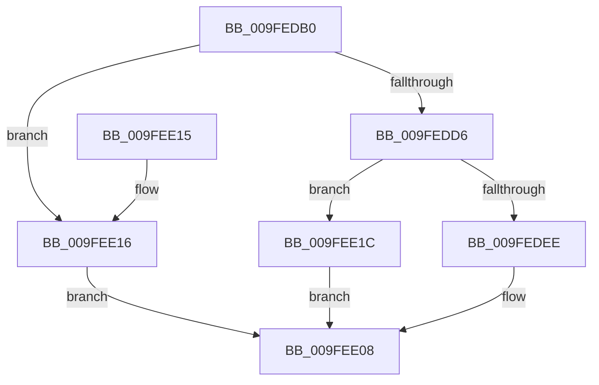

# EtwpQueueReply

- RVA: `0x009FEDB0`–`0x009FEE31` (길이 `129` bytes)
- VA: `0x00000001409FEDB0`
- 실행 섹션: `PAGE`
- PDB 이름 있음: `예`; PDB Function 태그: `아니요`
- unwind 정보 RVA: `0x0007CED0`
- 디코드: `37`개 명령, `129/129` bytes 표시
- 미해석 바이트: `0` (있으면 어셈블리에 `.byte`로 보존)

> 이 문서는 커널 이미지의 기계어와 PDB 기호를 분석해 생성했습니다. 4번과 5번은 함수 원형과 자료형을 바이너리 사용 방식에서 추정한 C 해석이며 원본 소스 복구 결과는 아닙니다.

## 1. Dependencies

- 직접 호출 지점: **4**; 고유 호출 대상: **4**
- 직접 호출자로 확인된 함수: **2**
- RIP 상대 이미지 참조: **0**

### Outgoing calls
- `0x009FEDCB` → [EtwpAllocDataBlock](EtwpAllocDataBlock_function_009FEE38.md) (function, `0x009FEE38`)
- `0x009FEDE4` → [ExAllocatePool2](../../poolcode/B8/ExAllocatePool2_function_00B820F0.md) (function, `0x00B820F0`)
- `0x009FEE03` → [KiInsertQueue](../../text/24/KiInsertQueue_function_0024FE50.md) (function, `0x0024FE50`)
- `0x009FEE2A` → [EtwpUnreferenceDataBlock](../8B/EtwpUnreferenceDataBlock_function_008BFC5C.md) (function, `0x008BFC5C`)

### Direct callers
- [EtwpSendNoReplyReply](../7B/EtwpSendNoReplyReply_function_007B9134.md) at `0x007B917C`
- [EtwpSendReplyDataBlock](EtwpSendReplyDataBlock_function_009FEC64.md) at `0x009FED2F`

### Static image references
- 디코드된 RIP-relative 메모리 참조가 없습니다.

## 2. Other-region calls and transfers

- 다른 실행 섹션으로 향하는 call: **2**
  - `0x009FEDE4` → [ExAllocatePool2](../../poolcode/B8/ExAllocatePool2_function_00B820F0.md) (`PAGE` → `POOLCODE`)
  - `0x009FEE03` → [KiInsertQueue](../../text/24/KiInsertQueue_function_0024FE50.md) (`PAGE` → `.text`)
- 별도 외부 분기/꼬리 이동을 확인하지 못했습니다.

## 3. Assembly (complete function range)

```asm
009FEDB0  48 89 5C 24 08                  mov qword ptr [rsp + 8], rbx
009FEDB5  57                              push rdi
009FEDB6  48 83 EC 20                     sub rsp, 0x20
009FEDBA  48 83 64 24 38 00               and qword ptr [rsp + 0x38], 0
009FEDC0  4C 8D 44 24 38                  lea r8, [rsp + 0x38]
009FEDC5  48 8B D9                        mov rbx, rcx
009FEDC8  8B 4A 04                        mov ecx, dword ptr [rdx + 4]
009FEDCB  E8 68 00 00 00                  call 0x1409fee38
009FEDD0  8B F8                           mov edi, eax
009FEDD2  85 C0                           test eax, eax
009FEDD4  78 40                           js 0x1409fee16
009FEDD6  BA 38 00 00 00                  mov edx, 0x38
009FEDDB  41 B8 45 74 77 72               mov r8d, 0x72777445
009FEDE1  8D 4A 08                        lea ecx, [rdx + 8]
009FEDE4  E8 07 33 18 00                  call 0x140b820f0
009FEDE9  48 85 C0                        test rax, rax
009FEDEC  74 2E                           je 0x1409fee1c
009FEDEE  48 8B 4C 24 38                  mov rcx, qword ptr [rsp + 0x38]
009FEDF3  45 33 C9                        xor r9d, r9d
009FEDF6  48 89 48 10                     mov qword ptr [rax + 0x10], rcx
009FEDFA  45 33 C0                        xor r8d, r8d
009FEDFD  48 8B CB                        mov rcx, rbx
009FEE00  48 8B D0                        mov rdx, rax
009FEE03  E8 48 10 85 FF                  call 0x14024fe50
009FEE08  48 8B 5C 24 30                  mov rbx, qword ptr [rsp + 0x30]
009FEE0D  8B C7                           mov eax, edi
009FEE0F  48 83 C4 20                     add rsp, 0x20
009FEE13  5F                              pop rdi
009FEE14  C3                              ret
009FEE15  CC                              int3
009FEE16  F0 FF 43 40                     lock inc dword ptr [rbx + 0x40]
009FEE1A  EB EC                           jmp 0x1409fee08
009FEE1C  BF 17 00 00 C0                  mov edi, 0xc0000017
009FEE21  F0 FF 43 40                     lock inc dword ptr [rbx + 0x40]
009FEE25  48 8B 4C 24 38                  mov rcx, qword ptr [rsp + 0x38]
009FEE2A  E8 2D 0E EC FF                  call 0x1408bfc5c
009FEE2F  EB D7                           jmp 0x1409fee08
```

## 4. C-style interpretation (structured pseudocode)

```c
__int64 __fastcall EtwpQueueReply(__int64 a1, __int64 a2, __int64 a3, int a4)
{
    __int64 result;
    __int64 v_rsp;
    unsigned __int64 v_stack_p10;
    unsigned __int64 v_stack_p38;
    unsigned __int64 v_stack_p8;

    v_stack_p8 = v_rbx;
    v_rsp = (v_rsp) - (32);
    result = EtwpAllocDataBlock((unsigned int)(*(unsigned int *)(a2 + 4)), a2, v_stack_p10, a4);
    if (sign_flag) goto loc_009FEE16;
    result = ExAllocatePool2(56 + 8, 56, (unsigned int)(0x72777445ULL), a4);
    if (result == 0) goto loc_009FEE1C;
    a4 = 0;
    *(unsigned __int64 *)(result + 16) = v_stack_p10;
    a3 = 0;
    result = KiInsertQueue(a1, result, a3, a4);
loc_009FEE08:
    v_rsp = (v_rsp) + (32);
    return (unsigned int)((unsigned int)((unsigned int)((unsigned int)(result))));
loc_009FEE16:
    goto loc_009FEE08;
loc_009FEE1C:
    result = EtwpUnreferenceDataBlock(v_stack_p38, result, a3, a4);
    goto loc_009FEE08;
}
```

## 5. (Beta) C Style

```c
int64_t EtwpQueueReply(void *Arg1, void *Arg2, int64_t Arg3, int32_t Arg4)
{
    uint8_t *arg1 = (uint8_t *)Arg1;
    uint8_t *arg2 = (uint8_t *)Arg2;

    int64_t result;
    int64_t local_rsp;
    uint64_t v_stack_p10;
    uint64_t v_stack_p38;
    uint64_t v_stack_p8;

    v_stack_p8 = local_rbx;
    local_rsp = (local_rsp) - (32);
    result = EtwpAllocDataBlock((uint32_t)(*(uint32_t *)(arg2 + 0x4)), Arg2, v_stack_p10, Arg4);
    if (sign_flag) goto loc_009FEE16;
    result = ExAllocatePool2(56 + 8, 56, (uint32_t)(0x72777445ULL), Arg4);
    if (result == 0) goto loc_009FEE1C;
    Arg4 = 0;
    *(uint64_t *)(result + 0x10) = v_stack_p10;
    Arg3 = 0;
    result = KiInsertQueue(Arg1, result, Arg3, Arg4);
loc_009FEE08:
    local_rsp = (local_rsp) + (32);
    return (uint32_t)((uint32_t)((uint32_t)((uint32_t)(result))));
loc_009FEE16:
    goto loc_009FEE08;
loc_009FEE1C:
    result = EtwpUnreferenceDataBlock(v_stack_p38, result, Arg3, Arg4);
    goto loc_009FEE08;
}
```

### 관측된 메모리 오프셋

구조체 형식이 확인되지 않은 접근은 인자 기준의 오프셋으로만 기록했습니다.

| 기준 인자 | 오프셋 표현 | 폭 (bit) | 접근 |
|---|---:|---:|---|
| `Arg1` | `+ 0x40` | `32` | `R/W` |
| `Arg2` | `+ 0x4` | `32` | `R` |

## 6. Execution-region graph

[열기: 2D/3D 그래프와 함수 탐색 컨트롤 패널](../../../control-panel.html?section=page&rva=0x009FEDB0&view=graph)

- 2D 그래프는 위에서 아래로 흐르고, 3D 그래프는 빈 공간을 드래그해 회전합니다. Shift+드래그는 이동, 휠은 확대·축소, 함수 노드 선택은 대상 보고서 이동입니다.

### Static fallback


