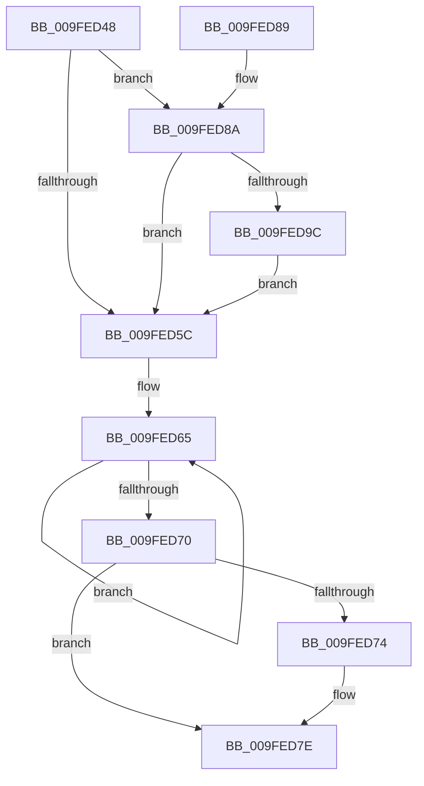

# EtwpReleaseQueueEntry

- RVA: `0x009FED48`–`0x009FEDA7` (길이 `95` bytes)
- VA: `0x00000001409FED48`
- 실행 섹션: `PAGE`
- PDB 이름 있음: `예`; PDB Function 태그: `아니요`
- unwind 정보 RVA: `0x00068A5C`
- 디코드: `32`개 명령, `95/95` bytes 표시
- 미해석 바이트: `0` (있으면 어셈블리에 `.byte`로 보존)

> 이 문서는 커널 이미지의 기계어와 PDB 기호를 분석해 생성했습니다. 4번과 5번은 함수 원형과 자료형을 바이너리 사용 방식에서 추정한 C 해석이며 원본 소스 복구 결과는 아닙니다.

## 1. Dependencies

- 직접 호출 지점: **3**; 고유 호출 대상: **3**
- 직접 호출자로 확인된 함수: **3**
- RIP 상대 이미지 참조: **0**

### Outgoing calls
- `0x009FED79` → [ExFreePoolWithTag](../../poolcode/B8/ExFreePoolWithTag_function_00B82870.md) (function, `0x00B82870`)
- `0x009FED8E` → [ObfDereferenceObject](../../text/2F/ObfDereferenceObject_function_002F9350.md) (function, `0x002F9350`)
- `0x009FEDA0` → [PsReleaseProcessWakeCounter](../88/PsReleaseProcessWakeCounter_function_0088B940.md) (function, `0x0088B940`)

### Direct callers
- [EtwpDeleteRegistrationObject](../8C/EtwpDeleteRegistrationObject_function_008C1F30.md) at `0x008C227F`
- [EtwpQueueNotification](../8C/EtwpQueueNotification_function_008C870C.md) at `0x008C890E`
- [EtwpSendReplyDataBlock](EtwpSendReplyDataBlock_function_009FEC64.md) at `0x009FED09`

### Static image references
- 디코드된 RIP-relative 메모리 참조가 없습니다.

## 2. Other-region calls and transfers

- 다른 실행 섹션으로 향하는 call: **2**
  - `0x009FED79` → [ExFreePoolWithTag](../../poolcode/B8/ExFreePoolWithTag_function_00B82870.md) (`PAGE` → `POOLCODE`)
  - `0x009FED8E` → [ObfDereferenceObject](../../text/2F/ObfDereferenceObject_function_002F9350.md) (`PAGE` → `.text`)
- 별도 외부 분기/꼬리 이동을 확인하지 못했습니다.

## 3. Assembly (complete function range)

```asm
009FED48  48 89 5C 24 08                  mov qword ptr [rsp + 8], rbx
009FED4D  57                              push rdi
009FED4E  48 83 EC 20                     sub rsp, 0x20
009FED52  8B FA                           mov edi, edx
009FED54  48 8B D9                        mov rbx, rcx
009FED57  F6 C2 02                        test dl, 2
009FED5A  75 2E                           jne 0x1409fed8a
009FED5C  F7 D7                           not edi
009FED5E  0F 0D 4B 34                     prefetchw byte ptr [rbx + 0x34]
009FED62  8B 43 34                        mov eax, dword ptr [rbx + 0x34]
009FED65  8B C8                           mov ecx, eax
009FED67  23 CF                           and ecx, edi
009FED69  F0 0F B1 4B 34                  lock cmpxchg dword ptr [rbx + 0x34], ecx
009FED6E  75 F5                           jne 0x1409fed65
009FED70  85 F8                           test eax, edi
009FED72  75 0A                           jne 0x1409fed7e
009FED74  33 D2                           xor edx, edx
009FED76  48 8B CB                        mov rcx, rbx
009FED79  E8 F2 3A 18 00                  call 0x140b82870
009FED7E  48 8B 5C 24 30                  mov rbx, qword ptr [rsp + 0x30]
009FED83  48 83 C4 20                     add rsp, 0x20
009FED87  5F                              pop rdi
009FED88  C3                              ret
009FED89  CC                              int3
009FED8A  48 8B 49 20                     mov rcx, qword ptr [rcx + 0x20]
009FED8E  E8 BD A5 8F FF                  call 0x1402f9350
009FED93  48 8B 4B 28                     mov rcx, qword ptr [rbx + 0x28]
009FED97  48 85 C9                        test rcx, rcx
009FED9A  74 C0                           je 0x1409fed5c
009FED9C  48 8B 53 18                     mov rdx, qword ptr [rbx + 0x18]
009FEDA0  E8 9B CB E8 FF                  call 0x14088b940
009FEDA5  EB B5                           jmp 0x1409fed5c
```

## 4. C-style interpretation (structured pseudocode)

```c
__int64 __fastcall EtwpReleaseQueueEntry(__int64 a1, int a2)
{
    __int64 result;
    __int64 v_rdi;
    __int64 v_rsp;
    unsigned __int64 v_stack_p8;

    v_stack_p8 = v_rbx;
    v_rsp = (v_rsp) - (32);
    if ((((unsigned __int8)(a2)) & (2)) != 0) goto loc_009FED8A;
loc_009FED5C:
    v_rdi = (unsigned int)(~((unsigned int)(a2)));
loc_009FED65:
    a1 = (unsigned int)(((unsigned int)((unsigned int)((unsigned int)(*(unsigned int *)(a1 + 52))))) & ((unsigned int)(v_rdi)));
    if (condition_is_not_equal) goto loc_009FED65;
    result = (unsigned int)(*(unsigned int *)(a1 + 52));
    if ((((unsigned int)((unsigned int)(*(unsigned int *)(a1 + 52)))) & ((unsigned int)(v_rdi))) == 0) {
        a2 = 0;
        a1 = a1;
        result = ExFreePoolWithTag(a1, a2, a3, a4);
    }
    v_rsp = (v_rsp) + (32);
    return result;
loc_009FED8A:
    result = ObfDereferenceObject(*(unsigned __int64 *)(a1 + 32), a2, a3, a4);
    if (*(unsigned __int64 *)(v_stack_p8 + 40) == 0) goto loc_009FED5C;
    result = PsReleaseProcessWakeCounter(*(unsigned __int64 *)(v_stack_p8 + 40), *(unsigned __int64 *)(v_stack_p8 + 24), a3, a4);
    goto loc_009FED5C;
}
```

## 5. (Beta) C Style

```c
int64_t EtwpReleaseQueueEntry(void *Arg1, int32_t Arg2)
{
    uint8_t *arg1 = (uint8_t *)Arg1;

    int64_t result;
    int64_t local_rdi;
    int64_t local_rsp;
    uint64_t v_stack_p8;

    v_stack_p8 = local_rbx;
    local_rsp = (local_rsp) - (32);
    if ((((uint8_t)(Arg2)) & (2)) != 0) goto loc_009FED8A;
loc_009FED5C:
    local_rdi = (uint32_t)(~((uint32_t)(Arg2)));
loc_009FED65:
    Arg1 = (uint32_t)(((uint32_t)((uint32_t)((uint32_t)(*(uint32_t *)(arg1 + 0x34))))) & ((uint32_t)(local_rdi)));
    if (condition_is_not_equal) goto loc_009FED65;
    result = (uint32_t)(*(uint32_t *)(arg1 + 0x34));
    if ((((uint32_t)((uint32_t)(*(uint32_t *)(arg1 + 0x34)))) & ((uint32_t)(local_rdi))) == 0) {
        Arg2 = 0;
        Arg1 = Arg1;
        result = ExFreePoolWithTag(Arg1, Arg2, a3, a4);
    }
    local_rsp = (local_rsp) + (32);
    return result;
loc_009FED8A:
    result = ObfDereferenceObject(*(uint64_t *)(arg1 + 0x20), Arg2, a3, a4);
    if (*(uint64_t *)(v_stack_p8 + 0x28) == 0) goto loc_009FED5C;
    result = PsReleaseProcessWakeCounter(*(uint64_t *)(v_stack_p8 + 0x28), *(uint64_t *)(v_stack_p8 + 0x18), a3, a4);
    goto loc_009FED5C;
}
```

### 관측된 메모리 오프셋

구조체 형식이 확인되지 않은 접근은 인자 기준의 오프셋으로만 기록했습니다.

| 기준 인자 | 오프셋 표현 | 폭 (bit) | 접근 |
|---|---:|---:|---|
| `Arg1` | `+ 0x18` | `64` | `R` |
| `Arg1` | `+ 0x20` | `64` | `R` |
| `Arg1` | `+ 0x28` | `64` | `R` |
| `Arg1` | `+ 0x34` | `8` | `R` |
| `Arg1` | `+ 0x34` | `32` | `R` |

## 6. Execution-region graph

[열기: 2D/3D 그래프와 함수 탐색 컨트롤 패널](../../../control-panel.html?section=page&rva=0x009FED48&view=graph)

- 2D 그래프는 위에서 아래로 흐르고, 3D 그래프는 빈 공간을 드래그해 회전합니다. Shift+드래그는 이동, 휠은 확대·축소, 함수 노드 선택은 대상 보고서 이동입니다.

### Static fallback


