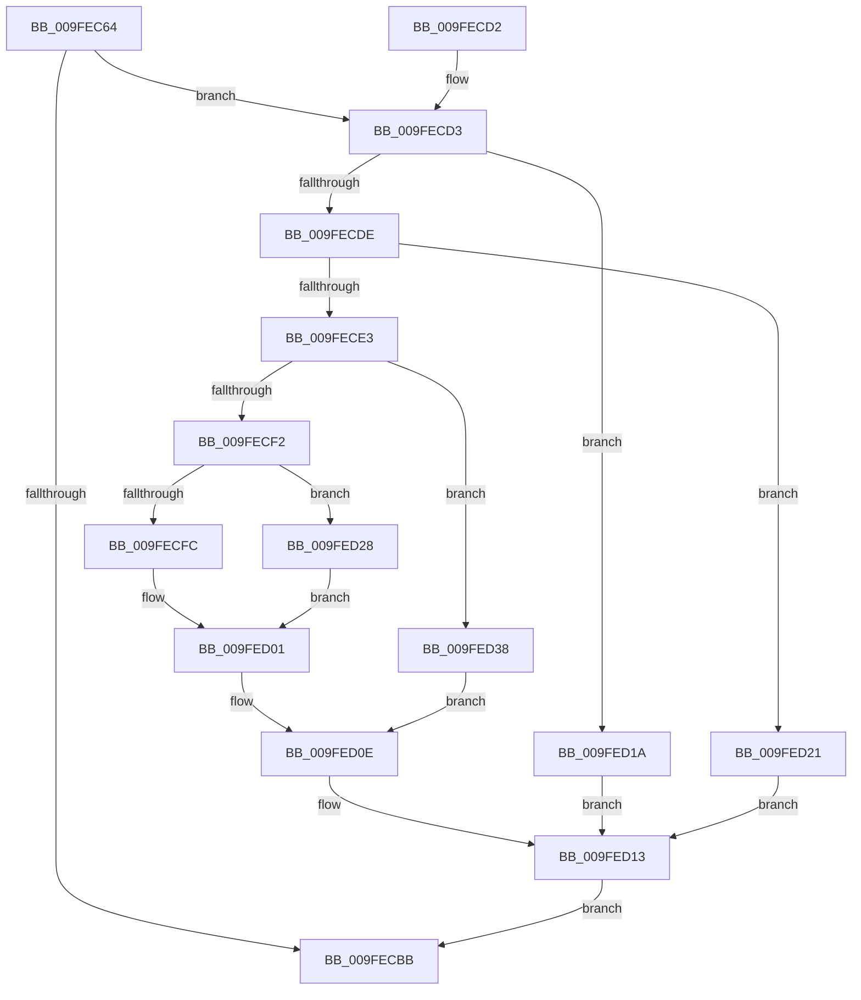

# EtwpSendReplyDataBlock

- RVA: `0x009FEC64`–`0x009FED3F` (길이 `219` bytes)
- VA: `0x00000001409FEC64`
- 실행 섹션: `PAGE`
- PDB 이름 있음: `예`; PDB Function 태그: `아니요`
- unwind 정보 RVA: `0x000A769C`
- 디코드: `61`개 명령, `219/219` bytes 표시
- 미해석 바이트: `0` (있으면 어셈블리에 `.byte`로 보존)

> 이 문서는 커널 이미지의 기계어와 PDB 기호를 분석해 생성했습니다. 4번과 5번은 함수 원형과 자료형을 바이너리 사용 방식에서 추정한 C 해석이며 원본 소스 복구 결과는 아닙니다.

## 1. Dependencies

- 직접 호출 지점: **5**; 고유 호출 대상: **5**
- 직접 호출자로 확인된 함수: **1**
- RIP 상대 이미지 참조: **1**

### Outgoing calls
- `0x009FECB0` → [ObReferenceObjectByHandle](../86/ObReferenceObjectByHandle_function_00868DB0.md) (function, `0x00868DB0`)
- `0x009FECBB` → [KeLeaveCriticalRegion](../../text/25/KeLeaveCriticalRegion_function_0025D8B0.md) (function, `0x0025D8B0`)
- `0x009FED09` → [EtwpReleaseQueueEntry](EtwpReleaseQueueEntry_function_009FED48.md) (function, `0x009FED48`)
- `0x009FED13` → [ObfDereferenceObject](../../text/2F/ObfDereferenceObject_function_002F9350.md) (function, `0x002F9350`)
- `0x009FED2F` → [EtwpQueueReply](EtwpQueueReply_function_009FEDB0.md) (function, `0x009FEDB0`)

### Direct callers
- [NtTraceControl](../A9/NtTraceControl_function_00A9ED40.md) at `0x00A9F1B7`

### Static image references
- `0x009FECA1` → RVA `0x00FC6D30` (`ALMOSTRO`; read)

## 2. Other-region calls and transfers

- 다른 실행 섹션으로 향하는 call: **2**
  - `0x009FECBB` → [KeLeaveCriticalRegion](../../text/25/KeLeaveCriticalRegion_function_0025D8B0.md) (`PAGE` → `.text`)
  - `0x009FED13` → [ObfDereferenceObject](../../text/2F/ObfDereferenceObject_function_002F9350.md) (`PAGE` → `.text`)
- 별도 외부 분기/꼬리 이동을 확인하지 못했습니다.

## 3. Assembly (complete function range)

```asm
009FEC64  4C 8B DC                        mov r11, rsp
009FEC67  49 89 5B 10                     mov qword ptr [r11 + 0x10], rbx
009FEC6B  49 89 73 18                     mov qword ptr [r11 + 0x18], rsi
009FEC6F  57                              push rdi
009FEC70  48 83 EC 30                     sub rsp, 0x30
009FEC74  65 48 8B 04 25 88 01 00 00      mov rax, qword ptr gs:[0x188]
009FEC7D  48 8B F1                        mov rsi, rcx
009FEC80  48 8B 49 18                     mov rcx, qword ptr [rcx + 0x18]
009FEC84  41 B1 01                        mov r9b, 1
009FEC87  49 83 63 F0 00                  and qword ptr [r11 - 0x10], 0
009FEC8C  BA 04 00 00 00                  mov edx, 4
009FEC91  49 83 63 08 00                  and qword ptr [r11 + 8], 0
009FEC96  8B 7E 10                        mov edi, dword ptr [rsi + 0x10]
009FEC99  66 FF 88 E4 01 00 00            dec word ptr [rax + 0x1e4]
009FECA0  90                              nop
009FECA1  4C 8B 05 88 80 5C 00            mov r8, qword ptr [rip + 0x5c8088]
009FECA8  49 8D 43 08                     lea rax, [r11 + 8]
009FECAC  49 89 43 E8                     mov qword ptr [r11 - 0x18], rax
009FECB0  E8 FB A0 E6 FF                  call 0x140868db0
009FECB5  8B D8                           mov ebx, eax
009FECB7  85 C0                           test eax, eax
009FECB9  79 18                           jns 0x1409fecd3
009FECBB  E8 F0 EB 85 FF                  call 0x14025d8b0
009FECC0  48 8B 74 24 50                  mov rsi, qword ptr [rsp + 0x50]
009FECC5  8B C3                           mov eax, ebx
009FECC7  48 8B 5C 24 48                  mov rbx, qword ptr [rsp + 0x48]
009FECCC  48 83 C4 30                     add rsp, 0x30
009FECD0  5F                              pop rdi
009FECD1  C3                              ret
009FECD2  CC                              int3
009FECD3  48 8B 4C 24 40                  mov rcx, qword ptr [rsp + 0x40]
009FECD8  F6 41 62 02                     test byte ptr [rcx + 0x62], 2
009FECDC  74 3C                           je 0x1409fed1a
009FECDE  83 FF 04                        cmp edi, 4
009FECE1  73 3E                           jae 0x1409fed21
009FECE3  48 8B C7                        mov rax, rdi
009FECE6  33 FF                           xor edi, edi
009FECE8  48 87 7C C1 30                  xchg qword ptr [rcx + rax*8 + 0x30], rdi
009FECED  48 85 FF                        test rdi, rdi
009FECF0  74 46                           je 0x1409fed38
009FECF2  48 8B 4F 20                     mov rcx, qword ptr [rdi + 0x20]
009FECF6  F6 41 62 20                     test byte ptr [rcx + 0x62], 0x20
009FECFA  74 2C                           je 0x1409fed28
009FECFC  BB 01 03 00 C0                  mov ebx, 0xc0000301
009FED01  BA 02 00 00 00                  mov edx, 2
009FED06  48 8B CF                        mov rcx, rdi
009FED09  E8 3A 00 00 00                  call 0x1409fed48
009FED0E  48 8B 4C 24 40                  mov rcx, qword ptr [rsp + 0x40]
009FED13  E8 38 A6 8F FF                  call 0x1402f9350
009FED18  EB A1                           jmp 0x1409fecbb
009FED1A  BB 08 00 00 C0                  mov ebx, 0xc0000008
009FED1F  EB F2                           jmp 0x1409fed13
009FED21  BB 0D 00 00 C0                  mov ebx, 0xc000000d
009FED26  EB EB                           jmp 0x1409fed13
009FED28  48 8B 49 30                     mov rcx, qword ptr [rcx + 0x30]
009FED2C  48 8B D6                        mov rdx, rsi
009FED2F  E8 7C 00 00 00                  call 0x1409fedb0
009FED34  8B D8                           mov ebx, eax
009FED36  EB C9                           jmp 0x1409fed01
009FED38  BB 0D 00 00 C0                  mov ebx, 0xc000000d
009FED3D  EB CF                           jmp 0x1409fed0e
```

## 4. C-style interpretation (structured pseudocode)

```c
__int64 __fastcall EtwpSendReplyDataBlock(__int64 a1)
{
    __int64 result;
    __int64 v_rdi;
    __int64 v_rsp;
    unsigned __int64 v_stack_p10;
    unsigned __int64 v_stack_p18;
    unsigned __int64 v_stack_p40;

    *(unsigned __int64 *)(v_rsp + 16) = v_rbx;
    *(unsigned __int64 *)(v_rsp + 24) = v_rsi;
    v_rsp = (v_rsp) - (48);
    *(unsigned __int64 *)(v_rsp - 24) = v_rsp + 8;
    result = ObReferenceObjectByHandle(*(unsigned __int64 *)(a1 + 24), 4, *(unsigned __int64 *)(v_rip + 6062216), 1);
    if (!sign_flag) goto loc_009FECD3;
loc_009FECBB:
    result = KeLeaveCriticalRegion(*(unsigned __int64 *)(a1 + 24), 4, *(unsigned __int64 *)(v_rip + 6062216), 1);
    v_rsp = (v_rsp) + (48);
    return (unsigned int)((unsigned int)((unsigned int)((unsigned int)(result))));
loc_009FECD3:
    if (((*(unsigned __int8 *)(v_stack_p40 + 98)) & (2)) == 0) goto loc_009FED1A;
    if (((unsigned int)((unsigned int)(*(unsigned int *)(a1 + 16)))) >= 4) goto loc_009FED21;
    v_rdi = 0;
    if (0 == 0) goto loc_009FED38;
    if (((*(unsigned __int8 *)(*(unsigned __int64 *)(v_rdi + 32) + 98)) & (32)) == 0) goto loc_009FED28;
loc_009FED01:
    result = EtwpReleaseQueueEntry(0, 2, *(unsigned __int64 *)(v_rip + 6062216), 1);
loc_009FED0E:
loc_009FED13:
    result = ObfDereferenceObject(v_stack_p40, 2, *(unsigned __int64 *)(v_rip + 6062216), 1);
    goto loc_009FECBB;
loc_009FED1A:
    goto loc_009FED13;
loc_009FED21:
    goto loc_009FED13;
loc_009FED28:
    result = EtwpQueueReply(*(unsigned __int64 *)(v_stack_p40 + 48), v_stack_p18, *(unsigned __int64 *)(v_rip + 6062216), 1);
    goto loc_009FED01;
loc_009FED38:
    goto loc_009FED0E;
}
```

## 5. (Beta) C Style

```c
int64_t EtwpSendReplyDataBlock(void *Arg1)
{
    uint8_t *arg1 = (uint8_t *)Arg1;

    int64_t result;
    int64_t local_rdi;
    int64_t local_rsp;
    uint64_t v_stack_p10;
    uint64_t v_stack_p18;
    uint64_t v_stack_p40;

    *(uint64_t *)(local_rsp + 0x10) = local_rbx;
    *(uint64_t *)(local_rsp + 0x18) = local_rsi;
    local_rsp = (local_rsp) - (48);
    *(uint64_t *)(local_rsp - 0x18) = local_rsp + 8;
    result = ObReferenceObjectByHandle(*(uint64_t *)(arg1 + 0x18), 4, *(uint64_t *)(v_rip + 0x5C8088), 1);
    if (!sign_flag) goto loc_009FECD3;
loc_009FECBB:
    result = KeLeaveCriticalRegion(*(uint64_t *)(arg1 + 0x18), 4, *(uint64_t *)(v_rip + 0x5C8088), 1);
    local_rsp = (local_rsp) + (48);
    return (uint32_t)((uint32_t)((uint32_t)((uint32_t)(result))));
loc_009FECD3:
    if (((*(uint8_t *)(v_stack_p40 + 0x62)) & (2)) == 0) goto loc_009FED1A;
    if (((uint32_t)((uint32_t)(*(uint32_t *)(arg1 + 0x10)))) >= 4) goto loc_009FED21;
    local_rdi = 0;
    if (0 == 0) goto loc_009FED38;
    if (((*(uint8_t *)(*(uint64_t *)(local_rdi + 0x20) + 0x62)) & (32)) == 0) goto loc_009FED28;
loc_009FED01:
    result = EtwpReleaseQueueEntry(0, 2, *(uint64_t *)(v_rip + 0x5C8088), 1);
loc_009FED0E:
loc_009FED13:
    result = ObfDereferenceObject(v_stack_p40, 2, *(uint64_t *)(v_rip + 0x5C8088), 1);
    goto loc_009FECBB;
loc_009FED1A:
    goto loc_009FED13;
loc_009FED21:
    goto loc_009FED13;
loc_009FED28:
    result = EtwpQueueReply(*(uint64_t *)(v_stack_p40 + 0x30), v_stack_p18, *(uint64_t *)(v_rip + 0x5C8088), 1);
    goto loc_009FED01;
loc_009FED38:
    goto loc_009FED0E;
}
```

### 관측된 메모리 오프셋

구조체 형식이 확인되지 않은 접근은 인자 기준의 오프셋으로만 기록했습니다.

| 기준 인자 | 오프셋 표현 | 폭 (bit) | 접근 |
|---|---:|---:|---|
| `Arg1` | `+ 0x10` | `32` | `R` |
| `Arg1` | `+ 0x18` | `64` | `R` |

## 6. Execution-region graph

[열기: 2D/3D 그래프와 함수 탐색 컨트롤 패널](../../../control-panel.html?section=page&rva=0x009FEC64&view=graph)

- 2D 그래프는 위에서 아래로 흐르고, 3D 그래프는 빈 공간을 드래그해 회전합니다. Shift+드래그는 이동, 휠은 확대·축소, 함수 노드 선택은 대상 보고서 이동입니다.

### Static fallback


