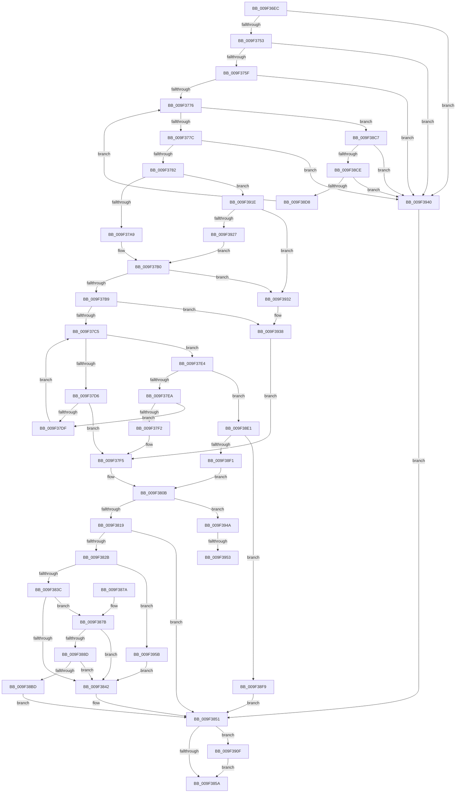

# EtwpSetProviderTraitsCommon

- RVA: `0x009F36EC`–`0x009F3974` (길이 `648` bytes)
- VA: `0x00000001409F36EC`
- 실행 섹션: `PAGE`
- PDB 이름 있음: `예`; PDB Function 태그: `예`
- unwind 정보 RVA: `0x000A6278`
- 디코드: `181`개 명령, `648/648` bytes 표시
- 미해석 바이트: `0` (있으면 어셈블리에 `.byte`로 보존)

> 이 문서는 커널 이미지의 기계어와 PDB 기호를 분석해 생성했습니다. 4번과 5번은 함수 원형과 자료형을 바이너리 사용 방식에서 추정한 C 해석이며 원본 소스 복구 결과는 아닙니다.

## 1. Dependencies

- 직접 호출 지점: **13**; 고유 호출 대상: **12**
- 직접 호출자로 확인된 함수: **2**
- RIP 상대 이미지 참조: **1**

### Outgoing calls
- `0x009F3766` → [strnlen](../../text/50/strnlen_function_00501590.md) (function, `0x00501590`)
- `0x009F3797` → [ExAcquireFastMutex](../../text/20/ExAcquireFastMutex_function_0020E5A0.md) (function, `0x0020E5A0`)
- `0x009F37CB` → [TraitsCompare](TraitsCompare_function_009F397C.md) (function, `0x009F397C`)
- `0x009F3801` → [RtlRbInsertNodeEx](../../text/2E/RtlRbInsertNodeEx_function_002E4570.md) (function, `0x002E4570`)
- `0x009F3820` → [ExReleaseFastMutex](../../text/25/ExReleaseFastMutex_function_002519C0.md) (function, `0x002519C0`)
- `0x009F382F` → [EtwpTraitsAreMinimalDecodeGuid](EtwpTraitsAreMinimalDecodeGuid_function_009F39B4.md) (function, `0x009F39B4`)
- `0x009F3864` → [_security_check_cookie](../../text/6A/_security_check_cookie_function_006AC640.md) (function, `0x006AC640`)
- `0x009F3883` → [EtwpGetProviderGroupFromTraits](EtwpGetProviderGroupFromTraits_function_009F42AC.md) (function, `0x009F42AC`)
- `0x009F38B2` → [EtwpAddRegEntryToGroup](EtwpAddRegEntryToGroup_function_009F39D4.md) (function, `0x009F39D4`)
- `0x009F38C0` → [EtwpReleaseProviderTraitsReference](../8C/EtwpReleaseProviderTraitsReference_function_008C11EC.md) (function, `0x008C11EC`)
- `0x009F3903` → [ExReleaseFastMutex](../../text/25/ExReleaseFastMutex_function_002519C0.md) (function, `0x002519C0`)
- `0x009F3914` → [ExFreePoolWithTag](../../poolcode/B8/ExFreePoolWithTag_function_00B82870.md) (function, `0x00B82870`)
- `0x009F395E` → [AddDecodeGuidToSessions](../A7/AddDecodeGuidToSessions_function_00A79A7C.md) (function, `0x00A79A7C`)

### Direct callers
- [EtwpSetProviderTraitsKm](EtwpSetProviderTraitsKm_function_009F3424.md) at `0x009F34B3`
- [EtwpSetProviderTraitsUm](EtwpSetProviderTraitsUm_function_009F3514.md) at `0x009F367E`

### Static image references
- `0x009F36FD` → RVA `0x00E0A740` (`.data`; read)

## 2. Other-region calls and transfers

- 다른 실행 섹션으로 향하는 call: **7**
  - `0x009F3766` → [strnlen](../../text/50/strnlen_function_00501590.md) (`PAGE` → `.text`)
  - `0x009F3797` → [ExAcquireFastMutex](../../text/20/ExAcquireFastMutex_function_0020E5A0.md) (`PAGE` → `.text`)
  - `0x009F3801` → [RtlRbInsertNodeEx](../../text/2E/RtlRbInsertNodeEx_function_002E4570.md) (`PAGE` → `.text`)
  - `0x009F3820` → [ExReleaseFastMutex](../../text/25/ExReleaseFastMutex_function_002519C0.md) (`PAGE` → `.text`)
  - `0x009F3864` → [_security_check_cookie](../../text/6A/_security_check_cookie_function_006AC640.md) (`PAGE` → `.text`)
  - `0x009F3903` → [ExReleaseFastMutex](../../text/25/ExReleaseFastMutex_function_002519C0.md) (`PAGE` → `.text`)
  - `0x009F3914` → [ExFreePoolWithTag](../../poolcode/B8/ExFreePoolWithTag_function_00B82870.md) (`PAGE` → `POOLCODE`)
- call이 아닌 외부 분기/꼬리 이동: **2**
  - `0x009F394D` → [sub_00B312F2](../B3/Unknown_function_00B312F2.md) (`tail-transfer`)
  - `0x009F3956` → [sub_00B312F2 + 0xE](../B3/Unknown_function_00B312F2.md) (`tail-transfer`)

## 3. Assembly (complete function range)

```asm
009F36EC  40 53                           push rbx
009F36EE  55                              push rbp
009F36EF  56                              push rsi
009F36F0  57                              push rdi
009F36F1  41 54                           push r12
009F36F3  41 55                           push r13
009F36F5  41 56                           push r14
009F36F7  41 57                           push r15
009F36F9  48 83 EC 68                     sub rsp, 0x68
009F36FD  48 8B 05 3C 70 41 00            mov rax, qword ptr [rip + 0x41703c]
009F3704  48 33 C4                        xor rax, rsp
009F3707  48 89 44 24 58                  mov qword ptr [rsp + 0x58], rax
009F370C  48 8B BC 24 D0 00 00 00         mov rdi, qword ptr [rsp + 0xd0]
009F3714  33 ED                           xor ebp, ebp
009F3716  4C 8B BC 24 E0 00 00 00         mov r15, qword ptr [rsp + 0xe0]
009F371E  49 8B F1                        mov rsi, r9
009F3721  8B 9C 24 D8 00 00 00            mov ebx, dword ptr [rsp + 0xd8]
009F3728  4C 8B EF                        mov r13, rdi
009F372B  4C 8B A4 24 E8 00 00 00         mov r12, qword ptr [rsp + 0xe8]
009F3733  44 0F B7 F5                     movzx r14d, bp
009F3737  4C 89 44 24 38                  mov qword ptr [rsp + 0x38], r8
009F373C  89 54 24 30                     mov dword ptr [rsp + 0x30], edx
009F3740  48 89 4C 24 40                  mov qword ptr [rsp + 0x40], rcx
009F3745  4C 89 7C 24 48                  mov qword ptr [rsp + 0x48], r15
009F374A  83 FB 03                        cmp ebx, 3
009F374D  0F 82 ED 01 00 00               jb 0x1409f3940
009F3753  0F B7 47 1C                     movzx eax, word ptr [rdi + 0x1c]
009F3757  3B C3                           cmp eax, ebx
009F3759  0F 85 E1 01 00 00               jne 0x1409f3940
009F375F  8D 53 FE                        lea edx, [rbx - 2]
009F3762  48 8D 4F 1E                     lea rcx, [rdi + 0x1e]
009F3766  E8 25 DE B0 FF                  call 0x140501590
009F376B  8D 48 03                        lea ecx, [rax + 3]
009F376E  3B CB                           cmp ecx, ebx
009F3770  0F 87 CA 01 00 00               ja 0x1409f3940
009F3776  0F 82 4B 01 00 00               jb 0x1409f38c7
009F377C  0F 85 BE 01 00 00               jne 0x1409f3940
009F3782  33 C0                           xor eax, eax
009F3784  0F 57 C0                        xorps xmm0, xmm0
009F3787  0F 11 07                        movups xmmword ptr [rdi], xmm0
009F378A  48 89 47 10                     mov qword ptr [rdi + 0x10], rax
009F378E  49 8B CF                        mov rcx, r15
009F3791  8D 68 01                        lea ebp, [rax + 1]
009F3794  89 6F 18                        mov dword ptr [rdi + 0x18], ebp
009F3797  E8 04 AE 81 FF                  call 0x14020e5a0
009F379C  33 C9                           xor ecx, ecx
009F379E  41 84 6C 24 08                  test byte ptr [r12 + 8], bpl
009F37A3  0F 85 75 01 00 00               jne 0x1409f391e
009F37A9  49 8B 04 24                     mov rax, qword ptr [r12]
009F37AD  48 8B D8                        mov rbx, rax
009F37B0  48 85 C0                        test rax, rax
009F37B3  0F 84 79 01 00 00               je 0x1409f3932
009F37B9  44 8A F9                        mov r15b, cl
009F37BC  48 85 DB                        test rbx, rbx
009F37BF  0F 84 73 01 00 00               je 0x1409f3938
009F37C5  48 8B D3                        mov rdx, rbx
009F37C8  48 8B CF                        mov rcx, rdi
009F37CB  E8 AC 01 00 00                  call 0x1409f397c
009F37D0  33 D2                           xor edx, edx
009F37D2  85 C0                           test eax, eax
009F37D4  7E 0E                           jle 0x1409f37e4
009F37D6  48 8B 43 08                     mov rax, qword ptr [rbx + 8]
009F37DA  48 85 C0                        test rax, rax
009F37DD  74 16                           je 0x1409f37f5
009F37DF  48 8B D8                        mov rbx, rax
009F37E2  EB E1                           jmp 0x1409f37c5
009F37E4  0F 89 F7 00 00 00               jns 0x1409f38e1
009F37EA  48 8B 03                        mov rax, qword ptr [rbx]
009F37ED  48 85 C0                        test rax, rax
009F37F0  75 ED                           jne 0x1409f37df
009F37F2  40 8A EA                        mov bpl, dl
009F37F5  4C 8B CF                        mov r9, rdi
009F37F8  44 8A C5                        mov r8b, bpl
009F37FB  48 8B D3                        mov rdx, rbx
009F37FE  49 8B CC                        mov rcx, r12
009F3801  E8 6A 0D 8F FF                  call 0x1402e4570
009F3806  33 D2                           xor edx, edx
009F3808  44 8B EA                        mov r13d, edx
009F380B  33 C0                           xor eax, eax
009F380D  F0 48 0F B1 7E 70               lock cmpxchg qword ptr [rsi + 0x70], rdi
009F3813  0F 85 31 01 00 00               jne 0x1409f394a
009F3819  8B DA                           mov ebx, edx
009F381B  48 8B 4C 24 48                  mov rcx, qword ptr [rsp + 0x48]
009F3820  E8 9B E1 85 FF                  call 0x1402519c0
009F3825  33 ED                           xor ebp, ebp
009F3827  85 DB                           test ebx, ebx
009F3829  75 26                           jne 0x1409f3851
009F382B  48 8D 4F 1C                     lea rcx, [rdi + 0x1c]
009F382F  E8 80 01 00 00                  call 0x1409f39b4
009F3834  84 C0                           test al, al
009F3836  0F 85 1F 01 00 00               jne 0x1409f395b
009F383C  48 39 6E 28                     cmp qword ptr [rsi + 0x28], rbp
009F3840  74 39                           je 0x1409f387b
009F3842  B8 00 01 00 00                  mov eax, 0x100
009F3847  66 44 0B F0                     or r14w, ax
009F384B  66 F0 44 09 76 62               lock or word ptr [rsi + 0x62], r14w
009F3851  4D 85 ED                        test r13, r13
009F3854  0F 85 B5 00 00 00               jne 0x1409f390f
009F385A  8B C3                           mov eax, ebx
009F385C  48 8B 4C 24 58                  mov rcx, qword ptr [rsp + 0x58]
009F3861  48 33 CC                        xor rcx, rsp
009F3864  E8 D7 8D CB FF                  call 0x1406ac640
009F3869  48 83 C4 68                     add rsp, 0x68
009F386D  41 5F                           pop r15
009F386F  41 5E                           pop r14
009F3871  41 5D                           pop r13
009F3873  41 5C                           pop r12
009F3875  5F                              pop rdi
009F3876  5E                              pop rsi
009F3877  5D                              pop rbp
009F3878  5B                              pop rbx
009F3879  C3                              ret
009F387A  CC                              int3
009F387B  0F 57 C0                        xorps xmm0, xmm0
009F387E  0F 11 44 24 48                  movups xmmword ptr [rsp + 0x48], xmm0
009F3883  E8 24 0A 00 00                  call 0x1409f42ac
009F3888  48 85 C0                        test rax, rax
009F388B  74 B5                           je 0x1409f3842
009F388D  0F 10 00                        movups xmm0, xmmword ptr [rax]
009F3890  48 8B 44 24 38                  mov rax, qword ptr [rsp + 0x38]
009F3895  48 8D 54 24 48                  lea rdx, [rsp + 0x48]
009F389A  44 8B 4C 24 30                  mov r9d, dword ptr [rsp + 0x30]
009F389F  48 8B CE                        mov rcx, rsi
009F38A2  4C 8B 44 24 40                  mov r8, qword ptr [rsp + 0x40]
009F38A7  F3 0F 7F 44 24 48               movdqu xmmword ptr [rsp + 0x48], xmm0
009F38AD  48 89 44 24 20                  mov qword ptr [rsp + 0x20], rax
009F38B2  E8 1D 01 00 00                  call 0x1409f39d4
009F38B7  8B D8                           mov ebx, eax
009F38B9  85 C0                           test eax, eax
009F38BB  74 85                           je 0x1409f3842
009F38BD  48 8B CE                        mov rcx, rsi
009F38C0  E8 27 D9 EC FF                  call 0x1408c11ec
009F38C5  EB 8A                           jmp 0x1409f3851
009F38C7  8D 41 02                        lea eax, [rcx + 2]
009F38CA  3B C3                           cmp eax, ebx
009F38CC  77 72                           ja 0x1409f3940
009F38CE  0F B7 54 39 1C                  movzx edx, word ptr [rcx + rdi + 0x1c]
009F38D3  83 FA 03                        cmp edx, 3
009F38D6  72 68                           jb 0x1409f3940
009F38D8  03 CA                           add ecx, edx
009F38DA  3B CB                           cmp ecx, ebx
009F38DC  E9 95 FE FF FF                  jmp 0x1409f3776
009F38E1  8B 43 18                        mov eax, dword ptr [rbx + 0x18]
009F38E4  44 8A FD                        mov r15b, bpl
009F38E7  48 8B FB                        mov rdi, rbx
009F38EA  8D 48 01                        lea ecx, [rax + 1]
009F38ED  3B C8                           cmp ecx, eax
009F38EF  72 08                           jb 0x1409f38f9
009F38F1  89 4B 18                        mov dword ptr [rbx + 0x18], ecx
009F38F4  E9 12 FF FF FF                  jmp 0x1409f380b
009F38F9  48 8B 4C 24 48                  mov rcx, qword ptr [rsp + 0x48]
009F38FE  BB 95 00 00 C0                  mov ebx, 0xc0000095
009F3903  E8 B8 E0 85 FF                  call 0x1402519c0
009F3908  33 ED                           xor ebp, ebp
009F390A  E9 42 FF FF FF                  jmp 0x1409f3851
009F390F  33 D2                           xor edx, edx
009F3911  49 8B CD                        mov rcx, r13
009F3914  E8 57 EF 18 00                  call 0x140b82870
009F3919  E9 3C FF FF FF                  jmp 0x1409f385a
009F391E  49 8B 1C 24                     mov rbx, qword ptr [r12]
009F3922  48 85 DB                        test rbx, rbx
009F3925  74 0B                           je 0x1409f3932
009F3927  48 8B C3                        mov rax, rbx
009F392A  49 33 C4                        xor rax, r12
009F392D  E9 7E FE FF FF                  jmp 0x1409f37b0
009F3932  48 8B D9                        mov rbx, rcx
009F3935  44 8A F9                        mov r15b, cl
009F3938  40 8A E9                        mov bpl, cl
009F393B  E9 B5 FE FF FF                  jmp 0x1409f37f5
009F3940  BB 02 01 00 C0                  mov ebx, 0xc0000102
009F3945  E9 07 FF FF FF                  jmp 0x1409f3851
009F394A  45 84 FF                        test r15b, r15b
009F394D  0F 84 9F D9 13 00               je 0x140b312f2
009F3953  FF 4F 18                        dec dword ptr [rdi + 0x18]
009F3956  E9 A5 D9 13 00                  jmp 0x140b31300
009F395B  48 8B CE                        mov rcx, rsi
009F395E  E8 19 61 08 00                  call 0x140a79a7c
009F3963  F6 D8                           neg al
009F3965  66 45 1B F6                     sbb r14w, r14w
009F3969  66 41 81 E6 00 02               and r14w, 0x200
009F396F  E9 CE FE FF FF                  jmp 0x1409f3842
```

## 4. C-style interpretation (structured pseudocode)

```c
__int64 __fastcall EtwpSetProviderTraitsCommon(__int64 a1, int a2, __int64 a3, __int64 a4, __int64 a5, unsigned int a6, __int64 a7, __int64 a8)
{
    __int64 result;
    __int64 v_r14;
    __int64 v_rbp;
    __int64 v_rsp;
    unsigned __int64 v_stack_m50;
    unsigned __int64 v_stack_m60;
    unsigned __int64 v_stack_m68;
    unsigned __int64 v_stack_m70;
    unsigned int v_stack_m78;
    unsigned __int64 v_stack_p20;
    unsigned int v_stack_p30;
    unsigned __int64 v_stack_p38;
    unsigned __int64 v_stack_p40;
    unsigned __int64 v_stack_p48;

    v_rsp = (v_rsp) - (104);
    result = (*(unsigned __int64 *)(v_rip + 4288572)) ^ (v_rsp);
    v_stack_m50 = result;
    v_rbp = 0;
    v_stack_m70 = a3;
    v_stack_m78 = a2;
    v_stack_m68 = a1;
    v_stack_m60 = a7;
    if (((unsigned int)((unsigned int)(a6))) < 3) goto loc_009F3940;
    if (((unsigned int)(*(unsigned __int16 *)(a5 + 28))) != ((unsigned int)((unsigned int)(a6)))) goto loc_009F3940;
    result = strnlen(a5 + 30, (unsigned int)(a6) - 2, a3, a4);
    if (((unsigned int)(result + 3)) > ((unsigned int)((unsigned int)(a6)))) goto loc_009F3940;
loc_009F3776:
    if (((unsigned int)(result + 3)) < ((unsigned int)((unsigned int)(a6)))) goto loc_009F38C7;
    if (((unsigned int)(result + 3)) != ((unsigned int)((unsigned int)(a6)))) goto loc_009F3940;
    result = 0;
    *(unsigned __int64 *)(a5) = v_xmm0;
    *(unsigned __int64 *)(a5 + 16) = 0;
    *(unsigned int *)(a5 + 24) = (unsigned int)(result + 1);
    result = ExAcquireFastMutex(a7, (unsigned int)(a6) - 2, a3, a4);
    a1 = 0;
    if (((*(unsigned __int8 *)(a8 + 8)) & ((unsigned __int8)(result + 1))) != 0) goto loc_009F391E;
loc_009F37B0:
    if (*(unsigned __int64 *)(a8) == 0) goto loc_009F3932;
    if (*(unsigned __int64 *)(a8) == 0) goto loc_009F3938;
loc_009F37C5:
    result = TraitsCompare(a5, *(unsigned __int64 *)(a8), a3, a4);
    a2 = 0;
    if (condition_is_less_or_equal) goto loc_009F37E4;
    if (*(unsigned __int64 *)(*(unsigned __int64 *)(a8) + 8) == 0) goto loc_009F37F5;
loc_009F37DF:
    goto loc_009F37C5;
loc_009F37E4:
    if (!sign_flag) goto loc_009F38E1;
    if (*(unsigned __int64 *)(*(unsigned __int64 *)(*(unsigned __int64 *)(a8) + 8)) != 0) goto loc_009F37DF;
loc_009F37F5:
    result = RtlRbInsertNodeEx(a8, *(unsigned __int64 *)(*(unsigned __int64 *)(a8) + 8), 0, a5);
    a2 = 0;
loc_009F380B:
    result = 0;
    if (condition_is_not_equal) goto loc_009F394A;
    result = ExReleaseFastMutex(v_stack_m60, a2, 0, a5);
    v_rbp = 0;
    if (0 != 0) goto loc_009F3851;
    result = EtwpTraitsAreMinimalDecodeGuid(a5 + 28, a2, 0, a5);
    if ((unsigned __int8)(result) != 0) goto loc_009F395B;
    if ((*(unsigned __int64 *)(a4 + 40)) == 0) goto loc_009F387B;
loc_009F3842:
    v_r14 = (unsigned __int16)((0) | (256));
loc_009F3851:
    if (0 != 0) goto loc_009F390F;
loc_009F385A:
    a1 = (v_stack_m50) ^ (v_rsp);
    result = _security_check_cookie(a1, a2, 0, a5);
    v_rsp = (v_rsp) + (104);
    return result;
loc_009F387B:
    v_stack_p48 = v_xmm0;
    result = EtwpGetProviderGroupFromTraits(a1, a2, 0, a5);
    if (result == 0) goto loc_009F3842;
    v_stack_p48 = v_xmm0;
    v_stack_p20 = v_stack_p38;
    result = EtwpAddRegEntryToGroup(a4, v_stack_p48, v_stack_p40, (unsigned int)(v_stack_p30));
    if ((unsigned int)(result) == 0) goto loc_009F3842;
    result = EtwpReleaseProviderTraitsReference(a4, v_stack_p48, v_stack_p40, (unsigned int)(v_stack_p30));
    goto loc_009F3851;
loc_009F38C7:
    if (((unsigned int)(a4 + 2)) > ((unsigned int)((unsigned int)((unsigned int)(result))))) goto loc_009F3940;
    if (((unsigned int)(*(unsigned __int16 *)(a4 + a5 * 1 + 28))) < 3) goto loc_009F3940;
    a1 = (unsigned int)((a4) + ((unsigned int)(*(unsigned __int16 *)(a4 + a5 * 1 + 28))));
    goto loc_009F3776;
loc_009F38E1:
    if (((unsigned int)((unsigned int)(*(unsigned int *)((unsigned int)((unsigned int)(result)) + 24)) + 1)) < ((unsigned int)((unsigned int)(*(unsigned int *)((unsigned int)((unsigned int)(result)) + 24))))) goto loc_009F38F9;
    *(unsigned int *)((unsigned int)((unsigned int)(result)) + 24) = (unsigned int)((unsigned int)(*(unsigned int *)((unsigned int)((unsigned int)(result)) + 24)) + 1);
    goto loc_009F380B;
loc_009F38F9:
    result = ExReleaseFastMutex(v_stack_p48, *(unsigned __int16 *)(a4 + a5 * 1 + 28), v_stack_p40, (unsigned int)(v_stack_p30));
    v_rbp = 0;
    goto loc_009F3851;
loc_009F390F:
    a2 = 0;
    result = ExFreePoolWithTag(0, a2, v_stack_p40, (unsigned int)(v_stack_p30));
    goto loc_009F385A;
loc_009F391E:
    if (*(unsigned __int64 *)(a8) == 0) goto loc_009F3932;
    result = (*(unsigned __int64 *)(a8)) ^ (a8);
    goto loc_009F37B0;
loc_009F3932:
loc_009F3938:
    goto loc_009F37F5;
loc_009F3940:
    goto loc_009F3851;
loc_009F394A:
loc_009F395B:
    result = AddDecodeGuidToSessions(a4, a2, v_stack_p40, (unsigned int)(v_stack_p30));
    result = (unsigned __int8)(-(result));
    v_r14 = (unsigned __int16)((v_r14) & (512));
    goto loc_009F3842;
}
```

## 5. (Beta) C Style

```c
int64_t EtwpSetProviderTraitsCommon(int64_t Arg1, int32_t Arg2, int64_t Arg3, void *Arg4, void *Arg5, uint32_t Arg6, int64_t Arg7, void *Arg8)
{
    uint8_t *arg4 = (uint8_t *)Arg4;
    uint8_t *arg5 = (uint8_t *)Arg5;
    uint8_t *arg8 = (uint8_t *)Arg8;

    int64_t result;
    int64_t local_r14;
    int64_t local_rbp;
    int64_t local_rsp;
    uint64_t v_stack_m50;
    uint64_t v_stack_m60;
    uint64_t v_stack_m68;
    uint64_t v_stack_m70;
    uint32_t v_stack_m78;
    uint64_t v_stack_p20;
    uint32_t v_stack_p30;
    uint64_t v_stack_p38;
    uint64_t v_stack_p40;
    uint64_t v_stack_p48;

    local_rsp = (local_rsp) - (104);
    result = (*(uint64_t *)(v_rip + 0x41703C)) ^ (local_rsp);
    v_stack_m50 = result;
    local_rbp = 0;
    v_stack_m70 = Arg3;
    v_stack_m78 = Arg2;
    v_stack_m68 = Arg1;
    v_stack_m60 = Arg7;
    if (((uint32_t)((uint32_t)(Arg6))) < 3) goto loc_009F3940;
    if (((uint32_t)(*(uint16_t *)(arg5 + 0x1C))) != ((uint32_t)((uint32_t)(Arg6)))) goto loc_009F3940;
    result = strnlen(Arg5 + 30, (uint32_t)(Arg6) - 2, Arg3, Arg4);
    if (((uint32_t)(result + 3)) > ((uint32_t)((uint32_t)(Arg6)))) goto loc_009F3940;
loc_009F3776:
    if (((uint32_t)(result + 3)) < ((uint32_t)((uint32_t)(Arg6)))) goto loc_009F38C7;
    if (((uint32_t)(result + 3)) != ((uint32_t)((uint32_t)(Arg6)))) goto loc_009F3940;
    result = 0;
    *(uint64_t *)(arg5) = v_xmm0;
    *(uint64_t *)(arg5 + 0x10) = 0;
    *(uint32_t *)(arg5 + 0x18) = (uint32_t)(result + 1);
    result = ExAcquireFastMutex(Arg7, (uint32_t)(Arg6) - 2, Arg3, Arg4);
    Arg1 = 0;
    if (((*(uint8_t *)(arg8 + 0x8)) & ((uint8_t)(result + 1))) != 0) goto loc_009F391E;
loc_009F37B0:
    if (*(uint64_t *)(arg8) == 0) goto loc_009F3932;
    if (*(uint64_t *)(arg8) == 0) goto loc_009F3938;
loc_009F37C5:
    result = TraitsCompare(Arg5, *(uint64_t *)(arg8), Arg3, Arg4);
    Arg2 = 0;
    if (condition_is_less_or_equal) goto loc_009F37E4;
    if (*(uint64_t *)(*(uint64_t *)(arg8) + 0x8) == 0) goto loc_009F37F5;
loc_009F37DF:
    goto loc_009F37C5;
loc_009F37E4:
    if (!sign_flag) goto loc_009F38E1;
    if (*(uint64_t *)(*(uint64_t *)(*(uint64_t *)(arg8) + 0x8)) != 0) goto loc_009F37DF;
loc_009F37F5:
    result = RtlRbInsertNodeEx(Arg8, *(uint64_t *)(*(uint64_t *)(arg8) + 0x8), 0, Arg5);
    Arg2 = 0;
loc_009F380B:
    result = 0;
    if (condition_is_not_equal) goto loc_009F394A;
    result = ExReleaseFastMutex(v_stack_m60, Arg2, 0, Arg5);
    local_rbp = 0;
    if (0 != 0) goto loc_009F3851;
    result = EtwpTraitsAreMinimalDecodeGuid(Arg5 + 28, Arg2, 0, Arg5);
    if ((uint8_t)(result) != 0) goto loc_009F395B;
    if ((*(uint64_t *)(arg4 + 0x28)) == 0) goto loc_009F387B;
loc_009F3842:
    local_r14 = (uint16_t)((0) | (256));
loc_009F3851:
    if (0 != 0) goto loc_009F390F;
loc_009F385A:
    Arg1 = (v_stack_m50) ^ (local_rsp);
    result = _security_check_cookie(Arg1, Arg2, 0, Arg5);
    local_rsp = (local_rsp) + (104);
    return result;
loc_009F387B:
    v_stack_p48 = v_xmm0;
    result = EtwpGetProviderGroupFromTraits(Arg1, Arg2, 0, Arg5);
    if (result == 0) goto loc_009F3842;
    v_stack_p48 = v_xmm0;
    v_stack_p20 = v_stack_p38;
    result = EtwpAddRegEntryToGroup(Arg4, v_stack_p48, v_stack_p40, (uint32_t)(v_stack_p30));
    if ((uint32_t)(result) == 0) goto loc_009F3842;
    result = EtwpReleaseProviderTraitsReference(Arg4, v_stack_p48, v_stack_p40, (uint32_t)(v_stack_p30));
    goto loc_009F3851;
loc_009F38C7:
    if (((uint32_t)(Arg4 + 2)) > ((uint32_t)((uint32_t)((uint32_t)(result))))) goto loc_009F3940;
    if (((uint32_t)(*(uint16_t *)(arg4 + arg5 * 1 + 0x1C))) < 3) goto loc_009F3940;
    Arg1 = (uint32_t)((Arg4) + ((uint32_t)(*(uint16_t *)(arg4 + arg5 * 1 + 0x1C))));
    goto loc_009F3776;
loc_009F38E1:
    if (((uint32_t)((uint32_t)(*(uint32_t *)((uint32_t)((uint32_t)(result)) + 0x18)) + 1)) < ((uint32_t)((uint32_t)(*(uint32_t *)((uint32_t)((uint32_t)(result)) + 0x18))))) goto loc_009F38F9;
    *(uint32_t *)((uint32_t)((uint32_t)(result)) + 0x18) = (uint32_t)((uint32_t)(*(uint32_t *)((uint32_t)((uint32_t)(result)) + 0x18)) + 1);
    goto loc_009F380B;
loc_009F38F9:
    result = ExReleaseFastMutex(v_stack_p48, *(uint16_t *)(arg4 + arg5 * 1 + 0x1C), v_stack_p40, (uint32_t)(v_stack_p30));
    local_rbp = 0;
    goto loc_009F3851;
loc_009F390F:
    Arg2 = 0;
    result = ExFreePoolWithTag(0, Arg2, v_stack_p40, (uint32_t)(v_stack_p30));
    goto loc_009F385A;
loc_009F391E:
    if (*(uint64_t *)(arg8) == 0) goto loc_009F3932;
    result = (*(uint64_t *)(arg8)) ^ (Arg8);
    goto loc_009F37B0;
loc_009F3932:
loc_009F3938:
    goto loc_009F37F5;
loc_009F3940:
    goto loc_009F3851;
loc_009F394A:
loc_009F395B:
    result = AddDecodeGuidToSessions(Arg4, Arg2, v_stack_p40, (uint32_t)(v_stack_p30));
    result = (uint8_t)(-(result));
    local_r14 = (uint16_t)((local_r14) & (512));
    goto loc_009F3842;
}
```

### 관측된 메모리 오프셋

구조체 형식이 확인되지 않은 접근은 인자 기준의 오프셋으로만 기록했습니다.

| 기준 인자 | 오프셋 표현 | 폭 (bit) | 접근 |
|---|---:|---:|---|
| `Arg4` | `+ 0x28` | `64` | `R` |
| `Arg4` | `+ 0x62` | `16` | `R/W` |
| `Arg4` | `+ 0x70` | `64` | `R` |
| `Arg5` | `+ 0x0` | `128` | `R` |
| `Arg5` | `+ 0x10` | `64` | `W` |
| `Arg5` | `+ 0x18` | `32` | `W` |
| `Arg5` | `+ 0x1C` | `16` | `R` |
| `Arg5` | `+ 0x1E` | `64` | `R` |
| `Arg8` | `+ 0x0` | `64` | `R` |
| `Arg8` | `+ 0x8` | `8` | `R` |

## 6. Execution-region graph

[열기: 2D/3D 그래프와 함수 탐색 컨트롤 패널](../../../control-panel.html?section=page&rva=0x009F36EC&view=graph)

- 2D 그래프는 위에서 아래로 흐르고, 3D 그래프는 빈 공간을 드래그해 회전합니다. Shift+드래그는 이동, 휠은 확대·축소, 함수 노드 선택은 대상 보고서 이동입니다.

### Static fallback


