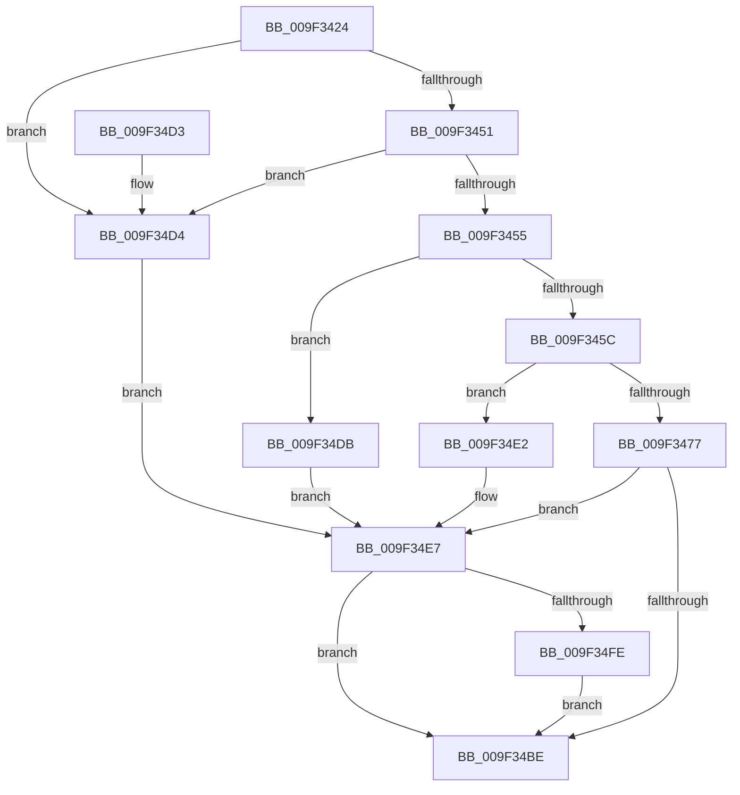

# EtwpSetProviderTraitsKm

- RVA: `0x009F3424`–`0x009F350C` (길이 `232` bytes)
- VA: `0x00000001409F3424`
- 실행 섹션: `PAGE`
- PDB 이름 있음: `예`; PDB Function 태그: `아니요`
- unwind 정보 RVA: `0x000A622C`
- 디코드: `65`개 명령, `232/232` bytes 표시
- 미해석 바이트: `0` (있으면 어셈블리에 `.byte`로 보존)

> 이 문서는 커널 이미지의 기계어와 PDB 기호를 분석해 생성했습니다. 4번과 5번은 함수 원형과 자료형을 바이너리 사용 방식에서 추정한 C 해석이며 원본 소스 복구 결과는 아닙니다.

## 1. Dependencies

- 직접 호출 지점: **5**; 고유 호출 대상: **5**
- 직접 호출자로 확인된 함수: **1**
- RIP 상대 이미지 참조: **4**

### Outgoing calls
- `0x009F346A` → [ExAllocatePool2](../../poolcode/B8/ExAllocatePool2_function_00B820F0.md) (function, `0x00B820F0`)
- `0x009F3481` → [memcpy](../../text/6C/memcpy_function_006C6840.md) (function, `0x006C6840`)
- `0x009F34B3` → [EtwpSetProviderTraitsCommon](EtwpSetProviderTraitsCommon_function_009F36EC.md) (function, `0x009F36EC`)
- `0x009F34F5` → [EtwEventEnabled](../../text/39/EtwEventEnabled_function_00392450.md) (function, `0x00392450`)
- `0x009F3505` → [EtwpEventWriteRegistrationStatus](../7B/EtwpEventWriteRegistrationStatus_function_007B5EE0.md) (function, `0x007B5EE0`)

### Direct callers
- [EtwSetInformation](../7B/EtwSetInformation_function_007B9070.md) at `0x007B90F6`

### Static image references
- `0x009F3486` → RVA `0x00EFF4A0` (`.data`; read)
- `0x009F349A` → RVA `0x00EFF460` (`.data`; read)
- `0x009F34E7` → RVA `0x00EFF840` (`.data`; read)
- `0x009F34EE` → RVA `0x000230E8` (`.rdata`; read)

## 2. Other-region calls and transfers

- 다른 실행 섹션으로 향하는 call: **3**
  - `0x009F346A` → [ExAllocatePool2](../../poolcode/B8/ExAllocatePool2_function_00B820F0.md) (`PAGE` → `POOLCODE`)
  - `0x009F3481` → [memcpy](../../text/6C/memcpy_function_006C6840.md) (`PAGE` → `.text`)
  - `0x009F34F5` → [EtwEventEnabled](../../text/39/EtwEventEnabled_function_00392450.md) (`PAGE` → `.text`)
- 별도 외부 분기/꼬리 이동을 확인하지 못했습니다.

## 3. Assembly (complete function range)

```asm
009F3424  48 89 5C 24 10                  mov qword ptr [rsp + 0x10], rbx
009F3429  48 89 6C 24 18                  mov qword ptr [rsp + 0x18], rbp
009F342E  56                              push rsi
009F342F  57                              push rdi
009F3430  41 56                           push r14
009F3432  48 83 EC 40                     sub rsp, 0x40
009F3436  83 64 24 60 00                  and dword ptr [rsp + 0x60], 0
009F343B  4C 8B F2                        mov r14, rdx
009F343E  0F B7 41 62                     movzx eax, word ptr [rcx + 0x62]
009F3442  48 8B F9                        mov rdi, rcx
009F3445  41 0F B7 F0                     movzx esi, r8w
009F3449  A8 08                           test al, 8
009F344B  0F 85 83 00 00 00               jne 0x1409f34d4
009F3451  A8 01                           test al, 1
009F3453  74 7F                           je 0x1409f34d4
009F3455  48 83 79 70 00                  cmp qword ptr [rcx + 0x70], 0
009F345A  75 7F                           jne 0x1409f34db
009F345C  8D 56 1C                        lea edx, [rsi + 0x1c]
009F345F  B9 40 00 00 00                  mov ecx, 0x40
009F3464  41 B8 45 74 77 54               mov r8d, 0x54777445
009F346A  E8 81 EC 18 00                  call 0x140b820f0
009F346F  48 8B D8                        mov rbx, rax
009F3472  48 85 C0                        test rax, rax
009F3475  74 6B                           je 0x1409f34e2
009F3477  44 8B C6                        mov r8d, esi
009F347A  48 8D 48 1C                     lea rcx, [rax + 0x1c]
009F347E  49 8B D6                        mov rdx, r14
009F3481  E8 BA 33 CD FF                  call 0x1406c6840
009F3486  48 8D 05 13 C0 50 00            lea rax, [rip + 0x50c013]
009F348D  4C 8B CF                        mov r9, rdi
009F3490  48 89 44 24 38                  mov qword ptr [rsp + 0x38], rax
009F3495  4C 8D 44 24 60                  lea r8, [rsp + 0x60]
009F349A  48 8D 05 BF BF 50 00            lea rax, [rip + 0x50bfbf]
009F34A1  33 D2                           xor edx, edx
009F34A3  48 89 44 24 30                  mov qword ptr [rsp + 0x30], rax
009F34A8  33 C9                           xor ecx, ecx
009F34AA  89 74 24 28                     mov dword ptr [rsp + 0x28], esi
009F34AE  48 89 5C 24 20                  mov qword ptr [rsp + 0x20], rbx
009F34B3  E8 34 02 00 00                  call 0x1409f36ec
009F34B8  8B D8                           mov ebx, eax
009F34BA  85 C0                           test eax, eax
009F34BC  75 29                           jne 0x1409f34e7
009F34BE  48 8B 6C 24 70                  mov rbp, qword ptr [rsp + 0x70]
009F34C3  8B C3                           mov eax, ebx
009F34C5  48 8B 5C 24 68                  mov rbx, qword ptr [rsp + 0x68]
009F34CA  48 83 C4 40                     add rsp, 0x40
009F34CE  41 5E                           pop r14
009F34D0  5F                              pop rdi
009F34D1  5E                              pop rsi
009F34D2  C3                              ret
009F34D3  CC                              int3
009F34D4  BB 0D 00 00 C0                  mov ebx, 0xc000000d
009F34D9  EB 0C                           jmp 0x1409f34e7
009F34DB  BB 01 00 00 C0                  mov ebx, 0xc0000001
009F34E0  EB 05                           jmp 0x1409f34e7
009F34E2  BB 9A 00 00 C0                  mov ebx, 0xc000009a
009F34E7  48 8B 0D 52 C3 50 00            mov rcx, qword ptr [rip + 0x50c352]
009F34EE  48 8D 15 F3 FB 62 FF            lea rdx, [rip - 0x9d040d]
009F34F5  E8 56 EF 99 FF                  call 0x140392450
009F34FA  84 C0                           test al, al
009F34FC  74 C0                           je 0x1409f34be
009F34FE  4C 8B CF                        mov r9, rdi
009F3501  89 5C 24 20                     mov dword ptr [rsp + 0x20], ebx
009F3505  E8 D6 29 DC FF                  call 0x1407b5ee0
009F350A  EB B2                           jmp 0x1409f34be
```

## 4. C-style interpretation (structured pseudocode)

```c
__int64 __fastcall EtwpSetProviderTraitsKm(__int64 a1, __int64 a2, unsigned __int16 a3)
{
    __int64 result;
    __int64 v_rsp;
    unsigned __int64 v_stack_m20;
    unsigned __int64 v_stack_m28;
    unsigned int v_stack_m30;
    unsigned __int64 v_stack_m38;
    unsigned __int64 v_stack_p10;
    unsigned __int64 v_stack_p18;
    unsigned int v_stack_p20;
    unsigned int v_stack_p8;

    v_stack_p10 = v_rbx;
    v_stack_p18 = v_rbp;
    v_rsp = (v_rsp) - (64);
    if ((((unsigned __int8)(*(unsigned __int16 *)(a1 + 98))) & (8)) != 0) goto loc_009F34D4;
    if ((((unsigned __int8)(*(unsigned __int16 *)(a1 + 98))) & (1)) == 0) goto loc_009F34D4;
    if ((*(unsigned __int64 *)(a1 + 112)) != 0) goto loc_009F34DB;
    result = ExAllocatePool2(64, a3 + 28, (unsigned int)(0x54777445ULL), a4);
    if (result == 0) goto loc_009F34E2;
    result = memcpy(result + 28, a2, (unsigned int)(a3), a4);
    v_stack_m20 = v_rip + 5292051;
    a2 = 0;
    v_stack_m28 = v_rip + 5291967;
    a1 = 0;
    v_stack_m30 = a3;
    v_stack_m38 = result;
    result = EtwpSetProviderTraitsCommon(a1, a2, v_stack_p8, a1);
    if ((unsigned int)(result) != 0) goto loc_009F34E7;
loc_009F34BE:
    v_rsp = (v_rsp) + (64);
    return (unsigned int)((unsigned int)((unsigned int)((unsigned int)(result))));
loc_009F34D4:
    goto loc_009F34E7;
loc_009F34DB:
    goto loc_009F34E7;
loc_009F34E2:
loc_009F34E7:
    result = EtwEventEnabled(*(unsigned __int64 *)(v_rip + 5292882), v_rip - 10290189, v_stack_p8, a1);
    if ((unsigned __int8)(result) == 0) goto loc_009F34BE;
    v_stack_p20 = (unsigned int)((unsigned int)(0xC000009AULL));
    result = EtwpEventWriteRegistrationStatus(*(unsigned __int64 *)(v_rip + 5292882), v_rip - 10290189, v_stack_p8, 0);
    goto loc_009F34BE;
}
```

## 5. (Beta) C Style

```c
int64_t EtwpSetProviderTraitsKm(void *Arg1, int64_t Arg2, void *Arg3)
{
    uint8_t *arg1 = (uint8_t *)Arg1;
    uint8_t *arg3 = (uint8_t *)Arg3;

    int64_t result;
    int64_t local_rsp;
    uint64_t v_stack_m20;
    uint64_t v_stack_m28;
    uint32_t v_stack_m30;
    uint64_t v_stack_m38;
    uint64_t v_stack_p10;
    uint64_t v_stack_p18;
    uint32_t v_stack_p20;
    uint32_t v_stack_p8;

    v_stack_p10 = local_rbx;
    v_stack_p18 = local_rbp;
    local_rsp = (local_rsp) - (64);
    if ((((uint8_t)(*(uint16_t *)(arg1 + 0x62))) & (8)) != 0) goto loc_009F34D4;
    if ((((uint8_t)(*(uint16_t *)(arg1 + 0x62))) & (1)) == 0) goto loc_009F34D4;
    if ((*(uint64_t *)(arg1 + 0x70)) != 0) goto loc_009F34DB;
    result = ExAllocatePool2(64, Arg3 + 28, (uint32_t)(0x54777445ULL), a4);
    if (result == 0) goto loc_009F34E2;
    result = memcpy(result + 28, Arg2, (uint32_t)(Arg3), a4);
    v_stack_m20 = v_rip + 5292051;
    Arg2 = 0;
    v_stack_m28 = v_rip + 5291967;
    Arg1 = 0;
    v_stack_m30 = Arg3;
    v_stack_m38 = result;
    result = EtwpSetProviderTraitsCommon(Arg1, Arg2, v_stack_p8, Arg1);
    if ((uint32_t)(result) != 0) goto loc_009F34E7;
loc_009F34BE:
    local_rsp = (local_rsp) + (64);
    return (uint32_t)((uint32_t)((uint32_t)((uint32_t)(result))));
loc_009F34D4:
    goto loc_009F34E7;
loc_009F34DB:
    goto loc_009F34E7;
loc_009F34E2:
loc_009F34E7:
    result = EtwEventEnabled(*(uint64_t *)(v_rip + 0x50C352), v_rip - 10290189, v_stack_p8, Arg1);
    if ((uint8_t)(result) == 0) goto loc_009F34BE;
    v_stack_p20 = (uint32_t)((uint32_t)(0xC000009AULL));
    result = EtwpEventWriteRegistrationStatus(*(uint64_t *)(v_rip + 0x50C352), v_rip - 10290189, v_stack_p8, 0);
    goto loc_009F34BE;
}
```

### 관측된 메모리 오프셋

구조체 형식이 확인되지 않은 접근은 인자 기준의 오프셋으로만 기록했습니다.

| 기준 인자 | 오프셋 표현 | 폭 (bit) | 접근 |
|---|---:|---:|---|
| `Arg1` | `+ 0x62` | `16` | `R` |
| `Arg1` | `+ 0x70` | `64` | `R` |
| `Arg3` | `+ 0x1C` | `32` | `R` |

## 6. Execution-region graph

[열기: 2D/3D 그래프와 함수 탐색 컨트롤 패널](../../../control-panel.html?section=page&rva=0x009F3424&view=graph)

- 2D 그래프는 위에서 아래로 흐르고, 3D 그래프는 빈 공간을 드래그해 회전합니다. Shift+드래그는 이동, 휠은 확대·축소, 함수 노드 선택은 대상 보고서 이동입니다.

### Static fallback


