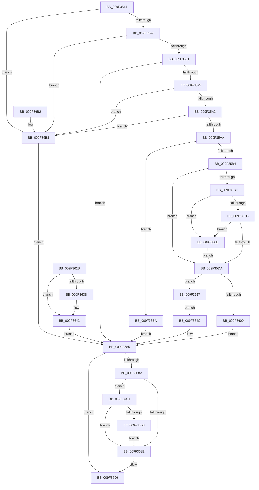

# EtwpSetProviderTraitsUm

- RVA: `0x009F3514`–`0x009F36E6` (길이 `466` bytes)
- VA: `0x00000001409F3514`
- 실행 섹션: `PAGE`
- PDB 이름 있음: `예`; PDB Function 태그: `아니요`
- unwind 정보 RVA: `0x000A6244`
- 디코드: `124`개 명령, `466/466` bytes 표시
- 미해석 바이트: `0` (있으면 어셈블리에 `.byte`로 보존)

> 이 문서는 커널 이미지의 기계어와 PDB 기호를 분석해 생성했습니다. 4번과 5번은 함수 원형과 자료형을 바이너리 사용 방식에서 추정한 C 해석이며 원본 소스 복구 결과는 아닙니다.

## 1. Dependencies

- 직접 호출 지점: **8**; 고유 호출 대상: **8**
- 직접 호출자로 확인된 함수: **1**
- RIP 상대 이미지 참조: **5**

### Outgoing calls
- `0x009F3573` → [ObReferenceObjectByHandle](../86/ObReferenceObjectByHandle_function_00868DB0.md) (function, `0x00868DB0`)
- `0x009F35EE` → [ExAllocatePool2](../../poolcode/B8/ExAllocatePool2_function_00B820F0.md) (function, `0x00B820F0`)
- `0x009F3624` → [memcpy](../../text/6C/memcpy_function_006C6840.md) (function, `0x006C6840`)
- `0x009F363D` → [ExFreePoolWithTag](../../poolcode/B8/ExFreePoolWithTag_function_00B82870.md) (function, `0x00B82870`)
- `0x009F367E` → [EtwpSetProviderTraitsCommon](EtwpSetProviderTraitsCommon_function_009F36EC.md) (function, `0x009F36EC`)
- `0x009F3691` → [ObfDereferenceObject](../../text/2F/ObfDereferenceObject_function_002F9350.md) (function, `0x002F9350`)
- `0x009F36CF` → [EtwEventEnabled](../../text/39/EtwEventEnabled_function_00392450.md) (function, `0x00392450`)
- `0x009F36DF` → [EtwpEventWriteRegistrationStatus](../7B/EtwpEventWriteRegistrationStatus_function_007B5EE0.md) (function, `0x007B5EE0`)

### Direct callers
- [NtTraceControl](../A9/NtTraceControl_function_00A9ED40.md) at `0x00A9F44D`

### Static image references
- `0x009F3551` → RVA `0x00FC6D30` (`ALMOSTRO`; read)
- `0x009F3651` → RVA `0x00EFF500` (`.data`; read)
- `0x009F365D` → RVA `0x00EFF4C0` (`.data`; read)
- `0x009F36C1` → RVA `0x000230E8` (`.rdata`; read)
- `0x009F36C8` → RVA `0x00EFF840` (`.data`; read)

## 2. Other-region calls and transfers

- 다른 실행 섹션으로 향하는 call: **5**
  - `0x009F35EE` → [ExAllocatePool2](../../poolcode/B8/ExAllocatePool2_function_00B820F0.md) (`PAGE` → `POOLCODE`)
  - `0x009F3624` → [memcpy](../../text/6C/memcpy_function_006C6840.md) (`PAGE` → `.text`)
  - `0x009F363D` → [ExFreePoolWithTag](../../poolcode/B8/ExFreePoolWithTag_function_00B82870.md) (`PAGE` → `POOLCODE`)
  - `0x009F3691` → [ObfDereferenceObject](../../text/2F/ObfDereferenceObject_function_002F9350.md) (`PAGE` → `.text`)
  - `0x009F36CF` → [EtwEventEnabled](../../text/39/EtwEventEnabled_function_00392450.md) (`PAGE` → `.text`)
- 별도 외부 분기/꼬리 이동을 확인하지 못했습니다.

## 3. Assembly (complete function range)

```asm
009F3514  4C 8B DC                        mov r11, rsp
009F3517  49 89 5B 10                     mov qword ptr [r11 + 0x10], rbx
009F351B  49 89 73 18                     mov qword ptr [r11 + 0x18], rsi
009F351F  57                              push rdi
009F3520  41 54                           push r12
009F3522  41 55                           push r13
009F3524  41 56                           push r14
009F3526  41 57                           push r15
009F3528  48 83 EC 50                     sub rsp, 0x50
009F352C  4D 8B E0                        mov r12, r8
009F352F  44 8B EA                        mov r13d, edx
009F3532  4C 8B F1                        mov r14, rcx
009F3535  33 FF                           xor edi, edi
009F3537  8B F7                           mov esi, edi
009F3539  49 89 7B D0                     mov qword ptr [r11 - 0x30], rdi
009F353D  48 39 79 08                     cmp qword ptr [rcx + 8], rdi
009F3541  0F 84 6C 01 00 00               je 0x1409f36b3
009F3547  66 39 79 10                     cmp word ptr [rcx + 0x10], di
009F354B  0F 84 62 01 00 00               je 0x1409f36b3
009F3551  4C 8B 05 D8 37 5D 00            mov r8, qword ptr [rip + 0x5d37d8]
009F3558  48 8B 09                        mov rcx, qword ptr [rcx]
009F355B  49 89 7B 08                     mov qword ptr [r11 + 8], rdi
009F355F  49 89 7B B0                     mov qword ptr [r11 - 0x50], rdi
009F3563  49 8D 43 08                     lea rax, [r11 + 8]
009F3567  49 89 43 A8                     mov qword ptr [r11 - 0x58], rax
009F356B  41 B1 01                        mov r9b, 1
009F356E  BA 00 08 00 00                  mov edx, 0x800
009F3573  E8 38 58 E7 FF                  call 0x140868db0
009F3578  8B D8                           mov ebx, eax
009F357A  4C 8B BC 24 80 00 00 00         mov r15, qword ptr [rsp + 0x80]
009F3582  49 8B F7                        mov rsi, r15
009F3585  4C 89 BC 24 98 00 00 00         mov qword ptr [rsp + 0x98], r15
009F358D  85 C0                           test eax, eax
009F358F  0F 88 F0 00 00 00               js 0x1409f3685
009F3595  41 0F B7 47 62                  movzx eax, word ptr [r15 + 0x62]
009F359A  A8 08                           test al, 8
009F359C  0F 85 11 01 00 00               jne 0x1409f36b3
009F35A2  A8 02                           test al, 2
009F35A4  0F 84 09 01 00 00               je 0x1409f36b3
009F35AA  49 39 7F 70                     cmp qword ptr [r15 + 0x70], rdi
009F35AE  0F 85 06 01 00 00               jne 0x1409f36ba
009F35B4  41 0F B7 46 10                  movzx eax, word ptr [r14 + 0x10]
009F35B9  66 85 C0                        test ax, ax
009F35BC  74 1C                           je 0x1409f35da
009F35BE  49 8B 4E 08                     mov rcx, qword ptr [r14 + 8]
009F35C2  48 8D 14 01                     lea rdx, [rcx + rax]
009F35C6  48 B8 00 00 FF FF FF 7F 00 00   movabs rax, 0x7fffffff0000
009F35D0  48 3B D0                        cmp rdx, rax
009F35D3  77 36                           ja 0x1409f360b
009F35D5  48 3B D1                        cmp rdx, rcx
009F35D8  72 31                           jb 0x1409f360b
009F35DA  41 0F B7 56 10                  movzx edx, word ptr [r14 + 0x10]
009F35DF  48 83 C2 1C                     add rdx, 0x1c
009F35E3  B9 00 01 00 00                  mov ecx, 0x100
009F35E8  41 B8 45 74 77 54               mov r8d, 0x54777445
009F35EE  E8 FD EA 18 00                  call 0x140b820f0
009F35F3  48 8B D8                        mov rbx, rax
009F35F6  48 89 44 24 48                  mov qword ptr [rsp + 0x48], rax
009F35FB  48 85 C0                        test rax, rax
009F35FE  75 17                           jne 0x1409f3617
009F3600  BB 9A 00 00 C0                  mov ebx, 0xc000009a
009F3605  89 5C 24 40                     mov dword ptr [rsp + 0x40], ebx
009F3609  EB 7A                           jmp 0x1409f3685
009F360B  8A 00                           mov al, byte ptr [rax]
009F360D  4C 8B BC 24 80 00 00 00         mov r15, qword ptr [rsp + 0x80]
009F3615  EB C3                           jmp 0x1409f35da
009F3617  45 0F B7 46 10                  movzx r8d, word ptr [r14 + 0x10]
009F361C  48 8D 48 1C                     lea rcx, [rax + 0x1c]
009F3620  49 8B 56 08                     mov rdx, qword ptr [r14 + 8]
009F3624  E8 17 32 CD FF                  call 0x1406c6840
009F3629  EB 21                           jmp 0x1409f364c
009F362B  8B D8                           mov ebx, eax
009F362D  89 44 24 40                     mov dword ptr [rsp + 0x40], eax
009F3631  48 8B 4C 24 48                  mov rcx, qword ptr [rsp + 0x48]
009F3636  48 85 C9                        test rcx, rcx
009F3639  74 07                           je 0x1409f3642
009F363B  33 D2                           xor edx, edx
009F363D  E8 2E F2 18 00                  call 0x140b82870
009F3642  48 8B B4 24 98 00 00 00         mov rsi, qword ptr [rsp + 0x98]
009F364A  EB 39                           jmp 0x1409f3685
009F364C  41 0F B7 46 10                  movzx eax, word ptr [r14 + 0x10]
009F3651  48 8D 0D A8 BE 50 00            lea rcx, [rip + 0x50bea8]
009F3658  48 89 4C 24 38                  mov qword ptr [rsp + 0x38], rcx
009F365D  48 8D 0D 5C BE 50 00            lea rcx, [rip + 0x50be5c]
009F3664  48 89 4C 24 30                  mov qword ptr [rsp + 0x30], rcx
009F3669  89 44 24 28                     mov dword ptr [rsp + 0x28], eax
009F366D  48 89 5C 24 20                  mov qword ptr [rsp + 0x20], rbx
009F3672  4D 8B CF                        mov r9, r15
009F3675  4D 8B C4                        mov r8, r12
009F3678  41 8B D5                        mov edx, r13d
009F367B  49 8B CE                        mov rcx, r14
009F367E  E8 69 00 00 00                  call 0x1409f36ec
009F3683  8B D8                           mov ebx, eax
009F3685  48 85 F6                        test rsi, rsi
009F3688  74 0C                           je 0x1409f3696
009F368A  85 DB                           test ebx, ebx
009F368C  75 33                           jne 0x1409f36c1
009F368E  48 8B CE                        mov rcx, rsi
009F3691  E8 BA 5C 90 FF                  call 0x1402f9350
009F3696  8B C3                           mov eax, ebx
009F3698  4C 8D 5C 24 50                  lea r11, [rsp + 0x50]
009F369D  49 8B 5B 38                     mov rbx, qword ptr [r11 + 0x38]
009F36A1  49 8B 73 40                     mov rsi, qword ptr [r11 + 0x40]
009F36A5  49 8B E3                        mov rsp, r11
009F36A8  41 5F                           pop r15
009F36AA  41 5E                           pop r14
009F36AC  41 5D                           pop r13
009F36AE  41 5C                           pop r12
009F36B0  5F                              pop rdi
009F36B1  C3                              ret
009F36B2  CC                              int3
009F36B3  BB 0D 00 00 C0                  mov ebx, 0xc000000d
009F36B8  EB CB                           jmp 0x1409f3685
009F36BA  BB 01 00 00 C0                  mov ebx, 0xc0000001
009F36BF  EB C4                           jmp 0x1409f3685
009F36C1  48 8D 15 20 FA 62 FF            lea rdx, [rip - 0x9d05e0]
009F36C8  48 8B 0D 71 C1 50 00            mov rcx, qword ptr [rip + 0x50c171]
009F36CF  E8 7C ED 99 FF                  call 0x140392450
009F36D4  84 C0                           test al, al
009F36D6  74 B6                           je 0x1409f368e
009F36D8  89 5C 24 20                     mov dword ptr [rsp + 0x20], ebx
009F36DC  4C 8B CE                        mov r9, rsi
009F36DF  E8 FC 27 DC FF                  call 0x1407b5ee0
009F36E4  EB A8                           jmp 0x1409f368e
```

## 4. C-style interpretation (structured pseudocode)

```c
__int64 __fastcall EtwpSetProviderTraitsUm(__int64 a1, int a2, __int64 a3)
{
    __int64 result;
    __int64 v_rdi;
    __int64 v_rsp;
    unsigned __int64 v_stack_m28;
    unsigned __int64 v_stack_m30;
    unsigned int v_stack_m38;
    unsigned __int64 v_stack_m40;
    unsigned __int64 v_stack_m48;
    unsigned int v_stack_m50;
    unsigned __int64 v_stack_m58;
    unsigned __int64 v_stack_p20;
    unsigned __int64 v_stack_p8;

    *(unsigned __int64 *)(v_rsp + 16) = v_rbx;
    *(unsigned __int64 *)(v_rsp + 24) = v_rsi;
    v_rsp = (v_rsp) - (80);
    v_rdi = 0;
    *(unsigned __int64 *)(v_rsp - 48) = 0;
    if ((*(unsigned __int64 *)(a1 + 8)) == 0) goto loc_009F36B3;
    if ((*(unsigned __int16 *)(a1 + 16)) == 0) goto loc_009F36B3;
    *(unsigned __int64 *)(v_rsp + 8) = 0;
    *(unsigned __int64 *)(v_rsp - 80) = 0;
    *(unsigned __int64 *)(v_rsp - 88) = v_rsp + 8;
    result = ObReferenceObjectByHandle(*(unsigned __int64 *)(a1), (unsigned int)(0x800ULL), *(unsigned __int64 *)(v_rip + 6109144), 1);
    v_stack_p20 = v_stack_p8;
    if (sign_flag) goto loc_009F3685;
    if ((((unsigned __int8)(*(unsigned __int16 *)(v_stack_p8 + 98))) & (8)) != 0) goto loc_009F36B3;
    if ((((unsigned __int8)(*(unsigned __int16 *)(v_stack_p8 + 98))) & (2)) == 0) goto loc_009F36B3;
    if ((*(unsigned __int64 *)(v_stack_p8 + 112)) != 0) goto loc_009F36BA;
    if ((unsigned __int16)(*(unsigned __int16 *)(a1 + 16)) == 0) goto loc_009F35DA;
    if ((*(unsigned __int64 *)(a1 + 8) + *(unsigned __int16 *)(a1 + 16) * 1) > (*(unsigned __int16 *)(a1 + 16))) goto loc_009F360B;
    if ((*(unsigned __int64 *)(a1 + 8) + *(unsigned __int16 *)(a1 + 16) * 1) < (*(unsigned __int64 *)(a1 + 8))) goto loc_009F360B;
loc_009F35DA:
    a2 = (*(unsigned __int16 *)(a1 + 16)) + (28);
    result = ExAllocatePool2(256, a2, (unsigned int)(0x54777445ULL), 1);
    v_stack_m30 = result;
    if (result != 0) goto loc_009F3617;
    v_stack_m38 = (unsigned int)((unsigned int)(0xC000009AULL));
    goto loc_009F3685;
loc_009F360B:
    goto loc_009F35DA;
loc_009F3617:
    result = memcpy(*(unsigned __int8 *)(result) + 28, *(unsigned __int64 *)(a1 + 8), *(unsigned __int16 *)(a1 + 16), 1);
    goto loc_009F364C;
loc_009F364C:
    v_stack_m40 = v_rip + 5291688;
    v_stack_m48 = v_rip + 5291612;
    v_stack_m50 = (unsigned int)(*(unsigned __int16 *)(a1 + 16));
    v_stack_m58 = (unsigned int)(0xC000009AULL);
    result = EtwpSetProviderTraitsCommon(a1, (unsigned int)((unsigned int)((unsigned int)(a2))), a3, v_stack_p8);
loc_009F3685:
    if (v_stack_p8 == 0) goto loc_009F3696;
    if ((unsigned int)((unsigned int)((unsigned int)(result))) != 0) goto loc_009F36C1;
loc_009F368E:
    result = ObfDereferenceObject(v_stack_p8, (unsigned int)((unsigned int)((unsigned int)(a2))), a3, v_stack_p8);
loc_009F3696:
    return (unsigned int)((unsigned int)((unsigned int)((unsigned int)(result))));
loc_009F36B3:
    goto loc_009F3685;
loc_009F36BA:
    goto loc_009F3685;
loc_009F36C1:
    result = EtwEventEnabled(*(unsigned __int64 *)(v_rip + 5292401), v_rip - 10290656, a3, v_stack_p8);
    if ((unsigned __int8)(result) == 0) goto loc_009F368E;
    v_stack_m30 = (unsigned int)((unsigned int)(0xC0000001ULL));
    result = EtwpEventWriteRegistrationStatus(*(unsigned __int64 *)(v_rip + 5292401), v_rip - 10290656, a3, *(unsigned __int64 *)(v_stack_m28 + 64));
    goto loc_009F368E;
}
```

## 5. (Beta) C Style

```c
int64_t EtwpSetProviderTraitsUm(void *Arg1, int32_t Arg2, int64_t Arg3)
{
    uint8_t *arg1 = (uint8_t *)Arg1;

    int64_t result;
    int64_t local_rdi;
    int64_t local_rsp;
    uint64_t v_stack_m28;
    uint64_t v_stack_m30;
    uint32_t v_stack_m38;
    uint64_t v_stack_m40;
    uint64_t v_stack_m48;
    uint32_t v_stack_m50;
    uint64_t v_stack_m58;
    uint64_t v_stack_p20;
    uint64_t v_stack_p8;

    *(uint64_t *)(local_rsp + 0x10) = local_rbx;
    *(uint64_t *)(local_rsp + 0x18) = local_rsi;
    local_rsp = (local_rsp) - (80);
    local_rdi = 0;
    *(uint64_t *)(local_rsp - 0x30) = 0;
    if ((*(uint64_t *)(arg1 + 0x8)) == 0) goto loc_009F36B3;
    if ((*(uint16_t *)(arg1 + 0x10)) == 0) goto loc_009F36B3;
    *(uint64_t *)(local_rsp + 0x8) = 0;
    *(uint64_t *)(local_rsp - 0x50) = 0;
    *(uint64_t *)(local_rsp - 0x58) = local_rsp + 8;
    result = ObReferenceObjectByHandle(*(uint64_t *)(arg1), (uint32_t)(0x800ULL), *(uint64_t *)(v_rip + 0x5D37D8), 1);
    v_stack_p20 = v_stack_p8;
    if (sign_flag) goto loc_009F3685;
    if ((((uint8_t)(*(uint16_t *)(v_stack_p8 + 0x62))) & (8)) != 0) goto loc_009F36B3;
    if ((((uint8_t)(*(uint16_t *)(v_stack_p8 + 0x62))) & (2)) == 0) goto loc_009F36B3;
    if ((*(uint64_t *)(v_stack_p8 + 0x70)) != 0) goto loc_009F36BA;
    if ((uint16_t)(*(uint16_t *)(arg1 + 0x10)) == 0) goto loc_009F35DA;
    if ((*(uint64_t *)(arg1 + 0x8) + *(uint16_t *)(arg1 + 0x10) * 1) > (*(uint16_t *)(arg1 + 0x10))) goto loc_009F360B;
    if ((*(uint64_t *)(arg1 + 0x8) + *(uint16_t *)(arg1 + 0x10) * 1) < (*(uint64_t *)(arg1 + 0x8))) goto loc_009F360B;
loc_009F35DA:
    Arg2 = (*(uint16_t *)(arg1 + 0x10)) + (28);
    result = ExAllocatePool2(256, Arg2, (uint32_t)(0x54777445ULL), 1);
    v_stack_m30 = result;
    if (result != 0) goto loc_009F3617;
    v_stack_m38 = (uint32_t)((uint32_t)(0xC000009AULL));
    goto loc_009F3685;
loc_009F360B:
    goto loc_009F35DA;
loc_009F3617:
    result = memcpy(*(uint8_t *)(result) + 28, *(uint64_t *)(arg1 + 0x8), *(uint16_t *)(arg1 + 0x10), 1);
    goto loc_009F364C;
loc_009F364C:
    v_stack_m40 = v_rip + 5291688;
    v_stack_m48 = v_rip + 5291612;
    v_stack_m50 = (uint32_t)(*(uint16_t *)(arg1 + 0x10));
    v_stack_m58 = (uint32_t)(0xC000009AULL);
    result = EtwpSetProviderTraitsCommon(Arg1, (uint32_t)((uint32_t)((uint32_t)(Arg2))), Arg3, v_stack_p8);
loc_009F3685:
    if (v_stack_p8 == 0) goto loc_009F3696;
    if ((uint32_t)((uint32_t)((uint32_t)(result))) != 0) goto loc_009F36C1;
loc_009F368E:
    result = ObfDereferenceObject(v_stack_p8, (uint32_t)((uint32_t)((uint32_t)(Arg2))), Arg3, v_stack_p8);
loc_009F3696:
    return (uint32_t)((uint32_t)((uint32_t)((uint32_t)(result))));
loc_009F36B3:
    goto loc_009F3685;
loc_009F36BA:
    goto loc_009F3685;
loc_009F36C1:
    result = EtwEventEnabled(*(uint64_t *)(v_rip + 0x50C171), v_rip - 10290656, Arg3, v_stack_p8);
    if ((uint8_t)(result) == 0) goto loc_009F368E;
    v_stack_m30 = (uint32_t)((uint32_t)(0xC0000001ULL));
    result = EtwpEventWriteRegistrationStatus(*(uint64_t *)(v_rip + 0x50C171), v_rip - 10290656, Arg3, *(uint64_t *)(v_stack_m28 + 0x40));
    goto loc_009F368E;
}
```

### 관측된 메모리 오프셋

구조체 형식이 확인되지 않은 접근은 인자 기준의 오프셋으로만 기록했습니다.

| 기준 인자 | 오프셋 표현 | 폭 (bit) | 접근 |
|---|---:|---:|---|
| `Arg1` | `+ 0x0` | `64` | `R` |
| `Arg1` | `+ 0x8` | `64` | `R` |
| `Arg1` | `+ 0x10` | `16` | `R` |

## 6. Execution-region graph

[열기: 2D/3D 그래프와 함수 탐색 컨트롤 패널](../../../control-panel.html?section=page&rva=0x009F3514&view=graph)

- 2D 그래프는 위에서 아래로 흐르고, 3D 그래프는 빈 공간을 드래그해 회전합니다. Shift+드래그는 이동, 휠은 확대·축소, 함수 노드 선택은 대상 보고서 이동입니다.

### Static fallback


