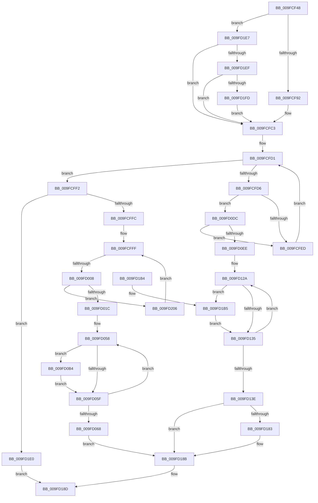

# EtwpUpdateGuidEnableInfo

- RVA: `0x009FCF48`–`0x009FD20E` (길이 `710` bytes)
- VA: `0x00000001409FCF48`
- 실행 섹션: `PAGE`
- PDB 이름 있음: `예`; PDB Function 태그: `예`
- unwind 정보 RVA: `0x000A722C`
- 디코드: `186`개 명령, `710/710` bytes 표시
- 미해석 바이트: `0` (있으면 어셈블리에 `.byte`로 보존)

> 이 문서는 커널 이미지의 기계어와 PDB 기호를 분석해 생성했습니다. 4번과 5번은 함수 원형과 자료형을 바이너리 사용 방식에서 추정한 C 해석이며 원본 소스 복구 결과는 아닙니다.

## 1. Dependencies

- 직접 호출 지점: **5**; 고유 호출 대상: **4**
- 직접 호출자로 확인된 함수: **1**
- RIP 상대 이미지 참조: **1**

### Outgoing calls
- `0x009FD0A2` → [EtwpUpdateGuidFilterData](EtwpUpdateGuidFilterData_function_009FD214.md) (function, `0x009FD214`)
- `0x009FD0AA` → [EtwpReferenceGuidEntry](../8C/EtwpReferenceGuidEntry_function_008C1ED0.md) (function, `0x008C1ED0`)
- `0x009FD178` → [EtwpUpdateGuidFilterData](EtwpUpdateGuidFilterData_function_009FD214.md) (function, `0x009FD214`)
- `0x009FD186` → [EtwpUnreferenceGuidEntry](../8C/EtwpUnreferenceGuidEntry_function_008C3320.md) (function, `0x008C3320`)
- `0x009FD194` → [_security_check_cookie](../../text/6A/_security_check_cookie_function_006AC640.md) (function, `0x006AC640`)

### Direct callers
- [EtwpEnableGuid](../A5/EtwpEnableGuid_function_00A5CD28.md) at `0x00A5D1F2`

### Static image references
- `0x009FCF64` → RVA `0x00E0A740` (`.data`; read)

## 2. Other-region calls and transfers

- 다른 실행 섹션으로 향하는 call: **1**
  - `0x009FD194` → [_security_check_cookie](../../text/6A/_security_check_cookie_function_006AC640.md) (`PAGE` → `.text`)
- call이 아닌 외부 분기/꼬리 이동: **1**
  - `0x009FD002` → [sub_00B3261C](../B3/Unknown_function_00B3261C.md) (`tail-transfer`)

## 3. Assembly (complete function range)

```asm
009FCF48  48 89 5C 24 10                  mov qword ptr [rsp + 0x10], rbx
009FCF4D  55                              push rbp
009FCF4E  56                              push rsi
009FCF4F  57                              push rdi
009FCF50  41 54                           push r12
009FCF52  41 55                           push r13
009FCF54  41 56                           push r14
009FCF56  41 57                           push r15
009FCF58  48 8D 6C 24 E1                  lea rbp, [rsp - 0x1f]
009FCF5D  48 81 EC E0 00 00 00            sub rsp, 0xe0
009FCF64  48 8B 05 D5 D7 40 00            mov rax, qword ptr [rip + 0x40d7d5]
009FCF6B  48 33 C4                        xor rax, rsp
009FCF6E  48 89 45 0F                     mov qword ptr [rbp + 0xf], rax
009FCF72  8B 42 48                        mov eax, dword ptr [rdx + 0x48]
009FCF75  45 33 DB                        xor r11d, r11d
009FCF78  4C 8B 6D 7F                     mov r13, qword ptr [rbp + 0x7f]
009FCF7C  4D 8B E1                        mov r12, r9
009FCF7F  48 8B FA                        mov rdi, rdx
009FCF82  48 8B D9                        mov rbx, rcx
009FCF85  45 8D 4B 01                     lea r9d, [r11 + 1]
009FCF89  41 3B C1                        cmp eax, r9d
009FCF8C  0F 85 55 02 00 00               jne 0x1409fd1e7
009FCF92  8A 52 70                        mov dl, byte ptr [rdx + 0x70]
009FCF95  8A 49 5B                        mov cl, byte ptr [rcx + 0x5b]
009FCF98  8A C2                           mov al, dl
009FCF9A  32 C1                           xor al, cl
009FCF9C  41 22 D1                        and dl, r9b
009FCF9F  41 22 C1                        and al, r9b
009FCFA2  32 C1                           xor al, cl
009FCFA4  88 43 5B                        mov byte ptr [rbx + 0x5b], al
009FCFA7  8A 47 6B                        mov al, byte ptr [rdi + 0x6b]
009FCFAA  02 C0                           add al, al
009FCFAC  0A C2                           or al, dl
009FCFAE  88 43 5B                        mov byte ptr [rbx + 0x5b], al
009FCFB1  0F B7 47 68                     movzx eax, word ptr [rdi + 0x68]
009FCFB5  66 89 43 58                     mov word ptr [rbx + 0x58], ax
009FCFB9  8A 47 6A                        mov al, byte ptr [rdi + 0x6a]
009FCFBC  88 43 5A                        mov byte ptr [rbx + 0x5a], al
009FCFBF  4C 89 43 50                     mov qword ptr [rbx + 0x50], r8
009FCFC3  44 0F B7 57 4E                  movzx r10d, word ptr [rdi + 0x4e]
009FCFC8  41 8B D3                        mov edx, r11d
009FCFCB  41 B8 10 00 00 00               mov r8d, 0x10
009FCFD1  41 3B D0                        cmp edx, r8d
009FCFD4  73 1C                           jae 0x1409fcff2
009FCFD6  8B C2                           mov eax, edx
009FCFD8  48 C1 E0 05                     shl rax, 5
009FCFDC  8B CA                           mov ecx, edx
009FCFDE  66 44 39 94 18 86 00 00 00      cmp word ptr [rax + rbx + 0x86], r10w
009FCFE7  0F 84 EF 00 00 00               je 0x1409fd0dc
009FCFED  41 03 D1                        add edx, r9d
009FCFF0  EB DF                           jmp 0x1409fcfd1
009FCFF2  44 39 5F 48                     cmp dword ptr [rdi + 0x48], r11d
009FCFF6  0F 84 E4 01 00 00               je 0x1409fd1e0
009FCFFC  41 8B D3                        mov edx, r11d
009FCFFF  41 3B D0                        cmp edx, r8d
009FD002  0F 83 14 56 13 00               jae 0x140b3261c
009FD008  8B C2                           mov eax, edx
009FD00A  48 83 C0 04                     add rax, 4
009FD00E  48 C1 E0 05                     shl rax, 5
009FD012  44 39 1C 18                     cmp dword ptr [rax + rbx], r11d
009FD016  0F 85 EA 01 00 00               jne 0x1409fd206
009FD01C  0F 10 47 48                     movups xmm0, xmmword ptr [rdi + 0x48]
009FD020  49 83 CB FF                     or r11, 0xffffffffffffffff
009FD024  4C 8D 93 84 00 00 00            lea r10, [rbx + 0x84]
009FD02B  0F 11 04 18                     movups xmmword ptr [rax + rbx], xmm0
009FD02F  0F 10 4F 58                     movups xmm1, xmmword ptr [rdi + 0x58]
009FD033  0F 57 C0                        xorps xmm0, xmm0
009FD036  0F 11 44 24 30                  movups xmmword ptr [rsp + 0x30], xmm0
009FD03B  44 8B 7C 24 38                  mov r15d, dword ptr [rsp + 0x38]
009FD040  40 8A 74 24 34                  mov sil, byte ptr [rsp + 0x34]
009FD045  0F 11 44 24 40                  movups xmmword ptr [rsp + 0x40], xmm0
009FD04A  4C 8B 74 24 40                  mov r14, qword ptr [rsp + 0x40]
009FD04F  0F 11 4C 18 10                  movups xmmword ptr [rax + rbx + 0x10], xmm1
009FD054  4C 89 5D 87                     mov qword ptr [rbp - 0x79], r11
009FD058  41 83 7A FC 00                  cmp dword ptr [r10 - 4], 0
009FD05D  75 55                           jne 0x1409fd0b4
009FD05F  49 83 C2 20                     add r10, 0x20
009FD063  4D 2B C1                        sub r8, r9
009FD066  75 F0                           jne 0x1409fd058
009FD068  8A CA                           mov cl, dl
009FD06A  40 88 74 24 34                  mov byte ptr [rsp + 0x34], sil
009FD06F  66 41 D3 E1                     shl r9w, cl
009FD073  48 8B CB                        mov rcx, rbx
009FD076  44 89 7C 24 38                  mov dword ptr [rsp + 0x38], r15d
009FD07B  0F 10 44 24 30                  movups xmm0, xmmword ptr [rsp + 0x30]
009FD080  4C 89 74 24 40                  mov qword ptr [rsp + 0x40], r14
009FD085  0F 10 4C 24 40                  movups xmm1, xmmword ptr [rsp + 0x40]
009FD08A  0F 11 43 60                     movups xmmword ptr [rbx + 0x60], xmm0
009FD08E  0F 11 4B 70                     movups xmmword ptr [rbx + 0x70], xmm1
009FD092  66 45 89 4D 00                  mov word ptr [r13], r9w
009FD097  4D 8B CC                        mov r9, r12
009FD09A  44 39 47 48                     cmp dword ptr [rdi + 0x48], r8d
009FD09E  41 0F 94 C0                     sete r8b
009FD0A2  E8 6D 01 00 00                  call 0x1409fd214
009FD0A7  48 8B CB                        mov rcx, rbx
009FD0AA  E8 21 4E EC FF                  call 0x1408c1ed0
009FD0AF  E9 D7 00 00 00                  jmp 0x1409fd18b
009FD0B4  41 0F B6 0A                     movzx ecx, byte ptr [r10]
009FD0B8  40 3A F1                        cmp sil, cl
009FD0BB  40 0F B6 C6                     movzx eax, sil
009FD0BF  44 89 4C 24 30                  mov dword ptr [rsp + 0x30], r9d
009FD0C4  0F 46 C1                        cmovbe eax, ecx
009FD0C7  4D 23 5A 14                     and r11, qword ptr [r10 + 0x14]
009FD0CB  4D 0B 72 0C                     or r14, qword ptr [r10 + 0xc]
009FD0CF  40 8A F0                        mov sil, al
009FD0D2  45 0B 7A 04                     or r15d, dword ptr [r10 + 4]
009FD0D6  4C 89 5D 87                     mov qword ptr [rbp - 0x79], r11
009FD0DA  EB 83                           jmp 0x1409fd05f
009FD0DC  48 8D 41 04                     lea rax, [rcx + 4]
009FD0E0  48 C1 E0 05                     shl rax, 5
009FD0E4  44 39 1C 18                     cmp dword ptr [rax + rbx], r11d
009FD0E8  0F 84 FF FE FF FF               je 0x1409fcfed
009FD0EE  0F 10 47 48                     movups xmm0, xmmword ptr [rdi + 0x48]
009FD0F2  49 83 CB FF                     or r11, 0xffffffffffffffff
009FD0F6  4C 8D 93 84 00 00 00            lea r10, [rbx + 0x84]
009FD0FD  0F 11 04 18                     movups xmmword ptr [rax + rbx], xmm0
009FD101  0F 10 4F 58                     movups xmm1, xmmword ptr [rdi + 0x58]
009FD105  0F 57 C0                        xorps xmm0, xmm0
009FD108  0F 11 44 24 30                  movups xmmword ptr [rsp + 0x30], xmm0
009FD10D  44 8B 7C 24 38                  mov r15d, dword ptr [rsp + 0x38]
009FD112  40 8A 74 24 34                  mov sil, byte ptr [rsp + 0x34]
009FD117  0F 11 44 24 40                  movups xmmword ptr [rsp + 0x40], xmm0
009FD11C  4C 8B 74 24 40                  mov r14, qword ptr [rsp + 0x40]
009FD121  0F 11 4C 18 10                  movups xmmword ptr [rax + rbx + 0x10], xmm1
009FD126  4C 89 5D 87                     mov qword ptr [rbp - 0x79], r11
009FD12A  41 83 7A FC 00                  cmp dword ptr [r10 - 4], 0
009FD12F  0F 85 80 00 00 00               jne 0x1409fd1b5
009FD135  49 83 C2 20                     add r10, 0x20
009FD139  4D 2B C1                        sub r8, r9
009FD13C  75 EC                           jne 0x1409fd12a
009FD13E  8A CA                           mov cl, dl
009FD140  40 88 74 24 34                  mov byte ptr [rsp + 0x34], sil
009FD145  66 41 D3 E1                     shl r9w, cl
009FD149  48 8B CB                        mov rcx, rbx
009FD14C  44 89 7C 24 38                  mov dword ptr [rsp + 0x38], r15d
009FD151  0F 10 44 24 30                  movups xmm0, xmmword ptr [rsp + 0x30]
009FD156  4C 89 74 24 40                  mov qword ptr [rsp + 0x40], r14
009FD15B  0F 10 4C 24 40                  movups xmm1, xmmword ptr [rsp + 0x40]
009FD160  0F 11 43 60                     movups xmmword ptr [rbx + 0x60], xmm0
009FD164  0F 11 4B 70                     movups xmmword ptr [rbx + 0x70], xmm1
009FD168  66 45 89 4D 00                  mov word ptr [r13], r9w
009FD16D  4D 8B CC                        mov r9, r12
009FD170  44 39 47 48                     cmp dword ptr [rdi + 0x48], r8d
009FD174  41 0F 94 C0                     sete r8b
009FD178  E8 97 00 00 00                  call 0x1409fd214
009FD17D  83 7F 48 00                     cmp dword ptr [rdi + 0x48], 0
009FD181  75 08                           jne 0x1409fd18b
009FD183  48 8B CB                        mov rcx, rbx
009FD186  E8 95 61 EC FF                  call 0x1408c3320
009FD18B  33 C0                           xor eax, eax
009FD18D  48 8B 4D 0F                     mov rcx, qword ptr [rbp + 0xf]
009FD191  48 33 CC                        xor rcx, rsp
009FD194  E8 A7 F4 CA FF                  call 0x1406ac640
009FD199  48 8B 9C 24 28 01 00 00         mov rbx, qword ptr [rsp + 0x128]
009FD1A1  48 81 C4 E0 00 00 00            add rsp, 0xe0
009FD1A8  41 5F                           pop r15
009FD1AA  41 5E                           pop r14
009FD1AC  41 5D                           pop r13
009FD1AE  41 5C                           pop r12
009FD1B0  5F                              pop rdi
009FD1B1  5E                              pop rsi
009FD1B2  5D                              pop rbp
009FD1B3  C3                              ret
009FD1B4  CC                              int3
009FD1B5  41 0F B6 0A                     movzx ecx, byte ptr [r10]
009FD1B9  40 3A F1                        cmp sil, cl
009FD1BC  40 0F B6 C6                     movzx eax, sil
009FD1C0  44 89 4C 24 30                  mov dword ptr [rsp + 0x30], r9d
009FD1C5  0F 46 C1                        cmovbe eax, ecx
009FD1C8  4D 23 5A 14                     and r11, qword ptr [r10 + 0x14]
009FD1CC  4D 0B 72 0C                     or r14, qword ptr [r10 + 0xc]
009FD1D0  40 8A F0                        mov sil, al
009FD1D3  45 0B 7A 04                     or r15d, dword ptr [r10 + 4]
009FD1D7  4C 89 5D 87                     mov qword ptr [rbp - 0x79], r11
009FD1DB  E9 55 FF FF FF                  jmp 0x1409fd135
009FD1E0  B8 25 02 00 C0                  mov eax, 0xc0000225
009FD1E5  EB A6                           jmp 0x1409fd18d
009FD1E7  85 C0                           test eax, eax
009FD1E9  0F 85 D4 FD FF FF               jne 0x1409fcfc3
009FD1EF  0F B7 42 68                     movzx eax, word ptr [rdx + 0x68]
009FD1F3  66 39 41 58                     cmp word ptr [rcx + 0x58], ax
009FD1F7  0F 85 C6 FD FF FF               jne 0x1409fcfc3
009FD1FD  80 61 5B FE                     and byte ptr [rcx + 0x5b], 0xfe
009FD201  E9 BD FD FF FF                  jmp 0x1409fcfc3
009FD206  41 03 D1                        add edx, r9d
009FD209  E9 F1 FD FF FF                  jmp 0x1409fcfff
```

## 4. C-style interpretation (structured pseudocode)

```c
__int64 __fastcall EtwpUpdateGuidEnableInfo(__int64 a1, __int64 a2, __int64 a3, __int64 a4, __int64 a5)
{
    __int64 result;
    __int64 v_r10;
    __int64 v_r11;
    __int64 v_r14;
    __int64 v_r15;
    __int64 v_rsp;
    unsigned __int64 v_stack_m48;
    unsigned __int64 v_stack_m57;
    unsigned __int64 v_stack_mD0;
    unsigned __int64 v_stack_mD8;
    unsigned int v_stack_mE0;
    unsigned __int8 v_stack_mE4;
    unsigned __int64 v_stack_mE8;
    unsigned __int64 v_stack_p10;
    unsigned int v_stack_p30;

    v_stack_p10 = v_rbx;
    v_rsp = (v_rsp) - (224);
    result = (*(unsigned __int64 *)(v_rip + 4249557)) ^ (v_rsp);
    v_stack_m48 = result;
    v_r11 = 0;
    if (((unsigned int)((unsigned int)(*(unsigned int *)(a2 + 72)))) != ((unsigned int)(v_r11 + 1))) goto loc_009FD1E7;
    result = (unsigned __int8)(((unsigned __int8)(*(unsigned __int8 *)(a2 + 112))) ^ ((unsigned __int8)(*(unsigned __int8 *)(a1 + 91))));
    a2 = (unsigned __int8)((*(unsigned __int8 *)(a2 + 112)) & ((unsigned __int8)(v_r11 + 1)));
    result = (unsigned __int8)((result) & ((unsigned __int8)(v_r11 + 1)));
    result = (unsigned __int8)((result) ^ ((unsigned __int8)(*(unsigned __int8 *)(a1 + 91))));
    *(unsigned __int8 *)(a1 + 91) = (unsigned __int8)(result);
    result = (unsigned __int8)((*(unsigned __int8 *)(a2 + 107)) + ((unsigned __int8)(*(unsigned __int8 *)(a2 + 107))));
    result = (unsigned __int8)((result) | ((unsigned __int8)(a2)));
    *(unsigned __int8 *)(a1 + 91) = (unsigned __int8)(result);
    *(unsigned __int16 *)(a1 + 88) = (unsigned __int16)(*(unsigned __int16 *)(a2 + 104));
    *(unsigned __int8 *)(a1 + 90) = (unsigned __int8)(*(unsigned __int8 *)(a2 + 106));
    *(unsigned __int64 *)(a1 + 80) = a3;
loc_009FCFC3:
loc_009FCFD1:
    if (0 >= 16) goto loc_009FCFF2;
    result = (0) << (5);
    if ((*(unsigned __int16 *)(result + a1 * 1 + 134)) == ((unsigned __int16)(*(unsigned __int16 *)(a2 + 78)))) goto loc_009FD0DC;
loc_009FCFED:
    a2 = (unsigned int)((0) + ((unsigned int)(v_r11 + 1)));
    goto loc_009FCFD1;
loc_009FCFF2:
    if ((*(unsigned int *)(a2 + 72)) == 0) goto loc_009FD1E0;
loc_009FCFFF:
    result = (0) + (4);
    result = (result) << (5);
    if ((*(unsigned int *)(result + a1 * 1)) != 0) goto loc_009FD206;
    v_r11 = (v_r11) | (-1);
    *(unsigned __int64 *)(result + a1 * 1) = v_xmm0;
    v_stack_mE8 = v_xmm0;
    v_stack_mD8 = v_xmm0;
    *(unsigned __int64 *)(result + a1 * 1 + 16) = v_xmm1;
    v_stack_mD0 = v_r11;
loc_009FD058:
    if ((*(unsigned int *)(a1 + 132 - 4)) != 0) goto loc_009FD0B4;
loc_009FD05F:
    v_r10 = (a1 + 132) + (32);
    a3 = (16) - (v_r11 + 1);
    if (condition_is_not_equal) goto loc_009FD058;
    v_stack_mE4 = (unsigned __int8)(v_stack_mE4);
    a4 = (unsigned __int16)((v_r11 + 1) << (0));
    v_stack_mE0 = (unsigned int)((unsigned int)(v_stack_mE0));
    v_stack_mD8 = v_stack_mD8;
    *(unsigned __int64 *)(a1 + 96) = v_xmm0;
    *(unsigned __int64 *)(a1 + 112) = v_xmm1;
    *(unsigned __int16 *)(a5) = (unsigned __int16)(a4);
    a3 = ((*(unsigned int *)(a2 + 72)) == ((unsigned int)(a3))) ? 1 : 0;
    result = EtwpUpdateGuidFilterData(a1, 0, a3, a4);
    result = EtwpReferenceGuidEntry(a1, 0, a3, a4);
    goto loc_009FD18B;
loc_009FD0B4:
    v_stack_mE8 = (unsigned int)(a4);
    result = (unsigned __int8)(v_stack_mE4);
    if (((unsigned __int8)(v_stack_mE4)) <= ((unsigned __int8)(*(unsigned __int8 *)(v_r10)))) { result = (unsigned int)(*(unsigned __int8 *)(v_r10)); }
    v_r11 = (v_r11) & (*(unsigned __int64 *)(v_r10 + 20));
    v_r14 = (v_stack_mD8) | (*(unsigned __int64 *)(v_r10 + 12));
    v_r15 = (unsigned int)(((unsigned int)(v_stack_mE0)) | (*(unsigned int *)(v_r10 + 4)));
    v_stack_mD0 = v_r11;
    goto loc_009FD05F;
loc_009FD0DC:
    result = (*(unsigned __int8 *)(v_r10) + 4) << (5);
    if ((*(unsigned int *)(result + a1 * 1)) == ((unsigned int)(v_r11))) goto loc_009FCFED;
    v_r11 = (v_r11) | (-1);
    *(unsigned __int64 *)(result + a1 * 1) = v_xmm0;
    v_stack_mE8 = v_xmm0;
    v_stack_mD8 = v_xmm0;
    *(unsigned __int64 *)(result + a1 * 1 + 16) = v_xmm1;
    v_stack_mD0 = v_r11;
loc_009FD12A:
    if ((*(unsigned int *)(a1 + 132 - 4)) != 0) goto loc_009FD1B5;
loc_009FD135:
    v_r10 = (a1 + 132) + (32);
    a3 = (a3) - (a4);
    if (condition_is_not_equal) goto loc_009FD12A;
    v_stack_mE4 = (unsigned __int8)(v_stack_mE4);
    a4 = (unsigned __int16)((a4) << (0));
    v_stack_mE0 = (unsigned int)((unsigned int)(v_stack_mE0));
    v_stack_mD8 = v_stack_mD8;
    *(unsigned __int64 *)(a1 + 96) = v_xmm0;
    *(unsigned __int64 *)(a1 + 112) = v_xmm1;
    *(unsigned __int16 *)(a5) = (unsigned __int16)(a4);
    a3 = ((*(unsigned int *)(a2 + 72)) == ((unsigned int)(a3))) ? 1 : 0;
    result = EtwpUpdateGuidFilterData(a1, 0, a3, a4);
    if ((*(unsigned int *)(a2 + 72)) == 0) {
        a1 = a1;
        result = EtwpUnreferenceGuidEntry(a1, 0, a3, a4);
    }
    result = 0;
loc_009FD18D:
    a1 = (v_stack_m48) ^ (v_rsp);
    result = _security_check_cookie(a1, 0, a3, a4);
    v_rsp = (v_rsp) + (224);
    return result;
loc_009FD1B5:
    v_stack_p30 = (unsigned int)(a4);
    result = (unsigned __int8)(v_stack_mE4);
    if (((unsigned __int8)(v_stack_mE4)) <= ((unsigned __int8)(*(unsigned __int8 *)(v_r10)))) { result = (unsigned int)(*(unsigned __int8 *)(v_r10)); }
    v_r11 = (v_r11) & (*(unsigned __int64 *)(v_r10 + 20));
    v_r14 = (v_stack_mD8) | (*(unsigned __int64 *)(v_r10 + 12));
    v_r15 = (unsigned int)(((unsigned int)(v_stack_mE0)) | (*(unsigned int *)(v_r10 + 4)));
    v_stack_mD0 = v_r11;
    goto loc_009FD135;
loc_009FD1E0:
    goto loc_009FD18D;
loc_009FD1E7:
    if ((unsigned int)((unsigned int)(0xC0000225ULL)) != 0) goto loc_009FCFC3;
    if ((*(unsigned __int16 *)(*(unsigned __int8 *)(v_r10) + 88)) != ((unsigned __int16)(*(unsigned __int16 *)(0 + 104)))) goto loc_009FCFC3;
    goto loc_009FCFC3;
loc_009FD206:
    a2 = (unsigned int)((0) + ((unsigned int)(a4)));
    goto loc_009FCFFF;
}
```

## 5. (Beta) C Style

```c
int64_t EtwpUpdateGuidEnableInfo(void *Arg1, void *Arg2, int64_t Arg3, int64_t Arg4, void *Arg5)
{
    uint8_t *arg1 = (uint8_t *)Arg1;
    uint8_t *arg2 = (uint8_t *)Arg2;
    uint8_t *arg5 = (uint8_t *)Arg5;

    int64_t result;
    int64_t local_r10;
    int64_t local_r11;
    int64_t local_r14;
    int64_t local_r15;
    int64_t local_rsp;
    uint64_t v_stack_m48;
    uint64_t v_stack_m57;
    uint64_t v_stack_mD0;
    uint64_t v_stack_mD8;
    uint32_t v_stack_mE0;
    uint8_t v_stack_mE4;
    uint64_t v_stack_mE8;
    uint64_t v_stack_p10;
    uint32_t v_stack_p30;

    v_stack_p10 = local_rbx;
    local_rsp = (local_rsp) - (224);
    result = (*(uint64_t *)(v_rip + 0x40D7D5)) ^ (local_rsp);
    v_stack_m48 = result;
    local_r11 = 0;
    if (((uint32_t)((uint32_t)(*(uint32_t *)(arg2 + 0x48)))) != ((uint32_t)(local_r11 + 1))) goto loc_009FD1E7;
    result = (uint8_t)(((uint8_t)(*(uint8_t *)(arg2 + 0x70))) ^ ((uint8_t)(*(uint8_t *)(arg1 + 0x5B))));
    Arg2 = (uint8_t)((*(uint8_t *)(arg2 + 0x70)) & ((uint8_t)(local_r11 + 1)));
    result = (uint8_t)((result) & ((uint8_t)(local_r11 + 1)));
    result = (uint8_t)((result) ^ ((uint8_t)(*(uint8_t *)(arg1 + 0x5B))));
    *(uint8_t *)(arg1 + 0x5B) = (uint8_t)(result);
    result = (uint8_t)((*(uint8_t *)(arg2 + 0x6B)) + ((uint8_t)(*(uint8_t *)(arg2 + 0x6B))));
    result = (uint8_t)((result) | ((uint8_t)(Arg2)));
    *(uint8_t *)(arg1 + 0x5B) = (uint8_t)(result);
    *(uint16_t *)(arg1 + 0x58) = (uint16_t)(*(uint16_t *)(arg2 + 0x68));
    *(uint8_t *)(arg1 + 0x5A) = (uint8_t)(*(uint8_t *)(arg2 + 0x6A));
    *(uint64_t *)(arg1 + 0x50) = Arg3;
loc_009FCFC3:
loc_009FCFD1:
    if (0 >= 16) goto loc_009FCFF2;
    result = (0) << (5);
    if ((*(uint16_t *)(result + arg1 * 1 + 0x86)) == ((uint16_t)(*(uint16_t *)(arg2 + 0x4E)))) goto loc_009FD0DC;
loc_009FCFED:
    Arg2 = (uint32_t)((0) + ((uint32_t)(local_r11 + 1)));
    goto loc_009FCFD1;
loc_009FCFF2:
    if ((*(uint32_t *)(arg2 + 0x48)) == 0) goto loc_009FD1E0;
loc_009FCFFF:
    result = (0) + (4);
    result = (result) << (5);
    if ((*(uint32_t *)(result + arg1 * 1)) != 0) goto loc_009FD206;
    local_r11 = (local_r11) | (-1);
    *(uint64_t *)(result + arg1 * 1) = v_xmm0;
    v_stack_mE8 = v_xmm0;
    v_stack_mD8 = v_xmm0;
    *(uint64_t *)(result + arg1 * 1 + 0x10) = v_xmm1;
    v_stack_mD0 = local_r11;
loc_009FD058:
    if ((*(uint32_t *)(arg1 + 0x84 - 0x4)) != 0) goto loc_009FD0B4;
loc_009FD05F:
    local_r10 = (Arg1 + 132) + (32);
    Arg3 = (16) - (local_r11 + 1);
    if (condition_is_not_equal) goto loc_009FD058;
    v_stack_mE4 = (uint8_t)(v_stack_mE4);
    Arg4 = (uint16_t)((local_r11 + 1) << (0));
    v_stack_mE0 = (uint32_t)((uint32_t)(v_stack_mE0));
    v_stack_mD8 = v_stack_mD8;
    *(uint64_t *)(arg1 + 0x60) = v_xmm0;
    *(uint64_t *)(arg1 + 0x70) = v_xmm1;
    *(uint16_t *)(arg5) = (uint16_t)(Arg4);
    Arg3 = ((*(uint32_t *)(arg2 + 0x48)) == ((uint32_t)(Arg3))) ? 1 : 0;
    result = EtwpUpdateGuidFilterData(Arg1, 0, Arg3, Arg4);
    result = EtwpReferenceGuidEntry(Arg1, 0, Arg3, Arg4);
    goto loc_009FD18B;
loc_009FD0B4:
    v_stack_mE8 = (uint32_t)(Arg4);
    result = (uint8_t)(v_stack_mE4);
    if (((uint8_t)(v_stack_mE4)) <= ((uint8_t)(*(uint8_t *)(local_r10)))) { result = (uint32_t)(*(uint8_t *)(local_r10)); }
    local_r11 = (local_r11) & (*(uint64_t *)(local_r10 + 0x14));
    local_r14 = (v_stack_mD8) | (*(uint64_t *)(local_r10 + 0xC));
    local_r15 = (uint32_t)(((uint32_t)(v_stack_mE0)) | (*(uint32_t *)(local_r10 + 0x4)));
    v_stack_mD0 = local_r11;
    goto loc_009FD05F;
loc_009FD0DC:
    result = (*(uint8_t *)(local_r10) + 4) << (5);
    if ((*(uint32_t *)(result + arg1 * 1)) == ((uint32_t)(local_r11))) goto loc_009FCFED;
    local_r11 = (local_r11) | (-1);
    *(uint64_t *)(result + arg1 * 1) = v_xmm0;
    v_stack_mE8 = v_xmm0;
    v_stack_mD8 = v_xmm0;
    *(uint64_t *)(result + arg1 * 1 + 0x10) = v_xmm1;
    v_stack_mD0 = local_r11;
loc_009FD12A:
    if ((*(uint32_t *)(arg1 + 0x84 - 0x4)) != 0) goto loc_009FD1B5;
loc_009FD135:
    local_r10 = (Arg1 + 132) + (32);
    Arg3 = (Arg3) - (Arg4);
    if (condition_is_not_equal) goto loc_009FD12A;
    v_stack_mE4 = (uint8_t)(v_stack_mE4);
    Arg4 = (uint16_t)((Arg4) << (0));
    v_stack_mE0 = (uint32_t)((uint32_t)(v_stack_mE0));
    v_stack_mD8 = v_stack_mD8;
    *(uint64_t *)(arg1 + 0x60) = v_xmm0;
    *(uint64_t *)(arg1 + 0x70) = v_xmm1;
    *(uint16_t *)(arg5) = (uint16_t)(Arg4);
    Arg3 = ((*(uint32_t *)(arg2 + 0x48)) == ((uint32_t)(Arg3))) ? 1 : 0;
    result = EtwpUpdateGuidFilterData(Arg1, 0, Arg3, Arg4);
    if ((*(uint32_t *)(arg2 + 0x48)) == 0) {
        Arg1 = Arg1;
        result = EtwpUnreferenceGuidEntry(Arg1, 0, Arg3, Arg4);
    }
    result = 0;
loc_009FD18D:
    Arg1 = (v_stack_m48) ^ (local_rsp);
    result = _security_check_cookie(Arg1, 0, Arg3, Arg4);
    local_rsp = (local_rsp) + (224);
    return result;
loc_009FD1B5:
    v_stack_p30 = (uint32_t)(Arg4);
    result = (uint8_t)(v_stack_mE4);
    if (((uint8_t)(v_stack_mE4)) <= ((uint8_t)(*(uint8_t *)(local_r10)))) { result = (uint32_t)(*(uint8_t *)(local_r10)); }
    local_r11 = (local_r11) & (*(uint64_t *)(local_r10 + 0x14));
    local_r14 = (v_stack_mD8) | (*(uint64_t *)(local_r10 + 0xC));
    local_r15 = (uint32_t)(((uint32_t)(v_stack_mE0)) | (*(uint32_t *)(local_r10 + 0x4)));
    v_stack_mD0 = local_r11;
    goto loc_009FD135;
loc_009FD1E0:
    goto loc_009FD18D;
loc_009FD1E7:
    if ((uint32_t)((uint32_t)(0xC0000225ULL)) != 0) goto loc_009FCFC3;
    if ((*(uint16_t *)(*(uint8_t *)(local_r10) + 0x58)) != ((uint16_t)(*(uint16_t *)(0 + 0x68)))) goto loc_009FCFC3;
    goto loc_009FCFC3;
loc_009FD206:
    Arg2 = (uint32_t)((0) + ((uint32_t)(Arg4)));
    goto loc_009FCFFF;
}
```

### 관측된 메모리 오프셋

구조체 형식이 확인되지 않은 접근은 인자 기준의 오프셋으로만 기록했습니다.

| 기준 인자 | 오프셋 표현 | 폭 (bit) | 접근 |
|---|---:|---:|---|
| `Arg1` | `- 0x4` | `32` | `R` |
| `Arg1` | `+ 0x0` | `8` | `R` |
| `Arg1` | `+ 0x4` | `32` | `R` |
| `Arg1` | `+ 0xC` | `64` | `R` |
| `Arg1` | `+ 0x14` | `64` | `R` |
| `Arg1` | `+ 0x50` | `64` | `W` |
| `Arg1` | `+ 0x58` | `16` | `R` |
| `Arg1` | `+ 0x58` | `16` | `W` |
| `Arg1` | `+ 0x5A` | `8` | `W` |
| `Arg1` | `+ 0x5B` | `8` | `R` |
| `Arg1` | `+ 0x5B` | `8` | `R/W` |
| `Arg1` | `+ 0x5B` | `8` | `W` |
| `Arg1` | `+ 0x60` | `128` | `R` |
| `Arg1` | `+ 0x70` | `128` | `R` |
| `Arg1` | `+ 0x84` | `64` | `R` |
| `Arg2` | `+ 0x48` | `32` | `R` |
| `Arg2` | `+ 0x48` | `128` | `R` |
| `Arg2` | `+ 0x4E` | `16` | `R` |
| `Arg2` | `+ 0x58` | `128` | `R` |
| `Arg2` | `+ 0x68` | `16` | `R` |
| `Arg2` | `+ 0x6A` | `8` | `R` |
| `Arg2` | `+ 0x6B` | `8` | `R` |
| `Arg2` | `+ 0x70` | `8` | `R` |
| `Arg5` | `+ 0x0` | `16` | `W` |

## 6. Execution-region graph

[열기: 2D/3D 그래프와 함수 탐색 컨트롤 패널](../../../control-panel.html?section=page&rva=0x009FCF48&view=graph)

- 2D 그래프는 위에서 아래로 흐르고, 3D 그래프는 빈 공간을 드래그해 회전합니다. Shift+드래그는 이동, 휠은 확대·축소, 함수 노드 선택은 대상 보고서 이동입니다.

### Static fallback


