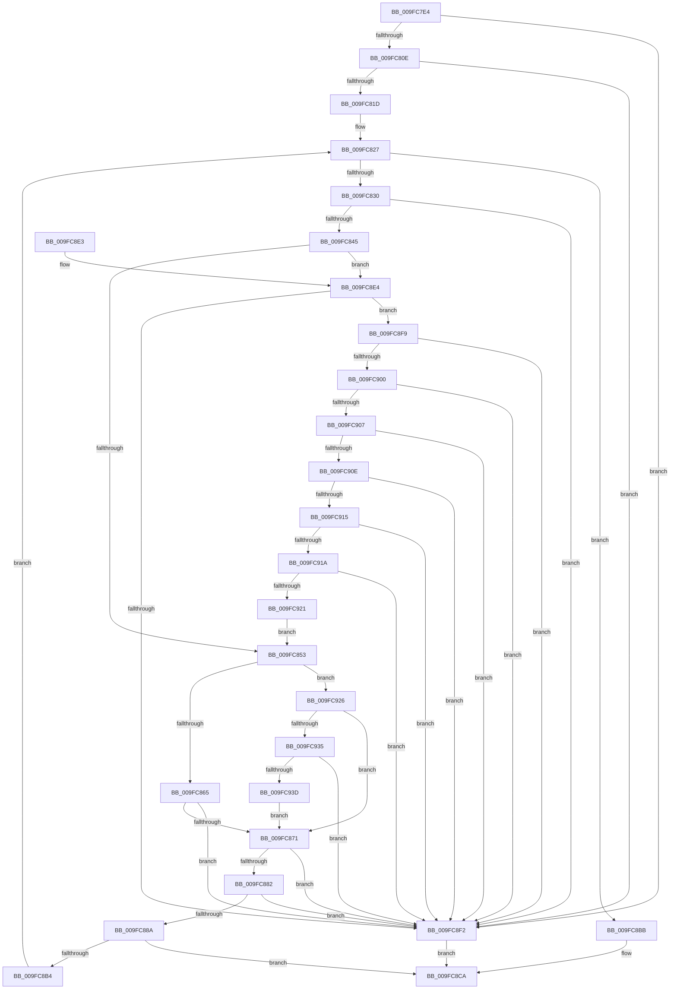

# EtwpValidateFilterDescriptors

- RVA: `0x009FC7E4`–`0x009FC942` (길이 `350` bytes)
- VA: `0x00000001409FC7E4`
- 실행 섹션: `PAGE`
- PDB 이름 있음: `예`; PDB Function 태그: `아니요`
- unwind 정보 RVA: `0x000A71D4`
- 디코드: `93`개 명령, `350/350` bytes 표시
- 미해석 바이트: `0` (있으면 어셈블리에 `.byte`로 보존)

> 이 문서는 커널 이미지의 기계어와 PDB 기호를 분석해 생성했습니다. 4번과 5번은 함수 원형과 자료형을 바이너리 사용 방식에서 추정한 C 해석이며 원본 소스 복구 결과는 아닙니다.

## 1. Dependencies

- 직접 호출 지점: **1**; 고유 호출 대상: **1**
- 직접 호출자로 확인된 함수: **1**
- RIP 상대 이미지 참조: **0**

### Outgoing calls
- `0x009FC8AB` → [EtwpAllocateFilter](EtwpAllocateFilter_function_009FC948.md) (function, `0x009FC948`)

### Direct callers
- [EtwpValidateEnableNotification](../8C/EtwpValidateEnableNotification_function_008C779C.md) at `0x008C78E7`

### Static image references
- 디코드된 RIP-relative 메모리 참조가 없습니다.

## 2. Other-region calls and transfers

- 다른 실행 섹션으로 향하는 call: **0**
- 별도 외부 분기/꼬리 이동을 확인하지 못했습니다.

## 3. Assembly (complete function range)

```asm
009FC7E4  48 89 5C 24 08                  mov qword ptr [rsp + 8], rbx
009FC7E9  48 89 6C 24 10                  mov qword ptr [rsp + 0x10], rbp
009FC7EE  48 89 74 24 18                  mov qword ptr [rsp + 0x18], rsi
009FC7F3  57                              push rdi
009FC7F4  41 56                           push r14
009FC7F6  41 57                           push r15
009FC7F8  48 83 EC 30                     sub rsp, 0x30
009FC7FC  8B 79 74                        mov edi, dword ptr [rcx + 0x74]
009FC7FF  4C 8B F2                        mov r14, rdx
009FC802  48 8B D9                        mov rbx, rcx
009FC805  83 FF 0D                        cmp edi, 0xd
009FC808  0F 87 E4 00 00 00               ja 0x1409fc8f2
009FC80E  C1 E7 04                        shl edi, 4
009FC811  83 C7 78                        add edi, 0x78
009FC814  3B 79 04                        cmp edi, dword ptr [rcx + 4]
009FC817  0F 87 D5 00 00 00               ja 0x1409fc8f2
009FC81D  33 ED                           xor ebp, ebp
009FC81F  41 BF 00 00 00 80               mov r15d, 0x80000000
009FC825  33 F6                           xor esi, esi
009FC827  3B 73 74                        cmp esi, dword ptr [rbx + 0x74]
009FC82A  0F 83 8B 00 00 00               jae 0x1409fc8bb
009FC830  8B D6                           mov edx, esi
009FC832  48 03 D2                        add rdx, rdx
009FC835  8B C7                           mov eax, edi
009FC837  4C 8B 4C D3 78                  mov r9, qword ptr [rbx + rdx*8 + 0x78]
009FC83C  4C 3B C8                        cmp r9, rax
009FC83F  0F 82 AD 00 00 00               jb 0x1409fc8f2
009FC845  44 8B 43 50                     mov r8d, dword ptr [rbx + 0x50]
009FC849  41 F6 C0 20                     test r8b, 0x20
009FC84D  0F 85 91 00 00 00               jne 0x1409fc8e4
009FC853  8B 8C D3 84 00 00 00            mov ecx, dword ptr [rbx + rdx*8 + 0x84]
009FC85A  41 0F BA E0 0A                  bt r8d, 0xa
009FC85F  0F 82 C1 00 00 00               jb 0x1409fc926
009FC865  81 F9 00 80 00 80               cmp ecx, 0x80008000
009FC86B  0F 84 81 00 00 00               je 0x1409fc8f2
009FC871  44 8B 84 D3 80 00 00 00         mov r8d, dword ptr [rbx + rdx*8 + 0x80]
009FC879  4B 8D 14 01                     lea rdx, [r9 + r8]
009FC87D  49 3B D1                        cmp rdx, r9
009FC880  72 70                           jb 0x1409fc8f2
009FC882  8B 43 04                        mov eax, dword ptr [rbx + 4]
009FC885  48 3B D0                        cmp rdx, rax
009FC888  77 68                           ja 0x1409fc8f2
009FC88A  49 8D 04 19                     lea rax, [r9 + rbx]
009FC88E  44 89 44 24 28                  mov dword ptr [rsp + 0x28], r8d
009FC893  41 03 E8                        add ebp, r8d
009FC896  48 89 44 24 20                  mov qword ptr [rsp + 0x20], rax
009FC89B  4C 8D 4B 28                     lea r9, [rbx + 0x28]
009FC89F  89 4C 24 2C                     mov dword ptr [rsp + 0x2c], ecx
009FC8A3  4D 8B C6                        mov r8, r14
009FC8A6  48 8D 54 24 20                  lea rdx, [rsp + 0x20]
009FC8AB  E8 98 00 00 00                  call 0x1409fc948
009FC8B0  85 C0                           test eax, eax
009FC8B2  78 16                           js 0x1409fc8ca
009FC8B4  FF C6                           inc esi
009FC8B6  E9 6C FF FF FF                  jmp 0x1409fc827
009FC8BB  8D 04 2F                        lea eax, [rdi + rbp]
009FC8BE  2B 43 04                        sub eax, dword ptr [rbx + 4]
009FC8C1  F7 D8                           neg eax
009FC8C3  1B C0                           sbb eax, eax
009FC8C5  25 0D 00 00 C0                  and eax, 0xc000000d
009FC8CA  48 8B 5C 24 50                  mov rbx, qword ptr [rsp + 0x50]
009FC8CF  48 8B 6C 24 58                  mov rbp, qword ptr [rsp + 0x58]
009FC8D4  48 8B 74 24 60                  mov rsi, qword ptr [rsp + 0x60]
009FC8D9  48 83 C4 30                     add rsp, 0x30
009FC8DD  41 5F                           pop r15
009FC8DF  41 5E                           pop r14
009FC8E1  5F                              pop rdi
009FC8E2  C3                              ret
009FC8E3  CC                              int3
009FC8E4  8B 84 D3 84 00 00 00            mov eax, dword ptr [rbx + rdx*8 + 0x84]
009FC8EB  3D 00 10 00 80                  cmp eax, 0x80001000
009FC8F0  75 07                           jne 0x1409fc8f9
009FC8F2  B8 0D 00 00 C0                  mov eax, 0xc000000d
009FC8F7  EB D1                           jmp 0x1409fc8ca
009FC8F9  3D 00 02 00 80                  cmp eax, 0x80000200
009FC8FE  74 F2                           je 0x1409fc8f2
009FC900  3D 00 04 00 80                  cmp eax, 0x80000400
009FC905  74 EB                           je 0x1409fc8f2
009FC907  3D 00 20 00 80                  cmp eax, 0x80002000
009FC90C  74 E4                           je 0x1409fc8f2
009FC90E  3D 00 01 00 80                  cmp eax, 0x80000100
009FC913  74 DD                           je 0x1409fc8f2
009FC915  41 3B C7                        cmp eax, r15d
009FC918  74 D8                           je 0x1409fc8f2
009FC91A  3D 02 00 00 80                  cmp eax, 0x80000002
009FC91F  74 D1                           je 0x1409fc8f2
009FC921  E9 2D FF FF FF                  jmp 0x1409fc853
009FC926  42 8D 04 39                     lea eax, [rcx + r15]
009FC92A  A9 FD FE FF FF                  test eax, 0xfffffefd
009FC92F  0F 85 3C FF FF FF               jne 0x1409fc871
009FC935  81 F9 02 01 00 80               cmp ecx, 0x80000102
009FC93B  75 B5                           jne 0x1409fc8f2
009FC93D  E9 2F FF FF FF                  jmp 0x1409fc871
```

## 4. C-style interpretation (structured pseudocode)

```c
__int64 __fastcall EtwpValidateFilterDescriptors(__int64 a1, __int64 a2)
{
    __int64 result;
    __int64 v_rbp;
    __int64 v_rdi;
    __int64 v_rsi;
    __int64 v_rsp;
    unsigned int v_stack_m1C;
    unsigned int v_stack_m20;
    unsigned __int64 v_stack_m28;
    unsigned __int64 v_stack_p10;
    unsigned __int64 v_stack_p18;
    unsigned __int64 v_stack_p8;

    v_stack_p8 = v_rbx;
    v_stack_p10 = v_rbp;
    v_stack_p18 = v_rsi;
    v_rsp = (v_rsp) - (48);
    if (((unsigned int)((unsigned int)(*(unsigned int *)(a1 + 116)))) > 13) goto loc_009FC8F2;
    v_rdi = (unsigned int)(((unsigned int)(*(unsigned int *)(a1 + 116))) << (4));
    v_rdi = (unsigned int)((v_rdi) + (120));
    if (((unsigned int)(v_rdi)) > (*(unsigned int *)(a1 + 4))) goto loc_009FC8F2;
    v_rbp = 0;
    v_rsi = 0;
loc_009FC827:
    if (0 >= (*(unsigned int *)(a1 + 116))) goto loc_009FC8BB;
    a2 = (0) + (0);
    if ((*(unsigned __int64 *)(a1 + a2 * 8 + 120)) < ((unsigned int)((unsigned int)(v_rdi)))) goto loc_009FC8F2;
    if ((((unsigned __int8)((unsigned int)(*(unsigned int *)(a1 + 80)))) & (32)) != 0) goto loc_009FC8E4;
loc_009FC853:
    if (condition_is_below) goto loc_009FC926;
    if (((unsigned int)((unsigned int)(*(unsigned int *)(a1 + a2 * 8 + 132)))) == 0x80008000ULL) goto loc_009FC8F2;
loc_009FC871:
    if ((*(unsigned __int64 *)(a1 + a2 * 8 + 120) + (unsigned int)(*(unsigned int *)(a1 + a2 * 8 + 128)) * 1) < (*(unsigned __int64 *)(a1 + a2 * 8 + 120))) goto loc_009FC8F2;
    if ((*(unsigned __int64 *)(a1 + a2 * 8 + 120) + (unsigned int)(*(unsigned int *)(a1 + a2 * 8 + 128)) * 1) > ((unsigned int)(*(unsigned int *)(a1 + 4)))) goto loc_009FC8F2;
    v_stack_m20 = (unsigned int)((unsigned int)(*(unsigned int *)(a1 + a2 * 8 + 128)));
    v_rbp = (unsigned int)((v_rbp) + ((unsigned int)((unsigned int)(*(unsigned int *)(a1 + a2 * 8 + 128)))));
    v_stack_m28 = *(unsigned __int64 *)(a1 + a2 * 8 + 120) + a1 * 1;
    v_stack_m1C = (unsigned int)((unsigned int)(*(unsigned int *)(a1 + a2 * 8 + 132)));
    result = EtwpAllocateFilter((unsigned int)(*(unsigned int *)(a1 + a2 * 8 + 132)), v_stack_m28, a2, a1 + 40);
    if (sign_flag) goto loc_009FC8CA;
    v_rsi = (unsigned int)((v_rsi) + 1);
    goto loc_009FC827;
loc_009FC8BB:
    result = (unsigned int)((v_rdi + v_rbp * 1) - (*(unsigned int *)(a1 + 4)));
    result = (unsigned int)(-(result));
    result = (unsigned int)((result) & (0xC000000DULL));
loc_009FC8CA:
    v_rsp = (v_rsp) + (48);
    return result;
loc_009FC8E4:
    if (((unsigned int)((unsigned int)(*(unsigned int *)(v_stack_p8 + v_stack_m28 * 8 + 132)))) != 0x80001000ULL) goto loc_009FC8F9;
loc_009FC8F2:
    goto loc_009FC8CA;
loc_009FC8F9:
    if (((unsigned int)((unsigned int)(0xC000000DULL))) == 0x80000200ULL) goto loc_009FC8F2;
    if (((unsigned int)((unsigned int)(0xC000000DULL))) == 0x80000400ULL) goto loc_009FC8F2;
    if (((unsigned int)((unsigned int)(0xC000000DULL))) == 0x80002000ULL) goto loc_009FC8F2;
    if (((unsigned int)((unsigned int)(0xC000000DULL))) == 0x80000100ULL) goto loc_009FC8F2;
    if (((unsigned int)((unsigned int)(0xC000000DULL))) == ((unsigned int)((unsigned int)(0x80000000ULL)))) goto loc_009FC8F2;
    if (((unsigned int)((unsigned int)(0xC000000DULL))) == 0x80000002ULL) goto loc_009FC8F2;
    goto loc_009FC853;
loc_009FC926:
    if ((((unsigned int)((unsigned int)(*(unsigned int *)(a1 + a2 * 8 + 132)) + (unsigned int)(0x80000000ULL) * 1)) & (0xFFFFFEFDULL)) != 0) goto loc_009FC871;
    if (((unsigned int)((unsigned int)(*(unsigned int *)(a1 + a2 * 8 + 132)))) != 0x80000102ULL) goto loc_009FC8F2;
    goto loc_009FC871;
}
```

## 5. (Beta) C Style

```c
int64_t EtwpValidateFilterDescriptors(void *Arg1, int64_t Arg2)
{
    uint8_t *arg1 = (uint8_t *)Arg1;

    int64_t result;
    int64_t local_rbp;
    int64_t local_rdi;
    int64_t local_rsi;
    int64_t local_rsp;
    uint32_t v_stack_m1C;
    uint32_t v_stack_m20;
    uint64_t v_stack_m28;
    uint64_t v_stack_p10;
    uint64_t v_stack_p18;
    uint64_t v_stack_p8;

    v_stack_p8 = local_rbx;
    v_stack_p10 = local_rbp;
    v_stack_p18 = local_rsi;
    local_rsp = (local_rsp) - (48);
    if (((uint32_t)((uint32_t)(*(uint32_t *)(arg1 + 0x74)))) > 13) goto loc_009FC8F2;
    local_rdi = (uint32_t)(((uint32_t)(*(uint32_t *)(arg1 + 0x74))) << (4));
    local_rdi = (uint32_t)((local_rdi) + (120));
    if (((uint32_t)(local_rdi)) > (*(uint32_t *)(arg1 + 0x4))) goto loc_009FC8F2;
    local_rbp = 0;
    local_rsi = 0;
loc_009FC827:
    if (0 >= (*(uint32_t *)(arg1 + 0x74))) goto loc_009FC8BB;
    Arg2 = (0) + (0);
    if ((*(uint64_t *)(arg1 + Arg2 * 8 + 0x78)) < ((uint32_t)((uint32_t)(local_rdi)))) goto loc_009FC8F2;
    if ((((uint8_t)((uint32_t)(*(uint32_t *)(arg1 + 0x50)))) & (32)) != 0) goto loc_009FC8E4;
loc_009FC853:
    if (condition_is_below) goto loc_009FC926;
    if (((uint32_t)((uint32_t)(*(uint32_t *)(arg1 + Arg2 * 8 + 0x84)))) == 0x80008000ULL) goto loc_009FC8F2;
loc_009FC871:
    if ((*(uint64_t *)(arg1 + Arg2 * 8 + 0x78) + (uint32_t)(*(uint32_t *)(arg1 + Arg2 * 8 + 0x80)) * 1) < (*(uint64_t *)(arg1 + Arg2 * 8 + 0x78))) goto loc_009FC8F2;
    if ((*(uint64_t *)(arg1 + Arg2 * 8 + 0x78) + (uint32_t)(*(uint32_t *)(arg1 + Arg2 * 8 + 0x80)) * 1) > ((uint32_t)(*(uint32_t *)(arg1 + 0x4)))) goto loc_009FC8F2;
    v_stack_m20 = (uint32_t)((uint32_t)(*(uint32_t *)(arg1 + Arg2 * 8 + 0x80)));
    local_rbp = (uint32_t)((local_rbp) + ((uint32_t)((uint32_t)(*(uint32_t *)(arg1 + Arg2 * 8 + 0x80)))));
    v_stack_m28 = *(uint64_t *)(arg1 + Arg2 * 8 + 0x78) + Arg1 * 1;
    v_stack_m1C = (uint32_t)((uint32_t)(*(uint32_t *)(arg1 + Arg2 * 8 + 0x84)));
    result = EtwpAllocateFilter((uint32_t)(*(uint32_t *)(arg1 + Arg2 * 8 + 0x84)), v_stack_m28, Arg2, Arg1 + 40);
    if (sign_flag) goto loc_009FC8CA;
    local_rsi = (uint32_t)((local_rsi) + 1);
    goto loc_009FC827;
loc_009FC8BB:
    result = (uint32_t)((local_rdi + local_rbp * 1) - (*(uint32_t *)(arg1 + 0x4)));
    result = (uint32_t)(-(result));
    result = (uint32_t)((result) & (0xC000000DULL));
loc_009FC8CA:
    local_rsp = (local_rsp) + (48);
    return result;
loc_009FC8E4:
    if (((uint32_t)((uint32_t)(*(uint32_t *)(v_stack_p8 + v_stack_m28 * 8 + 0x84)))) != 0x80001000ULL) goto loc_009FC8F9;
loc_009FC8F2:
    goto loc_009FC8CA;
loc_009FC8F9:
    if (((uint32_t)((uint32_t)(0xC000000DULL))) == 0x80000200ULL) goto loc_009FC8F2;
    if (((uint32_t)((uint32_t)(0xC000000DULL))) == 0x80000400ULL) goto loc_009FC8F2;
    if (((uint32_t)((uint32_t)(0xC000000DULL))) == 0x80002000ULL) goto loc_009FC8F2;
    if (((uint32_t)((uint32_t)(0xC000000DULL))) == 0x80000100ULL) goto loc_009FC8F2;
    if (((uint32_t)((uint32_t)(0xC000000DULL))) == ((uint32_t)((uint32_t)(0x80000000ULL)))) goto loc_009FC8F2;
    if (((uint32_t)((uint32_t)(0xC000000DULL))) == 0x80000002ULL) goto loc_009FC8F2;
    goto loc_009FC853;
loc_009FC926:
    if ((((uint32_t)((uint32_t)(*(uint32_t *)(arg1 + Arg2 * 8 + 0x84)) + (uint32_t)(0x80000000ULL) * 1)) & (0xFFFFFEFDULL)) != 0) goto loc_009FC871;
    if (((uint32_t)((uint32_t)(*(uint32_t *)(arg1 + Arg2 * 8 + 0x84)))) != 0x80000102ULL) goto loc_009FC8F2;
    goto loc_009FC871;
}
```

### 관측된 메모리 오프셋

구조체 형식이 확인되지 않은 접근은 인자 기준의 오프셋으로만 기록했습니다.

| 기준 인자 | 오프셋 표현 | 폭 (bit) | 접근 |
|---|---:|---:|---|
| `Arg1` | `+ 0x4` | `32` | `R` |
| `Arg1` | `+ 0x28` | `64` | `R` |
| `Arg1` | `+ 0x50` | `32` | `R` |
| `Arg1` | `+ 0x74` | `32` | `R` |
| `Arg1` | `+ 0x78 + rdx*8` | `64` | `R` |
| `Arg1` | `+ 0x80 + rdx*8` | `32` | `R` |
| `Arg1` | `+ 0x84 + rdx*8` | `32` | `R` |

## 6. Execution-region graph

[열기: 2D/3D 그래프와 함수 탐색 컨트롤 패널](../../../control-panel.html?section=page&rva=0x009FC7E4&view=graph)

- 2D 그래프는 위에서 아래로 흐르고, 3D 그래프는 빈 공간을 드래그해 회전합니다. Shift+드래그는 이동, 휠은 확대·축소, 함수 노드 선택은 대상 보고서 이동입니다.

### Static fallback


