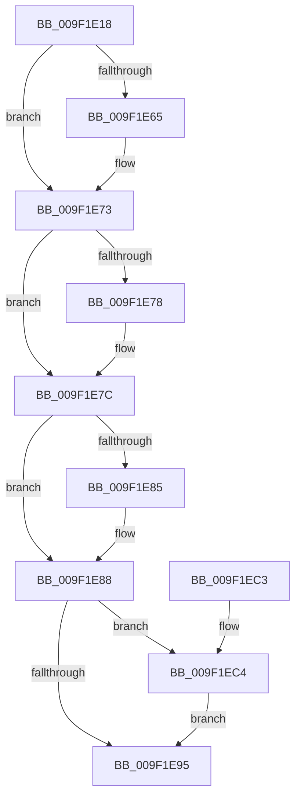

# ExReferenceHandleDebugInfo

- RVA: `0x009F1E18`–`0x009F1ECE` (길이 `182` bytes)
- VA: `0x00000001409F1E18`
- 실행 섹션: `PAGE`
- PDB 이름 있음: `예`; PDB Function 태그: `아니요`
- unwind 정보 RVA: `0x000841B4`
- 디코드: `51`개 명령, `182/182` bytes 표시
- 미해석 바이트: `0` (있으면 어셈블리에 `.byte`로 보존)

> 이 문서는 커널 이미지의 기계어와 PDB 기호를 분석해 생성했습니다. 4번과 5번은 함수 원형과 자료형을 바이너리 사용 방식에서 추정한 C 해석이며 원본 소스 복구 결과는 아닙니다.

## 1. Dependencies

- 직접 호출 지점: **5**; 고유 호출 대상: **5**
- 직접 호출자로 확인된 함수: **2**
- RIP 상대 이미지 참조: **0**

### Outgoing calls
- `0x009F1E55` → [KeAbPreAcquire](../../text/21/KeAbPreAcquire_function_00210230.md) (function, `0x00210230`)
- `0x009F1E6E` → [ExfAcquirePushLockExclusiveEx](../../text/20/ExfAcquirePushLockExclusiveEx_function_0020FC90.md) (function, `0x0020FC90`)
- `0x009F1E98` → [KeAbPostRelease](../../text/2E/KeAbPostRelease_function_002E1600.md) (function, `0x002E1600`)
- `0x009F1EA0` → [KeLeaveCriticalRegionThread](../../text/25/KeLeaveCriticalRegionThread_function_0025EFF0.md) (function, `0x0025EFF0`)
- `0x009F1EC7` → [ExfTryToWakePushLock](../../text/26/ExfTryToWakePushLock_function_00265DD0.md) (function, `0x00265DD0`)

### Direct callers
- [ExpUpdateDebugInfo](../86/ExpUpdateDebugInfo_function_0086B174.md) at `0x0086B19F`
- [NtQueryInformationProcess](../9A/NtQueryInformationProcess_function_009AA250.md) at `0x009AC2A4`

### Static image references
- 디코드된 RIP-relative 메모리 참조가 없습니다.

## 2. Other-region calls and transfers

- 다른 실행 섹션으로 향하는 call: **5**
  - `0x009F1E55` → [KeAbPreAcquire](../../text/21/KeAbPreAcquire_function_00210230.md) (`PAGE` → `.text`)
  - `0x009F1E6E` → [ExfAcquirePushLockExclusiveEx](../../text/20/ExfAcquirePushLockExclusiveEx_function_0020FC90.md) (`PAGE` → `.text`)
  - `0x009F1E98` → [KeAbPostRelease](../../text/2E/KeAbPostRelease_function_002E1600.md) (`PAGE` → `.text`)
  - `0x009F1EA0` → [KeLeaveCriticalRegionThread](../../text/25/KeLeaveCriticalRegionThread_function_0025EFF0.md) (`PAGE` → `.text`)
  - `0x009F1EC7` → [ExfTryToWakePushLock](../../text/26/ExfTryToWakePushLock_function_00265DD0.md) (`PAGE` → `.text`)
- 별도 외부 분기/꼬리 이동을 확인하지 못했습니다.

## 3. Assembly (complete function range)

```asm
009F1E18  48 8B C4                        mov rax, rsp
009F1E1B  48 89 58 08                     mov qword ptr [rax + 8], rbx
009F1E1F  48 89 68 10                     mov qword ptr [rax + 0x10], rbp
009F1E23  48 89 70 18                     mov qword ptr [rax + 0x18], rsi
009F1E27  48 89 78 20                     mov qword ptr [rax + 0x20], rdi
009F1E2B  41 56                           push r14
009F1E2D  48 83 EC 20                     sub rsp, 0x20
009F1E31  65 48 8B 2C 25 88 01 00 00      mov rbp, qword ptr gs:[0x188]
009F1E3A  48 8D 79 38                     lea rdi, [rcx + 0x38]
009F1E3E  4C 8B F1                        mov r14, rcx
009F1E41  48 83 CB FF                     or rbx, 0xffffffffffffffff
009F1E45  45 33 C0                        xor r8d, r8d
009F1E48  33 D2                           xor edx, edx
009F1E4A  48 8B CF                        mov rcx, rdi
009F1E4D  66 01 9D E4 01 00 00            add word ptr [rbp + 0x1e4], bx
009F1E54  90                              nop
009F1E55  E8 D6 E3 81 FF                  call 0x140210230
009F1E5A  F0 48 0F BA 2F 00               lock bts qword ptr [rdi], 0
009F1E60  48 8B F0                        mov rsi, rax
009F1E63  73 0E                           jae 0x1409f1e73
009F1E65  4C 8B C7                        mov r8, rdi
009F1E68  48 8B D0                        mov rdx, rax
009F1E6B  48 8B CF                        mov rcx, rdi
009F1E6E  E8 1D DE 81 FF                  call 0x14020fc90
009F1E73  48 85 F6                        test rsi, rsi
009F1E76  74 04                           je 0x1409f1e7c
009F1E78  C6 46 0A 01                     mov byte ptr [rsi + 0xa], 1
009F1E7C  49 8B 76 60                     mov rsi, qword ptr [r14 + 0x60]
009F1E80  48 85 F6                        test rsi, rsi
009F1E83  74 03                           je 0x1409f1e88
009F1E85  F0 FF 06                        lock inc dword ptr [rsi]
009F1E88  F0 48 0F C1 1F                  lock xadd qword ptr [rdi], rbx
009F1E8D  80 E3 06                        and bl, 6
009F1E90  80 FB 02                        cmp bl, 2
009F1E93  74 2F                           je 0x1409f1ec4
009F1E95  48 8B CF                        mov rcx, rdi
009F1E98  E8 63 F7 8E FF                  call 0x1402e1600
009F1E9D  48 8B CD                        mov rcx, rbp
009F1EA0  E8 4B D1 86 FF                  call 0x14025eff0
009F1EA5  48 8B 5C 24 30                  mov rbx, qword ptr [rsp + 0x30]
009F1EAA  48 8B C6                        mov rax, rsi
009F1EAD  48 8B 74 24 40                  mov rsi, qword ptr [rsp + 0x40]
009F1EB2  48 8B 6C 24 38                  mov rbp, qword ptr [rsp + 0x38]
009F1EB7  48 8B 7C 24 48                  mov rdi, qword ptr [rsp + 0x48]
009F1EBC  48 83 C4 20                     add rsp, 0x20
009F1EC0  41 5E                           pop r14
009F1EC2  C3                              ret
009F1EC3  CC                              int3
009F1EC4  48 8B CF                        mov rcx, rdi
009F1EC7  E8 04 3F 87 FF                  call 0x140265dd0
009F1ECC  EB C7                           jmp 0x1409f1e95
```

## 4. C-style interpretation (structured pseudocode)

```c
__int64 __fastcall ExReferenceHandleDebugInfo(__int64 a1, int a2, int a3)
{
    __int64 result;
    __int64 v_rbx;
    __int64 v_rsp;
    unsigned __int64 v_stack_p10;
    unsigned __int64 v_stack_p18;
    unsigned __int64 v_stack_p20;
    unsigned __int64 v_stack_p8;

    *(unsigned __int64 *)(v_rsp + 8) = v_rbx;
    *(unsigned __int64 *)(v_rsp + 16) = v_rbp;
    *(unsigned __int64 *)(v_rsp + 24) = v_rsi;
    *(unsigned __int64 *)(v_rsp + 32) = v_rdi;
    v_rsp = (v_rsp) - (32);
    v_rbx = (v_rbx) | (-1);
    a3 = 0;
    a2 = 0;
    result = KeAbPreAcquire(a1 + 56, a2, a3, a4);
    if (!(condition_is_above_or_equal)) {
        a3 = a1 + 56;
        a2 = result;
        a1 = a1 + 56;
        result = ExfAcquirePushLockExclusiveEx(a1, a2, a3, a4);
    }
    if (result != 0) {
        *(unsigned __int8 *)(result + 10) = 1;
    }
    if (*(unsigned __int64 *)(a1 + 96) != 0) {
    }
    v_rbx = (unsigned __int8)((v_rbx) & (6));
    if (((unsigned __int8)(v_rbx)) == 2) goto loc_009F1EC4;
loc_009F1E95:
    result = KeAbPostRelease(a1 + 56, a2, a3, a4);
    result = KeLeaveCriticalRegionThread(*(unsigned __int64 *)(gs_base + (0 + 392)), a2, a3, a4);
    v_rsp = (v_rsp) + (32);
    return *(unsigned __int64 *)(a1 + 96);
loc_009F1EC4:
    result = ExfTryToWakePushLock(v_stack_p20, a2, a3, a4);
    goto loc_009F1E95;
}
```

## 5. (Beta) C Style

```c
int64_t ExReferenceHandleDebugInfo(void *Arg1, int32_t Arg2, int32_t Arg3)
{
    uint8_t *arg1 = (uint8_t *)Arg1;

    int64_t result;
    int64_t local_rbx;
    int64_t local_rsp;
    uint64_t v_stack_p10;
    uint64_t v_stack_p18;
    uint64_t v_stack_p20;
    uint64_t v_stack_p8;

    *(uint64_t *)(local_rsp + 0x8) = local_rbx;
    *(uint64_t *)(local_rsp + 0x10) = local_rbp;
    *(uint64_t *)(local_rsp + 0x18) = local_rsi;
    *(uint64_t *)(local_rsp + 0x20) = local_rdi;
    local_rsp = (local_rsp) - (32);
    local_rbx = (local_rbx) | (-1);
    Arg3 = 0;
    Arg2 = 0;
    result = KeAbPreAcquire(Arg1 + 56, Arg2, Arg3, a4);
    if (!(condition_is_above_or_equal)) {
        Arg3 = Arg1 + 56;
        Arg2 = result;
        Arg1 = Arg1 + 56;
        result = ExfAcquirePushLockExclusiveEx(Arg1, Arg2, Arg3, a4);
    }
    if (result != 0) {
        *(uint8_t *)(result + 0xA) = 1;
    }
    if (*(uint64_t *)(arg1 + 0x60) != 0) {
    }
    local_rbx = (uint8_t)((local_rbx) & (6));
    if (((uint8_t)(local_rbx)) == 2) goto loc_009F1EC4;
loc_009F1E95:
    result = KeAbPostRelease(Arg1 + 56, Arg2, Arg3, a4);
    result = KeLeaveCriticalRegionThread(*(uint64_t *)(gs_base + (0 + 0x188)), Arg2, Arg3, a4);
    local_rsp = (local_rsp) + (32);
    return *(uint64_t *)(arg1 + 0x60);
loc_009F1EC4:
    result = ExfTryToWakePushLock(v_stack_p20, Arg2, Arg3, a4);
    goto loc_009F1E95;
}
```

### 관측된 메모리 오프셋

구조체 형식이 확인되지 않은 접근은 인자 기준의 오프셋으로만 기록했습니다.

| 기준 인자 | 오프셋 표현 | 폭 (bit) | 접근 |
|---|---:|---:|---|
| `Arg1` | `+ 0x0` | `64` | `R/W` |
| `Arg1` | `+ 0x38` | `64` | `R` |
| `Arg1` | `+ 0x60` | `64` | `R` |

## 6. Execution-region graph

[열기: 2D/3D 그래프와 함수 탐색 컨트롤 패널](../../../control-panel.html?section=page&rva=0x009F1E18&view=graph)

- 2D 그래프는 위에서 아래로 흐르고, 3D 그래프는 빈 공간을 드래그해 회전합니다. Shift+드래그는 이동, 휠은 확대·축소, 함수 노드 선택은 대상 보고서 이동입니다.

### Static fallback


