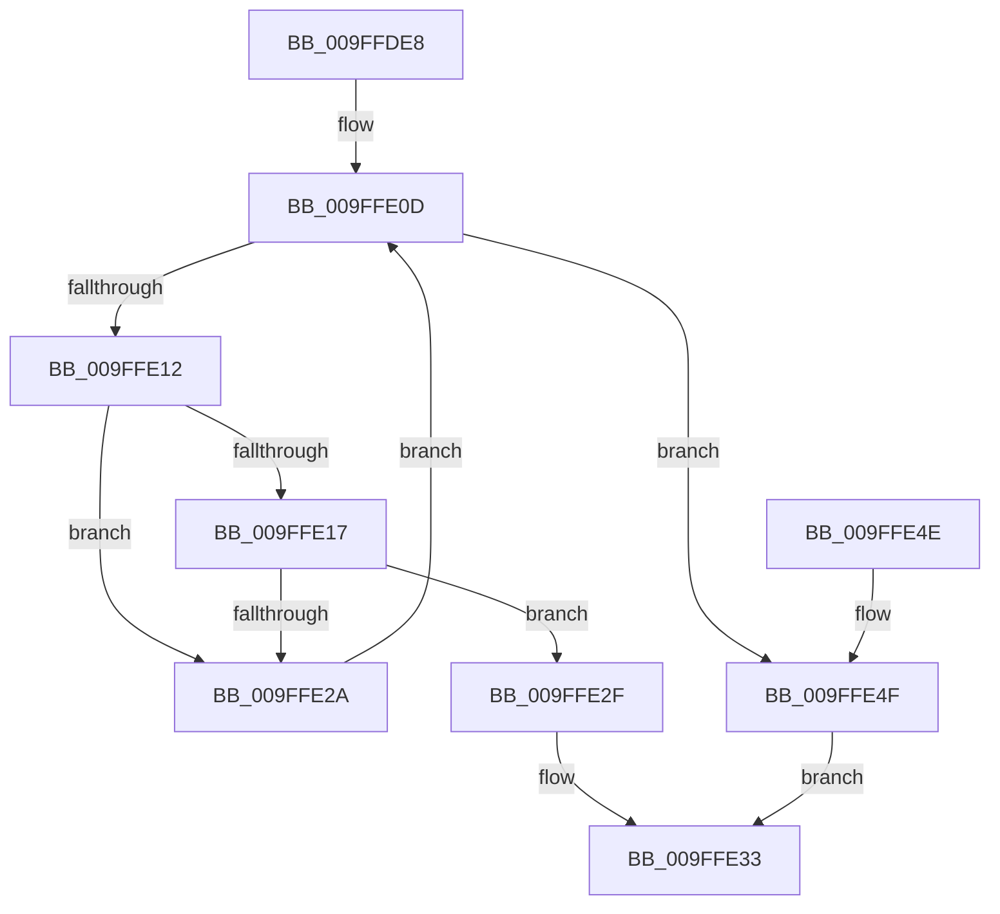

# ExpWnfFindScopeInstance

- RVA: `0x009FFDE8`–`0x009FFE53` (길이 `107` bytes)
- VA: `0x00000001409FFDE8`
- 실행 섹션: `PAGE`
- PDB 이름 있음: `예`; PDB Function 태그: `아니요`
- unwind 정보 RVA: `0x0005FD64`
- 디코드: `34`개 명령, `107/107` bytes 표시
- 미해석 바이트: `0` (있으면 어셈블리에 `.byte`로 보존)

> 이 문서는 커널 이미지의 기계어와 PDB 기호를 분석해 생성했습니다. 4번과 5번은 함수 원형과 자료형을 바이너리 사용 방식에서 추정한 C 해석이며 원본 소스 복구 결과는 아닙니다.

## 1. Dependencies

- 직접 호출 지점: **1**; 고유 호출 대상: **1**
- 직접 호출자로 확인된 함수: **2**
- RIP 상대 이미지 참조: **0**

### Outgoing calls
- `0x009FFE21` → [memcmp](../../text/6C/memcmp_function_006C6B10.md) (function, `0x006C6B10`)

### Direct callers
- [ExpWnfDeleteScopeById](../90/ExpWnfDeleteScopeById_function_00908168.md) at `0x009081E7`
- [sub_0090B43E](../90/Unknown_function_0090B43E.md) at `0x0090B4F0`
- [sub_0090B43E](../90/Unknown_function_0090B43E.md) at `0x0090B575`

### Static image references
- 디코드된 RIP-relative 메모리 참조가 없습니다.

## 2. Other-region calls and transfers

- 다른 실행 섹션으로 향하는 call: **1**
  - `0x009FFE21` → [memcmp](../../text/6C/memcmp_function_006C6B10.md) (`PAGE` → `.text`)
- 별도 외부 분기/꼬리 이동을 확인하지 못했습니다.

## 3. Assembly (complete function range)

```asm
009FFDE8  48 8B C4                        mov rax, rsp
009FFDEB  48 89 58 08                     mov qword ptr [rax + 8], rbx
009FFDEF  48 89 68 10                     mov qword ptr [rax + 0x10], rbp
009FFDF3  48 89 70 18                     mov qword ptr [rax + 0x18], rsi
009FFDF7  48 89 78 20                     mov qword ptr [rax + 0x20], rdi
009FFDFB  41 56                           push r14
009FFDFD  48 83 EC 20                     sub rsp, 0x20
009FFE01  48 8B 19                        mov rbx, qword ptr [rcx]
009FFE04  4C 8B F2                        mov r14, rdx
009FFE07  41 8B E8                        mov ebp, r8d
009FFE0A  48 8B F1                        mov rsi, rcx
009FFE0D  48 3B DE                        cmp rbx, rsi
009FFE10  74 3D                           je 0x1409ffe4f
009FFE12  3B 6B F4                        cmp ebp, dword ptr [rbx - 0xc]
009FFE15  75 13                           jne 0x1409ffe2a
009FFE17  48 8B 53 F8                     mov rdx, qword ptr [rbx - 8]
009FFE1B  4C 8B C5                        mov r8, rbp
009FFE1E  49 8B CE                        mov rcx, r14
009FFE21  E8 EA 6C CC FF                  call 0x1406c6b10
009FFE26  85 C0                           test eax, eax
009FFE28  74 05                           je 0x1409ffe2f
009FFE2A  48 8B 1B                        mov rbx, qword ptr [rbx]
009FFE2D  EB DE                           jmp 0x1409ffe0d
009FFE2F  48 8D 43 E0                     lea rax, [rbx - 0x20]
009FFE33  48 8B 5C 24 30                  mov rbx, qword ptr [rsp + 0x30]
009FFE38  48 8B 6C 24 38                  mov rbp, qword ptr [rsp + 0x38]
009FFE3D  48 8B 74 24 40                  mov rsi, qword ptr [rsp + 0x40]
009FFE42  48 8B 7C 24 48                  mov rdi, qword ptr [rsp + 0x48]
009FFE47  48 83 C4 20                     add rsp, 0x20
009FFE4B  41 5E                           pop r14
009FFE4D  C3                              ret
009FFE4E  CC                              int3
009FFE4F  33 C0                           xor eax, eax
009FFE51  EB E0                           jmp 0x1409ffe33
```

## 4. C-style interpretation (structured pseudocode)

```c
__int64 __fastcall ExpWnfFindScopeInstance(__int64 a1, __int64 a2, int a3)
{
    __int64 result;
    __int64 v_rsp;
    unsigned __int64 v_stack_p10;
    unsigned __int64 v_stack_p18;
    unsigned __int64 v_stack_p20;
    unsigned __int64 v_stack_p8;

    *(unsigned __int64 *)(v_rsp + 8) = v_rbx;
    *(unsigned __int64 *)(v_rsp + 16) = v_rbp;
    *(unsigned __int64 *)(v_rsp + 24) = v_rsi;
    *(unsigned __int64 *)(v_rsp + 32) = v_rdi;
    v_rsp = (v_rsp) - (32);
loc_009FFE0D:
    if ((*(unsigned __int64 *)(a1)) == a1) goto loc_009FFE4F;
    if (((unsigned int)((unsigned int)(a3))) != (*(unsigned int *)(*(unsigned __int64 *)(a1) - 12))) goto loc_009FFE2A;
    result = memcmp(a2, *(unsigned __int64 *)(*(unsigned __int64 *)(a1) - 8), (unsigned int)(a3), a4);
    if ((unsigned int)(result) == 0) goto loc_009FFE2F;
loc_009FFE2A:
    goto loc_009FFE0D;
loc_009FFE2F:
loc_009FFE33:
    v_rsp = (v_rsp) + (32);
    return *(unsigned __int64 *)(*(unsigned __int64 *)(a1)) - 32;
loc_009FFE4F:
    result = 0;
    goto loc_009FFE33;
}
```

## 5. (Beta) C Style

```c
int64_t ExpWnfFindScopeInstance(void *Arg1, int64_t Arg2, int32_t Arg3)
{
    uint8_t *arg1 = (uint8_t *)Arg1;

    int64_t result;
    int64_t local_rsp;
    uint64_t v_stack_p10;
    uint64_t v_stack_p18;
    uint64_t v_stack_p20;
    uint64_t v_stack_p8;

    *(uint64_t *)(local_rsp + 0x8) = local_rbx;
    *(uint64_t *)(local_rsp + 0x10) = local_rbp;
    *(uint64_t *)(local_rsp + 0x18) = local_rsi;
    *(uint64_t *)(local_rsp + 0x20) = local_rdi;
    local_rsp = (local_rsp) - (32);
loc_009FFE0D:
    if ((*(uint64_t *)(arg1)) == Arg1) goto loc_009FFE4F;
    if (((uint32_t)((uint32_t)(Arg3))) != (*(uint32_t *)(*(uint64_t *)(arg1) - 0xC))) goto loc_009FFE2A;
    result = memcmp(Arg2, *(uint64_t *)(*(uint64_t *)(arg1) - 0x8), (uint32_t)(Arg3), a4);
    if ((uint32_t)(result) == 0) goto loc_009FFE2F;
loc_009FFE2A:
    goto loc_009FFE0D;
loc_009FFE2F:
loc_009FFE33:
    local_rsp = (local_rsp) + (32);
    return *(uint64_t *)(*(uint64_t *)(arg1)) - 32;
loc_009FFE4F:
    result = 0;
    goto loc_009FFE33;
}
```

### 관측된 메모리 오프셋

구조체 형식이 확인되지 않은 접근은 인자 기준의 오프셋으로만 기록했습니다.

| 기준 인자 | 오프셋 표현 | 폭 (bit) | 접근 |
|---|---:|---:|---|
| `Arg1` | `+ 0x0` | `64` | `R` |

## 6. Execution-region graph

[열기: 2D/3D 그래프와 함수 탐색 컨트롤 패널](../../../control-panel.html?section=page&rva=0x009FFDE8&view=graph)

- 2D 그래프는 위에서 아래로 흐르고, 3D 그래프는 빈 공간을 드래그해 회전합니다. Shift+드래그는 이동, 휠은 확대·축소, 함수 노드 선택은 대상 보고서 이동입니다.

### Static fallback


