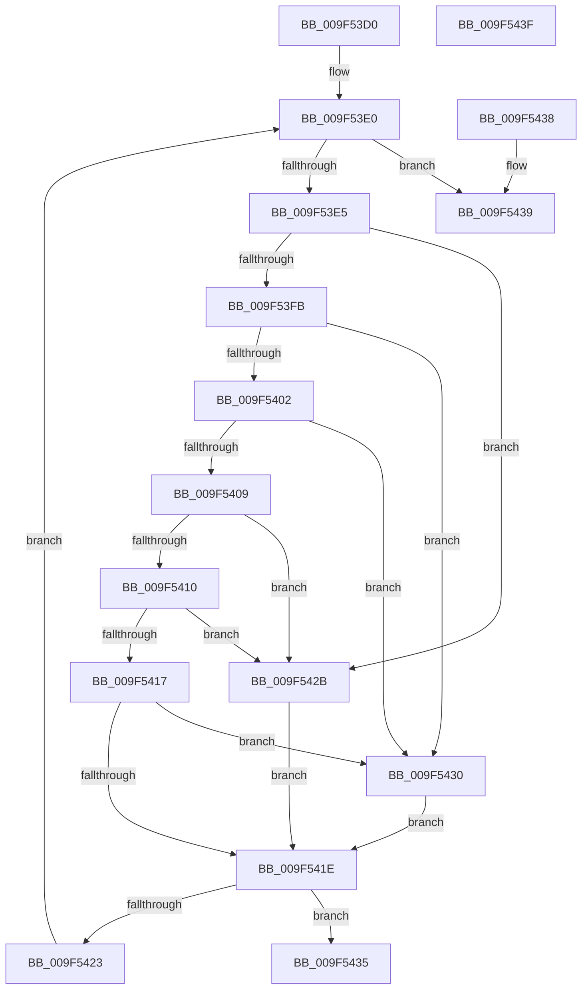

# FindFilterOperatorClose

- RVA: `0x009F53D0`–`0x009F5440` (길이 `112` bytes)
- VA: `0x00000001409F53D0`
- 실행 섹션: `PAGE`
- PDB 이름 있음: `예`; PDB Function 태그: `아니요`
- unwind 정보 RVA: `0x000DB714`
- 디코드: `38`개 명령, `112/112` bytes 표시
- 미해석 바이트: `0` (있으면 어셈블리에 `.byte`로 보존)

> 이 문서는 커널 이미지의 기계어와 PDB 기호를 분석해 생성했습니다. 4번과 5번은 함수 원형과 자료형을 바이너리 사용 방식에서 추정한 C 해석이며 원본 소스 복구 결과는 아닙니다.

## 1. Dependencies

- 직접 호출 지점: **0**; 고유 호출 대상: **0**
- 직접 호출자로 확인된 함수: **2**
- RIP 상대 이미지 참조: **0**

### Outgoing calls
- 직접 디코드된 call 명령이 없습니다.

### Direct callers
- [FilterEvalStrict](../8E/FilterEvalStrict_function_008E0ADC.md) at `0x008E0B4C`
- [FilterEvalStrict](../8E/FilterEvalStrict_function_008E0ADC.md) at `0x008E0C9A`
- [sub_00B1CF9C](../B1/Unknown_function_00B1CF9C.md) at `0x00B1CFC7`

### Static image references
- 디코드된 RIP-relative 메모리 참조가 없습니다.

## 2. Other-region calls and transfers

- 다른 실행 섹션으로 향하는 call: **0**
- 별도 외부 분기/꼬리 이동을 확인하지 못했습니다.

## 3. Assembly (complete function range)

```asm
009F53D0  45 33 D2                        xor r10d, r10d
009F53D3  45 8B DA                        mov r11d, r10d
009F53D6  45 89 10                        mov dword ptr [r8], r10d
009F53D9  45 8B CA                        mov r9d, r10d
009F53DC  0F 1F 40 00                     nop dword ptr [rax]
009F53E0  44 3B C9                        cmp r9d, ecx
009F53E3  73 54                           jae 0x1409f5439
009F53E5  41 8B C1                        mov eax, r9d
009F53E8  48 6B C0 38                     imul rax, rax, 0x38
009F53EC  8B 04 10                        mov eax, dword ptr [rax + rdx]
009F53EF  25 00 00 F0 0F                  and eax, 0xff00000
009F53F4  3D 00 00 30 00                  cmp eax, 0x300000
009F53F9  74 30                           je 0x1409f542b
009F53FB  3D 00 00 40 00                  cmp eax, 0x400000
009F5400  74 2E                           je 0x1409f5430
009F5402  3D 00 00 60 00                  cmp eax, 0x600000
009F5407  74 27                           je 0x1409f5430
009F5409  3D 00 00 50 00                  cmp eax, 0x500000
009F540E  74 1B                           je 0x1409f542b
009F5410  3D 00 00 10 00                  cmp eax, 0x100000
009F5415  74 14                           je 0x1409f542b
009F5417  3D 00 00 20 00                  cmp eax, 0x200000
009F541C  74 12                           je 0x1409f5430
009F541E  45 3B D3                        cmp r10d, r11d
009F5421  74 12                           je 0x1409f5435
009F5423  41 FF C1                        inc r9d
009F5426  45 89 08                        mov dword ptr [r8], r9d
009F5429  EB B5                           jmp 0x1409f53e0
009F542B  41 FF C2                        inc r10d
009F542E  EB EE                           jmp 0x1409f541e
009F5430  41 FF C3                        inc r11d
009F5433  EB E9                           jmp 0x1409f541e
009F5435  33 C0                           xor eax, eax
009F5437  C3                              ret
009F5438  CC                              int3
009F5439  B8 0D 00 00 C0                  mov eax, 0xc000000d
009F543E  C3                              ret
009F543F  CC                              int3
```

## 4. C-style interpretation (structured pseudocode)

```c
__int64 __fastcall FindFilterOperatorClose(int a1, __int64 a2, __int64 a3)
{
    __int64 result;
    __int64 v_r10;
    __int64 v_r11;

    v_r10 = 0;
    *(unsigned int *)(a3) = 0;
loc_009F53E0:
    if (0 >= a1) goto loc_009F5439;
    result = (0) * (0);
    result = (unsigned int)(((unsigned int)(*(unsigned int *)(result + a2 * 1))) & (0xFF00000ULL));
    if (((unsigned int)(result)) == 0x300000ULL) goto loc_009F542B;
    if (((unsigned int)(result)) == 0x400000ULL) goto loc_009F5430;
    if (((unsigned int)(result)) == 0x600000ULL) goto loc_009F5430;
    if (((unsigned int)(result)) == 0x500000ULL) goto loc_009F542B;
    if (((unsigned int)(result)) == 0x100000ULL) goto loc_009F542B;
    if (((unsigned int)(result)) == 0x200000ULL) goto loc_009F5430;
loc_009F541E:
    if (0 == 0) goto loc_009F5435;
    a4 = (unsigned int)((0) + 1);
    *(unsigned int *)(a3) = (unsigned int)(a4);
    goto loc_009F53E0;
loc_009F542B:
    v_r10 = (unsigned int)((v_r10) + 1);
    goto loc_009F541E;
loc_009F5430:
    v_r11 = (unsigned int)((0) + 1);
    goto loc_009F541E;
loc_009F5435:
    result = 0;
    return result;
loc_009F5439:
    return (unsigned int)(0xC000000DULL);
}
```

## 5. (Beta) C Style

```c
int64_t FindFilterOperatorClose(int32_t Arg1, int64_t Arg2, void *Arg3)
{
    uint8_t *arg3 = (uint8_t *)Arg3;

    int64_t result;
    int64_t local_r10;
    int64_t local_r11;

    local_r10 = 0;
    *(uint32_t *)(arg3) = 0;
loc_009F53E0:
    if (0 >= Arg1) goto loc_009F5439;
    result = (0) * (0);
    result = (uint32_t)(((uint32_t)(*(uint32_t *)(result + Arg2 * 1))) & (0xFF00000ULL));
    if (((uint32_t)(result)) == 0x300000ULL) goto loc_009F542B;
    if (((uint32_t)(result)) == 0x400000ULL) goto loc_009F5430;
    if (((uint32_t)(result)) == 0x600000ULL) goto loc_009F5430;
    if (((uint32_t)(result)) == 0x500000ULL) goto loc_009F542B;
    if (((uint32_t)(result)) == 0x100000ULL) goto loc_009F542B;
    if (((uint32_t)(result)) == 0x200000ULL) goto loc_009F5430;
loc_009F541E:
    if (0 == 0) goto loc_009F5435;
    a4 = (uint32_t)((0) + 1);
    *(uint32_t *)(arg3) = (uint32_t)(a4);
    goto loc_009F53E0;
loc_009F542B:
    local_r10 = (uint32_t)((local_r10) + 1);
    goto loc_009F541E;
loc_009F5430:
    local_r11 = (uint32_t)((0) + 1);
    goto loc_009F541E;
loc_009F5435:
    result = 0;
    return result;
loc_009F5439:
    return (uint32_t)(0xC000000DULL);
}
```

### 관측된 메모리 오프셋

구조체 형식이 확인되지 않은 접근은 인자 기준의 오프셋으로만 기록했습니다.

| 기준 인자 | 오프셋 표현 | 폭 (bit) | 접근 |
|---|---:|---:|---|
| `Arg3` | `+ 0x0` | `32` | `W` |

## 6. Execution-region graph

[열기: 2D/3D 그래프와 함수 탐색 컨트롤 패널](../../../control-panel.html?section=page&rva=0x009F53D0&view=graph)

- 2D 그래프는 위에서 아래로 흐르고, 3D 그래프는 빈 공간을 드래그해 회전합니다. Shift+드래그는 이동, 휠은 확대·축소, 함수 노드 선택은 대상 보고서 이동입니다.

### Static fallback


