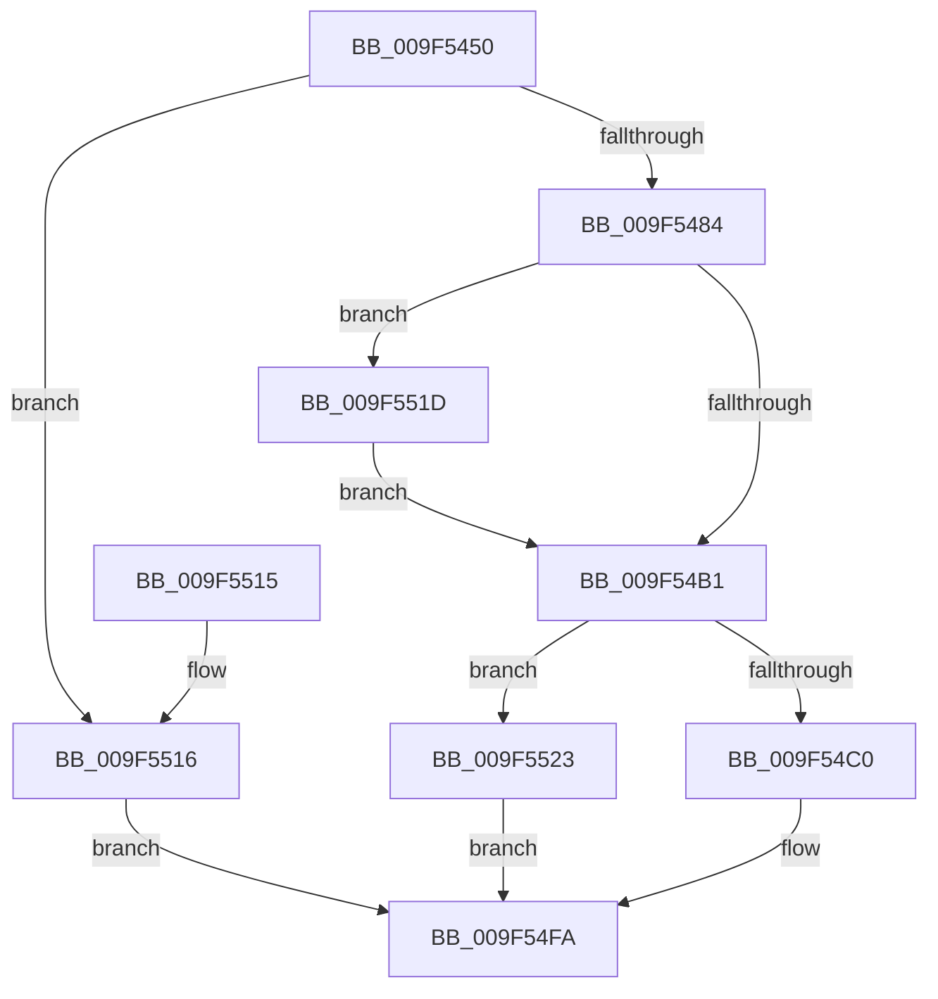

# FsRtlAllocateExtraCreateParameter

- RVA: `0x009F5450`–`0x009F552A` (길이 `218` bytes)
- VA: `0x00000001409F5450`
- 실행 섹션: `PAGE`
- PDB 이름 있음: `예`; PDB Function 태그: `아니요`
- unwind 정보 RVA: `0x000A6780`
- 디코드: `60`개 명령, `218/218` bytes 표시
- 미해석 바이트: `0` (있으면 어셈블리에 `.byte`로 보존)

> 이 문서는 커널 이미지의 기계어와 PDB 기호를 분석해 생성했습니다. 4번과 5번은 함수 원형과 자료형을 바이너리 사용 방식에서 추정한 C 해석이며 원본 소스 복구 결과는 아닙니다.

## 1. Dependencies

- 직접 호출 지점: **1**; 고유 호출 대상: **1**
- 직접 호출자로 확인된 함수: **1**
- RIP 상대 이미지 참조: **0**

### Outgoing calls
- `0x009F54B6` → [ExAllocatePool2](../../poolcode/B8/ExAllocatePool2_function_00B820F0.md) (function, `0x00B820F0`)

### Direct callers
- [sub_00B3BD22](../B3/Unknown_function_00B3BD22.md) at `0x00B3BD51`

### Static image references
- 디코드된 RIP-relative 메모리 참조가 없습니다.

## 2. Other-region calls and transfers

- 다른 실행 섹션으로 향하는 call: **1**
  - `0x009F54B6` → [ExAllocatePool2](../../poolcode/B8/ExAllocatePool2_function_00B820F0.md) (`PAGE` → `POOLCODE`)
- 별도 외부 분기/꼬리 이동을 확인하지 못했습니다.

## 3. Assembly (complete function range)

```asm
009F5450  48 8B C4                        mov rax, rsp
009F5453  48 89 58 08                     mov qword ptr [rax + 8], rbx
009F5457  48 89 68 10                     mov qword ptr [rax + 0x10], rbp
009F545B  48 89 70 18                     mov qword ptr [rax + 0x18], rsi
009F545F  48 89 78 20                     mov qword ptr [rax + 0x20], rdi
009F5463  41 56                           push r14
009F5465  48 83 EC 20                     sub rsp, 0x20
009F5469  48 8B 74 24 58                  mov rsi, qword ptr [rsp + 0x58]
009F546E  8D 5A 48                        lea ebx, [rdx + 0x48]
009F5471  49 8B E9                        mov rbp, r9
009F5474  4C 8B F1                        mov r14, rcx
009F5477  48 83 26 00                     and qword ptr [rsi], 0
009F547B  83 FB 48                        cmp ebx, 0x48
009F547E  0F 82 92 00 00 00               jb 0x1409f5516
009F5484  41 8B D0                        mov edx, r8d
009F5487  83 E2 02                        and edx, 2
009F548A  8B C2                           mov eax, edx
009F548C  F7 D8                           neg eax
009F548E  1B FF                           sbb edi, edi
009F5490  83 E7 40                        and edi, 0x40
009F5493  83 C7 02                        add edi, 2
009F5496  F7 DA                           neg edx
009F5498  8B D3                           mov edx, ebx
009F549A  48 1B C9                        sbb rcx, rcx
009F549D  48 81 E1 40 FF FF FF            and rcx, 0xffffffffffffff40
009F54A4  48 81 C1 00 01 00 00            add rcx, 0x100
009F54AB  41 F6 C0 01                     test r8b, 1
009F54AF  75 6C                           jne 0x1409f551d
009F54B1  44 8B 44 24 50                  mov r8d, dword ptr [rsp + 0x50]
009F54B6  E8 35 CC 18 00                  call 0x140b820f0
009F54BB  48 85 C0                        test rax, rax
009F54BE  74 63                           je 0x1409f5523
009F54C0  83 60 04 00                     and dword ptr [rax + 4], 0
009F54C4  48 83 60 10 00                  and qword ptr [rax + 0x10], 0
009F54C9  48 83 60 08 00                  and qword ptr [rax + 8], 0
009F54CE  C7 00 45 63 70 48               mov dword ptr [rax], 0x48706345
009F54D4  41 0F 10 06                     movups xmm0, xmmword ptr [r14]
009F54D8  48 83 60 38 00                  and qword ptr [rax + 0x38], 0
009F54DD  48 83 60 40 00                  and qword ptr [rax + 0x40], 0
009F54E2  F3 0F 7F 40 18                  movdqu xmmword ptr [rax + 0x18], xmm0
009F54E7  48 89 68 28                     mov qword ptr [rax + 0x28], rbp
009F54EB  89 78 30                        mov dword ptr [rax + 0x30], edi
009F54EE  89 58 34                        mov dword ptr [rax + 0x34], ebx
009F54F1  48 83 C0 48                     add rax, 0x48
009F54F5  48 89 06                        mov qword ptr [rsi], rax
009F54F8  33 C0                           xor eax, eax
009F54FA  48 8B 5C 24 30                  mov rbx, qword ptr [rsp + 0x30]
009F54FF  48 8B 6C 24 38                  mov rbp, qword ptr [rsp + 0x38]
009F5504  48 8B 74 24 40                  mov rsi, qword ptr [rsp + 0x40]
009F5509  48 8B 7C 24 48                  mov rdi, qword ptr [rsp + 0x48]
009F550E  48 83 C4 20                     add rsp, 0x20
009F5512  41 5E                           pop r14
009F5514  C3                              ret
009F5515  CC                              int3
009F5516  B8 95 00 00 C0                  mov eax, 0xc0000095
009F551B  EB DD                           jmp 0x1409f54fa
009F551D  48 83 C9 01                     or rcx, 1
009F5521  EB 8E                           jmp 0x1409f54b1
009F5523  B8 9A 00 00 C0                  mov eax, 0xc000009a
009F5528  EB D0                           jmp 0x1409f54fa
```

## 4. C-style interpretation (structured pseudocode)

```c
__int64 __fastcall FsRtlAllocateExtraCreateParameter(__int64 a1, __int64 a2, int a3, __int64 a4, unsigned int a5, __int64 a6)
{
    __int64 result;
    __int64 v_rdi;
    __int64 v_rsp;
    unsigned __int64 v_stack_p10;
    unsigned __int64 v_stack_p18;
    unsigned __int64 v_stack_p20;
    unsigned __int64 v_stack_p8;

    *(unsigned __int64 *)(v_rsp + 8) = v_rbx;
    *(unsigned __int64 *)(v_rsp + 16) = v_rbp;
    *(unsigned __int64 *)(v_rsp + 24) = v_rsi;
    *(unsigned __int64 *)(v_rsp + 32) = v_rdi;
    v_rsp = (v_rsp) - (32);
    if (((unsigned int)(a2 + 72)) < 72) goto loc_009F5516;
    a2 = (unsigned int)(((unsigned int)(a3)) & (2));
    result = (unsigned int)(-((unsigned int)((unsigned int)(a2))));
    v_rdi = (unsigned int)((v_rdi) & (64));
    v_rdi = (unsigned int)((v_rdi) + (2));
    a2 = (unsigned int)(-(a2));
    a1 = (a1) & (-192);
    a1 = (a1) + (256);
    if ((((unsigned __int8)(a3)) & (1)) != 0) goto loc_009F551D;
loc_009F54B1:
    result = ExAllocatePool2(a1, (unsigned int)((unsigned int)(a2 + 72)), (unsigned int)(a5), a4);
    if (result == 0) goto loc_009F5523;
    *(unsigned int *)(result) = 0x48706345ULL;
    *(unsigned __int64 *)(result + 24) = v_xmm0;
    *(unsigned __int64 *)(result + 40) = a4;
    *(unsigned int *)(result + 48) = (unsigned int)(v_rdi);
    *(unsigned int *)(result + 52) = (unsigned int)(a2 + 72);
    result = (result) + (72);
    *(unsigned __int64 *)(a6) = result;
    result = 0;
loc_009F54FA:
    v_rsp = (v_rsp) + (32);
    return result;
loc_009F5516:
    goto loc_009F54FA;
loc_009F551D:
    a1 = (a1) | (1);
    goto loc_009F54B1;
loc_009F5523:
    goto loc_009F54FA;
}
```

## 5. (Beta) C Style

```c
int64_t FsRtlAllocateExtraCreateParameter(void *Arg1, void *Arg2, int32_t Arg3, int64_t Arg4, uint32_t Arg5, void *Arg6)
{
    uint8_t *arg1 = (uint8_t *)Arg1;
    uint8_t *arg2 = (uint8_t *)Arg2;
    uint8_t *arg6 = (uint8_t *)Arg6;

    int64_t result;
    int64_t local_rdi;
    int64_t local_rsp;
    uint64_t v_stack_p10;
    uint64_t v_stack_p18;
    uint64_t v_stack_p20;
    uint64_t v_stack_p8;

    *(uint64_t *)(local_rsp + 0x8) = local_rbx;
    *(uint64_t *)(local_rsp + 0x10) = local_rbp;
    *(uint64_t *)(local_rsp + 0x18) = local_rsi;
    *(uint64_t *)(local_rsp + 0x20) = local_rdi;
    local_rsp = (local_rsp) - (32);
    if (((uint32_t)(Arg2 + 72)) < 72) goto loc_009F5516;
    Arg2 = (uint32_t)(((uint32_t)(Arg3)) & (2));
    result = (uint32_t)(-((uint32_t)((uint32_t)(Arg2))));
    local_rdi = (uint32_t)((local_rdi) & (64));
    local_rdi = (uint32_t)((local_rdi) + (2));
    Arg2 = (uint32_t)(-(Arg2));
    Arg1 = (Arg1) & (-192);
    Arg1 = (Arg1) + (256);
    if ((((uint8_t)(Arg3)) & (1)) != 0) goto loc_009F551D;
loc_009F54B1:
    result = ExAllocatePool2(Arg1, (uint32_t)((uint32_t)(Arg2 + 72)), (uint32_t)(Arg5), Arg4);
    if (result == 0) goto loc_009F5523;
    *(uint32_t *)(result) = 0x48706345ULL;
    *(uint64_t *)(result + 0x18) = v_xmm0;
    *(uint64_t *)(result + 0x28) = Arg4;
    *(uint32_t *)(result + 0x30) = (uint32_t)(local_rdi);
    *(uint32_t *)(result + 0x34) = (uint32_t)(Arg2 + 72);
    result = (result) + (72);
    *(uint64_t *)(arg6) = result;
    result = 0;
loc_009F54FA:
    local_rsp = (local_rsp) + (32);
    return result;
loc_009F5516:
    goto loc_009F54FA;
loc_009F551D:
    Arg1 = (Arg1) | (1);
    goto loc_009F54B1;
loc_009F5523:
    goto loc_009F54FA;
}
```

### 관측된 메모리 오프셋

구조체 형식이 확인되지 않은 접근은 인자 기준의 오프셋으로만 기록했습니다.

| 기준 인자 | 오프셋 표현 | 폭 (bit) | 접근 |
|---|---:|---:|---|
| `Arg1` | `+ 0x0` | `128` | `R` |
| `Arg2` | `+ 0x48` | `32` | `R` |
| `Arg6` | `+ 0x0` | `64` | `R/W` |
| `Arg6` | `+ 0x0` | `64` | `W` |

## 6. Execution-region graph

[열기: 2D/3D 그래프와 함수 탐색 컨트롤 패널](../../../control-panel.html?section=page&rva=0x009F5450&view=graph)

- 2D 그래프는 위에서 아래로 흐르고, 3D 그래프는 빈 공간을 드래그해 회전합니다. Shift+드래그는 이동, 휠은 확대·축소, 함수 노드 선택은 대상 보고서 이동입니다.

### Static fallback


