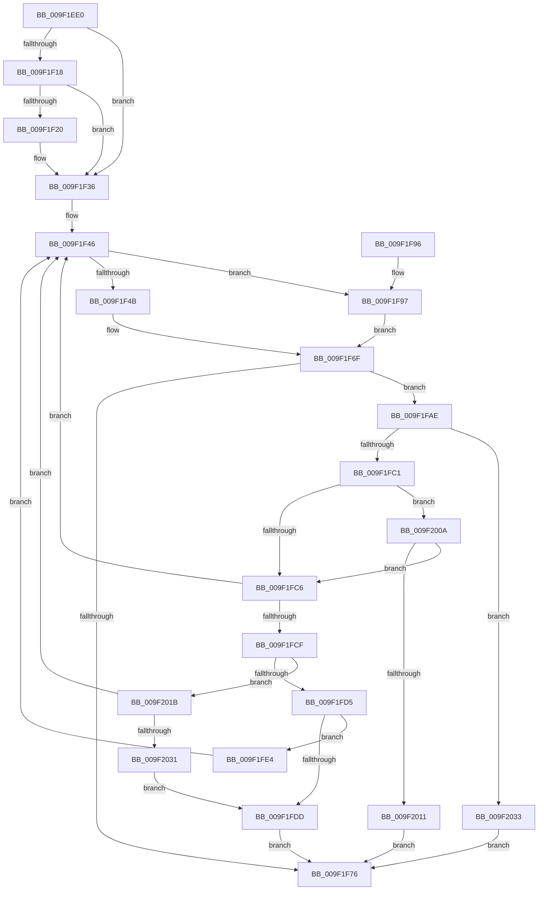

# FsRtlCancellableWaitForMultipleObjects

- RVA: `0x009F1EE0`–`0x009F203D` (길이 `349` bytes)
- VA: `0x00000001409F1EE0`
- 실행 섹션: `PAGE`
- PDB 이름 있음: `예`; PDB Function 태그: `아니요`
- unwind 정보 RVA: `0x000A5FEC`
- 디코드: `95`개 명령, `349/349` bytes 표시
- 미해석 바이트: `0` (있으면 어셈블리에 `.byte`로 보존)

> 이 문서는 커널 이미지의 기계어와 PDB 기호를 분석해 생성했습니다. 4번과 5번은 함수 원형과 자료형을 바이너리 사용 방식에서 추정한 C 해석이며 원본 소스 복구 결과는 아닙니다.

## 1. Dependencies

- 직접 호출 지점: **4**; 고유 호출 대상: **3**
- 직접 호출자로 확인된 함수: **0**
- RIP 상대 이미지 참조: **0**

### Outgoing calls
- `0x009F1F23` → [KeQueryTimeIncrement](../../text/44/KeQueryTimeIncrement_function_0044B4C0.md) (function, `0x0044B4C0`)
- `0x009F1F6A` → [KeWaitForMultipleObjects](../../text/20/KeWaitForMultipleObjects_function_0020D110.md) (function, `0x0020D110`)
- `0x009F1FA7` → [KeWaitForSingleObject](../../text/20/KeWaitForSingleObject_function_0020E6B0.md) (function, `0x0020E6B0`)
- `0x009F1FE4` → [KeQueryTimeIncrement](../../text/44/KeQueryTimeIncrement_function_0044B4C0.md) (function, `0x0044B4C0`)

### Direct callers
- 이 함수 시작 RVA로 연결되는 직접 call은 확인되지 않았습니다. 간접 호출은 완전히 역산할 수 없습니다.

### Static image references
- 디코드된 RIP-relative 메모리 참조가 없습니다.

## 2. Other-region calls and transfers

- 다른 실행 섹션으로 향하는 call: **4**
  - `0x009F1F23` → [KeQueryTimeIncrement](../../text/44/KeQueryTimeIncrement_function_0044B4C0.md) (`PAGE` → `.text`)
  - `0x009F1F6A` → [KeWaitForMultipleObjects](../../text/20/KeWaitForMultipleObjects_function_0020D110.md) (`PAGE` → `.text`)
  - `0x009F1FA7` → [KeWaitForSingleObject](../../text/20/KeWaitForSingleObject_function_0020E6B0.md) (`PAGE` → `.text`)
  - `0x009F1FE4` → [KeQueryTimeIncrement](../../text/44/KeQueryTimeIncrement_function_0044B4C0.md) (`PAGE` → `.text`)
- 별도 외부 분기/꼬리 이동을 확인하지 못했습니다.

## 3. Assembly (complete function range)

```asm
009F1EE0  48 89 5C 24 08                  mov qword ptr [rsp + 8], rbx
009F1EE5  48 89 6C 24 10                  mov qword ptr [rsp + 0x10], rbp
009F1EEA  48 89 74 24 18                  mov qword ptr [rsp + 0x18], rsi
009F1EEF  57                              push rdi
009F1EF0  41 54                           push r12
009F1EF2  41 55                           push r13
009F1EF4  41 56                           push r14
009F1EF6  41 57                           push r15
009F1EF8  48 83 EC 40                     sub rsp, 0x40
009F1EFC  33 DB                           xor ebx, ebx
009F1EFE  49 8B F1                        mov rsi, r9
009F1F01  45 8B E0                        mov r12d, r8d
009F1F04  4C 8B F2                        mov r14, rdx
009F1F07  8B E9                           mov ebp, ecx
009F1F09  48 BF 20 03 00 00 80 F7 FF FF   movabs rdi, 0xfffff78000000320
009F1F13  4D 85 C9                        test r9, r9
009F1F16  74 1E                           je 0x1409f1f36
009F1F18  49 8B 19                        mov rbx, qword ptr [r9]
009F1F1B  48 85 DB                        test rbx, rbx
009F1F1E  79 16                           jns 0x1409f1f36
009F1F20  48 8B 1F                        mov rbx, qword ptr [rdi]
009F1F23  E8 98 95 A5 FF                  call 0x14044b4c0
009F1F28  44 8B C0                        mov r8d, eax
009F1F2B  48 8B 06                        mov rax, qword ptr [rsi]
009F1F2E  48 99                           cqo
009F1F30  49 F7 F8                        idiv r8
009F1F33  48 2B D8                        sub rbx, rax
009F1F36  4C 8B AC 24 98 00 00 00         mov r13, qword ptr [rsp + 0x98]
009F1F3E  4C 8B BC 24 90 00 00 00         mov r15, qword ptr [rsp + 0x90]
009F1F46  83 FD 01                        cmp ebp, 1
009F1F49  74 4C                           je 0x1409f1f97
009F1F4B  4C 89 7C 24 38                  mov qword ptr [rsp + 0x38], r15
009F1F50  45 33 C9                        xor r9d, r9d
009F1F53  48 89 74 24 30                  mov qword ptr [rsp + 0x30], rsi
009F1F58  45 8B C4                        mov r8d, r12d
009F1F5B  C6 44 24 28 01                  mov byte ptr [rsp + 0x28], 1
009F1F60  49 8B D6                        mov rdx, r14
009F1F63  8B CD                           mov ecx, ebp
009F1F65  C6 44 24 20 00                  mov byte ptr [rsp + 0x20], 0
009F1F6A  E8 A1 B1 81 FF                  call 0x14020d110
009F1F6F  3D 01 01 00 00                  cmp eax, 0x101
009F1F74  74 38                           je 0x1409f1fae
009F1F76  48 8B 5C 24 70                  mov rbx, qword ptr [rsp + 0x70]
009F1F7B  48 8B 6C 24 78                  mov rbp, qword ptr [rsp + 0x78]
009F1F80  48 8B B4 24 80 00 00 00         mov rsi, qword ptr [rsp + 0x80]
009F1F88  48 83 C4 40                     add rsp, 0x40
009F1F8C  41 5F                           pop r15
009F1F8E  41 5E                           pop r14
009F1F90  41 5D                           pop r13
009F1F92  41 5C                           pop r12
009F1F94  5F                              pop rdi
009F1F95  C3                              ret
009F1F96  CC                              int3
009F1F97  49 8B 0E                        mov rcx, qword ptr [r14]
009F1F9A  41 B1 01                        mov r9b, 1
009F1F9D  45 33 C0                        xor r8d, r8d
009F1FA0  48 89 74 24 20                  mov qword ptr [rsp + 0x20], rsi
009F1FA5  33 D2                           xor edx, edx
009F1FA7  E8 04 C7 81 FF                  call 0x14020e6b0
009F1FAC  EB C1                           jmp 0x1409f1f6f
009F1FAE  65 48 8B 04 25 88 01 00 00      mov rax, qword ptr gs:[0x188]
009F1FB7  8B 80 A0 05 00 00               mov eax, dword ptr [rax + 0x5a0]
009F1FBD  A8 01                           test al, 1
009F1FBF  75 72                           jne 0x1409f2033
009F1FC1  4D 85 ED                        test r13, r13
009F1FC4  75 44                           jne 0x1409f200a
009F1FC6  48 85 F6                        test rsi, rsi
009F1FC9  0F 84 77 FF FF FF               je 0x1409f1f46
009F1FCF  48 83 3E 00                     cmp qword ptr [rsi], 0
009F1FD3  7D 46                           jge 0x1409f201b
009F1FD5  48 8B 3F                        mov rdi, qword ptr [rdi]
009F1FD8  48 3B FB                        cmp rdi, rbx
009F1FDB  7C 07                           jl 0x1409f1fe4
009F1FDD  B8 02 01 00 00                  mov eax, 0x102
009F1FE2  EB 92                           jmp 0x1409f1f76
009F1FE4  E8 D7 94 A5 FF                  call 0x14044b4c0
009F1FE9  8B C8                           mov ecx, eax
009F1FEB  48 8B C3                        mov rax, rbx
009F1FEE  48 2B C7                        sub rax, rdi
009F1FF1  48 BF 20 03 00 00 80 F7 FF FF   movabs rdi, 0xfffff78000000320
009F1FFB  48 0F AF C8                     imul rcx, rax
009F1FFF  48 F7 D9                        neg rcx
009F2002  48 89 0E                        mov qword ptr [rsi], rcx
009F2005  E9 3C FF FF FF                  jmp 0x1409f1f46
009F200A  41 80 7D 44 00                  cmp byte ptr [r13 + 0x44], 0
009F200F  74 B5                           je 0x1409f1fc6
009F2011  B8 20 01 00 C0                  mov eax, 0xc0000120
009F2016  E9 5B FF FF FF                  jmp 0x1409f1f76
009F201B  48 B8 14 00 00 00 80 F7 FF FF   movabs rax, 0xfffff78000000014
009F2025  48 8B 00                        mov rax, qword ptr [rax]
009F2028  48 3B C3                        cmp rax, rbx
009F202B  0F 8C 15 FF FF FF               jl 0x1409f1f46
009F2031  EB AA                           jmp 0x1409f1fdd
009F2033  B8 4B 00 00 C0                  mov eax, 0xc000004b
009F2038  E9 39 FF FF FF                  jmp 0x1409f1f76
```

## 4. C-style interpretation (structured pseudocode)

```c
__int64 __fastcall FsRtlCancellableWaitForMultipleObjects(int a1, __int64 a2, int a3, __int64 a4, __int64 a5, __int64 a6)
{
    __int64 result;
    __int64 v_rbx;
    __int64 v_rsp;
    unsigned __int64 v_stack_m30;
    unsigned __int64 v_stack_m38;
    unsigned __int8 v_stack_m40;
    unsigned __int8 v_stack_m48;
    unsigned __int64 v_stack_p10;
    unsigned __int64 v_stack_p18;
    unsigned __int64 v_stack_p20;
    unsigned __int64 v_stack_p8;

    v_stack_p8 = v_rbx;
    v_stack_p10 = v_rbp;
    v_stack_p18 = v_rsi;
    v_rsp = (v_rsp) - (64);
    v_rbx = 0;
    if (a4 == 0) goto loc_009F1F36;
    v_rbx = *(unsigned __int64 *)(a4);
    if (sign_flag) {
        v_rbx = *(unsigned __int64 *)(v_rdi);
        result = KeQueryTimeIncrement(a1, a2, a3, a4);
        a3 = (unsigned int)(result);
        result = *(unsigned __int64 *)(a4);
        v_rbx = (v_rbx) - (result);
    }
loc_009F1F46:
    if (((unsigned int)((unsigned int)(a1))) == 1) goto loc_009F1F97;
    v_stack_m30 = a5;
    a4 = 0;
    v_stack_m38 = 0;
    v_stack_m40 = 1;
    v_stack_m48 = 0;
    result = KeWaitForMultipleObjects((unsigned int)((unsigned int)((unsigned int)(a1))), a2, (unsigned int)((unsigned int)((unsigned int)(a3))), a4);
loc_009F1F6F:
    if (((unsigned int)(result)) == 257) goto loc_009F1FAE;
loc_009F1F76:
    v_rsp = (v_rsp) + (64);
    return result;
loc_009F1F97:
    a3 = 0;
    v_stack_p20 = v_stack_p18;
    a2 = 0;
    result = KeWaitForSingleObject(*(unsigned __int64 *)(a2), a2, a3, 1);
    goto loc_009F1F6F;
loc_009F1FAE:
    if ((((unsigned __int8)((unsigned int)(*(unsigned int *)(*(unsigned __int64 *)(gs_base + (0 + 392)) + 1440)))) & (1)) != 0) goto loc_009F2033;
    if (a6 != 0) goto loc_009F200A;
loc_009F1FC6:
    if (v_stack_p18 == 0) goto loc_009F1F46;
    if ((*(unsigned __int64 *)(v_stack_p18)) >= 0) goto loc_009F201B;
    if ((*(unsigned __int64 *)(v_rdi)) < v_stack_p8) goto loc_009F1FE4;
loc_009F1FDD:
    goto loc_009F1F76;
loc_009F1FE4:
    result = KeQueryTimeIncrement(*(unsigned __int64 *)(a2), a2, a3, 1);
    result = (v_stack_p8) - (*(unsigned __int64 *)(v_rdi));
    a1 = ((unsigned int)((unsigned int)(result))) * (result);
    a1 = -(a1);
    *(unsigned __int64 *)(v_stack_p18) = a1;
    goto loc_009F1F46;
loc_009F200A:
    if ((*(unsigned __int8 *)(a6 + 68)) == 0) goto loc_009F1FC6;
    goto loc_009F1F76;
loc_009F201B:
    if ((*(unsigned __int64 *)((unsigned int)(0xC0000120ULL))) < v_stack_p8) goto loc_009F1F46;
    goto loc_009F1FDD;
loc_009F2033:
    goto loc_009F1F76;
}
```

## 5. (Beta) C Style

```c
int64_t FsRtlCancellableWaitForMultipleObjects(int32_t Arg1, void *Arg2, int32_t Arg3, void *Arg4, int64_t Arg5, int64_t Arg6)
{
    uint8_t *arg2 = (uint8_t *)Arg2;
    uint8_t *arg4 = (uint8_t *)Arg4;

    int64_t result;
    int64_t local_rbx;
    int64_t local_rsp;
    uint64_t v_stack_m30;
    uint64_t v_stack_m38;
    uint8_t v_stack_m40;
    uint8_t v_stack_m48;
    uint64_t v_stack_p10;
    uint64_t v_stack_p18;
    uint64_t v_stack_p20;
    uint64_t v_stack_p8;

    v_stack_p8 = local_rbx;
    v_stack_p10 = local_rbp;
    v_stack_p18 = local_rsi;
    local_rsp = (local_rsp) - (64);
    local_rbx = 0;
    if (Arg4 == NULL) goto loc_009F1F36;
    local_rbx = *(uint64_t *)(arg4);
    if (sign_flag) {
        local_rbx = *(uint64_t *)(local_rdi);
        result = KeQueryTimeIncrement(Arg1, Arg2, Arg3, Arg4);
        Arg3 = (uint32_t)(result);
        result = *(uint64_t *)(arg4);
        local_rbx = (local_rbx) - (result);
    }
loc_009F1F46:
    if (((uint32_t)((uint32_t)(Arg1))) == 1) goto loc_009F1F97;
    v_stack_m30 = Arg5;
    Arg4 = 0;
    v_stack_m38 = 0;
    v_stack_m40 = 1;
    v_stack_m48 = 0;
    result = KeWaitForMultipleObjects((uint32_t)((uint32_t)((uint32_t)(Arg1))), Arg2, (uint32_t)((uint32_t)((uint32_t)(Arg3))), Arg4);
loc_009F1F6F:
    if (((uint32_t)(result)) == 257) goto loc_009F1FAE;
loc_009F1F76:
    local_rsp = (local_rsp) + (64);
    return result;
loc_009F1F97:
    Arg3 = 0;
    v_stack_p20 = v_stack_p18;
    Arg2 = 0;
    result = KeWaitForSingleObject(*(uint64_t *)(arg2), Arg2, Arg3, 1);
    goto loc_009F1F6F;
loc_009F1FAE:
    if ((((uint8_t)((uint32_t)(*(uint32_t *)(*(uint64_t *)(gs_base + (0 + 0x188)) + 0x5A0)))) & (1)) != 0) goto loc_009F2033;
    if (Arg6 != 0) goto loc_009F200A;
loc_009F1FC6:
    if (v_stack_p18 == 0) goto loc_009F1F46;
    if ((*(uint64_t *)(v_stack_p18)) >= 0) goto loc_009F201B;
    if ((*(uint64_t *)(local_rdi)) < v_stack_p8) goto loc_009F1FE4;
loc_009F1FDD:
    goto loc_009F1F76;
loc_009F1FE4:
    result = KeQueryTimeIncrement(*(uint64_t *)(arg2), Arg2, Arg3, 1);
    result = (v_stack_p8) - (*(uint64_t *)(local_rdi));
    Arg1 = ((uint32_t)((uint32_t)(result))) * (result);
    Arg1 = -(Arg1);
    *(uint64_t *)(v_stack_p18) = Arg1;
    goto loc_009F1F46;
loc_009F200A:
    if ((*(uint8_t *)(Arg6 + 0x44)) == 0) goto loc_009F1FC6;
    goto loc_009F1F76;
loc_009F201B:
    if ((*(uint64_t *)((uint32_t)(0xC0000120ULL))) < v_stack_p8) goto loc_009F1F46;
    goto loc_009F1FDD;
loc_009F2033:
    goto loc_009F1F76;
}
```

### 관측된 메모리 오프셋

구조체 형식이 확인되지 않은 접근은 인자 기준의 오프셋으로만 기록했습니다.

| 기준 인자 | 오프셋 표현 | 폭 (bit) | 접근 |
|---|---:|---:|---|
| `Arg2` | `+ 0x0` | `64` | `R` |
| `Arg4` | `+ 0x0` | `64` | `R` |

## 6. Execution-region graph

[열기: 2D/3D 그래프와 함수 탐색 컨트롤 패널](../../../control-panel.html?section=page&rva=0x009F1EE0&view=graph)

- 2D 그래프는 위에서 아래로 흐르고, 3D 그래프는 빈 공간을 드래그해 회전합니다. Shift+드래그는 이동, 휠은 확대·축소, 함수 노드 선택은 대상 보고서 이동입니다.

### Static fallback


