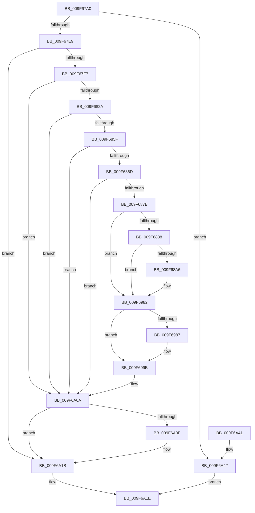

# FsRtlCheckOplockForFsFilterCallback

- RVA: `0x009F67A0`–`0x009F6A49` (길이 `681` bytes)
- VA: `0x00000001409F67A0`
- 실행 섹션: `PAGE`
- PDB 이름 있음: `예`; PDB Function 태그: `아니요`
- unwind 정보 RVA: `0x000A6C20`
- 디코드: `126`개 명령, `681/681` bytes 표시
- 미해석 바이트: `0` (있으면 어셈블리에 `.byte`로 보존)

> 이 문서는 커널 이미지의 기계어와 PDB 기호를 분석해 생성했습니다. 4번과 5번은 함수 원형과 자료형을 바이너리 사용 방식에서 추정한 C 해석이며 원본 소스 복구 결과는 아닙니다.

## 1. Dependencies

- 직접 호출 지점: **9**; 고유 호출 대상: **8**
- 직접 호출자로 확인된 함수: **0**
- RIP 상대 이미지 참조: **3**

### Outgoing calls
- `0x009F67E9` → [Feature_OpocksAndMappedSections__private_ReportDeviceUsage](../../text/46/Feature_OpocksAndMappedSections__private_ReportDeviceUsage_function_0046BC88.md) (function, `0x0046BC88`)
- `0x009F6806` → [ExAcquireFastMutexUnsafe](../../text/3F/ExAcquireFastMutexUnsafe_function_003F3720.md) (function, `0x003F3720`)
- `0x009F6838` → [memset](../../text/6C/memset_function_006C6C40.md) (function, `0x006C6C40`)
- `0x009F6899` → [tlgKeywordOn](../../text/42/tlgKeywordOn_function_0042EAA0.md) (function, `0x0042EAA0`)
- `0x009F6975` → [tlgWriteAgg](../../text/2F/tlgWriteAgg_function_002F0F7C.md) (function, `0x002F0F7C`)
- `0x009F698E` → [ExAcquireFastMutexUnsafe](../../text/3F/ExAcquireFastMutexUnsafe_function_003F3720.md) (function, `0x003F3720`)
- `0x009F69F3` → [FsRtlpOplockBreakByCacheFlags](../../text/4E/FsRtlpOplockBreakByCacheFlags_function_004E4990.md) (function, `0x004E4990`)
- `0x009F6A16` → [ExReleaseFastMutexUnsafe](../../text/25/ExReleaseFastMutexUnsafe_function_002503A0.md) (function, `0x002503A0`)
- `0x009F6A29` → [_security_check_cookie](../../text/6A/_security_check_cookie_function_006AC640.md) (function, `0x006AC640`)

### Direct callers
- 이 함수 시작 RVA로 연결되는 직접 call은 확인되지 않았습니다. 간접 호출은 완전히 역산할 수 없습니다.

### Static image references
- `0x009F67B3` → RVA `0x00E0A740` (`.data`; read)
- `0x009F687B` → RVA `0x00E06C50` (`.data`; read)
- `0x009F6967` → RVA `0x00045946` (`.rdata`; read)

## 2. Other-region calls and transfers

- 다른 실행 섹션으로 향하는 call: **9**
  - `0x009F67E9` → [Feature_OpocksAndMappedSections__private_ReportDeviceUsage](../../text/46/Feature_OpocksAndMappedSections__private_ReportDeviceUsage_function_0046BC88.md) (`PAGE` → `.text`)
  - `0x009F6806` → [ExAcquireFastMutexUnsafe](../../text/3F/ExAcquireFastMutexUnsafe_function_003F3720.md) (`PAGE` → `.text`)
  - `0x009F6838` → [memset](../../text/6C/memset_function_006C6C40.md) (`PAGE` → `.text`)
  - `0x009F6899` → [tlgKeywordOn](../../text/42/tlgKeywordOn_function_0042EAA0.md) (`PAGE` → `.text`)
  - `0x009F6975` → [tlgWriteAgg](../../text/2F/tlgWriteAgg_function_002F0F7C.md) (`PAGE` → `.text`)
  - `0x009F698E` → [ExAcquireFastMutexUnsafe](../../text/3F/ExAcquireFastMutexUnsafe_function_003F3720.md) (`PAGE` → `.text`)
  - `0x009F69F3` → [FsRtlpOplockBreakByCacheFlags](../../text/4E/FsRtlpOplockBreakByCacheFlags_function_004E4990.md) (`PAGE` → `.text`)
  - `0x009F6A16` → [ExReleaseFastMutexUnsafe](../../text/25/ExReleaseFastMutexUnsafe_function_002503A0.md) (`PAGE` → `.text`)
  - `0x009F6A29` → [_security_check_cookie](../../text/6A/_security_check_cookie_function_006AC640.md) (`PAGE` → `.text`)
- 별도 외부 분기/꼬리 이동을 확인하지 못했습니다.

## 3. Assembly (complete function range)

```asm
009F67A0  40 53                           push rbx
009F67A2  56                              push rsi
009F67A3  57                              push rdi
009F67A4  41 54                           push r12
009F67A6  41 55                           push r13
009F67A8  41 56                           push r14
009F67AA  41 57                           push r15
009F67AC  48 81 EC 80 01 00 00            sub rsp, 0x180
009F67B3  48 8B 05 86 3F 41 00            mov rax, qword ptr [rip + 0x413f86]
009F67BA  48 33 C4                        xor rax, rsp
009F67BD  48 89 84 24 70 01 00 00         mov qword ptr [rsp + 0x170], rax
009F67C5  45 8B E0                        mov r12d, r8d
009F67C8  48 8B F2                        mov rsi, rdx
009F67CB  45 33 ED                        xor r13d, r13d
009F67CE  45 8B F5                        mov r14d, r13d
009F67D1  48 8B 19                        mov rbx, qword ptr [rcx]
009F67D4  48 89 9C 24 A8 00 00 00         mov qword ptr [rsp + 0xa8], rbx
009F67DC  41 F7 C0 F7 FF FF FF            test r8d, 0xfffffff7
009F67E3  0F 85 59 02 00 00               jne 0x1409f6a42
009F67E9  E8 9A 54 A7 FF                  call 0x14046bc88
009F67EE  48 85 DB                        test rbx, rbx
009F67F1  0F 84 24 02 00 00               je 0x1409f6a1b
009F67F7  44 88 AC 24 80 00 00 00         mov byte ptr [rsp + 0x80], r13b
009F67FF  48 8B 8B 98 00 00 00            mov rcx, qword ptr [rbx + 0x98]
009F6806  E8 15 CF 9F FF                  call 0x1403f3720
009F680B  40 B7 01                        mov dil, 1
009F680E  40 88 BC 24 80 00 00 00         mov byte ptr [rsp + 0x80], dil
009F6816  44 8B BB 90 00 00 00            mov r15d, dword ptr [rbx + 0x90]
009F681D  41 F7 C7 00 70 00 00            test r15d, 0x7000
009F6824  0F 84 E0 01 00 00               je 0x1409f6a0a
009F682A  33 D2                           xor edx, edx
009F682C  45 8D 45 48                     lea r8d, [r13 + 0x48]
009F6830  48 8D 8C 24 B0 00 00 00         lea rcx, [rsp + 0xb0]
009F6838  E8 03 04 CD FF                  call 0x1406c6c40
009F683D  45 8D 55 04                     lea r10d, [r13 + 4]
009F6841  44 88 94 24 B0 00 00 00         mov byte ptr [rsp + 0xb0], r10b
009F6849  48 8B 46 10                     mov rax, qword ptr [rsi + 0x10]
009F684D  48 89 84 24 E0 00 00 00         mov qword ptr [rsp + 0xe0], rax
009F6855  80 7E 04 FF                     cmp byte ptr [rsi + 4], 0xff
009F6859  0F 85 AB 01 00 00               jne 0x1409f6a0a
009F685F  44 8B 46 18                     mov r8d, dword ptr [rsi + 0x18]
009F6863  41 83 F8 01                     cmp r8d, 1
009F6867  0F 85 9D 01 00 00               jne 0x1409f6a0a
009F686D  44 8B 4E 1C                     mov r9d, dword ptr [rsi + 0x1c]
009F6871  41 F6 C1 44                     test r9b, 0x44
009F6875  0F 84 8F 01 00 00               je 0x1409f6a0a
009F687B  83 3D CE 03 41 00 05            cmp dword ptr [rip + 0x4103ce], 5
009F6882  0F 86 FA 00 00 00               jbe 0x1409f6982
009F6888  48 BA 00 00 00 00 00 40 00 00   movabs rdx, 0x400000000000
009F6892  48 8D 0D B7 03 41 00            lea rcx, [rip + 0x4103b7]
009F6899  E8 02 82 A3 FF                  call 0x14042eaa0
009F689E  84 C0                           test al, al
009F68A0  0F 84 DC 00 00 00               je 0x1409f6982
009F68A6  48 C7 84 24 98 00 00 00 01 00 00 00  mov qword ptr [rsp + 0x98], 1
009F68B2  48 8D 84 24 98 00 00 00         lea rax, [rsp + 0x98]
009F68BA  48 89 84 24 20 01 00 00         mov qword ptr [rsp + 0x120], rax
009F68C2  48 C7 84 24 28 01 00 00 08 00 00 00  mov qword ptr [rsp + 0x128], 8
009F68CE  44 89 84 24 84 00 00 00         mov dword ptr [rsp + 0x84], r8d
009F68D6  48 8D 84 24 84 00 00 00         lea rax, [rsp + 0x84]
009F68DE  48 89 84 24 30 01 00 00         mov qword ptr [rsp + 0x130], rax
009F68E6  4C 89 94 24 38 01 00 00         mov qword ptr [rsp + 0x138], r10
009F68EE  44 89 8C 24 88 00 00 00         mov dword ptr [rsp + 0x88], r9d
009F68F6  48 8D 84 24 88 00 00 00         lea rax, [rsp + 0x88]
009F68FE  48 89 84 24 40 01 00 00         mov qword ptr [rsp + 0x140], rax
009F6906  4C 89 94 24 48 01 00 00         mov qword ptr [rsp + 0x148], r10
009F690E  44 89 BC 24 8C 00 00 00         mov dword ptr [rsp + 0x8c], r15d
009F6916  48 8D 84 24 8C 00 00 00         lea rax, [rsp + 0x8c]
009F691E  48 89 84 24 50 01 00 00         mov qword ptr [rsp + 0x150], rax
009F6926  4C 89 94 24 58 01 00 00         mov qword ptr [rsp + 0x158], r10
009F692E  48 C7 84 24 A0 00 00 00 00 00 00 01  mov qword ptr [rsp + 0xa0], 0x1000000
009F693A  48 8D 84 24 A0 00 00 00         lea rax, [rsp + 0xa0]
009F6942  48 89 84 24 60 01 00 00         mov qword ptr [rsp + 0x160], rax
009F694A  48 C7 84 24 68 01 00 00 08 00 00 00  mov qword ptr [rsp + 0x168], 8
009F6956  48 8D 84 24 00 01 00 00         lea rax, [rsp + 0x100]
009F695E  48 89 44 24 20                  mov qword ptr [rsp + 0x20], rax
009F6963  45 8D 4D 07                     lea r9d, [r13 + 7]
009F6967  48 8D 15 D8 EF 64 FF            lea rdx, [rip - 0x9b1028]
009F696E  48 8D 0D DB 02 41 00            lea rcx, [rip + 0x4102db]
009F6975  E8 02 A6 8F FF                  call 0x1402f0f7c
009F697A  40 8A BC 24 80 00 00 00         mov dil, byte ptr [rsp + 0x80]
009F6982  40 84 FF                        test dil, dil
009F6985  75 14                           jne 0x1409f699b
009F6987  48 8B 8B 98 00 00 00            mov rcx, qword ptr [rbx + 0x98]
009F698E  E8 8D CD 9F FF                  call 0x1403f3720
009F6993  C6 84 24 80 00 00 00 01         mov byte ptr [rsp + 0x80], 1
009F699B  4C 89 6C 24 78                  mov qword ptr [rsp + 0x78], r13
009F69A0  48 8D 84 24 80 00 00 00         lea rax, [rsp + 0x80]
009F69A8  48 89 44 24 70                  mov qword ptr [rsp + 0x70], rax
009F69AD  4C 89 6C 24 68                  mov qword ptr [rsp + 0x68], r13
009F69B2  4C 89 6C 24 60                  mov qword ptr [rsp + 0x60], r13
009F69B7  4C 89 6C 24 58                  mov qword ptr [rsp + 0x58], r13
009F69BC  4C 89 6C 24 50                  mov qword ptr [rsp + 0x50], r13
009F69C1  4C 89 6C 24 48                  mov qword ptr [rsp + 0x48], r13
009F69C6  4C 89 6C 24 40                  mov qword ptr [rsp + 0x40], r13
009F69CB  4C 89 6C 24 38                  mov qword ptr [rsp + 0x38], r13
009F69D0  4C 89 6C 24 30                  mov qword ptr [rsp + 0x30], r13
009F69D5  C7 44 24 28 00 50 00 00         mov dword ptr [rsp + 0x28], 0x5000
009F69DD  44 89 6C 24 20                  mov dword ptr [rsp + 0x20], r13d
009F69E2  45 8B CC                        mov r9d, r12d
009F69E5  45 33 C0                        xor r8d, r8d
009F69E8  48 8D 94 24 B0 00 00 00         lea rdx, [rsp + 0xb0]
009F69F0  48 8B CB                        mov rcx, rbx
009F69F3  E8 98 DF AE FF                  call 0x1404e4990
009F69F8  44 8B F0                        mov r14d, eax
009F69FB  89 84 24 90 00 00 00            mov dword ptr [rsp + 0x90], eax
009F6A02  40 8A BC 24 80 00 00 00         mov dil, byte ptr [rsp + 0x80]
009F6A0A  40 84 FF                        test dil, dil
009F6A0D  74 0C                           je 0x1409f6a1b
009F6A0F  48 8B 8B 98 00 00 00            mov rcx, qword ptr [rbx + 0x98]
009F6A16  E8 85 99 85 FF                  call 0x1402503a0
009F6A1B  41 8B C6                        mov eax, r14d
009F6A1E  48 8B 8C 24 70 01 00 00         mov rcx, qword ptr [rsp + 0x170]
009F6A26  48 33 CC                        xor rcx, rsp
009F6A29  E8 12 5C CB FF                  call 0x1406ac640
009F6A2E  48 81 C4 80 01 00 00            add rsp, 0x180
009F6A35  41 5F                           pop r15
009F6A37  41 5E                           pop r14
009F6A39  41 5D                           pop r13
009F6A3B  41 5C                           pop r12
009F6A3D  5F                              pop rdi
009F6A3E  5E                              pop rsi
009F6A3F  5B                              pop rbx
009F6A40  C3                              ret
009F6A41  CC                              int3
009F6A42  B8 0D 00 00 C0                  mov eax, 0xc000000d
009F6A47  EB D5                           jmp 0x1409f6a1e
```

## 4. C-style interpretation (structured pseudocode)

```c
__int64 __fastcall FsRtlCheckOplockForFsFilterCallback(__int64 a1, __int64 a2, int a3)
{
    __int64 result;
    __int64 v_r13;
    __int64 v_rdi;
    __int64 v_rsp;
    unsigned __int64 v_stack_m108;
    unsigned __int64 v_stack_m110;
    unsigned __int64 v_stack_m118;
    unsigned __int64 v_stack_m120;
    unsigned int v_stack_m128;
    unsigned int v_stack_m12C;
    unsigned int v_stack_m130;
    unsigned int v_stack_m134;
    unsigned __int8 v_stack_m138;
    unsigned __int64 v_stack_m140;
    unsigned __int64 v_stack_m148;
    unsigned __int64 v_stack_m150;
    unsigned __int64 v_stack_m158;
    unsigned __int64 v_stack_m160;
    unsigned __int64 v_stack_m168;
    unsigned __int64 v_stack_m170;
    unsigned __int64 v_stack_m178;
    unsigned __int64 v_stack_m180;
    unsigned __int64 v_stack_m188;
    unsigned int v_stack_m190;
    unsigned __int64 v_stack_m198;
    unsigned __int64 v_stack_m48;
    unsigned __int64 v_stack_m50;
    unsigned __int64 v_stack_m58;
    unsigned __int64 v_stack_m60;
    unsigned __int64 v_stack_m68;
    unsigned __int64 v_stack_m70;
    unsigned __int64 v_stack_m78;
    unsigned __int64 v_stack_m80;
    unsigned __int64 v_stack_m88;
    unsigned __int64 v_stack_m90;
    unsigned __int64 v_stack_m98;
    unsigned __int64 v_stack_mB8;
    unsigned __int64 v_stack_mD8;

    v_rsp = (v_rsp) - (384);
    result = (*(unsigned __int64 *)(v_rip + 4276102)) ^ (v_rsp);
    v_stack_m48 = result;
    v_r13 = 0;
    v_stack_m110 = *(unsigned __int64 *)(a1);
    if (((a3) & (0xFFFFFFF7ULL)) != 0) goto loc_009F6A42;
    result = Feature_OpocksAndMappedSections__private_ReportDeviceUsage(a1, a2, a3, a4);
    if (*(unsigned __int64 *)(a1) == 0) goto loc_009F6A1B;
    v_stack_m138 = 0;
    result = ExAcquireFastMutexUnsafe(*(unsigned __int64 *)(*(unsigned __int64 *)(a1) + 152), a2, a3, a4);
    v_stack_m138 = 1;
    if ((((unsigned int)((unsigned int)(*(unsigned int *)(*(unsigned __int64 *)(a1) + 144)))) & (0x7000ULL)) == 0) goto loc_009F6A0A;
    a2 = 0;
    result = memset(v_stack_m108, a2, v_r13 + 72, a4);
    v_stack_m108 = (unsigned __int8)(v_r13 + 4);
    v_stack_mD8 = *(unsigned __int64 *)(a2 + 16);
    if ((*(unsigned __int8 *)(a2 + 4)) != 255) goto loc_009F6A0A;
    if (((unsigned int)((unsigned int)(*(unsigned int *)(a2 + 24)))) != 1) goto loc_009F6A0A;
    if ((((unsigned __int8)((unsigned int)(*(unsigned int *)(a2 + 28)))) & (68)) == 0) goto loc_009F6A0A;
    if ((*(unsigned int *)(v_rip + 4260814)) <= 5) goto loc_009F6982;
    result = tlgKeywordOn(v_rip + 4260791, a2, (unsigned int)(*(unsigned int *)(a2 + 24)), (unsigned int)(*(unsigned int *)(a2 + 28)));
    v_rdi = 1;
    if ((unsigned __int8)(result) != 0) {
        v_stack_m120 = 1;
        result = v_stack_m120;
        v_stack_m98 = result;
        v_stack_m90 = 8;
        v_stack_m134 = (unsigned int)((unsigned int)(*(unsigned int *)(a2 + 24)));
        result = v_stack_m134;
        v_stack_m88 = result;
        v_stack_m80 = v_r13 + 4;
        v_stack_m130 = (unsigned int)((unsigned int)(*(unsigned int *)(a2 + 28)));
        result = v_stack_m130;
        v_stack_m78 = result;
        v_stack_m70 = v_r13 + 4;
        v_stack_m12C = (unsigned int)((unsigned int)(*(unsigned int *)(*(unsigned __int64 *)(a1) + 144)));
        result = v_stack_m12C;
        v_stack_m68 = result;
        v_stack_m60 = v_r13 + 4;
        v_stack_m118 = 0x1000000ULL;
        result = v_stack_m118;
        v_stack_m58 = result;
        v_stack_m50 = 8;
        result = v_stack_mB8;
        v_stack_m198 = result;
        a4 = v_r13 + 7;
        a2 = v_rip - 10162216;
        a1 = v_rip + 4260571;
        result = tlgWriteAgg(a1, a2, (unsigned int)(*(unsigned int *)(a2 + 24)), a4);
        v_rdi = v_stack_m138;
    }
    if ((unsigned __int8)(v_rdi) == 0) {
        a1 = *(unsigned __int64 *)(*(unsigned __int64 *)(a1) + 152);
        result = ExAcquireFastMutexUnsafe(a1, a2, (unsigned int)(*(unsigned int *)(a2 + 24)), a4);
        v_stack_m138 = 1;
    }
    v_stack_m140 = 0;
    v_stack_m148 = v_stack_m138;
    v_stack_m150 = 0;
    v_stack_m158 = 0;
    v_stack_m160 = 0;
    v_stack_m168 = 0;
    v_stack_m170 = 0;
    v_stack_m178 = 0;
    v_stack_m180 = 0;
    v_stack_m188 = 0;
    v_stack_m190 = 0x5000ULL;
    v_stack_m198 = 0;
    a3 = 0;
    result = FsRtlpOplockBreakByCacheFlags(*(unsigned __int64 *)(a1), v_stack_m108, a3, (unsigned int)((unsigned int)((unsigned int)(a3))));
    v_stack_m128 = (unsigned int)(result);
loc_009F6A0A:
    if ((unsigned __int8)(v_stack_m138) != 0) {
        a1 = *(unsigned __int64 *)(*(unsigned __int64 *)(a1) + 152);
        result = ExReleaseFastMutexUnsafe(a1, v_stack_m108, a3, (unsigned int)((unsigned int)((unsigned int)(a3))));
    }
loc_009F6A1E:
    a1 = (v_stack_m48) ^ (v_rsp);
    result = _security_check_cookie(a1, v_stack_m108, a3, (unsigned int)((unsigned int)((unsigned int)(a3))));
    v_rsp = (v_rsp) + (384);
    return result;
loc_009F6A42:
    goto loc_009F6A1E;
}
```

## 5. (Beta) C Style

```c
int64_t FsRtlCheckOplockForFsFilterCallback(void *Arg1, void *Arg2, int32_t Arg3)
{
    uint8_t *arg1 = (uint8_t *)Arg1;
    uint8_t *arg2 = (uint8_t *)Arg2;

    int64_t result;
    int64_t local_r13;
    int64_t local_rdi;
    int64_t local_rsp;
    uint64_t v_stack_m108;
    uint64_t v_stack_m110;
    uint64_t v_stack_m118;
    uint64_t v_stack_m120;
    uint32_t v_stack_m128;
    uint32_t v_stack_m12C;
    uint32_t v_stack_m130;
    uint32_t v_stack_m134;
    uint8_t v_stack_m138;
    uint64_t v_stack_m140;
    uint64_t v_stack_m148;
    uint64_t v_stack_m150;
    uint64_t v_stack_m158;
    uint64_t v_stack_m160;
    uint64_t v_stack_m168;
    uint64_t v_stack_m170;
    uint64_t v_stack_m178;
    uint64_t v_stack_m180;
    uint64_t v_stack_m188;
    uint32_t v_stack_m190;
    uint64_t v_stack_m198;
    uint64_t v_stack_m48;
    uint64_t v_stack_m50;
    uint64_t v_stack_m58;
    uint64_t v_stack_m60;
    uint64_t v_stack_m68;
    uint64_t v_stack_m70;
    uint64_t v_stack_m78;
    uint64_t v_stack_m80;
    uint64_t v_stack_m88;
    uint64_t v_stack_m90;
    uint64_t v_stack_m98;
    uint64_t v_stack_mB8;
    uint64_t v_stack_mD8;

    local_rsp = (local_rsp) - (384);
    result = (*(uint64_t *)(v_rip + 0x413F86)) ^ (local_rsp);
    v_stack_m48 = result;
    local_r13 = 0;
    v_stack_m110 = *(uint64_t *)(arg1);
    if (((Arg3) & (0xFFFFFFF7ULL)) != 0) goto loc_009F6A42;
    result = Feature_OpocksAndMappedSections__private_ReportDeviceUsage(Arg1, Arg2, Arg3, a4);
    if (*(uint64_t *)(arg1) == 0) goto loc_009F6A1B;
    v_stack_m138 = 0;
    result = ExAcquireFastMutexUnsafe(*(uint64_t *)(*(uint64_t *)(arg1) + 0x98), Arg2, Arg3, a4);
    v_stack_m138 = 1;
    if ((((uint32_t)((uint32_t)(*(uint32_t *)(*(uint64_t *)(arg1) + 0x90)))) & (0x7000ULL)) == 0) goto loc_009F6A0A;
    Arg2 = 0;
    result = memset(v_stack_m108, Arg2, local_r13 + 72, a4);
    v_stack_m108 = (uint8_t)(local_r13 + 4);
    v_stack_mD8 = *(uint64_t *)(arg2 + 0x10);
    if ((*(uint8_t *)(arg2 + 0x4)) != 255) goto loc_009F6A0A;
    if (((uint32_t)((uint32_t)(*(uint32_t *)(arg2 + 0x18)))) != 1) goto loc_009F6A0A;
    if ((((uint8_t)((uint32_t)(*(uint32_t *)(arg2 + 0x1C)))) & (68)) == 0) goto loc_009F6A0A;
    if ((*(uint32_t *)(v_rip + 0x4103CE)) <= 5) goto loc_009F6982;
    result = tlgKeywordOn(v_rip + 4260791, Arg2, (uint32_t)(*(uint32_t *)(arg2 + 0x18)), (uint32_t)(*(uint32_t *)(arg2 + 0x1C)));
    local_rdi = 1;
    if ((uint8_t)(result) != 0) {
        v_stack_m120 = 1;
        result = v_stack_m120;
        v_stack_m98 = result;
        v_stack_m90 = 8;
        v_stack_m134 = (uint32_t)((uint32_t)(*(uint32_t *)(arg2 + 0x18)));
        result = v_stack_m134;
        v_stack_m88 = result;
        v_stack_m80 = local_r13 + 4;
        v_stack_m130 = (uint32_t)((uint32_t)(*(uint32_t *)(arg2 + 0x1C)));
        result = v_stack_m130;
        v_stack_m78 = result;
        v_stack_m70 = local_r13 + 4;
        v_stack_m12C = (uint32_t)((uint32_t)(*(uint32_t *)(*(uint64_t *)(arg1) + 0x90)));
        result = v_stack_m12C;
        v_stack_m68 = result;
        v_stack_m60 = local_r13 + 4;
        v_stack_m118 = 0x1000000ULL;
        result = v_stack_m118;
        v_stack_m58 = result;
        v_stack_m50 = 8;
        result = v_stack_mB8;
        v_stack_m198 = result;
        a4 = local_r13 + 7;
        Arg2 = v_rip - 10162216;
        Arg1 = v_rip + 4260571;
        result = tlgWriteAgg(Arg1, Arg2, (uint32_t)(*(uint32_t *)(arg2 + 0x18)), a4);
        local_rdi = v_stack_m138;
    }
    if ((uint8_t)(local_rdi) == 0) {
        Arg1 = *(uint64_t *)(*(uint64_t *)(arg1) + 0x98);
        result = ExAcquireFastMutexUnsafe(Arg1, Arg2, (uint32_t)(*(uint32_t *)(arg2 + 0x18)), a4);
        v_stack_m138 = 1;
    }
    v_stack_m140 = 0;
    v_stack_m148 = v_stack_m138;
    v_stack_m150 = 0;
    v_stack_m158 = 0;
    v_stack_m160 = 0;
    v_stack_m168 = 0;
    v_stack_m170 = 0;
    v_stack_m178 = 0;
    v_stack_m180 = 0;
    v_stack_m188 = 0;
    v_stack_m190 = 0x5000ULL;
    v_stack_m198 = 0;
    Arg3 = 0;
    result = FsRtlpOplockBreakByCacheFlags(*(uint64_t *)(arg1), v_stack_m108, Arg3, (uint32_t)((uint32_t)((uint32_t)(Arg3))));
    v_stack_m128 = (uint32_t)(result);
loc_009F6A0A:
    if ((uint8_t)(v_stack_m138) != 0) {
        Arg1 = *(uint64_t *)(*(uint64_t *)(arg1) + 0x98);
        result = ExReleaseFastMutexUnsafe(Arg1, v_stack_m108, Arg3, (uint32_t)((uint32_t)((uint32_t)(Arg3))));
    }
loc_009F6A1E:
    Arg1 = (v_stack_m48) ^ (local_rsp);
    result = _security_check_cookie(Arg1, v_stack_m108, Arg3, (uint32_t)((uint32_t)((uint32_t)(Arg3))));
    local_rsp = (local_rsp) + (384);
    return result;
loc_009F6A42:
    goto loc_009F6A1E;
}
```

### 관측된 메모리 오프셋

구조체 형식이 확인되지 않은 접근은 인자 기준의 오프셋으로만 기록했습니다.

| 기준 인자 | 오프셋 표현 | 폭 (bit) | 접근 |
|---|---:|---:|---|
| `Arg1` | `+ 0x0` | `64` | `R` |
| `Arg2` | `+ 0x4` | `8` | `R` |
| `Arg2` | `+ 0x10` | `64` | `R` |
| `Arg2` | `+ 0x18` | `32` | `R` |
| `Arg2` | `+ 0x1C` | `32` | `R` |

## 6. Execution-region graph

[열기: 2D/3D 그래프와 함수 탐색 컨트롤 패널](../../../control-panel.html?section=page&rva=0x009F67A0&view=graph)

- 2D 그래프는 위에서 아래로 흐르고, 3D 그래프는 빈 공간을 드래그해 회전합니다. Shift+드래그는 이동, 휠은 확대·축소, 함수 노드 선택은 대상 보고서 이동입니다.

### Static fallback


