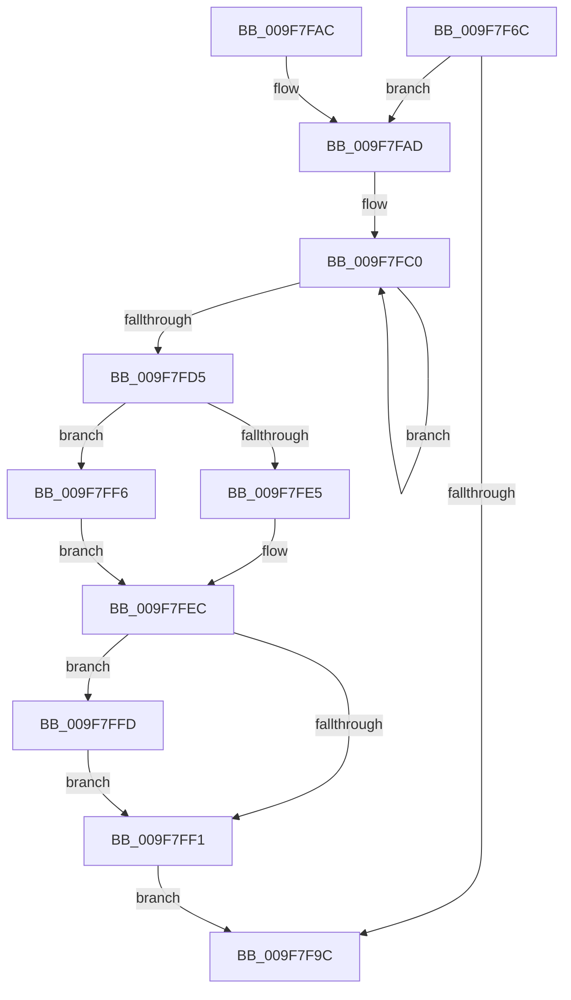

# IoDiskIoAttributionAllocate

- RVA: `0x009F7F6C`–`0x009F800E` (길이 `162` bytes)
- VA: `0x00000001409F7F6C`
- 실행 섹션: `PAGE`
- PDB 이름 있음: `예`; PDB Function 태그: `아니요`
- unwind 정보 RVA: `0x00079B98`
- 디코드: `43`개 명령, `162/162` bytes 표시
- 미해석 바이트: `0` (있으면 어셈블리에 `.byte`로 보존)

> 이 문서는 커널 이미지의 기계어와 PDB 기호를 분석해 생성했습니다. 4번과 5번은 함수 원형과 자료형을 바이너리 사용 방식에서 추정한 C 해석이며 원본 소스 복구 결과는 아닙니다.

## 1. Dependencies

- 직접 호출 지점: **3**; 고유 호출 대상: **3**
- 직접 호출자로 확인된 함수: **2**
- RIP 상대 이미지 참조: **1**

### Outgoing calls
- `0x009F7F8F` → [ExAllocatePool2](../../poolcode/B8/ExAllocatePool2_function_00B820F0.md) (function, `0x00B820F0`)
- `0x009F7FF6` → [ExWaitForRundownProtectionRelease](../../text/2A/ExWaitForRundownProtectionRelease_function_002A4CB0.md) (function, `0x002A4CB0`)
- `0x009F8000` → [IoDiskIoAttributionReference](../../text/47/IoDiskIoAttributionReference_function_00473F4C.md) (function, `0x00473F4C`)

### Direct callers
- [PspSetJobIoAttribution](PspSetJobIoAttribution_function_009F7C50.md) at `0x009F7D66`
- [sub_00B31590](../B3/Unknown_function_00B31590.md) at `0x00B3160F`

### Static image references
- `0x009F7FC3` → RVA `0x00F8D1E8` (`.data`; read/write)

## 2. Other-region calls and transfers

- 다른 실행 섹션으로 향하는 call: **3**
  - `0x009F7F8F` → [ExAllocatePool2](../../poolcode/B8/ExAllocatePool2_function_00B820F0.md) (`PAGE` → `POOLCODE`)
  - `0x009F7FF6` → [ExWaitForRundownProtectionRelease](../../text/2A/ExWaitForRundownProtectionRelease_function_002A4CB0.md) (`PAGE` → `.text`)
  - `0x009F8000` → [IoDiskIoAttributionReference](../../text/47/IoDiskIoAttributionReference_function_00473F4C.md) (`PAGE` → `.text`)
- 별도 외부 분기/꼬리 이동을 확인하지 못했습니다.

## 3. Assembly (complete function range)

```asm
009F7F6C  48 89 5C 24 08                  mov qword ptr [rsp + 8], rbx
009F7F71  48 89 74 24 10                  mov qword ptr [rsp + 0x10], rsi
009F7F76  57                              push rdi
009F7F77  48 83 EC 20                     sub rsp, 0x20
009F7F7B  48 8B FA                        mov rdi, rdx
009F7F7E  48 8B F1                        mov rsi, rcx
009F7F81  BA B8 00 00 00                  mov edx, 0xb8
009F7F86  41 B8 49 6F 44 41               mov r8d, 0x41446f49
009F7F8C  8D 4A 88                        lea ecx, [rdx - 0x78]
009F7F8F  E8 5C A1 18 00                  call 0x140b820f0
009F7F94  48 8B D8                        mov rbx, rax
009F7F97  48 85 C0                        test rax, rax
009F7F9A  75 11                           jne 0x1409f7fad
009F7F9C  48 8B 5C 24 30                  mov rbx, qword ptr [rsp + 0x30]
009F7FA1  48 8B 74 24 38                  mov rsi, qword ptr [rsp + 0x38]
009F7FA6  48 83 C4 20                     add rsp, 0x20
009F7FAA  5F                              pop rdi
009F7FAB  C3                              ret
009F7FAC  CC                              int3
009F7FAD  48 83 60 28 00                  and qword ptr [rax + 0x28], 0
009F7FB2  B9 01 00 00 00                  mov ecx, 1
009F7FB7  48 83 48 10 FF                  or qword ptr [rax + 0x10], 0xffffffffffffffff
009F7FBC  48 89 48 20                     mov qword ptr [rax + 0x20], rcx
009F7FC0  48 8B C1                        mov rax, rcx
009F7FC3  F0 48 0F C1 05 1C 52 59 00      lock xadd qword ptr [rip + 0x59521c], rax
009F7FCC  48 03 C1                        add rax, rcx
009F7FCF  48 89 43 18                     mov qword ptr [rbx + 0x18], rax
009F7FD3  74 EB                           je 0x1409f7fc0
009F7FD5  48 8D 8B A8 00 00 00            lea rcx, [rbx + 0xa8]
009F7FDC  48 83 21 00                     and qword ptr [rcx], 0
009F7FE0  48 85 F6                        test rsi, rsi
009F7FE3  74 11                           je 0x1409f7ff6
009F7FE5  48 89 B3 A0 00 00 00            mov qword ptr [rbx + 0xa0], rsi
009F7FEC  48 85 FF                        test rdi, rdi
009F7FEF  75 0C                           jne 0x1409f7ffd
009F7FF1  48 8B C3                        mov rax, rbx
009F7FF4  EB A6                           jmp 0x1409f7f9c
009F7FF6  E8 B5 CC 8A FF                  call 0x1402a4cb0
009F7FFB  EB EF                           jmp 0x1409f7fec
009F7FFD  48 8B CF                        mov rcx, rdi
009F8000  E8 47 BF A7 FF                  call 0x140473f4c
009F8005  48 89 BB B0 00 00 00            mov qword ptr [rbx + 0xb0], rdi
009F800C  EB E3                           jmp 0x1409f7ff1
```

## 4. C-style interpretation (structured pseudocode)

```c
__int64 __fastcall IoDiskIoAttributionAllocate(__int64 a1, __int64 a2)
{
    __int64 result;
    __int64 v_rsp;
    unsigned __int64 v_stack_p10;
    unsigned __int64 v_stack_p8;

    v_stack_p8 = v_rbx;
    v_stack_p10 = v_rsi;
    v_rsp = (v_rsp) - (32);
    result = ExAllocatePool2(184 - 120, 184, (unsigned int)(0x41446F49ULL), a4);
    if (result != 0) goto loc_009F7FAD;
loc_009F7F9C:
    v_rsp = (v_rsp) + (32);
    return result;
loc_009F7FAD:
    *(unsigned __int64 *)(result + 32) = 1;
loc_009F7FC0:
    result = (1) + (1);
    *(unsigned __int64 *)(v_stack_p8 + 24) = result;
    if (condition_is_equal) goto loc_009F7FC0;
    if (v_stack_p10 == 0) goto loc_009F7FF6;
    *(unsigned __int64 *)(v_stack_p8 + 160) = v_stack_p10;
loc_009F7FEC:
    if (a2 != 0) goto loc_009F7FFD;
loc_009F7FF1:
    goto loc_009F7F9C;
loc_009F7FF6:
    result = ExWaitForRundownProtectionRelease(v_stack_p8 + 168, 184, (unsigned int)(0x41446F49ULL), a4);
    goto loc_009F7FEC;
loc_009F7FFD:
    result = IoDiskIoAttributionReference(a2, 184, (unsigned int)(0x41446F49ULL), a4);
    *(unsigned __int64 *)(v_stack_p8 + 176) = a2;
    goto loc_009F7FF1;
}
```

## 5. (Beta) C Style

```c
int64_t IoDiskIoAttributionAllocate(int64_t Arg1, int64_t Arg2)
{
    int64_t result;
    int64_t local_rsp;
    uint64_t v_stack_p10;
    uint64_t v_stack_p8;

    v_stack_p8 = local_rbx;
    v_stack_p10 = local_rsi;
    local_rsp = (local_rsp) - (32);
    result = ExAllocatePool2(184 - 120, 184, (uint32_t)(0x41446F49ULL), a4);
    if (result != 0) goto loc_009F7FAD;
loc_009F7F9C:
    local_rsp = (local_rsp) + (32);
    return result;
loc_009F7FAD:
    *(uint64_t *)(result + 0x20) = 1;
loc_009F7FC0:
    result = (1) + (1);
    *(uint64_t *)(v_stack_p8 + 0x18) = result;
    if (condition_is_equal) goto loc_009F7FC0;
    if (v_stack_p10 == 0) goto loc_009F7FF6;
    *(uint64_t *)(v_stack_p8 + 0xA0) = v_stack_p10;
loc_009F7FEC:
    if (Arg2 != 0) goto loc_009F7FFD;
loc_009F7FF1:
    goto loc_009F7F9C;
loc_009F7FF6:
    result = ExWaitForRundownProtectionRelease(v_stack_p8 + 168, 184, (uint32_t)(0x41446F49ULL), a4);
    goto loc_009F7FEC;
loc_009F7FFD:
    result = IoDiskIoAttributionReference(Arg2, 184, (uint32_t)(0x41446F49ULL), a4);
    *(uint64_t *)(v_stack_p8 + 0xB0) = Arg2;
    goto loc_009F7FF1;
}
```

## 6. Execution-region graph

[열기: 2D/3D 그래프와 함수 탐색 컨트롤 패널](../../../control-panel.html?section=page&rva=0x009F7F6C&view=graph)

- 2D 그래프는 위에서 아래로 흐르고, 3D 그래프는 빈 공간을 드래그해 회전합니다. Shift+드래그는 이동, 휠은 확대·축소, 함수 노드 선택은 대상 보고서 이동입니다.

### Static fallback


