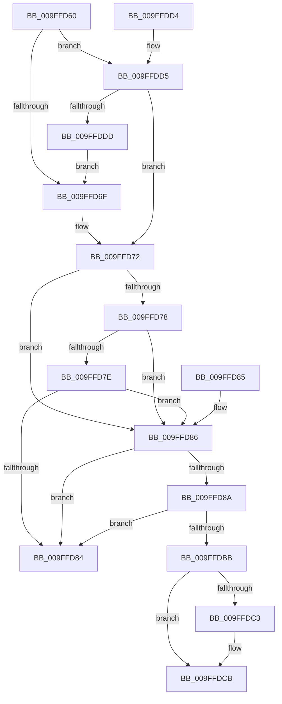

# IoUpdateLinkShareAccessEx

- RVA: `0x009FFD60`–`0x009FFDDF` (길이 `127` bytes)
- VA: `0x00000001409FFD60`
- 실행 섹션: `PAGE`
- PDB 이름 있음: `예`; PDB Function 태그: `아니요`
- unwind 정보 RVA: `0x000DB714`
- 디코드: `44`개 명령, `127/127` bytes 표시
- 미해석 바이트: `0` (있으면 어셈블리에 `.byte`로 보존)

> 이 문서는 커널 이미지의 기계어와 PDB 기호를 분석해 생성했습니다. 4번과 5번은 함수 원형과 자료형을 바이너리 사용 방식에서 추정한 C 해석이며 원본 소스 복구 결과는 아닙니다.

## 1. Dependencies

- 직접 호출 지점: **0**; 고유 호출 대상: **0**
- 직접 호출자로 확인된 함수: **2**
- RIP 상대 이미지 참조: **0**

### Outgoing calls
- 직접 디코드된 call 명령이 없습니다.

### Direct callers
- [IoUpdateLinkShareAccess](../71/IoUpdateLinkShareAccess_function_0071E280.md) at `0x0071E287`
- [IoUpdateShareAccess](IoUpdateShareAccess_function_009FFD40.md) at `0x009FFD4A`

### Static image references
- 디코드된 RIP-relative 메모리 참조가 없습니다.

## 2. Other-region calls and transfers

- 다른 실행 섹션으로 향하는 call: **0**
- 별도 외부 분기/꼬리 이동을 확인하지 못했습니다.

## 3. Assembly (complete function range)

```asm
009FFD60  48 8B 81 D0 00 00 00            mov rax, qword ptr [rcx + 0xd0]
009FFD67  45 33 D2                        xor r10d, r10d
009FFD6A  48 85 C0                        test rax, rax
009FFD6D  75 66                           jne 0x1409ffdd5
009FFD6F  41 8A C2                        mov al, r10b
009FFD72  44 38 51 4A                     cmp byte ptr [rcx + 0x4a], r10b
009FFD76  75 0E                           jne 0x1409ffd86
009FFD78  44 38 51 4B                     cmp byte ptr [rcx + 0x4b], r10b
009FFD7C  75 08                           jne 0x1409ffd86
009FFD7E  44 38 51 4C                     cmp byte ptr [rcx + 0x4c], r10b
009FFD82  75 02                           jne 0x1409ffd86
009FFD84  C3                              ret
009FFD85  CC                              int3
009FFD86  84 C0                           test al, al
009FFD88  75 FA                           jne 0x1409ffd84
009FFD8A  FF 02                           inc dword ptr [rdx]
009FFD8C  0F B6 41 4A                     movzx eax, byte ptr [rcx + 0x4a]
009FFD90  01 42 04                        add dword ptr [rdx + 4], eax
009FFD93  0F B6 41 4B                     movzx eax, byte ptr [rcx + 0x4b]
009FFD97  01 42 08                        add dword ptr [rdx + 8], eax
009FFD9A  0F B6 41 4D                     movzx eax, byte ptr [rcx + 0x4d]
009FFD9E  01 42 10                        add dword ptr [rdx + 0x10], eax
009FFDA1  0F B6 41 4E                     movzx eax, byte ptr [rcx + 0x4e]
009FFDA5  01 42 14                        add dword ptr [rdx + 0x14], eax
009FFDA8  0F B6 41 4C                     movzx eax, byte ptr [rcx + 0x4c]
009FFDAC  01 42 0C                        add dword ptr [rdx + 0xc], eax
009FFDAF  0F B6 41 4F                     movzx eax, byte ptr [rcx + 0x4f]
009FFDB3  01 42 18                        add dword ptr [rdx + 0x18], eax
009FFDB6  4D 85 C0                        test r8, r8
009FFDB9  74 C9                           je 0x1409ffd84
009FFDBB  41 FF 00                        inc dword ptr [r8]
009FFDBE  45 84 C9                        test r9b, r9b
009FFDC1  78 08                           js 0x1409ffdcb
009FFDC3  0F B6 41 4C                     movzx eax, byte ptr [rcx + 0x4c]
009FFDC7  41 01 40 04                     add dword ptr [r8 + 4], eax
009FFDCB  0F B6 41 4F                     movzx eax, byte ptr [rcx + 0x4f]
009FFDCF  41 01 40 08                     add dword ptr [r8 + 8], eax
009FFDD3  C3                              ret
009FFDD4  CC                              int3
009FFDD5  8B 00                           mov eax, dword ptr [rax]
009FFDD7  A8 01                           test al, 1
009FFDD9  B0 01                           mov al, 1
009FFDDB  75 95                           jne 0x1409ffd72
009FFDDD  EB 90                           jmp 0x1409ffd6f
```

## 4. C-style interpretation (structured pseudocode)

```c
__int64 __fastcall IoUpdateLinkShareAccessEx(__int64 a1, __int64 a2, __int64 a3, unsigned __int8 a4)
{
    __int64 result;
    __int64 v_r10;

    v_r10 = 0;
    if (*(unsigned __int64 *)(a1 + 208) != 0) goto loc_009FFDD5;
loc_009FFD6F:
loc_009FFD72:
    if ((*(unsigned __int8 *)(a1 + 74)) != 0) goto loc_009FFD86;
    if ((*(unsigned __int8 *)(a1 + 75)) != 0) goto loc_009FFD86;
    if ((*(unsigned __int8 *)(a1 + 76)) != 0) goto loc_009FFD86;
loc_009FFD84:
    return 0;
loc_009FFD86:
    if (0 != 0) goto loc_009FFD84;
    if (a3 == 0) goto loc_009FFD84;
    result = *(unsigned __int8 *)(a1 + 79);
    if (!(sign_flag)) {
        result = *(unsigned __int8 *)(a1 + 76);
    }
    return *(unsigned __int8 *)(a1 + 79);
loc_009FFDD5:
    if ((((unsigned __int8)((unsigned int)(*(unsigned int *)(*(unsigned __int8 *)(a1 + 79))))) & (1)) != 0) goto loc_009FFD72;
    goto loc_009FFD6F;
}
```

## 5. (Beta) C Style

```c
int64_t IoUpdateLinkShareAccessEx(void *Arg1, void *Arg2, int64_t Arg3, uint8_t Arg4)
{
    uint8_t *arg1 = (uint8_t *)Arg1;
    uint8_t *arg2 = (uint8_t *)Arg2;

    int64_t result;
    int64_t local_r10;

    local_r10 = 0;
    if (*(uint64_t *)(arg1 + 0xD0) != 0) goto loc_009FFDD5;
loc_009FFD6F:
loc_009FFD72:
    if ((*(uint8_t *)(arg1 + 0x4A)) != 0) goto loc_009FFD86;
    if ((*(uint8_t *)(arg1 + 0x4B)) != 0) goto loc_009FFD86;
    if ((*(uint8_t *)(arg1 + 0x4C)) != 0) goto loc_009FFD86;
loc_009FFD84:
    return 0;
loc_009FFD86:
    if (0 != 0) goto loc_009FFD84;
    if (Arg3 == 0) goto loc_009FFD84;
    result = *(uint8_t *)(arg1 + 0x4F);
    if (!(sign_flag)) {
        result = *(uint8_t *)(arg1 + 0x4C);
    }
    return *(uint8_t *)(arg1 + 0x4F);
loc_009FFDD5:
    if ((((uint8_t)((uint32_t)(*(uint32_t *)(*(uint8_t *)(arg1 + 0x4F))))) & (1)) != 0) goto loc_009FFD72;
    goto loc_009FFD6F;
}
```

### 관측된 메모리 오프셋

구조체 형식이 확인되지 않은 접근은 인자 기준의 오프셋으로만 기록했습니다.

| 기준 인자 | 오프셋 표현 | 폭 (bit) | 접근 |
|---|---:|---:|---|
| `Arg1` | `+ 0x4A` | `8` | `R` |
| `Arg1` | `+ 0x4B` | `8` | `R` |
| `Arg1` | `+ 0x4C` | `8` | `R` |
| `Arg1` | `+ 0x4D` | `8` | `R` |
| `Arg1` | `+ 0x4E` | `8` | `R` |
| `Arg1` | `+ 0x4F` | `8` | `R` |
| `Arg1` | `+ 0xD0` | `64` | `R` |
| `Arg2` | `+ 0x0` | `32` | `R/W` |
| `Arg2` | `+ 0x4` | `32` | `R/W` |
| `Arg2` | `+ 0x8` | `32` | `R/W` |
| `Arg2` | `+ 0xC` | `32` | `R/W` |
| `Arg2` | `+ 0x10` | `32` | `R/W` |
| `Arg2` | `+ 0x14` | `32` | `R/W` |
| `Arg2` | `+ 0x18` | `32` | `R/W` |

## 6. Execution-region graph

[열기: 2D/3D 그래프와 함수 탐색 컨트롤 패널](../../../control-panel.html?section=page&rva=0x009FFD60&view=graph)

- 2D 그래프는 위에서 아래로 흐르고, 3D 그래프는 빈 공간을 드래그해 회전합니다. Shift+드래그는 이동, 휠은 확대·축소, 함수 노드 선택은 대상 보고서 이동입니다.

### Static fallback


