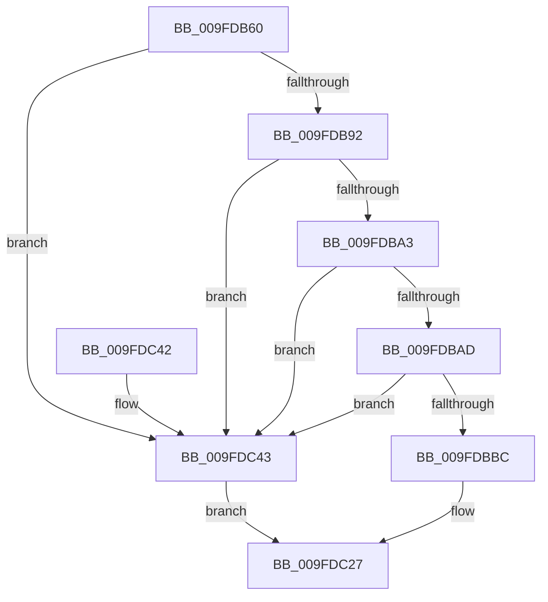

# IopParseFile

- RVA: `0x009FDB60`–`0x009FDC4A` (길이 `234` bytes)
- VA: `0x00000001409FDB60`
- 실행 섹션: `PAGE`
- PDB 이름 있음: `예`; PDB Function 태그: `아니요`
- unwind 정보 RVA: `0x000A72E8`
- 디코드: `52`개 명령, `234/234` bytes 표시
- 미해석 바이트: `0` (있으면 어셈블리에 `.byte`로 보존)

> 이 문서는 커널 이미지의 기계어와 PDB 기호를 분석해 생성했습니다. 4번과 5번은 함수 원형과 자료형을 바이너리 사용 방식에서 추정한 C 해석이며 원본 소스 복구 결과는 아닙니다.

## 1. Dependencies

- 직접 호출 지점: **2**; 고유 호출 대상: **2**
- 직접 호출자로 확인된 함수: **1**
- RIP 상대 이미지 참조: **1**

### Outgoing calls
- `0x009FDBBC` → [IoGetRelatedDeviceObject](../../text/29/IoGetRelatedDeviceObject_function_0029B120.md) (function, `0x0029B120`)
- `0x009FDC22` → [IopParseDevice](../89/IopParseDevice_function_0089E510.md) (function, `0x0089E510`)

### Direct callers
- [ObpLookupObjectName](../89/ObpLookupObjectName_function_0089BE90.md) at `0x0089D1EB`

### Static image references
- `0x009FDB79` → RVA `0x00FC6AE0` (`ALMOSTRO`; read)

## 2. Other-region calls and transfers

- 다른 실행 섹션으로 향하는 call: **1**
  - `0x009FDBBC` → [IoGetRelatedDeviceObject](../../text/29/IoGetRelatedDeviceObject_function_0029B120.md) (`PAGE` → `.text`)
- 별도 외부 분기/꼬리 이동을 확인하지 못했습니다.

## 3. Assembly (complete function range)

```asm
009FDB60  48 8B C4                        mov rax, rsp
009FDB63  48 89 58 08                     mov qword ptr [rax + 8], rbx
009FDB67  48 89 68 10                     mov qword ptr [rax + 0x10], rbp
009FDB6B  48 89 70 18                     mov qword ptr [rax + 0x18], rsi
009FDB6F  48 89 78 20                     mov qword ptr [rax + 0x20], rdi
009FDB73  41 56                           push r14
009FDB75  48 83 EC 60                     sub rsp, 0x60
009FDB79  48 3B 15 60 8F 5C 00            cmp rdx, qword ptr [rip + 0x5c8f60]
009FDB80  41 8A E9                        mov bpl, r9b
009FDB83  4D 8B F0                        mov r14, r8
009FDB86  48 8B FA                        mov rdi, rdx
009FDB89  48 8B F1                        mov rsi, rcx
009FDB8C  0F 85 B1 00 00 00               jne 0x1409fdc43
009FDB92  48 8B 9C 24 A8 00 00 00         mov rbx, qword ptr [rsp + 0xa8]
009FDB9A  48 85 DB                        test rbx, rbx
009FDB9D  0F 84 A0 00 00 00               je 0x1409fdc43
009FDBA3  66 83 3B 08                     cmp word ptr [rbx], 8
009FDBA7  0F 85 96 00 00 00               jne 0x1409fdc43
009FDBAD  B8 E0 00 00 00                  mov eax, 0xe0
009FDBB2  66 39 43 02                     cmp word ptr [rbx + 2], ax
009FDBB6  0F 85 87 00 00 00               jne 0x1409fdc43
009FDBBC  E8 5F D5 89 FF                  call 0x14029b120
009FDBC1  48 8B 8C 24 C0 00 00 00         mov rcx, qword ptr [rsp + 0xc0]
009FDBC9  44 8A CD                        mov r9b, bpl
009FDBCC  48 89 4C 24 50                  mov qword ptr [rsp + 0x50], rcx
009FDBD1  4D 8B C6                        mov r8, r14
009FDBD4  48 8B 8C 24 B8 00 00 00         mov rcx, qword ptr [rsp + 0xb8]
009FDBDC  48 8B D7                        mov rdx, rdi
009FDBDF  48 89 4C 24 48                  mov qword ptr [rsp + 0x48], rcx
009FDBE4  48 8B 8C 24 B0 00 00 00         mov rcx, qword ptr [rsp + 0xb0]
009FDBEC  48 89 4C 24 40                  mov qword ptr [rsp + 0x40], rcx
009FDBF1  48 8B 8C 24 A0 00 00 00         mov rcx, qword ptr [rsp + 0xa0]
009FDBF9  48 89 5C 24 38                  mov qword ptr [rsp + 0x38], rbx
009FDBFE  48 89 4C 24 30                  mov qword ptr [rsp + 0x30], rcx
009FDC03  48 8B 8C 24 98 00 00 00         mov rcx, qword ptr [rsp + 0x98]
009FDC0B  48 89 4C 24 28                  mov qword ptr [rsp + 0x28], rcx
009FDC10  8B 8C 24 90 00 00 00            mov ecx, dword ptr [rsp + 0x90]
009FDC17  89 4C 24 20                     mov dword ptr [rsp + 0x20], ecx
009FDC1B  48 8B C8                        mov rcx, rax
009FDC1E  48 89 73 28                     mov qword ptr [rbx + 0x28], rsi
009FDC22  E8 E9 08 EA FF                  call 0x14089e510
009FDC27  4C 8D 5C 24 60                  lea r11, [rsp + 0x60]
009FDC2C  49 8B 5B 10                     mov rbx, qword ptr [r11 + 0x10]
009FDC30  49 8B 6B 18                     mov rbp, qword ptr [r11 + 0x18]
009FDC34  49 8B 73 20                     mov rsi, qword ptr [r11 + 0x20]
009FDC38  49 8B 7B 28                     mov rdi, qword ptr [r11 + 0x28]
009FDC3C  49 8B E3                        mov rsp, r11
009FDC3F  41 5E                           pop r14
009FDC41  C3                              ret
009FDC42  CC                              int3
009FDC43  B8 24 00 00 C0                  mov eax, 0xc0000024
009FDC48  EB DD                           jmp 0x1409fdc27
```

## 4. C-style interpretation (structured pseudocode)

```c
__int64 __fastcall IopParseFile(__int64 a1, __int64 a2, __int64 a3, unsigned __int8 a4, unsigned int a5, __int64 a6, __int64 a7, __int64 a8, __int64 a9, __int64 a10, __int64 a11)
{
    __int64 result;
    __int64 v_rsp;
    unsigned __int64 v_stack_m18;
    unsigned __int64 v_stack_m20;
    unsigned __int64 v_stack_m28;
    unsigned __int64 v_stack_m30;
    unsigned __int64 v_stack_m38;
    unsigned __int64 v_stack_m40;
    unsigned int v_stack_m48;
    unsigned __int64 v_stack_m8;

    *(unsigned __int64 *)(v_rsp + 8) = v_rbx;
    *(unsigned __int64 *)(v_rsp + 16) = v_rbp;
    *(unsigned __int64 *)(v_rsp + 24) = v_rsi;
    *(unsigned __int64 *)(v_rsp + 32) = v_rdi;
    v_rsp = (v_rsp) - (96);
    if (a2 != (*(unsigned __int64 *)(v_rip + 6066016))) goto loc_009FDC43;
    if (a8 == 0) goto loc_009FDC43;
    if ((*(unsigned __int16 *)(a8)) != 8) goto loc_009FDC43;
    if ((*(unsigned __int16 *)(a8 + 2)) != 224) goto loc_009FDC43;
    result = IoGetRelatedDeviceObject(a1, a2, a3, a4);
    v_stack_m18 = a11;
    v_stack_m20 = a10;
    v_stack_m28 = a9;
    v_stack_m30 = a8;
    v_stack_m38 = a7;
    v_stack_m40 = a6;
    v_stack_m48 = (unsigned int)((unsigned int)(a5));
    *(unsigned __int64 *)(a8 + 40) = a1;
    result = IopParseDevice(result, a2, a3, a4);
loc_009FDC27:
    return result;
loc_009FDC43:
    goto loc_009FDC27;
}
```

## 5. (Beta) C Style

```c
int64_t IopParseFile(int64_t Arg1, int64_t Arg2, int64_t Arg3, uint8_t Arg4, uint32_t Arg5, int64_t Arg6, int64_t Arg7, int64_t Arg8, int64_t Arg9, int64_t Arg10, int64_t Arg11)
{
    int64_t result;
    int64_t local_rsp;
    uint64_t v_stack_m18;
    uint64_t v_stack_m20;
    uint64_t v_stack_m28;
    uint64_t v_stack_m30;
    uint64_t v_stack_m38;
    uint64_t v_stack_m40;
    uint32_t v_stack_m48;
    uint64_t v_stack_m8;

    *(uint64_t *)(local_rsp + 0x8) = local_rbx;
    *(uint64_t *)(local_rsp + 0x10) = local_rbp;
    *(uint64_t *)(local_rsp + 0x18) = local_rsi;
    *(uint64_t *)(local_rsp + 0x20) = local_rdi;
    local_rsp = (local_rsp) - (96);
    if (Arg2 != (*(uint64_t *)(v_rip + 0x5C8F60))) goto loc_009FDC43;
    if (Arg8 == 0) goto loc_009FDC43;
    if ((*(uint16_t *)(Arg8)) != 8) goto loc_009FDC43;
    if ((*(uint16_t *)(Arg8 + 0x2)) != 224) goto loc_009FDC43;
    result = IoGetRelatedDeviceObject(Arg1, Arg2, Arg3, Arg4);
    v_stack_m18 = Arg11;
    v_stack_m20 = Arg10;
    v_stack_m28 = Arg9;
    v_stack_m30 = Arg8;
    v_stack_m38 = Arg7;
    v_stack_m40 = Arg6;
    v_stack_m48 = (uint32_t)((uint32_t)(Arg5));
    *(uint64_t *)(Arg8 + 0x28) = Arg1;
    result = IopParseDevice(result, Arg2, Arg3, Arg4);
loc_009FDC27:
    return result;
loc_009FDC43:
    goto loc_009FDC27;
}
```

## 6. Execution-region graph

[열기: 2D/3D 그래프와 함수 탐색 컨트롤 패널](../../../control-panel.html?section=page&rva=0x009FDB60&view=graph)

- 2D 그래프는 위에서 아래로 흐르고, 3D 그래프는 빈 공간을 드래그해 회전합니다. Shift+드래그는 이동, 휠은 확대·축소, 함수 노드 선택은 대상 보고서 이동입니다.

### Static fallback


