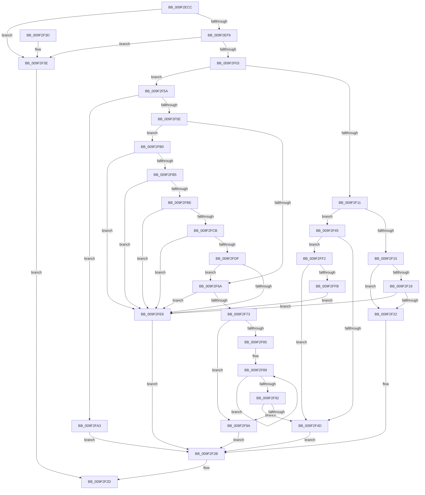

# LdrpResCompareResourceNames

- RVA: `0x009F2ECC`–`0x009F2FFD` (길이 `305` bytes)
- VA: `0x00000001409F2ECC`
- 실행 섹션: `PAGE`
- PDB 이름 있음: `예`; PDB Function 태그: `아니요`
- unwind 정보 RVA: `0x000A61D0`
- 디코드: `94`개 명령, `305/305` bytes 표시
- 미해석 바이트: `0` (있으면 어셈블리에 `.byte`로 보존)

> 이 문서는 커널 이미지의 기계어와 PDB 기호를 분석해 생성했습니다. 4번과 5번은 함수 원형과 자료형을 바이너리 사용 방식에서 추정한 C 해석이며 원본 소스 복구 결과는 아닙니다.

## 1. Dependencies

- 직접 호출 지점: **1**; 고유 호출 대상: **1**
- 직접 호출자로 확인된 함수: **1**
- RIP 상대 이미지 참조: **0**

### Outgoing calls
- `0x009F2F7A` → [wcsncmp](../../text/50/wcsncmp_function_00501CA0.md) (function, `0x00501CA0`)

### Direct callers
- [LdrpResSearchResourceInsideDirectory](LdrpResSearchResourceInsideDirectory_function_009F22F0.md) at `0x009F269C`

### Static image references
- 디코드된 RIP-relative 메모리 참조가 없습니다.

## 2. Other-region calls and transfers

- 다른 실행 섹션으로 향하는 call: **1**
  - `0x009F2F7A` → [wcsncmp](../../text/50/wcsncmp_function_00501CA0.md) (`PAGE` → `.text`)
- 별도 외부 분기/꼬리 이동을 확인하지 못했습니다.

## 3. Assembly (complete function range)

```asm
009F2ECC  48 89 5C 24 08                  mov qword ptr [rsp + 8], rbx
009F2ED1  48 89 74 24 10                  mov qword ptr [rsp + 0x10], rsi
009F2ED6  57                              push rdi
009F2ED7  48 83 EC 20                     sub rsp, 0x20
009F2EDB  8B 44 24 60                     mov eax, dword ptr [rsp + 0x60]
009F2EDF  33 DB                           xor ebx, ebx
009F2EE1  48 8B 54 24 50                  mov rdx, qword ptr [rsp + 0x50]
009F2EE6  25 00 10 00 00                  and eax, 0x1000
009F2EEB  49 8B F9                        mov rdi, r9
009F2EEE  4D 8B D0                        mov r10, r8
009F2EF1  4C 8B C9                        mov r9, rcx
009F2EF4  48 85 D2                        test rdx, rdx
009F2EF7  74 45                           je 0x1409f2f3e
009F2EF9  48 8B 4C 24 58                  mov rcx, qword ptr [rsp + 0x58]
009F2EFE  48 85 C9                        test rcx, rcx
009F2F01  74 3B                           je 0x1409f2f3e
009F2F03  8B 09                           mov ecx, dword ptr [rcx]
009F2F05  49 C7 C3 00 00 FF FF            mov r11, 0xffffffffffff0000
009F2F0C  49 85 FB                        test r11, rdi
009F2F0F  75 49                           jne 0x1409f2f5a
009F2F11  85 C9                           test ecx, ecx
009F2F13  78 30                           js 0x1409f2f45
009F2F15  85 C0                           test eax, eax
009F2F17  74 09                           je 0x1409f2f22
009F2F19  49 85 CB                        test r11, rcx
009F2F1C  0F 85 C6 00 00 00               jne 0x1409f2fe8
009F2F22  2B F9                           sub edi, ecx
009F2F24  48 8B 4C 24 68                  mov rcx, qword ptr [rsp + 0x68]
009F2F29  89 39                           mov dword ptr [rcx], edi
009F2F2B  8B C3                           mov eax, ebx
009F2F2D  48 8B 5C 24 30                  mov rbx, qword ptr [rsp + 0x30]
009F2F32  48 8B 74 24 38                  mov rsi, qword ptr [rsp + 0x38]
009F2F37  48 83 C4 20                     add rsp, 0x20
009F2F3B  5F                              pop rdi
009F2F3C  C3                              ret
009F2F3D  CC                              int3
009F2F3E  B8 0D 00 00 C0                  mov eax, 0xc000000d
009F2F43  EB E8                           jmp 0x1409f2f2d
009F2F45  85 C0                           test eax, eax
009F2F47  0F 85 A5 00 00 00               jne 0x1409f2ff2
009F2F4D  48 8B 44 24 68                  mov rax, qword ptr [rsp + 0x68]
009F2F52  C7 00 01 00 00 00               mov dword ptr [rax], 1
009F2F58  EB D1                           jmp 0x1409f2f2b
009F2F5A  85 C9                           test ecx, ecx
009F2F5C  79 45                           jns 0x1409f2fa3
009F2F5E  0F BA F1 1F                     btr ecx, 0x1f
009F2F62  48 8D 34 11                     lea rsi, [rcx + rdx]
009F2F66  85 C0                           test eax, eax
009F2F68  75 46                           jne 0x1409f2fb0
009F2F6A  48 8D 56 02                     lea rdx, [rsi + 2]
009F2F6E  49 85 D3                        test r11, rdx
009F2F71  74 75                           je 0x1409f2fe8
009F2F73  44 0F B7 06                     movzx r8d, word ptr [rsi]
009F2F77  48 8B CF                        mov rcx, rdi
009F2F7A  E8 21 ED B0 FF                  call 0x140501ca0
009F2F7F  8B D0                           mov edx, eax
009F2F81  85 C0                           test eax, eax
009F2F83  75 15                           jne 0x1409f2f9a
009F2F85  48 83 C9 FF                     or rcx, 0xffffffffffffffff
009F2F89  48 FF C1                        inc rcx
009F2F8C  66 39 1C 4F                     cmp word ptr [rdi + rcx*2], bx
009F2F90  75 F7                           jne 0x1409f2f89
009F2F92  0F B7 06                        movzx eax, word ptr [rsi]
009F2F95  48 3B C8                        cmp rcx, rax
009F2F98  75 B3                           jne 0x1409f2f4d
009F2F9A  48 8B 44 24 68                  mov rax, qword ptr [rsp + 0x68]
009F2F9F  89 10                           mov dword ptr [rax], edx
009F2FA1  EB 88                           jmp 0x1409f2f2b
009F2FA3  48 8B 44 24 68                  mov rax, qword ptr [rsp + 0x68]
009F2FA8  83 08 FF                        or dword ptr [rax], 0xffffffff
009F2FAB  E9 7B FF FF FF                  jmp 0x1409f2f2b
009F2FB0  48 3B F2                        cmp rsi, rdx
009F2FB3  72 33                           jb 0x1409f2fe8
009F2FB5  4C 8D 46 04                     lea r8, [rsi + 4]
009F2FB9  4C 3B C2                        cmp r8, rdx
009F2FBC  72 2A                           jb 0x1409f2fe8
009F2FBE  49 83 E1 FC                     and r9, 0xfffffffffffffffc
009F2FC2  4B 8D 04 11                     lea rax, [r9 + r10]
009F2FC6  4C 3B C0                        cmp r8, rax
009F2FC9  77 1D                           ja 0x1409f2fe8
009F2FCB  44 0F B7 06                     movzx r8d, word ptr [rsi]
009F2FCF  49 83 C0 02                     add r8, 2
009F2FD3  4E 8D 04 41                     lea r8, [rcx + r8*2]
009F2FD7  4C 03 C2                        add r8, rdx
009F2FDA  4C 3B C2                        cmp r8, rdx
009F2FDD  72 09                           jb 0x1409f2fe8
009F2FDF  4B 8D 04 11                     lea rax, [r9 + r10]
009F2FE3  4C 3B C0                        cmp r8, rax
009F2FE6  76 82                           jbe 0x1409f2f6a
009F2FE8  BB 7B 00 00 C0                  mov ebx, 0xc000007b
009F2FED  E9 39 FF FF FF                  jmp 0x1409f2f2b
009F2FF2  49 85 CB                        test r11, rcx
009F2FF5  0F 85 52 FF FF FF               jne 0x1409f2f4d
009F2FFB  EB EB                           jmp 0x1409f2fe8
```

## 4. C-style interpretation (structured pseudocode)

```c
__int64 __fastcall LdrpResCompareResourceNames(__int64 a1, __int64 a2, __int64 a3, __int64 a4, __int64 a5, __int64 a6, unsigned int a7, __int64 a8)
{
    __int64 result;
    __int64 v_rbx;
    __int64 v_rdi;
    __int64 v_rsp;
    unsigned __int64 v_stack_p10;
    unsigned __int64 v_stack_p8;

    v_stack_p8 = v_rbx;
    v_stack_p10 = v_rsi;
    v_rsp = (v_rsp) - (32);
    v_rbx = 0;
    result = (unsigned int)(((unsigned int)(a7)) & (0x1000ULL));
    if (a5 == 0) goto loc_009F2F3E;
    if (a6 == 0) goto loc_009F2F3E;
    if (((0xFFFFFFFFFFFF0000ULL) & (a4)) != 0) goto loc_009F2F5A;
    if (sign_flag) goto loc_009F2F45;
    if ((unsigned int)(result) == 0) goto loc_009F2F22;
    if (((0xFFFFFFFFFFFF0000ULL) & ((unsigned int)(*(unsigned int *)(a6)))) != 0) goto loc_009F2FE8;
loc_009F2F22:
    v_rdi = (unsigned int)((a4) - ((unsigned int)((unsigned int)(*(unsigned int *)(a6)))));
    *(unsigned int *)(a8) = (unsigned int)(v_rdi);
loc_009F2F2B:
loc_009F2F2D:
    v_rsp = (v_rsp) + (32);
    return 0;
loc_009F2F3E:
    goto loc_009F2F2D;
loc_009F2F45:
    if ((unsigned int)((unsigned int)(0xC000000DULL)) != 0) goto loc_009F2FF2;
loc_009F2F4D:
    *(unsigned int *)(a8) = 1;
    goto loc_009F2F2B;
loc_009F2F5A:
    if (!sign_flag) goto loc_009F2FA3;
    if ((unsigned int)(a8) != 0) goto loc_009F2FB0;
loc_009F2F6A:
    if (((0xFFFFFFFFFFFF0000ULL) & (a8 + a5 * 1 + 2)) == 0) goto loc_009F2FE8;
    result = wcsncmp(v_rdi, a8 + a5 * 1 + 2, *(unsigned __int16 *)(a8 + a5 * 1), a1);
    if ((unsigned int)(result) != 0) goto loc_009F2F9A;
    a1 = (v_rdi) | (-1);
loc_009F2F89:
    a1 = (a1) + 1;
    if ((*(unsigned __int16 *)(v_rdi + a1 * 2)) != ((unsigned __int16)(v_stack_p8))) goto loc_009F2F89;
    if (a1 != (*(unsigned __int16 *)(a8 + a5 * 1))) goto loc_009F2F4D;
loc_009F2F9A:
    *(unsigned int *)(a8) = (unsigned int)((unsigned int)((unsigned int)(result)));
    goto loc_009F2F2B;
loc_009F2FA3:
    goto loc_009F2F2B;
loc_009F2FB0:
    if ((a8 + a5 * 1) < ((unsigned int)((unsigned int)(result)))) goto loc_009F2FE8;
    if ((a8 + a5 * 1 + 4) < ((unsigned int)((unsigned int)(result)))) goto loc_009F2FE8;
    a4 = (a1) & (-4);
    if ((a8 + a5 * 1 + 4) > (a4 + a3 * 1)) goto loc_009F2FE8;
    a3 = (*(unsigned __int16 *)(a8 + a5 * 1)) + (2);
    a3 = (a1 + a3 * 2) + ((unsigned int)((unsigned int)(result)));
    if (a3 < ((unsigned int)((unsigned int)(result)))) goto loc_009F2FE8;
    if (a3 <= (a4 + a3 * 1)) goto loc_009F2F6A;
loc_009F2FE8:
    goto loc_009F2F2B;
loc_009F2FF2:
    if (((0xFFFFFFFFFFFF0000ULL) & (a1)) != 0) goto loc_009F2F4D;
    goto loc_009F2FE8;
}
```

## 5. (Beta) C Style

```c
int64_t LdrpResCompareResourceNames(void *Arg1, int64_t Arg2, int64_t Arg3, void *Arg4, int64_t Arg5, int64_t Arg6, uint32_t Arg7, void *Arg8)
{
    uint8_t *arg1 = (uint8_t *)Arg1;
    uint8_t *arg4 = (uint8_t *)Arg4;
    uint8_t *arg8 = (uint8_t *)Arg8;

    int64_t result;
    int64_t local_rbx;
    int64_t local_rdi;
    int64_t local_rsp;
    uint64_t v_stack_p10;
    uint64_t v_stack_p8;

    v_stack_p8 = local_rbx;
    v_stack_p10 = local_rsi;
    local_rsp = (local_rsp) - (32);
    local_rbx = 0;
    result = (uint32_t)(((uint32_t)(Arg7)) & (0x1000ULL));
    if (Arg5 == 0) goto loc_009F2F3E;
    if (Arg6 == 0) goto loc_009F2F3E;
    if (((0xFFFFFFFFFFFF0000ULL) & (Arg4)) != 0) goto loc_009F2F5A;
    if (sign_flag) goto loc_009F2F45;
    if ((uint32_t)(result) == 0) goto loc_009F2F22;
    if (((0xFFFFFFFFFFFF0000ULL) & ((uint32_t)(*(uint32_t *)(Arg6)))) != 0) goto loc_009F2FE8;
loc_009F2F22:
    local_rdi = (uint32_t)((Arg4) - ((uint32_t)((uint32_t)(*(uint32_t *)(Arg6)))));
    *(uint32_t *)(arg8) = (uint32_t)(local_rdi);
loc_009F2F2B:
loc_009F2F2D:
    local_rsp = (local_rsp) + (32);
    return 0;
loc_009F2F3E:
    goto loc_009F2F2D;
loc_009F2F45:
    if ((uint32_t)((uint32_t)(0xC000000DULL)) != 0) goto loc_009F2FF2;
loc_009F2F4D:
    *(uint32_t *)(arg8) = 1;
    goto loc_009F2F2B;
loc_009F2F5A:
    if (!sign_flag) goto loc_009F2FA3;
    if ((uint32_t)(Arg8) != 0) goto loc_009F2FB0;
loc_009F2F6A:
    if (((0xFFFFFFFFFFFF0000ULL) & (Arg8 + Arg5 * 1 + 2)) == 0) goto loc_009F2FE8;
    result = wcsncmp(local_rdi, Arg8 + Arg5 * 1 + 2, *(uint16_t *)(arg8 + Arg5 * 1), Arg1);
    if ((uint32_t)(result) != 0) goto loc_009F2F9A;
    Arg1 = (local_rdi) | (-1);
loc_009F2F89:
    Arg1 = (Arg1) + 1;
    if ((*(uint16_t *)(local_rdi + arg1 * 2)) != ((uint16_t)(v_stack_p8))) goto loc_009F2F89;
    if (Arg1 != (*(uint16_t *)(arg8 + Arg5 * 1))) goto loc_009F2F4D;
loc_009F2F9A:
    *(uint32_t *)(arg8) = (uint32_t)((uint32_t)((uint32_t)(result)));
    goto loc_009F2F2B;
loc_009F2FA3:
    goto loc_009F2F2B;
loc_009F2FB0:
    if ((Arg8 + Arg5 * 1) < ((uint32_t)((uint32_t)(result)))) goto loc_009F2FE8;
    if ((Arg8 + Arg5 * 1 + 4) < ((uint32_t)((uint32_t)(result)))) goto loc_009F2FE8;
    Arg4 = (Arg1) & (-4);
    if ((Arg8 + Arg5 * 1 + 4) > (Arg4 + Arg3 * 1)) goto loc_009F2FE8;
    Arg3 = (*(uint16_t *)(arg8 + Arg5 * 1)) + (2);
    Arg3 = (Arg1 + Arg3 * 2) + ((uint32_t)((uint32_t)(result)));
    if (Arg3 < ((uint32_t)((uint32_t)(result)))) goto loc_009F2FE8;
    if (Arg3 <= (Arg4 + Arg3 * 1)) goto loc_009F2F6A;
loc_009F2FE8:
    goto loc_009F2F2B;
loc_009F2FF2:
    if (((0xFFFFFFFFFFFF0000ULL) & (Arg1)) != 0) goto loc_009F2F4D;
    goto loc_009F2FE8;
}
```

### 관측된 메모리 오프셋

구조체 형식이 확인되지 않은 접근은 인자 기준의 오프셋으로만 기록했습니다.

| 기준 인자 | 오프셋 표현 | 폭 (bit) | 접근 |
|---|---:|---:|---|
| `Arg1` | `+ 0x0 + r10*1` | `64` | `R` |
| `Arg4` | `+ 0x0 + rcx*2` | `16` | `R` |
| `Arg8` | `+ 0x0` | `32` | `R/W` |
| `Arg8` | `+ 0x0` | `32` | `W` |

## 6. Execution-region graph

[열기: 2D/3D 그래프와 함수 탐색 컨트롤 패널](../../../control-panel.html?section=page&rva=0x009F2ECC&view=graph)

- 2D 그래프는 위에서 아래로 흐르고, 3D 그래프는 빈 공간을 드래그해 회전합니다. Shift+드래그는 이동, 휠은 확대·축소, 함수 노드 선택은 대상 보고서 이동입니다.

### Static fallback


