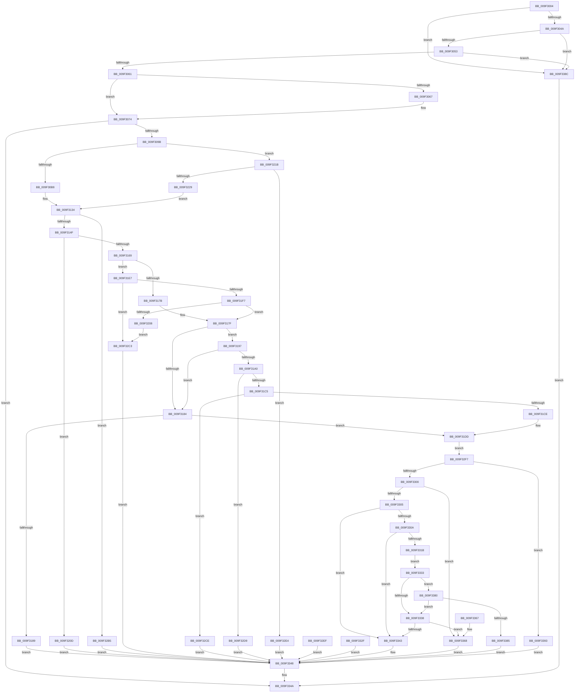

# LdrpResGetResourceDirectory

- RVA: `0x009F3004`–`0x009F339A` (길이 `918` bytes)
- VA: `0x00000001409F3004`
- 실행 섹션: `PAGE`
- PDB 이름 있음: `예`; PDB Function 태그: `아니요`
- unwind 정보 RVA: `0x000A61E4`
- 디코드: `240`개 명령, `918/918` bytes 표시
- 미해석 바이트: `0` (있으면 어셈블리에 `.byte`로 보존)

> 이 문서는 커널 이미지의 기계어와 PDB 기호를 분석해 생성했습니다. 4번과 5번은 함수 원형과 자료형을 바이너리 사용 방식에서 추정한 C 해석이며 원본 소스 복구 결과는 아닙니다.

## 1. Dependencies

- 직접 호출 지점: **2**; 고유 호출 대상: **2**
- 직접 호출자로 확인된 함수: **1**
- RIP 상대 이미지 참조: **0**

### Outgoing calls
- `0x009F308E` → [RtlImageNtHeaderEx](../../text/41/RtlImageNtHeaderEx_function_0041EAA0.md) (function, `0x0041EAA0`)
- `0x009F31B7` → [LdrpSectionTableFromVirtualAddress](LdrpSectionTableFromVirtualAddress_function_009F33A0.md) (function, `0x009F33A0`)

### Direct callers
- [LdrpResSearchResourceMappedFile](../../text/45/LdrpResSearchResourceMappedFile_function_00454C98.md) at `0x00454ED6`
- [LdrpResSearchResourceMappedFile](../../text/45/LdrpResSearchResourceMappedFile_function_00454C98.md) at `0x004551E0`

### Static image references
- 디코드된 RIP-relative 메모리 참조가 없습니다.

## 2. Other-region calls and transfers

- 다른 실행 섹션으로 향하는 call: **1**
  - `0x009F308E` → [RtlImageNtHeaderEx](../../text/41/RtlImageNtHeaderEx_function_0041EAA0.md) (`PAGE` → `.text`)
- 별도 외부 분기/꼬리 이동을 확인하지 못했습니다.

## 3. Assembly (complete function range)

```asm
009F3004  4C 8B DC                        mov r11, rsp
009F3007  49 89 5B 10                     mov qword ptr [r11 + 0x10], rbx
009F300B  49 89 73 18                     mov qword ptr [r11 + 0x18], rsi
009F300F  4D 89 4B 20                     mov qword ptr [r11 + 0x20], r9
009F3013  57                              push rdi
009F3014  41 54                           push r12
009F3016  41 55                           push r13
009F3018  41 56                           push r14
009F301A  41 57                           push r15
009F301C  48 81 EC 40 01 00 00            sub rsp, 0x140
009F3023  49 8B C1                        mov rax, r9
009F3026  45 8B F8                        mov r15d, r8d
009F3029  4C 8B E2                        mov r12, rdx
009F302C  48 8B F9                        mov rdi, rcx
009F302F  33 DB                           xor ebx, ebx
009F3031  48 89 5C 24 40                  mov qword ptr [rsp + 0x40], rbx
009F3036  49 89 5B 08                     mov qword ptr [r11 + 8], rbx
009F303A  44 8D 73 01                     lea r14d, [rbx + 1]
009F303E  41 8A F6                        mov sil, r14b
009F3041  48 85 C9                        test rcx, rcx
009F3044  0F 84 42 03 00 00               je 0x1409f338c
009F304A  48 85 C0                        test rax, rax
009F304D  0F 84 39 03 00 00               je 0x1409f338c
009F3053  48 39 9C 24 90 01 00 00         cmp qword ptr [rsp + 0x190], rbx
009F305B  0F 84 2B 03 00 00               je 0x1409f338c
009F3061  40 F6 C7 03                     test dil, 3
009F3065  74 0D                           je 0x1409f3074
009F3067  48 8B F1                        mov rsi, rcx
009F306A  49 23 F6                        and rsi, r14
009F306D  48 83 E7 FC                     and rdi, 0xfffffffffffffffc
009F3071  41 32 F6                        xor sil, r14b
009F3074  41 81 E7 00 10 00 00            and r15d, 0x1000
009F307B  8B CB                           mov ecx, ebx
009F307D  0F 94 C1                        sete cl
009F3080  4C 8D 8C 24 70 01 00 00         lea r9, [rsp + 0x170]
009F3088  4D 8B C4                        mov r8, r12
009F308B  48 8B D7                        mov rdx, rdi
009F308E  E8 0D BA A2 FF                  call 0x14041eaa0
009F3093  85 C0                           test eax, eax
009F3095  0F 88 AF 02 00 00               js 0x1409f334a
009F309B  4C 8B AC 24 70 01 00 00         mov r13, qword ptr [rsp + 0x170]
009F30A3  49 8D 4D 18                     lea rcx, [r13 + 0x18]
009F30A7  0F B7 01                        movzx eax, word ptr [rcx]
009F30AA  BA 0B 01 00 00                  mov edx, 0x10b
009F30AF  66 3B C2                        cmp ax, dx
009F30B2  0F 85 63 01 00 00               jne 0x1409f321b
009F30B8  48 8D 44 24 50                  lea rax, [rsp + 0x50]
009F30BD  0F 10 01                        movups xmm0, xmmword ptr [rcx]
009F30C0  0F 11 00                        movups xmmword ptr [rax], xmm0
009F30C3  0F 10 49 10                     movups xmm1, xmmword ptr [rcx + 0x10]
009F30C7  0F 11 48 10                     movups xmmword ptr [rax + 0x10], xmm1
009F30CB  0F 10 41 20                     movups xmm0, xmmword ptr [rcx + 0x20]
009F30CF  0F 11 40 20                     movups xmmword ptr [rax + 0x20], xmm0
009F30D3  0F 10 49 30                     movups xmm1, xmmword ptr [rcx + 0x30]
009F30D7  0F 11 48 30                     movups xmmword ptr [rax + 0x30], xmm1
009F30DB  0F 10 41 40                     movups xmm0, xmmword ptr [rcx + 0x40]
009F30DF  0F 11 40 40                     movups xmmword ptr [rax + 0x40], xmm0
009F30E3  0F 10 49 50                     movups xmm1, xmmword ptr [rcx + 0x50]
009F30E7  0F 11 48 50                     movups xmmword ptr [rax + 0x50], xmm1
009F30EB  0F 10 41 60                     movups xmm0, xmmword ptr [rcx + 0x60]
009F30EF  0F 11 40 60                     movups xmmword ptr [rax + 0x60], xmm0
009F30F3  BA 80 00 00 00                  mov edx, 0x80
009F30F8  48 03 C2                        add rax, rdx
009F30FB  0F 10 41 70                     movups xmm0, xmmword ptr [rcx + 0x70]
009F30FF  0F 11 40 F0                     movups xmmword ptr [rax - 0x10], xmm0
009F3103  48 03 CA                        add rcx, rdx
009F3106  0F 10 09                        movups xmm1, xmmword ptr [rcx]
009F3109  0F 11 08                        movups xmmword ptr [rax], xmm1
009F310C  0F 10 41 10                     movups xmm0, xmmword ptr [rcx + 0x10]
009F3110  0F 11 40 10                     movups xmmword ptr [rax + 0x10], xmm0
009F3114  0F 10 49 20                     movups xmm1, xmmword ptr [rcx + 0x20]
009F3118  0F 11 48 20                     movups xmmword ptr [rax + 0x20], xmm1
009F311C  0F 10 41 30                     movups xmm0, xmmword ptr [rcx + 0x30]
009F3120  0F 11 40 30                     movups xmmword ptr [rax + 0x30], xmm0
009F3124  0F 10 49 40                     movups xmm1, xmmword ptr [rcx + 0x40]
009F3128  0F 11 48 40                     movups xmmword ptr [rax + 0x40], xmm1
009F312C  0F 10 41 50                     movups xmm0, xmmword ptr [rcx + 0x50]
009F3130  0F 11 40 50                     movups xmmword ptr [rax + 0x50], xmm0
009F3134  8B 84 24 BC 00 00 00            mov eax, dword ptr [rsp + 0xbc]
009F313B  45 84 F6                        test r14b, r14b
009F313E  0F 45 84 24 AC 00 00 00         cmovne eax, dword ptr [rsp + 0xac]
009F3146  83 F8 02                        cmp eax, 2
009F3149  0F 86 66 01 00 00               jbe 0x1409f32b5
009F314F  8B 8C 24 D0 00 00 00            mov ecx, dword ptr [rsp + 0xd0]
009F3156  45 84 F6                        test r14b, r14b
009F3159  0F 45 8C 24 C0 00 00 00         cmovne ecx, dword ptr [rsp + 0xc0]
009F3161  85 C9                           test ecx, ecx
009F3163  0F 84 A4 00 00 00               je 0x1409f320d
009F3169  44 8B F1                        mov r14d, ecx
009F316C  49 B8 FF FF FE FF FF 7F 00 00   movabs r8, 0x7ffffffeffff
009F3176  49 3B F8                        cmp rdi, r8
009F3179  76 6C                           jbe 0x1409f31e7
009F317B  48 8D 14 39                     lea rdx, [rcx + rdi]
009F317F  40 84 F6                        test sil, sil
009F3182  74 13                           je 0x1409f3197
009F3184  48 3B D7                        cmp rdx, rdi
009F3187  73 54                           jae 0x1409f31dd
009F3189  BB 7B 00 00 C0                  mov ebx, 0xc000007b
009F318E  89 5C 24 30                     mov dword ptr [rsp + 0x30], ebx
009F3192  E9 B1 01 00 00                  jmp 0x1409f3348
009F3197  3B 8C 24 8C 00 00 00            cmp ecx, dword ptr [rsp + 0x8c]
009F319E  72 E4                           jb 0x1409f3184
009F31A0  45 85 FF                        test r15d, r15d
009F31A3  0F 95 C0                        setne al
009F31A6  88 44 24 28                     mov byte ptr [rsp + 0x28], al
009F31AA  89 4C 24 20                     mov dword ptr [rsp + 0x20], ecx
009F31AE  4D 8B C5                        mov r8, r13
009F31B1  49 8B D4                        mov rdx, r12
009F31B4  48 8B CF                        mov rcx, rdi
009F31B7  E8 E4 01 00 00                  call 0x1409f33a0
009F31BC  48 85 C0                        test rax, rax
009F31BF  0F 84 14 01 00 00               je 0x1409f32d9
009F31C5  39 58 10                        cmp dword ptr [rax + 0x10], ebx
009F31C8  0F 84 00 01 00 00               je 0x1409f32ce
009F31CE  8B 50 14                        mov edx, dword ptr [rax + 0x14]
009F31D1  8B 40 0C                        mov eax, dword ptr [rax + 0xc]
009F31D4  48 2B D0                        sub rdx, rax
009F31D7  49 03 D6                        add rdx, r14
009F31DA  48 03 D7                        add rdx, rdi
009F31DD  48 89 54 24 40                  mov qword ptr [rsp + 0x40], rdx
009F31E2  E9 10 01 00 00                  jmp 0x1409f32f7
009F31E7  48 8D 47 FF                     lea rax, [rdi - 1]
009F31EB  49 03 C6                        add rax, r14
009F31EE  48 3B C7                        cmp rax, rdi
009F31F1  0F 82 CC 00 00 00               jb 0x1409f32c3
009F31F7  48 8D 14 39                     lea rdx, [rcx + rdi]
009F31FB  48 8D 42 FF                     lea rax, [rdx - 1]
009F31FF  49 3B C0                        cmp rax, r8
009F3202  0F 86 77 FF FF FF               jbe 0x1409f317f
009F3208  E9 B6 00 00 00                  jmp 0x1409f32c3
009F320D  BB 89 00 00 C0                  mov ebx, 0xc0000089
009F3212  89 5C 24 30                     mov dword ptr [rsp + 0x30], ebx
009F3216  E9 2D 01 00 00                  jmp 0x1409f3348
009F321B  BA 0B 02 00 00                  mov edx, 0x20b
009F3220  66 3B C2                        cmp ax, dx
009F3223  0F 85 BB 00 00 00               jne 0x1409f32e4
009F3229  48 8D 44 24 50                  lea rax, [rsp + 0x50]
009F322E  0F 10 01                        movups xmm0, xmmword ptr [rcx]
009F3231  0F 11 00                        movups xmmword ptr [rax], xmm0
009F3234  0F 10 49 10                     movups xmm1, xmmword ptr [rcx + 0x10]
009F3238  0F 11 48 10                     movups xmmword ptr [rax + 0x10], xmm1
009F323C  0F 10 41 20                     movups xmm0, xmmword ptr [rcx + 0x20]
009F3240  0F 11 40 20                     movups xmmword ptr [rax + 0x20], xmm0
009F3244  0F 10 49 30                     movups xmm1, xmmword ptr [rcx + 0x30]
009F3248  0F 11 48 30                     movups xmmword ptr [rax + 0x30], xmm1
009F324C  0F 10 41 40                     movups xmm0, xmmword ptr [rcx + 0x40]
009F3250  0F 11 40 40                     movups xmmword ptr [rax + 0x40], xmm0
009F3254  0F 10 49 50                     movups xmm1, xmmword ptr [rcx + 0x50]
009F3258  0F 11 48 50                     movups xmmword ptr [rax + 0x50], xmm1
009F325C  0F 10 41 60                     movups xmm0, xmmword ptr [rcx + 0x60]
009F3260  0F 11 40 60                     movups xmmword ptr [rax + 0x60], xmm0
009F3264  BA 80 00 00 00                  mov edx, 0x80
009F3269  48 03 C2                        add rax, rdx
009F326C  0F 10 41 70                     movups xmm0, xmmword ptr [rcx + 0x70]
009F3270  0F 11 40 F0                     movups xmmword ptr [rax - 0x10], xmm0
009F3274  48 03 CA                        add rcx, rdx
009F3277  0F 10 09                        movups xmm1, xmmword ptr [rcx]
009F327A  0F 11 08                        movups xmmword ptr [rax], xmm1
009F327D  0F 10 41 10                     movups xmm0, xmmword ptr [rcx + 0x10]
009F3281  0F 11 40 10                     movups xmmword ptr [rax + 0x10], xmm0
009F3285  0F 10 49 20                     movups xmm1, xmmword ptr [rcx + 0x20]
009F3289  0F 11 48 20                     movups xmmword ptr [rax + 0x20], xmm1
009F328D  0F 10 41 30                     movups xmm0, xmmword ptr [rcx + 0x30]
009F3291  0F 11 40 30                     movups xmmword ptr [rax + 0x30], xmm0
009F3295  0F 10 49 40                     movups xmm1, xmmword ptr [rcx + 0x40]
009F3299  0F 11 48 40                     movups xmmword ptr [rax + 0x40], xmm1
009F329D  0F 10 41 50                     movups xmm0, xmmword ptr [rcx + 0x50]
009F32A1  0F 11 40 50                     movups xmmword ptr [rax + 0x50], xmm0
009F32A5  0F 10 49 60                     movups xmm1, xmmword ptr [rcx + 0x60]
009F32A9  0F 11 48 60                     movups xmmword ptr [rax + 0x60], xmm1
009F32AD  44 8A F3                        mov r14b, bl
009F32B0  E9 7F FE FF FF                  jmp 0x1409f3134
009F32B5  BB 89 00 00 C0                  mov ebx, 0xc0000089
009F32BA  89 5C 24 30                     mov dword ptr [rsp + 0x30], ebx
009F32BE  E9 85 00 00 00                  jmp 0x1409f3348
009F32C3  BB 7B 00 00 C0                  mov ebx, 0xc000007b
009F32C8  89 5C 24 30                     mov dword ptr [rsp + 0x30], ebx
009F32CC  EB 7A                           jmp 0x1409f3348
009F32CE  BB 89 00 00 C0                  mov ebx, 0xc0000089
009F32D3  89 5C 24 30                     mov dword ptr [rsp + 0x30], ebx
009F32D7  EB 6F                           jmp 0x1409f3348
009F32D9  BB 7B 00 00 C0                  mov ebx, 0xc000007b
009F32DE  89 5C 24 30                     mov dword ptr [rsp + 0x30], ebx
009F32E2  EB 64                           jmp 0x1409f3348
009F32E4  BB 7B 00 00 C0                  mov ebx, 0xc000007b
009F32E9  89 5C 24 30                     mov dword ptr [rsp + 0x30], ebx
009F32ED  EB 59                           jmp 0x1409f3348
009F32EF  8B D8                           mov ebx, eax
009F32F1  89 44 24 30                     mov dword ptr [rsp + 0x30], eax
009F32F5  EB 51                           jmp 0x1409f3348
009F32F7  48 85 D2                        test rdx, rdx
009F32FA  0F 84 93 00 00 00               je 0x1409f3393
009F3300  45 85 FF                        test r15d, r15d
009F3303  74 63                           je 0x1409f3368
009F3305  48 3B D7                        cmp rdx, rdi
009F3308  76 39                           jbe 0x1409f3343
009F330A  48 83 E7 FC                     and rdi, 0xfffffffffffffffc
009F330E  4E 8D 04 27                     lea r8, [rdi + r12]
009F3312  48 8D 42 10                     lea rax, [rdx + 0x10]
009F3316  49 3B C0                        cmp rax, r8
009F3319  77 28                           ja 0x1409f3343
009F331B  0F B7 42 0C                     movzx eax, word ptr [rdx + 0xc]
009F331F  66 89 44 24 34                  mov word ptr [rsp + 0x34], ax
009F3324  0F B7 4A 0E                     movzx ecx, word ptr [rdx + 0xe]
009F3328  66 89 4C 24 38                  mov word ptr [rsp + 0x38], cx
009F332D  EB 04                           jmp 0x1409f3333
009F332F  8B D8                           mov ebx, eax
009F3331  EB 15                           jmp 0x1409f3348
009F3333  66 85 C0                        test ax, ax
009F3336  74 48                           je 0x1409f3380
009F3338  03 C8                           add ecx, eax
009F333A  48 8D 0C CA                     lea rcx, [rdx + rcx*8]
009F333E  49 3B C8                        cmp rcx, r8
009F3341  76 25                           jbe 0x1409f3368
009F3343  BB 7B 00 00 C0                  mov ebx, 0xc000007b
009F3348  8B C3                           mov eax, ebx
009F334A  4C 8D 9C 24 40 01 00 00         lea r11, [rsp + 0x140]
009F3352  49 8B 5B 38                     mov rbx, qword ptr [r11 + 0x38]
009F3356  49 8B 73 40                     mov rsi, qword ptr [r11 + 0x40]
009F335A  49 8B E3                        mov rsp, r11
009F335D  41 5F                           pop r15
009F335F  41 5E                           pop r14
009F3361  41 5D                           pop r13
009F3363  41 5C                           pop r12
009F3365  5F                              pop rdi
009F3366  C3                              ret
009F3367  CC                              int3
009F3368  48 8B 84 24 88 01 00 00         mov rax, qword ptr [rsp + 0x188]
009F3370  48 89 10                        mov qword ptr [rax], rdx
009F3373  48 8B 84 24 90 01 00 00         mov rax, qword ptr [rsp + 0x190]
009F337B  4C 89 28                        mov qword ptr [rax], r13
009F337E  EB C8                           jmp 0x1409f3348
009F3380  66 85 C9                        test cx, cx
009F3383  75 B3                           jne 0x1409f3338
009F3385  BB 8A 00 00 C0                  mov ebx, 0xc000008a
009F338A  EB BC                           jmp 0x1409f3348
009F338C  B8 0D 00 00 C0                  mov eax, 0xc000000d
009F3391  EB B7                           jmp 0x1409f334a
009F3393  BB 89 00 00 C0                  mov ebx, 0xc0000089
009F3398  EB AE                           jmp 0x1409f3348
```

## 4. C-style interpretation (structured pseudocode)

```c
__int64 __fastcall LdrpResGetResourceDirectory(__int64 a1, __int64 a2, int a3, __int64 a4, __int64 a5)
{
    __int64 result;
    __int64 v_r15;
    __int64 v_rbx;
    __int64 v_rdi;
    __int64 v_rsi;
    __int64 v_rsp;
    unsigned __int64 v_stack_m118;
    unsigned __int64 v_stack_m128;
    unsigned __int16 v_stack_m130;
    unsigned __int16 v_stack_m134;
    unsigned int v_stack_m138;
    unsigned __int8 v_stack_m140;
    unsigned int v_stack_m148;
    unsigned __int64 v_stack_m28;
    unsigned int v_stack_m98;
    unsigned int v_stack_mA8;
    unsigned int v_stack_mAC;
    unsigned int v_stack_mBC;
    unsigned int v_stack_mDC;
    unsigned __int64 v_stack_p48;
    unsigned __int64 v_stack_p8;

    *(unsigned __int64 *)(v_rsp + 16) = v_rbx;
    *(unsigned __int64 *)(v_rsp + 24) = v_rsi;
    *(unsigned __int64 *)(v_rsp + 32) = a4;
    v_rsp = (v_rsp) - (320);
    v_rbx = 0;
    v_stack_m128 = 0;
    *(unsigned __int64 *)(v_rsp + 8) = 0;
    if (a1 == 0) goto loc_009F338C;
    if (a4 == 0) goto loc_009F338C;
    if (a5 == 0) goto loc_009F338C;
    v_rsi = (unsigned __int8)(v_rbx + 1);
    v_rdi = a1;
    if ((((unsigned __int8)(a1)) & (3)) != 0) {
        v_rsi = a1;
        v_rsi = (v_rsi) & (v_rbx + 1);
        v_rdi = (a1) & (-4);
        v_rsi = (unsigned __int8)((v_rsi) ^ ((unsigned __int8)(v_rbx + 1)));
    }
    v_r15 = (unsigned int)(((unsigned int)(a3)) & (0x1000ULL));
    a1 = (condition_is_equal) ? 1 : 0;
    result = RtlImageNtHeaderEx(a1, v_rdi, a2, v_stack_p8);
    if (sign_flag) goto loc_009F334A;
    if (((unsigned __int16)(*(unsigned __int16 *)(v_stack_p8 + 24))) != 267) goto loc_009F321B;
    *(unsigned __int64 *)(v_stack_m118) = v_xmm0;
    *(unsigned __int64 *)(v_stack_m118 + 16) = v_xmm1;
    *(unsigned __int64 *)(v_stack_m118 + 32) = v_xmm0;
    *(unsigned __int64 *)(v_stack_m118 + 48) = v_xmm1;
    *(unsigned __int64 *)(v_stack_m118 + 64) = v_xmm0;
    *(unsigned __int64 *)(v_stack_m118 + 80) = v_xmm1;
    *(unsigned __int64 *)(v_stack_m118 + 96) = v_xmm0;
    result = (v_stack_m118) + (128);
    *(unsigned __int64 *)(result - 16) = v_xmm0;
    a1 = (v_stack_p8 + 24) + (128);
    *(unsigned __int64 *)(result) = v_xmm1;
    *(unsigned __int64 *)(result + 16) = v_xmm0;
    *(unsigned __int64 *)(result + 32) = v_xmm1;
    *(unsigned __int64 *)(result + 48) = v_xmm0;
    *(unsigned __int64 *)(result + 64) = v_xmm1;
    *(unsigned __int64 *)(result + 80) = v_xmm0;
loc_009F3134:
    result = (unsigned int)(v_stack_mAC);
    if ((unsigned __int8)(v_rbx + 1) != 0) { result = v_stack_mBC; }
    if (((unsigned int)(result)) <= 2) goto loc_009F32B5;
    a1 = (unsigned int)(v_stack_m98);
    if ((unsigned __int8)(v_rbx + 1) != 0) { a1 = v_stack_mA8; }
    if ((unsigned int)(a1) == 0) goto loc_009F320D;
    if (v_rdi <= a2) goto loc_009F31E7;
loc_009F317F:
    if ((unsigned __int8)(v_rsi) == 0) goto loc_009F3197;
loc_009F3184:
    if ((a1 + v_rdi * 1) >= v_rdi) goto loc_009F31DD;
    v_stack_m138 = (unsigned int)((unsigned int)(0xC000007BULL));
    goto loc_009F3348;
loc_009F3197:
    if (((unsigned int)(a1)) < v_stack_mDC) goto loc_009F3184;
    result = ((unsigned int)(v_r15) != 0) ? 1 : 0;
    v_stack_m140 = (unsigned __int8)(result);
    v_stack_m148 = (unsigned int)(a1);
    result = LdrpSectionTableFromVirtualAddress(v_rdi, a2, v_stack_p8, v_stack_p8);
    if (result == 0) goto loc_009F32D9;
    if ((*(unsigned int *)(result + 16)) == ((unsigned int)((unsigned int)(0xC000007BULL)))) goto loc_009F32CE;
    a2 = ((unsigned int)(*(unsigned int *)(result + 20))) - ((unsigned int)(*(unsigned int *)(result + 12)));
    a2 = (a2) + ((unsigned int)((unsigned int)(a1)));
    a2 = (a2) + (v_rdi);
loc_009F31DD:
    v_stack_m128 = a2;
    goto loc_009F32F7;
loc_009F31E7:
    result = (v_rdi - 1) + ((unsigned int)((unsigned int)(a1)));
    if (result < v_rdi) goto loc_009F32C3;
    if ((v_rdi + v_rdi * 1 - 1) <= v_stack_p8) goto loc_009F317F;
    goto loc_009F32C3;
loc_009F320D:
    v_stack_m138 = (unsigned int)((unsigned int)(0xC0000089ULL));
    goto loc_009F3348;
loc_009F321B:
    if (((unsigned __int16)(v_rdi + v_rdi * 1 - 1)) != 523) goto loc_009F32E4;
    *(unsigned __int64 *)(v_stack_m118) = v_xmm0;
    *(unsigned __int64 *)(v_stack_m118 + 16) = v_xmm1;
    *(unsigned __int64 *)(v_stack_m118 + 32) = v_xmm0;
    *(unsigned __int64 *)(v_stack_m118 + 48) = v_xmm1;
    *(unsigned __int64 *)(v_stack_m118 + 64) = v_xmm0;
    *(unsigned __int64 *)(v_stack_m118 + 80) = v_xmm1;
    *(unsigned __int64 *)(v_stack_m118 + 96) = v_xmm0;
    result = (v_stack_m118) + (128);
    *(unsigned __int64 *)(result - 16) = v_xmm0;
    a1 = (v_rdi) + (128);
    *(unsigned __int64 *)(result) = v_xmm1;
    *(unsigned __int64 *)(result + 16) = v_xmm0;
    *(unsigned __int64 *)(result + 32) = v_xmm1;
    *(unsigned __int64 *)(result + 48) = v_xmm0;
    *(unsigned __int64 *)(result + 64) = v_xmm1;
    *(unsigned __int64 *)(result + 80) = v_xmm0;
    *(unsigned __int64 *)(result + 96) = v_xmm1;
    goto loc_009F3134;
loc_009F32B5:
    v_stack_m138 = (unsigned int)((unsigned int)(0xC0000089ULL));
    goto loc_009F3348;
loc_009F32C3:
    v_stack_m138 = (unsigned int)((unsigned int)(0xC000007BULL));
    goto loc_009F3348;
loc_009F32CE:
    v_stack_m138 = (unsigned int)((unsigned int)(0xC0000089ULL));
    goto loc_009F3348;
loc_009F32D9:
    v_stack_m138 = (unsigned int)((unsigned int)(0xC000007BULL));
    goto loc_009F3348;
loc_009F32E4:
    v_stack_m138 = (unsigned int)((unsigned int)(0xC000007BULL));
    goto loc_009F3348;
loc_009F32F7:
    if (128 == 0) goto loc_009F3393;
    if ((unsigned int)(v_r15) == 0) goto loc_009F3368;
    if (128 <= v_rdi) goto loc_009F3343;
    v_rdi = (v_rdi) & (-4);
    if ((128 + 16) > (v_rdi + a2 * 1)) goto loc_009F3343;
    v_stack_m134 = (unsigned __int16)(*(unsigned __int16 *)(128 + 12));
    v_stack_m130 = (unsigned __int16)(*(unsigned __int16 *)(128 + 14));
    goto loc_009F3333;
loc_009F3333:
    if ((unsigned __int16)(*(unsigned __int16 *)(128 + 12)) == 0) goto loc_009F3380;
loc_009F3338:
    a1 = (unsigned int)((*(unsigned __int16 *)(128 + 14)) + ((unsigned int)(*(unsigned __int16 *)(128 + 12))));
    if ((128 + a1 * 8) <= (v_rdi + a2 * 1)) goto loc_009F3368;
loc_009F3343:
loc_009F3348:
loc_009F334A:
    return (unsigned int)((unsigned int)((unsigned int)(0xC000007BULL)));
loc_009F3368:
    *(unsigned __int64 *)(v_stack_p48) = 128;
    *(unsigned __int64 *)(a5) = v_stack_p8;
    goto loc_009F3348;
loc_009F3380:
    if ((unsigned __int16)(128 + a1 * 8) != 0) goto loc_009F3338;
    goto loc_009F3348;
loc_009F338C:
    goto loc_009F334A;
loc_009F3393:
    goto loc_009F3348;
}
```

## 5. (Beta) C Style

```c
int64_t LdrpResGetResourceDirectory(int64_t Arg1, int64_t Arg2, int32_t Arg3, int64_t Arg4, void *Arg5)
{
    uint8_t *arg5 = (uint8_t *)Arg5;

    int64_t result;
    int64_t local_r15;
    int64_t local_rbx;
    int64_t local_rdi;
    int64_t local_rsi;
    int64_t local_rsp;
    uint64_t v_stack_m118;
    uint64_t v_stack_m128;
    uint16_t v_stack_m130;
    uint16_t v_stack_m134;
    uint32_t v_stack_m138;
    uint8_t v_stack_m140;
    uint32_t v_stack_m148;
    uint64_t v_stack_m28;
    uint32_t v_stack_m98;
    uint32_t v_stack_mA8;
    uint32_t v_stack_mAC;
    uint32_t v_stack_mBC;
    uint32_t v_stack_mDC;
    uint64_t v_stack_p48;
    uint64_t v_stack_p8;

    *(uint64_t *)(local_rsp + 0x10) = local_rbx;
    *(uint64_t *)(local_rsp + 0x18) = local_rsi;
    *(uint64_t *)(local_rsp + 0x20) = Arg4;
    local_rsp = (local_rsp) - (320);
    local_rbx = 0;
    v_stack_m128 = 0;
    *(uint64_t *)(local_rsp + 0x8) = 0;
    if (Arg1 == 0) goto loc_009F338C;
    if (Arg4 == 0) goto loc_009F338C;
    if (Arg5 == NULL) goto loc_009F338C;
    local_rsi = (uint8_t)(local_rbx + 1);
    local_rdi = Arg1;
    if ((((uint8_t)(Arg1)) & (3)) != 0) {
        local_rsi = Arg1;
        local_rsi = (local_rsi) & (local_rbx + 1);
        local_rdi = (Arg1) & (-4);
        local_rsi = (uint8_t)((local_rsi) ^ ((uint8_t)(local_rbx + 1)));
    }
    local_r15 = (uint32_t)(((uint32_t)(Arg3)) & (0x1000ULL));
    Arg1 = (condition_is_equal) ? 1 : 0;
    result = RtlImageNtHeaderEx(Arg1, local_rdi, Arg2, v_stack_p8);
    if (sign_flag) goto loc_009F334A;
    if (((uint16_t)(*(uint16_t *)(v_stack_p8 + 0x18))) != 267) goto loc_009F321B;
    *(uint64_t *)(v_stack_m118) = v_xmm0;
    *(uint64_t *)(v_stack_m118 + 0x10) = v_xmm1;
    *(uint64_t *)(v_stack_m118 + 0x20) = v_xmm0;
    *(uint64_t *)(v_stack_m118 + 0x30) = v_xmm1;
    *(uint64_t *)(v_stack_m118 + 0x40) = v_xmm0;
    *(uint64_t *)(v_stack_m118 + 0x50) = v_xmm1;
    *(uint64_t *)(v_stack_m118 + 0x60) = v_xmm0;
    result = (v_stack_m118) + (128);
    *(uint64_t *)(result - 0x10) = v_xmm0;
    Arg1 = (v_stack_p8 + 24) + (128);
    *(uint64_t *)(result) = v_xmm1;
    *(uint64_t *)(result + 0x10) = v_xmm0;
    *(uint64_t *)(result + 0x20) = v_xmm1;
    *(uint64_t *)(result + 0x30) = v_xmm0;
    *(uint64_t *)(result + 0x40) = v_xmm1;
    *(uint64_t *)(result + 0x50) = v_xmm0;
loc_009F3134:
    result = (uint32_t)(v_stack_mAC);
    if ((uint8_t)(local_rbx + 1) != 0) { result = v_stack_mBC; }
    if (((uint32_t)(result)) <= 2) goto loc_009F32B5;
    Arg1 = (uint32_t)(v_stack_m98);
    if ((uint8_t)(local_rbx + 1) != 0) { Arg1 = v_stack_mA8; }
    if ((uint32_t)(Arg1) == 0) goto loc_009F320D;
    if (local_rdi <= Arg2) goto loc_009F31E7;
loc_009F317F:
    if ((uint8_t)(local_rsi) == 0) goto loc_009F3197;
loc_009F3184:
    if ((Arg1 + local_rdi * 1) >= local_rdi) goto loc_009F31DD;
    v_stack_m138 = (uint32_t)((uint32_t)(0xC000007BULL));
    goto loc_009F3348;
loc_009F3197:
    if (((uint32_t)(Arg1)) < v_stack_mDC) goto loc_009F3184;
    result = ((uint32_t)(local_r15) != 0) ? 1 : 0;
    v_stack_m140 = (uint8_t)(result);
    v_stack_m148 = (uint32_t)(Arg1);
    result = LdrpSectionTableFromVirtualAddress(local_rdi, Arg2, v_stack_p8, v_stack_p8);
    if (result == 0) goto loc_009F32D9;
    if ((*(uint32_t *)(result + 0x10)) == ((uint32_t)((uint32_t)(0xC000007BULL)))) goto loc_009F32CE;
    Arg2 = ((uint32_t)(*(uint32_t *)(result + 0x14))) - ((uint32_t)(*(uint32_t *)(result + 0xC)));
    Arg2 = (Arg2) + ((uint32_t)((uint32_t)(Arg1)));
    Arg2 = (Arg2) + (local_rdi);
loc_009F31DD:
    v_stack_m128 = Arg2;
    goto loc_009F32F7;
loc_009F31E7:
    result = (local_rdi - 1) + ((uint32_t)((uint32_t)(Arg1)));
    if (result < local_rdi) goto loc_009F32C3;
    if ((local_rdi + local_rdi * 1 - 1) <= v_stack_p8) goto loc_009F317F;
    goto loc_009F32C3;
loc_009F320D:
    v_stack_m138 = (uint32_t)((uint32_t)(0xC0000089ULL));
    goto loc_009F3348;
loc_009F321B:
    if (((uint16_t)(local_rdi + local_rdi * 1 - 1)) != 523) goto loc_009F32E4;
    *(uint64_t *)(v_stack_m118) = v_xmm0;
    *(uint64_t *)(v_stack_m118 + 0x10) = v_xmm1;
    *(uint64_t *)(v_stack_m118 + 0x20) = v_xmm0;
    *(uint64_t *)(v_stack_m118 + 0x30) = v_xmm1;
    *(uint64_t *)(v_stack_m118 + 0x40) = v_xmm0;
    *(uint64_t *)(v_stack_m118 + 0x50) = v_xmm1;
    *(uint64_t *)(v_stack_m118 + 0x60) = v_xmm0;
    result = (v_stack_m118) + (128);
    *(uint64_t *)(result - 0x10) = v_xmm0;
    Arg1 = (local_rdi) + (128);
    *(uint64_t *)(result) = v_xmm1;
    *(uint64_t *)(result + 0x10) = v_xmm0;
    *(uint64_t *)(result + 0x20) = v_xmm1;
    *(uint64_t *)(result + 0x30) = v_xmm0;
    *(uint64_t *)(result + 0x40) = v_xmm1;
    *(uint64_t *)(result + 0x50) = v_xmm0;
    *(uint64_t *)(result + 0x60) = v_xmm1;
    goto loc_009F3134;
loc_009F32B5:
    v_stack_m138 = (uint32_t)((uint32_t)(0xC0000089ULL));
    goto loc_009F3348;
loc_009F32C3:
    v_stack_m138 = (uint32_t)((uint32_t)(0xC000007BULL));
    goto loc_009F3348;
loc_009F32CE:
    v_stack_m138 = (uint32_t)((uint32_t)(0xC0000089ULL));
    goto loc_009F3348;
loc_009F32D9:
    v_stack_m138 = (uint32_t)((uint32_t)(0xC000007BULL));
    goto loc_009F3348;
loc_009F32E4:
    v_stack_m138 = (uint32_t)((uint32_t)(0xC000007BULL));
    goto loc_009F3348;
loc_009F32F7:
    if (128 == 0) goto loc_009F3393;
    if ((uint32_t)(local_r15) == 0) goto loc_009F3368;
    if (128 <= local_rdi) goto loc_009F3343;
    local_rdi = (local_rdi) & (-4);
    if ((128 + 16) > (local_rdi + Arg2 * 1)) goto loc_009F3343;
    v_stack_m134 = (uint16_t)(*(uint16_t *)(128 + 0xC));
    v_stack_m130 = (uint16_t)(*(uint16_t *)(128 + 0xE));
    goto loc_009F3333;
loc_009F3333:
    if ((uint16_t)(*(uint16_t *)(128 + 0xC)) == 0) goto loc_009F3380;
loc_009F3338:
    Arg1 = (uint32_t)((*(uint16_t *)(128 + 0xE)) + ((uint32_t)(*(uint16_t *)(128 + 0xC))));
    if ((128 + Arg1 * 8) <= (local_rdi + Arg2 * 1)) goto loc_009F3368;
loc_009F3343:
loc_009F3348:
loc_009F334A:
    return (uint32_t)((uint32_t)((uint32_t)(0xC000007BULL)));
loc_009F3368:
    *(uint64_t *)(v_stack_p48) = 128;
    *(uint64_t *)(arg5) = v_stack_p8;
    goto loc_009F3348;
loc_009F3380:
    if ((uint16_t)(128 + Arg1 * 8) != 0) goto loc_009F3338;
    goto loc_009F3348;
loc_009F338C:
    goto loc_009F334A;
loc_009F3393:
    goto loc_009F3348;
}
```

### 관측된 메모리 오프셋

구조체 형식이 확인되지 않은 접근은 인자 기준의 오프셋으로만 기록했습니다.

| 기준 인자 | 오프셋 표현 | 폭 (bit) | 접근 |
|---|---:|---:|---|
| `Arg5` | `+ 0x0` | `64` | `W` |

## 6. Execution-region graph

[열기: 2D/3D 그래프와 함수 탐색 컨트롤 패널](../../../control-panel.html?section=page&rva=0x009F3004&view=graph)

- 2D 그래프는 위에서 아래로 흐르고, 3D 그래프는 빈 공간을 드래그해 회전합니다. Shift+드래그는 이동, 휠은 확대·축소, 함수 노드 선택은 대상 보고서 이동입니다.

### Static fallback


