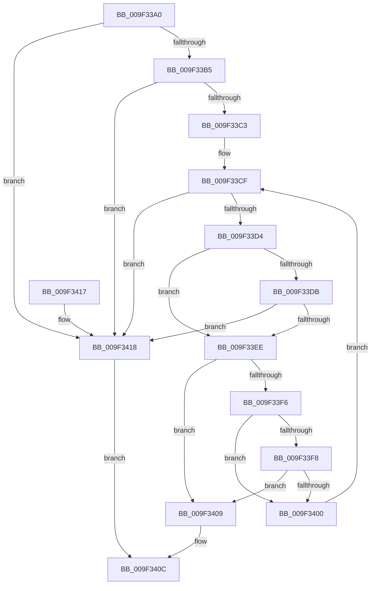

# LdrpSectionTableFromVirtualAddress

- RVA: `0x009F33A0`–`0x009F341C` (길이 `124` bytes)
- VA: `0x00000001409F33A0`
- 실행 섹션: `PAGE`
- PDB 이름 있음: `예`; PDB Function 태그: `아니요`
- unwind 정보 RVA: `0x0005FC94`
- 디코드: `40`개 명령, `124/124` bytes 표시
- 미해석 바이트: `0` (있으면 어셈블리에 `.byte`로 보존)

> 이 문서는 커널 이미지의 기계어와 PDB 기호를 분석해 생성했습니다. 4번과 5번은 함수 원형과 자료형을 바이너리 사용 방식에서 추정한 C 해석이며 원본 소스 복구 결과는 아닙니다.

## 1. Dependencies

- 직접 호출 지점: **0**; 고유 호출 대상: **0**
- 직접 호출자로 확인된 함수: **2**
- RIP 상대 이미지 참조: **0**

### Outgoing calls
- 직접 디코드된 call 명령이 없습니다.

### Direct callers
- [LdrpResSearchResourceInsideDirectory](LdrpResSearchResourceInsideDirectory_function_009F22F0.md) at `0x009F2B9F`
- [LdrpResSearchResourceInsideDirectory](LdrpResSearchResourceInsideDirectory_function_009F22F0.md) at `0x009F2BD5`
- [LdrpResSearchResourceInsideDirectory](LdrpResSearchResourceInsideDirectory_function_009F22F0.md) at `0x009F2C05`
- [LdrpResGetResourceDirectory](LdrpResGetResourceDirectory_function_009F3004.md) at `0x009F31B7`

### Static image references
- 디코드된 RIP-relative 메모리 참조가 없습니다.

## 2. Other-region calls and transfers

- 다른 실행 섹션으로 향하는 call: **0**
- 별도 외부 분기/꼬리 이동을 확인하지 못했습니다.

## 3. Assembly (complete function range)

```asm
009F33A0  48 89 5C 24 08                  mov qword ptr [rsp + 8], rbx
009F33A5  48 89 7C 24 10                  mov qword ptr [rsp + 0x10], rdi
009F33AA  48 8B DA                        mov rbx, rdx
009F33AD  48 8B F9                        mov rdi, rcx
009F33B0  4D 85 C0                        test r8, r8
009F33B3  74 63                           je 0x1409f3418
009F33B5  45 0F B7 50 14                  movzx r10d, word ptr [r8 + 0x14]
009F33BA  49 83 C2 18                     add r10, 0x18
009F33BE  4D 03 D0                        add r10, r8
009F33C1  74 55                           je 0x1409f3418
009F33C3  45 0F B7 58 06                  movzx r11d, word ptr [r8 + 6]
009F33C8  45 33 C9                        xor r9d, r9d
009F33CB  8B 54 24 28                     mov edx, dword ptr [rsp + 0x28]
009F33CF  45 3B CB                        cmp r9d, r11d
009F33D2  7D 44                           jge 0x1409f3418
009F33D4  80 7C 24 30 00                  cmp byte ptr [rsp + 0x30], 0
009F33D9  74 13                           je 0x1409f33ee
009F33DB  48 8B CF                        mov rcx, rdi
009F33DE  49 8D 42 28                     lea rax, [r10 + 0x28]
009F33E2  48 83 E1 FC                     and rcx, 0xfffffffffffffffc
009F33E6  48 03 CB                        add rcx, rbx
009F33E9  48 3B C1                        cmp rax, rcx
009F33EC  77 2A                           ja 0x1409f3418
009F33EE  41 8B 4A 0C                     mov ecx, dword ptr [r10 + 0xc]
009F33F2  3B D1                           cmp edx, ecx
009F33F4  74 13                           je 0x1409f3409
009F33F6  76 08                           jbe 0x1409f3400
009F33F8  41 03 4A 10                     add ecx, dword ptr [r10 + 0x10]
009F33FC  3B D1                           cmp edx, ecx
009F33FE  72 09                           jb 0x1409f3409
009F3400  49 83 C2 28                     add r10, 0x28
009F3404  41 FF C1                        inc r9d
009F3407  EB C6                           jmp 0x1409f33cf
009F3409  49 8B C2                        mov rax, r10
009F340C  48 8B 5C 24 08                  mov rbx, qword ptr [rsp + 8]
009F3411  48 8B 7C 24 10                  mov rdi, qword ptr [rsp + 0x10]
009F3416  C3                              ret
009F3417  CC                              int3
009F3418  33 C0                           xor eax, eax
009F341A  EB F0                           jmp 0x1409f340c
```

## 4. C-style interpretation (structured pseudocode)

```c
__int64 __fastcall LdrpSectionTableFromVirtualAddress(__int64 a1, __int64 a2, __int64 a3, int a4, unsigned int a5, unsigned __int8 a6)
{
    __int64 result;
    __int64 v_r10;
    unsigned __int64 v_stack_p10;
    unsigned __int64 v_stack_p8;

    v_stack_p8 = v_rbx;
    v_stack_p10 = v_rdi;
    if (a3 == 0) goto loc_009F3418;
    v_r10 = (*(unsigned __int16 *)(a3 + 20)) + (24);
    v_r10 = (v_r10) + (a3);
    if (condition_is_equal) goto loc_009F3418;
    a4 = 0;
loc_009F33CF:
    if (0 >= ((unsigned int)(*(unsigned __int16 *)(a3 + 6)))) goto loc_009F3418;
    if (a6 == 0) goto loc_009F33EE;
    a1 = (a1) & (-4);
    a1 = (a1) + (a2);
    if ((v_r10 + 40) > a1) goto loc_009F3418;
loc_009F33EE:
    if (((unsigned int)((unsigned int)(a5))) == ((unsigned int)((unsigned int)(*(unsigned int *)(v_r10 + 12))))) goto loc_009F3409;
    if (((unsigned int)((unsigned int)(a5))) <= ((unsigned int)((unsigned int)(*(unsigned int *)(v_r10 + 12))))) goto loc_009F3400;
    a1 = (unsigned int)(((unsigned int)(*(unsigned int *)(v_r10 + 12))) + (*(unsigned int *)(v_r10 + 16)));
    if (((unsigned int)((unsigned int)(a5))) < ((unsigned int)(a1))) goto loc_009F3409;
loc_009F3400:
    v_r10 = (v_r10) + (40);
    a4 = (unsigned int)((a4) + 1);
    goto loc_009F33CF;
loc_009F3409:
loc_009F340C:
    return v_r10;
loc_009F3418:
    result = 0;
    goto loc_009F340C;
}
```

## 5. (Beta) C Style

```c
int64_t LdrpSectionTableFromVirtualAddress(int64_t Arg1, int64_t Arg2, int64_t Arg3, int32_t Arg4, uint32_t Arg5, uint8_t Arg6)
{
    int64_t result;
    int64_t local_r10;
    uint64_t v_stack_p10;
    uint64_t v_stack_p8;

    v_stack_p8 = local_rbx;
    v_stack_p10 = local_rdi;
    if (Arg3 == 0) goto loc_009F3418;
    local_r10 = (*(uint16_t *)(Arg3 + 0x14)) + (24);
    local_r10 = (local_r10) + (Arg3);
    if (condition_is_equal) goto loc_009F3418;
    Arg4 = 0;
loc_009F33CF:
    if (0 >= ((uint32_t)(*(uint16_t *)(Arg3 + 0x6)))) goto loc_009F3418;
    if (Arg6 == 0) goto loc_009F33EE;
    Arg1 = (Arg1) & (-4);
    Arg1 = (Arg1) + (Arg2);
    if ((local_r10 + 40) > Arg1) goto loc_009F3418;
loc_009F33EE:
    if (((uint32_t)((uint32_t)(Arg5))) == ((uint32_t)((uint32_t)(*(uint32_t *)(local_r10 + 0xC))))) goto loc_009F3409;
    if (((uint32_t)((uint32_t)(Arg5))) <= ((uint32_t)((uint32_t)(*(uint32_t *)(local_r10 + 0xC))))) goto loc_009F3400;
    Arg1 = (uint32_t)(((uint32_t)(*(uint32_t *)(local_r10 + 0xC))) + (*(uint32_t *)(local_r10 + 0x10)));
    if (((uint32_t)((uint32_t)(Arg5))) < ((uint32_t)(Arg1))) goto loc_009F3409;
loc_009F3400:
    local_r10 = (local_r10) + (40);
    Arg4 = (uint32_t)((Arg4) + 1);
    goto loc_009F33CF;
loc_009F3409:
loc_009F340C:
    return local_r10;
loc_009F3418:
    result = 0;
    goto loc_009F340C;
}
```

## 6. Execution-region graph

[열기: 2D/3D 그래프와 함수 탐색 컨트롤 패널](../../../control-panel.html?section=page&rva=0x009F33A0&view=graph)

- 2D 그래프는 위에서 아래로 흐르고, 3D 그래프는 빈 공간을 드래그해 회전합니다. Shift+드래그는 이동, 휠은 확대·축소, 함수 노드 선택은 대상 보고서 이동입니다.

### Static fallback


