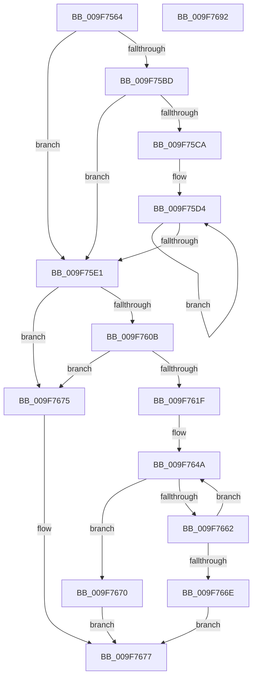

# MiAllocateCrcList

- RVA: `0x009F7564`–`0x009F7693` (길이 `303` bytes)
- VA: `0x00000001409F7564`
- 실행 섹션: `PAGE`
- PDB 이름 있음: `예`; PDB Function 태그: `아니요`
- unwind 정보 RVA: `0x0005E6B4`
- 디코드: `80`개 명령, `303/303` bytes 표시
- 미해석 바이트: `0` (있으면 어셈블리에 `.byte`로 보존)

> 이 문서는 커널 이미지의 기계어와 PDB 기호를 분석해 생성했습니다. 4번과 5번은 함수 원형과 자료형을 바이너리 사용 방식에서 추정한 C 해석이며 원본 소스 복구 결과는 아닙니다.

## 1. Dependencies

- 직접 호출 지점: **4**; 고유 호출 대상: **4**
- 직접 호출자로 확인된 함수: **1**
- RIP 상대 이미지 참조: **2**

### Outgoing calls
- `0x009F75A3` → [MiGetPrivatePageCount](../../text/49/MiGetPrivatePageCount_function_0049E4E4.md) (function, `0x0049E4E4`)
- `0x009F7615` → [MiCommitmentAvailable](../../text/43/MiCommitmentAvailable_function_004365C0.md) (function, `0x004365C0`)
- `0x009F762E` → [MiGetAvailablePagesBelowPriority](../../text/34/MiGetAvailablePagesBelowPriority_function_0034D340.md) (function, `0x0034D340`)
- `0x009F7658` → [MiAllocatePool](../../text/35/MiAllocatePool_function_0035B540.md) (function, `0x0035B540`)

### Direct callers
- [MiCombineAllPhysicalMemory](MiCombineAllPhysicalMemory_function_009F6B6C.md) at `0x009F6C41`

### Static image references
- `0x009F75BD` → RVA `0x00FC5000` (`ALMOSTRO`; read)
- `0x009F75CA` → RVA `0x00E37700` (`.data`; read)

## 2. Other-region calls and transfers

- 다른 실행 섹션으로 향하는 call: **4**
  - `0x009F75A3` → [MiGetPrivatePageCount](../../text/49/MiGetPrivatePageCount_function_0049E4E4.md) (`PAGE` → `.text`)
  - `0x009F7615` → [MiCommitmentAvailable](../../text/43/MiCommitmentAvailable_function_004365C0.md) (`PAGE` → `.text`)
  - `0x009F762E` → [MiGetAvailablePagesBelowPriority](../../text/34/MiGetAvailablePagesBelowPriority_function_0034D340.md) (`PAGE` → `.text`)
  - `0x009F7658` → [MiAllocatePool](../../text/35/MiAllocatePool_function_0035B540.md) (`PAGE` → `.text`)
- 별도 외부 분기/꼬리 이동을 확인하지 못했습니다.

## 3. Assembly (complete function range)

```asm
009F7564  48 8B C4                        mov rax, rsp
009F7567  48 89 58 08                     mov qword ptr [rax + 8], rbx
009F756B  48 89 68 10                     mov qword ptr [rax + 0x10], rbp
009F756F  48 89 70 18                     mov qword ptr [rax + 0x18], rsi
009F7573  48 89 78 20                     mov qword ptr [rax + 0x20], rdi
009F7577  41 56                           push r14
009F7579  48 83 EC 20                     sub rsp, 0x20
009F757D  48 8B 29                        mov rbp, qword ptr [rcx]
009F7580  8B FA                           mov edi, edx
009F7582  48 B8 CD CC CC CC CC CC CC CC   movabs rax, 0xcccccccccccccccd
009F758C  48 8B CD                        mov rcx, rbp
009F758F  49 F7 20                        mul qword ptr [r8]
009F7592  48 8B 9D C0 3F 00 00            mov rbx, qword ptr [rbp + 0x3fc0]
009F7599  4D 8B F0                        mov r14, r8
009F759C  48 8B F2                        mov rsi, rdx
009F759F  48 C1 EE 05                     shr rsi, 5
009F75A3  E8 3C 6F AA FF                  call 0x14049e4e4
009F75A8  48 83 CA FF                     or rdx, 0xffffffffffffffff
009F75AC  48 8D 0C 03                     lea rcx, [rbx + rax]
009F75B0  48 3B C8                        cmp rcx, rax
009F75B3  48 0F 42 CA                     cmovb rcx, rdx
009F75B7  40 F6 C7 01                     test dil, 1
009F75BB  74 24                           je 0x1409f75e1
009F75BD  0F B7 15 3C DA 5C 00            movzx edx, word ptr [rip + 0x5cda3c]
009F75C4  33 C9                           xor ecx, ecx
009F75C6  85 D2                           test edx, edx
009F75C8  74 17                           je 0x1409f75e1
009F75CA  48 8D 05 2F 01 44 00            lea rax, [rip + 0x44012f]
009F75D1  44 8B C2                        mov r8d, edx
009F75D4  48 03 08                        add rcx, qword ptr [rax]
009F75D7  48 8D 40 08                     lea rax, [rax + 8]
009F75DB  49 83 E8 01                     sub r8, 1
009F75DF  75 F3                           jne 0x1409f75d4
009F75E1  48 8B 9D 40 49 00 00            mov rbx, qword ptr [rbp + 0x4940]
009F75E8  48 3B CE                        cmp rcx, rsi
009F75EB  48 0F 46 F1                     cmovbe rsi, rcx
009F75EF  48 81 C3 00 FC FF FF            add rbx, -0x400
009F75F6  48 8D 04 B6                     lea rax, [rsi + rsi*4]
009F75FA  48 8D 0C C5 FF 0F 00 00         lea rcx, [rax*8 + 0xfff]
009F7602  48 C1 E9 0C                     shr rcx, 0xc
009F7606  48 85 DB                        test rbx, rbx
009F7609  7E 6A                           jle 0x1409f7675
009F760B  48 3B CB                        cmp rcx, rbx
009F760E  48 0F 46 D9                     cmovbe rbx, rcx
009F7612  48 8B CD                        mov rcx, rbp
009F7615  E8 A6 EF A3 FF                  call 0x1404365c0
009F761A  48 85 C0                        test rax, rax
009F761D  74 56                           je 0x1409f7675
009F761F  48 3B D8                        cmp rbx, rax
009F7622  BA 02 00 00 00                  mov edx, 2
009F7627  48 8B CD                        mov rcx, rbp
009F762A  48 0F 47 D8                     cmova rbx, rax
009F762E  E8 0D 5D 95 FF                  call 0x14034d340
009F7633  48 3B D8                        cmp rbx, rax
009F7636  48 0F 47 D8                     cmova rbx, rax
009F763A  B8 00 00 20 00                  mov eax, 0x200000
009F763F  48 C1 E3 0C                     shl rbx, 0xc
009F7643  48 3B D8                        cmp rbx, rax
009F7646  48 0F 42 D8                     cmovb rbx, rax
009F764A  41 B8 4D 53 75 6D               mov r8d, 0x6d75534d
009F7650  48 8B D3                        mov rdx, rbx
009F7653  B9 40 00 00 00                  mov ecx, 0x40
009F7658  E8 E3 3E 96 FF                  call 0x14035b540
009F765D  48 85 C0                        test rax, rax
009F7660  75 0E                           jne 0x1409f7670
009F7662  48 D1 EB                        shr rbx, 1
009F7665  48 81 FB 00 00 01 00            cmp rbx, 0x10000
009F766C  73 DC                           jae 0x1409f764a
009F766E  EB 07                           jmp 0x1409f7677
009F7670  49 89 1E                        mov qword ptr [r14], rbx
009F7673  EB 02                           jmp 0x1409f7677
009F7675  33 C0                           xor eax, eax
009F7677  48 8B 5C 24 30                  mov rbx, qword ptr [rsp + 0x30]
009F767C  48 8B 6C 24 38                  mov rbp, qword ptr [rsp + 0x38]
009F7681  48 8B 74 24 40                  mov rsi, qword ptr [rsp + 0x40]
009F7686  48 8B 7C 24 48                  mov rdi, qword ptr [rsp + 0x48]
009F768B  48 83 C4 20                     add rsp, 0x20
009F768F  41 5E                           pop r14
009F7691  C3                              ret
009F7692  CC                              int3
```

## 4. C-style interpretation (structured pseudocode)

```c
__int64 __fastcall MiAllocateCrcList(__int64 a1, __int64 a2, __int64 a3)
{
    __int64 result;
    __int64 v_rbx;
    __int64 v_rsi;
    __int64 v_rsp;
    unsigned __int64 v_stack_p10;
    unsigned __int64 v_stack_p18;
    unsigned __int64 v_stack_p20;
    unsigned __int64 v_stack_p8;

    *(unsigned __int64 *)(v_rsp + 8) = v_rbx;
    *(unsigned __int64 *)(v_rsp + 16) = v_rbp;
    *(unsigned __int64 *)(v_rsp + 24) = v_rsi;
    *(unsigned __int64 *)(v_rsp + 32) = v_rdi;
    v_rsp = (v_rsp) - (32);
    v_rsi = (a2) >> (5);
    result = MiGetPrivatePageCount(*(unsigned __int64 *)(a1), a2, a3, a4);
    a2 = (a2) | (-1);
    a1 = *(unsigned __int64 *)(*(unsigned __int64 *)(a1) + 16320) + result * 1;
    if ((*(unsigned __int64 *)(*(unsigned __int64 *)(a1) + 16320) + result * 1) < result) { a1 = a2; }
    if ((((unsigned __int8)((unsigned int)((unsigned int)(a2)))) & (1)) == 0) goto loc_009F75E1;
    a1 = 0;
    if ((unsigned int)(*(unsigned __int16 *)(v_rip + 6085180)) == 0) goto loc_009F75E1;
loc_009F75D4:
    a1 = (a1) + (*(unsigned __int64 *)(v_rip + 4456751));
    a3 = ((unsigned int)((unsigned int)(*(unsigned __int16 *)(v_rip + 6085180)))) - (1);
    if (condition_is_not_equal) goto loc_009F75D4;
loc_009F75E1:
    if (a1 <= v_rsi) { v_rsi = a1; }
    v_rbx = (*(unsigned __int64 *)(*(unsigned __int64 *)(a1) + 18752)) + (0xFFFFFFFFFFFFFC00ULL);
    a1 = (v_rsi + v_rsi * 4 * 8 + 4095) >> (12);
    if (condition_is_less_or_equal) goto loc_009F7675;
    if (a1 <= v_rbx) { v_rbx = a1; }
    result = MiCommitmentAvailable(*(unsigned __int64 *)(a1), *(unsigned __int16 *)(v_rip + 6085180), a3, a4);
    if (result == 0) goto loc_009F7675;
    if (v_rbx > result) { v_rbx = result; }
    result = MiGetAvailablePagesBelowPriority(*(unsigned __int64 *)(a1), 2, a3, a4);
    if (v_rbx > result) { v_rbx = result; }
    v_rbx = (v_rbx) << (12);
    if (v_rbx < ((unsigned int)(0x200000ULL))) { v_rbx = (unsigned int)(0x200000ULL); }
loc_009F764A:
    result = MiAllocatePool(64, v_rbx, (unsigned int)(0x6D75534DULL), a4);
    if (result != 0) goto loc_009F7670;
    v_rbx = (v_rbx) >> (1);
    if (v_rbx >= 0x10000ULL) goto loc_009F764A;
    goto loc_009F7677;
loc_009F7670:
    *(unsigned __int64 *)(a3) = v_rbx;
    goto loc_009F7677;
loc_009F7675:
    result = 0;
loc_009F7677:
    v_rsp = (v_rsp) + (32);
    return result;
}
```

## 5. (Beta) C Style

```c
int64_t MiAllocateCrcList(void *Arg1, int64_t Arg2, void *Arg3)
{
    uint8_t *arg1 = (uint8_t *)Arg1;
    uint8_t *arg3 = (uint8_t *)Arg3;

    int64_t result;
    int64_t local_rbx;
    int64_t local_rsi;
    int64_t local_rsp;
    uint64_t v_stack_p10;
    uint64_t v_stack_p18;
    uint64_t v_stack_p20;
    uint64_t v_stack_p8;

    *(uint64_t *)(local_rsp + 0x8) = local_rbx;
    *(uint64_t *)(local_rsp + 0x10) = local_rbp;
    *(uint64_t *)(local_rsp + 0x18) = local_rsi;
    *(uint64_t *)(local_rsp + 0x20) = local_rdi;
    local_rsp = (local_rsp) - (32);
    local_rsi = (Arg2) >> (5);
    result = MiGetPrivatePageCount(*(uint64_t *)(arg1), Arg2, Arg3, a4);
    Arg2 = (Arg2) | (-1);
    Arg1 = *(uint64_t *)(*(uint64_t *)(arg1) + 0x3FC0) + result * 1;
    if ((*(uint64_t *)(*(uint64_t *)(arg1) + 0x3FC0) + result * 1) < result) { Arg1 = Arg2; }
    if ((((uint8_t)((uint32_t)((uint32_t)(Arg2)))) & (1)) == 0) goto loc_009F75E1;
    Arg1 = 0;
    if ((uint32_t)(*(uint16_t *)(v_rip + 0x5CDA3C)) == 0) goto loc_009F75E1;
loc_009F75D4:
    Arg1 = (Arg1) + (*(uint64_t *)(v_rip + 0x44012F));
    Arg3 = ((uint32_t)((uint32_t)(*(uint16_t *)(v_rip + 0x5CDA3C)))) - (1);
    if (condition_is_not_equal) goto loc_009F75D4;
loc_009F75E1:
    if (Arg1 <= local_rsi) { local_rsi = Arg1; }
    local_rbx = (*(uint64_t *)(*(uint64_t *)(arg1) + 0x4940)) + (0xFFFFFFFFFFFFFC00ULL);
    Arg1 = (local_rsi + local_rsi * 4 * 8 + 4095) >> (12);
    if (condition_is_less_or_equal) goto loc_009F7675;
    if (Arg1 <= local_rbx) { local_rbx = Arg1; }
    result = MiCommitmentAvailable(*(uint64_t *)(arg1), *(uint16_t *)(v_rip + 0x5CDA3C), Arg3, a4);
    if (result == 0) goto loc_009F7675;
    if (local_rbx > result) { local_rbx = result; }
    result = MiGetAvailablePagesBelowPriority(*(uint64_t *)(arg1), 2, Arg3, a4);
    if (local_rbx > result) { local_rbx = result; }
    local_rbx = (local_rbx) << (12);
    if (local_rbx < ((uint32_t)(0x200000ULL))) { local_rbx = (uint32_t)(0x200000ULL); }
loc_009F764A:
    result = MiAllocatePool(64, local_rbx, (uint32_t)(0x6D75534DULL), a4);
    if (result != 0) goto loc_009F7670;
    local_rbx = (local_rbx) >> (1);
    if (local_rbx >= 0x10000ULL) goto loc_009F764A;
    goto loc_009F7677;
loc_009F7670:
    *(uint64_t *)(arg3) = local_rbx;
    goto loc_009F7677;
loc_009F7675:
    result = 0;
loc_009F7677:
    local_rsp = (local_rsp) + (32);
    return result;
}
```

### 관측된 메모리 오프셋

구조체 형식이 확인되지 않은 접근은 인자 기준의 오프셋으로만 기록했습니다.

| 기준 인자 | 오프셋 표현 | 폭 (bit) | 접근 |
|---|---:|---:|---|
| `Arg1` | `+ 0x0` | `64` | `R` |
| `Arg3` | `+ 0x0` | `64` | `R` |
| `Arg3` | `+ 0x0` | `64` | `W` |

## 6. Execution-region graph

[열기: 2D/3D 그래프와 함수 탐색 컨트롤 패널](../../../control-panel.html?section=page&rva=0x009F7564&view=graph)

- 2D 그래프는 위에서 아래로 흐르고, 3D 그래프는 빈 공간을 드래그해 회전합니다. Shift+드래그는 이동, 휠은 확대·축소, 함수 노드 선택은 대상 보고서 이동입니다.

### Static fallback


