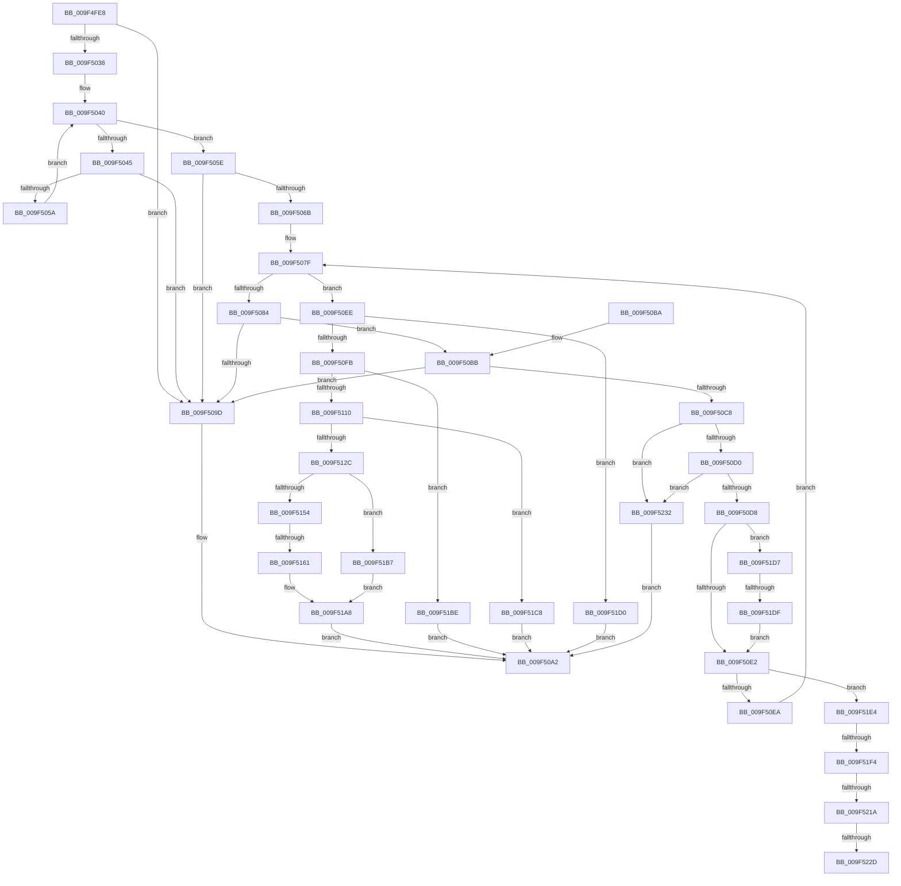

# MiCfgMarkValidEntries

- RVA: `0x009F4FE8`–`0x009F523C` (길이 `596` bytes)
- VA: `0x00000001409F4FE8`
- 실행 섹션: `PAGE`
- PDB 이름 있음: `예`; PDB Function 태그: `예`
- unwind 정보 RVA: `0x000A6648`
- 디코드: `164`개 명령, `596/596` bytes 표시
- 미해석 바이트: `0` (있으면 어셈블리에 `.byte`로 보존)

> 이 문서는 커널 이미지의 기계어와 PDB 기호를 분석해 생성했습니다. 4번과 5번은 함수 원형과 자료형을 바이너리 사용 방식에서 추정한 C 해석이며 원본 소스 복구 결과는 아닙니다.

## 1. Dependencies

- 직접 호출 지점: **7**; 고유 호출 대상: **6**
- 직접 호출자로 확인된 함수: **1**
- RIP 상대 이미지 참조: **0**

### Outgoing calls
- `0x009F5074` → [MiSelectCfgBitMap](MiSelectCfgBitMap_function_009F5244.md) (function, `0x009F5244`)
- `0x009F5119` → [MiObtainReferencedVadEx](../../text/31/MiObtainReferencedVadEx_function_00316690.md) (function, `0x00316690`)
- `0x009F519A` → [MiPopulateCfgBitMap](../8D/MiPopulateCfgBitMap_function_008D0FA4.md) (function, `0x008D0FA4`)
- `0x009F51AB` → [MiUnlockAndDereferenceVad](../../text/31/MiUnlockAndDereferenceVad_function_00316E60.md) (function, `0x00316E60`)
- `0x009F51E7` → [MiIsProcessCfgExportSuppressionEnabled](../A8/MiIsProcessCfgExportSuppressionEnabled_function_00A8F6DC.md) (function, `0x00A8F6DC`)
- `0x009F520C` → [CfgAddressToBitState](../../text/4B/CfgAddressToBitState_function_004B9550.md) (function, `0x004B9550`)
- `0x009F521D` → [MiIsProcessCfgExportSuppressionEnabled](../A8/MiIsProcessCfgExportSuppressionEnabled_function_00A8F6DC.md) (function, `0x00A8F6DC`)

### Direct callers
- [NtSetInformationVirtualMemory](NtSetInformationVirtualMemory_function_009F4580.md) at `0x009F4C9B`

### Static image references
- 디코드된 RIP-relative 메모리 참조가 없습니다.

## 2. Other-region calls and transfers

- 다른 실행 섹션으로 향하는 call: **3**
  - `0x009F5119` → [MiObtainReferencedVadEx](../../text/31/MiObtainReferencedVadEx_function_00316690.md) (`PAGE` → `.text`)
  - `0x009F51AB` → [MiUnlockAndDereferenceVad](../../text/31/MiUnlockAndDereferenceVad_function_00316E60.md) (`PAGE` → `.text`)
  - `0x009F520C` → [CfgAddressToBitState](../../text/4B/CfgAddressToBitState_function_004B9550.md) (`PAGE` → `.text`)
- call이 아닌 외부 분기/꼬리 이동: **6**
  - `0x009F515B` → [sub_00B314C0 + 0x29](../B3/Unknown_function_00B314C0.md) (`tail-transfer`)
  - `0x009F51D9` → [sub_00B314C0 + 0x1F](../B3/Unknown_function_00B314C0.md) (`tail-transfer`)
  - `0x009F51EE` → [sub_00B314C0 + 0x1F](../B3/Unknown_function_00B314C0.md) (`tail-transfer`)
  - `0x009F5214` → [sub_00B314C0](../B3/Unknown_function_00B314C0.md) (`tail-transfer`)
  - `0x009F5227` → [sub_00B314C0](../B3/Unknown_function_00B314C0.md) (`tail-transfer`)
  - `0x009F522D` → [sub_00B314C0 + 0x16](../B3/Unknown_function_00B314C0.md) (`tail-transfer`)

## 3. Assembly (complete function range)

```asm
009F4FE8  48 89 5C 24 10                  mov qword ptr [rsp + 0x10], rbx
009F4FED  4C 89 44 24 18                  mov qword ptr [rsp + 0x18], r8
009F4FF2  48 89 4C 24 08                  mov qword ptr [rsp + 8], rcx
009F4FF7  55                              push rbp
009F4FF8  56                              push rsi
009F4FF9  57                              push rdi
009F4FFA  41 54                           push r12
009F4FFC  41 55                           push r13
009F4FFE  41 56                           push r14
009F5000  41 57                           push r15
009F5002  48 8B EC                        mov rbp, rsp
009F5005  48 83 EC 60                     sub rsp, 0x60
009F5009  4C 8B 55 68                     mov r10, qword ptr [rbp + 0x68]
009F500D  33 C0                           xor eax, eax
009F500F  45 33 DB                        xor r11d, r11d
009F5012  89 45 F8                        mov dword ptr [rbp - 8], eax
009F5015  8B C2                           mov eax, edx
009F5017  44 89 5D E0                     mov dword ptr [rbp - 0x20], r11d
009F501B  41 0B C0                        or eax, r8d
009F501E  0F 57 C0                        xorps xmm0, xmm0
009F5021  45 89 1A                        mov dword ptr [r10], r11d
009F5024  49 8B F1                        mov rsi, r9
009F5027  48 8B DA                        mov rbx, rdx
009F502A  4C 8B E1                        mov r12, rcx
009F502D  0F 11 45 E8                     movups xmmword ptr [rbp - 0x18], xmm0
009F5031  A9 FF 0F 00 00                  test eax, 0xfff
009F5036  75 65                           jne 0x1409f509d
009F5038  44 8B 75 60                     mov r14d, dword ptr [rbp + 0x60]
009F503C  41 8D 53 01                     lea edx, [r11 + 1]
009F5040  41 3B D6                        cmp edx, r14d
009F5043  73 19                           jae 0x1409f505e
009F5045  8B C2                           mov eax, edx
009F5047  8D 4A FF                        lea ecx, [rdx - 1]
009F504A  48 03 C0                        add rax, rax
009F504D  48 03 C9                        add rcx, rcx
009F5050  49 8B 04 C1                     mov rax, qword ptr [r9 + rax*8]
009F5054  49 39 04 C9                     cmp qword ptr [r9 + rcx*8], rax
009F5058  77 43                           ja 0x1409f509d
009F505A  FF C2                           inc edx
009F505C  EB E2                           jmp 0x1409f5040
009F505E  41 8D 4E FF                     lea ecx, [r14 - 1]
009F5062  48 03 C9                        add rcx, rcx
009F5065  4D 39 04 C9                     cmp qword ptr [r9 + rcx*8], r8
009F5069  73 32                           jae 0x1409f509d
009F506B  45 33 C0                        xor r8d, r8d
009F506E  48 8B D3                        mov rdx, rbx
009F5071  49 8B CC                        mov rcx, r12
009F5074  E8 CB 01 00 00                  call 0x1409f5244
009F5079  4C 8B E8                        mov r13, rax
009F507C  41 8B FB                        mov edi, r11d
009F507F  41 3B FE                        cmp edi, r14d
009F5082  73 6A                           jae 0x1409f50ee
009F5084  41 8B 4D 18                     mov ecx, dword ptr [r13 + 0x18]
009F5088  44 8B FF                        mov r15d, edi
009F508B  4D 03 FF                        add r15, r15
009F508E  4A 8B 14 FE                     mov rdx, qword ptr [rsi + r15*8]
009F5092  48 8B C2                        mov rax, rdx
009F5095  83 E0 0F                        and eax, 0xf
009F5098  48 3B C1                        cmp rax, rcx
009F509B  74 1E                           je 0x1409f50bb
009F509D  B8 0D 00 00 C0                  mov eax, 0xc000000d
009F50A2  48 8B 9C 24 A8 00 00 00         mov rbx, qword ptr [rsp + 0xa8]
009F50AA  48 83 C4 60                     add rsp, 0x60
009F50AE  41 5F                           pop r15
009F50B0  41 5E                           pop r14
009F50B2  41 5D                           pop r13
009F50B4  41 5C                           pop r12
009F50B6  5F                              pop rdi
009F50B7  5E                              pop rsi
009F50B8  5D                              pop rbp
009F50B9  C3                              ret
009F50BA  CC                              int3
009F50BB  4A 8B 44 FE 08                  mov rax, qword ptr [rsi + r15*8 + 8]
009F50C0  48 A9 E0 FF FF FF               test rax, -0x20
009F50C6  75 D5                           jne 0x1409f509d
009F50C8  A8 08                           test al, 8
009F50CA  0F 85 62 01 00 00               jne 0x1409f5232
009F50D0  A8 10                           test al, 0x10
009F50D2  0F 85 5A 01 00 00               jne 0x1409f5232
009F50D8  F6 45 70 01                     test byte ptr [rbp + 0x70], 1
009F50DC  0F 85 F5 00 00 00               jne 0x1409f51d7
009F50E2  A8 04                           test al, 4
009F50E4  0F 85 FA 00 00 00               jne 0x1409f51e4
009F50EA  FF C7                           inc edi
009F50EC  EB 91                           jmp 0x1409f507f
009F50EE  48 8B 45 68                     mov rax, qword ptr [rbp + 0x68]
009F50F2  44 39 30                        cmp dword ptr [rax], r14d
009F50F5  0F 84 D5 00 00 00               je 0x1409f51d0
009F50FB  49 8B 84 24 10 04 00 00         mov rax, qword ptr [r12 + 0x410]
009F5103  4C 39 98 A8 04 00 00            cmp qword ptr [rax + 0x4a8], r11
009F510A  0F 84 AE 00 00 00               je 0x1409f51be
009F5110  4C 8D 45 E0                     lea r8, [rbp - 0x20]
009F5114  33 D2                           xor edx, edx
009F5116  48 8B CB                        mov rcx, rbx
009F5119  E8 72 15 92 FF                  call 0x140316690
009F511E  33 D2                           xor edx, edx
009F5120  48 8B F8                        mov rdi, rax
009F5123  48 85 C0                        test rax, rax
009F5126  0F 84 9C 00 00 00               je 0x1409f51c8
009F512C  0F B6 48 21                     movzx ecx, byte ptr [rax + 0x21]
009F5130  8B 40 1C                        mov eax, dword ptr [rax + 0x1c]
009F5133  4C 8B 7D 50                     mov r15, qword ptr [rbp + 0x50]
009F5137  48 C1 E1 20                     shl rcx, 0x20
009F513B  49 FF CF                        dec r15
009F513E  48 0B C8                        or rcx, rax
009F5141  4C 03 FB                        add r15, rbx
009F5144  48 C1 E1 0C                     shl rcx, 0xc
009F5148  48 81 C9 FF 0F 00 00            or rcx, 0xfff
009F514F  4C 3B F9                        cmp r15, rcx
009F5152  77 63                           ja 0x1409f51b7
009F5154  48 8B 4D 78                     mov rcx, qword ptr [rbp + 0x78]
009F5158  48 85 C9                        test rcx, rcx
009F515B  0F 85 88 C3 13 00               jne 0x140b314e9
009F5161  48 8B 45 68                     mov rax, qword ptr [rbp + 0x68]
009F5165  41 B9 01 00 00 00               mov r9d, 1
009F516B  48 89 54 24 30                  mov qword ptr [rsp + 0x30], rdx
009F5170  49 8B CD                        mov rcx, r13
009F5173  48 89 45 F8                     mov qword ptr [rbp - 8], rax
009F5177  48 8D 55 E8                     lea rdx, [rbp - 0x18]
009F517B  49 8D 87 FF 0F 00 00            lea rax, [r15 + 0xfff]
009F5182  44 89 75 E8                     mov dword ptr [rbp - 0x18], r14d
009F5186  48 25 00 F0 FF FF               and rax, 0xfffffffffffff000
009F518C  48 89 75 F0                     mov qword ptr [rbp - 0x10], rsi
009F5190  48 89 44 24 28                  mov qword ptr [rsp + 0x28], rax
009F5195  48 89 5C 24 20                  mov qword ptr [rsp + 0x20], rbx
009F519A  E8 05 BE ED FF                  call 0x1408d0fa4
009F519F  8B D8                           mov ebx, eax
009F51A1  33 C0                           xor eax, eax
009F51A3  85 DB                           test ebx, ebx
009F51A5  0F 49 D8                        cmovns ebx, eax
009F51A8  48 8B CF                        mov rcx, rdi
009F51AB  E8 B0 1C 92 FF                  call 0x140316e60
009F51B0  8B C3                           mov eax, ebx
009F51B2  E9 EB FE FF FF                  jmp 0x1409f50a2
009F51B7  BB 0D 00 00 C0                  mov ebx, 0xc000000d
009F51BC  EB EA                           jmp 0x1409f51a8
009F51BE  B8 45 00 00 C0                  mov eax, 0xc0000045
009F51C3  E9 DA FE FF FF                  jmp 0x1409f50a2
009F51C8  8B 45 E0                        mov eax, dword ptr [rbp - 0x20]
009F51CB  E9 D2 FE FF FF                  jmp 0x1409f50a2
009F51D0  33 C0                           xor eax, eax
009F51D2  E9 CB FE FF FF                  jmp 0x1409f50a2
009F51D7  A8 01                           test al, 1
009F51D9  0F 85 00 C3 13 00               jne 0x140b314df
009F51DF  E9 FE FE FF FF                  jmp 0x1409f50e2
009F51E4  49 8B CC                        mov rcx, r12
009F51E7  E8 F0 A4 09 00                  call 0x140a8f6dc
009F51EC  85 C0                           test eax, eax
009F51EE  0F 84 EB C2 13 00               je 0x140b314df
009F51F4  65 48 8B 04 25 88 01 00 00      mov rax, qword ptr gs:[0x188]
009F51FD  48 8D 0C 1A                     lea rcx, [rdx + rbx]
009F5201  49 8B 55 00                     mov rdx, qword ptr [r13]
009F5205  4C 8B A0 B8 00 00 00            mov r12, qword ptr [rax + 0xb8]
009F520C  E8 3F 43 AC FF                  call 0x1404b9550
009F5211  83 F8 02                        cmp eax, 2
009F5214  0F 85 A6 C2 13 00               jne 0x140b314c0
009F521A  49 8B CC                        mov rcx, r12
009F521D  E8 BA A4 09 00                  call 0x140a8f6dc
009F5222  45 33 DB                        xor r11d, r11d
009F5225  85 C0                           test eax, eax
009F5227  0F 84 93 C2 13 00               je 0x140b314c0
009F522D  E9 A4 C2 13 00                  jmp 0x140b314d6
009F5232  B8 BB 00 00 C0                  mov eax, 0xc00000bb
009F5237  E9 66 FE FF FF                  jmp 0x1409f50a2
```

## 4. C-style interpretation (structured pseudocode)

```c
__int64 __fastcall MiCfgMarkValidEntries(__int64 a1, __int64 a2, __int64 a3, __int64 a4, unsigned int a5, __int64 a6, unsigned __int8 a7, __int64 a8)
{
    __int64 result;
    __int64 v_r11;
    __int64 v_r15;
    __int64 v_rbx;
    __int64 v_rdi;
    __int64 v_rsp;
    unsigned int v_stack_m40;
    unsigned __int64 v_stack_m48;
    unsigned __int64 v_stack_m50;
    unsigned int v_stack_m58;
    unsigned __int64 v_stack_p10;
    unsigned __int64 v_stack_p18;
    unsigned __int64 v_stack_p20;
    unsigned __int64 v_stack_p28;
    unsigned __int64 v_stack_p30;
    unsigned __int64 v_stack_p8;

    v_stack_p10 = v_rbx;
    v_stack_p18 = a3;
    v_stack_p8 = a1;
    v_rsp = (v_rsp) - (96);
    result = 0;
    v_r11 = 0;
    v_stack_m40 = 0;
    v_stack_m58 = 0;
    result = (unsigned int)(((unsigned int)((unsigned int)(a2))) | ((unsigned int)(a3)));
    *(unsigned int *)(a6) = 0;
    v_stack_m50 = v_xmm0;
    if ((((unsigned int)(result)) & (0xFFFULL)) != 0) goto loc_009F509D;
loc_009F5040:
    if (((unsigned int)(v_r11 + 1)) >= ((unsigned int)((unsigned int)(a5)))) goto loc_009F505E;
    result = ((unsigned int)((unsigned int)(v_r11 + 1))) + ((unsigned int)((unsigned int)(v_r11 + 1)));
    a1 = (v_r11 + 1 - 1) + (v_r11 + 1 - 1);
    if ((*(unsigned __int64 *)(a4 + a1 * 8)) > (*(unsigned __int64 *)(a4 + result * 8))) goto loc_009F509D;
    a2 = (unsigned int)((v_r11 + 1) + 1);
    goto loc_009F5040;
loc_009F505E:
    a1 = ((unsigned int)(a5) - 1) + ((unsigned int)(a5) - 1);
    if ((*(unsigned __int64 *)(a4 + a1 * 8)) >= a3) goto loc_009F509D;
    a3 = 0;
    result = MiSelectCfgBitMap(a1, a2, a3, a4);
loc_009F507F:
    if (0 >= ((unsigned int)((unsigned int)(a5)))) goto loc_009F50EE;
    v_r15 = (0) + (0);
    result = (unsigned int)((*(unsigned __int64 *)(a4 + v_r15 * 8)) & (15));
    if (result == ((unsigned int)(*(unsigned int *)(result + 24)))) goto loc_009F50BB;
loc_009F509D:
loc_009F50A2:
    v_rsp = (v_rsp) + (96);
    return (unsigned int)(0xC000000DULL);
loc_009F50BB:
    if (((*(unsigned __int64 *)(a4 + v_r15 * 8 + 8)) & (-32)) != 0) goto loc_009F509D;
    if ((((unsigned __int8)(*(unsigned __int64 *)(a4 + v_r15 * 8 + 8))) & (8)) != 0) goto loc_009F5232;
    if ((((unsigned __int8)(*(unsigned __int64 *)(a4 + v_r15 * 8 + 8))) & (16)) != 0) goto loc_009F5232;
    if (((a7) & (1)) != 0) goto loc_009F51D7;
loc_009F50E2:
    if ((((unsigned __int8)(*(unsigned __int64 *)(a4 + v_r15 * 8 + 8))) & (4)) != 0) goto loc_009F51E4;
    v_rdi = (unsigned int)((0) + 1);
    goto loc_009F507F;
loc_009F50EE:
    if ((*(unsigned int *)(a6)) == ((unsigned int)((unsigned int)(a5)))) goto loc_009F51D0;
    if ((*(unsigned __int64 *)(*(unsigned __int64 *)(a1 + 1040) + 1192)) == 0) goto loc_009F51BE;
    a2 = 0;
    result = MiObtainReferencedVadEx(v_stack_p10, a2, v_stack_m58, a4);
    a2 = 0;
    if (result == 0) goto loc_009F51C8;
    a1 = (*(unsigned __int8 *)(result + 33)) << (32);
    v_r15 = (v_stack_p18) - 1;
    a1 = (a1) | ((unsigned int)(*(unsigned int *)(result + 28)));
    v_r15 = (v_r15) + (v_stack_p10);
    a1 = (a1) << (12);
    a1 = (a1) | (0xFFFULL);
    if (v_r15 > a1) goto loc_009F51B7;
    v_stack_p30 = 0;
    v_stack_m40 = a6;
    v_stack_m50 = (unsigned int)((unsigned int)(a5));
    result = (v_r15 + 4095) & (0xFFFFFFFFFFFFF000ULL);
    v_stack_m48 = a4;
    v_stack_p28 = result;
    v_stack_p20 = v_stack_p10;
    result = MiPopulateCfgBitMap(result, v_stack_m50, v_stack_m58, 1);
    result = 0;
    v_rbx = (unsigned int)((unsigned int)(result));
    if (!sign_flag) { v_rbx = 0; }
loc_009F51A8:
    result = MiUnlockAndDereferenceVad(0, v_stack_m50, v_stack_m58, 1);
    goto loc_009F50A2;
loc_009F51B7:
    goto loc_009F51A8;
loc_009F51BE:
    goto loc_009F50A2;
loc_009F51C8:
    goto loc_009F50A2;
loc_009F51D0:
    result = 0;
    goto loc_009F50A2;
loc_009F51D7:
    goto loc_009F50E2;
loc_009F51E4:
    result = MiIsProcessCfgExportSuppressionEnabled(a1, v_stack_m50, v_stack_m58, 1);
    result = CfgAddressToBitState(v_stack_m50 + (unsigned int)(0xC000000DULL) * 1, *(unsigned __int64 *)(result), v_stack_m58, 1);
    result = MiIsProcessCfgExportSuppressionEnabled(*(unsigned __int64 *)(*(unsigned __int64 *)(gs_base + (0 + 392)) + 184), *(unsigned __int64 *)(result), v_stack_m58, 1);
    v_r11 = 0;
loc_009F5232:
    goto loc_009F50A2;
}
```

## 5. (Beta) C Style

```c
int64_t MiCfgMarkValidEntries(void *Arg1, int64_t Arg2, int64_t Arg3, void *Arg4, void *Arg5, void *Arg6, uint8_t Arg7, int64_t Arg8)
{
    uint8_t *arg1 = (uint8_t *)Arg1;
    uint8_t *arg4 = (uint8_t *)Arg4;
    uint8_t *arg5 = (uint8_t *)Arg5;
    uint8_t *arg6 = (uint8_t *)Arg6;

    int64_t result;
    int64_t local_r11;
    int64_t local_r15;
    int64_t local_rbx;
    int64_t local_rdi;
    int64_t local_rsp;
    uint32_t v_stack_m40;
    uint64_t v_stack_m48;
    uint64_t v_stack_m50;
    uint32_t v_stack_m58;
    uint64_t v_stack_p10;
    uint64_t v_stack_p18;
    uint64_t v_stack_p20;
    uint64_t v_stack_p28;
    uint64_t v_stack_p30;
    uint64_t v_stack_p8;

    v_stack_p10 = local_rbx;
    v_stack_p18 = Arg3;
    v_stack_p8 = Arg1;
    local_rsp = (local_rsp) - (96);
    result = 0;
    local_r11 = 0;
    v_stack_m40 = 0;
    v_stack_m58 = 0;
    result = (uint32_t)(((uint32_t)((uint32_t)(Arg2))) | ((uint32_t)(Arg3)));
    *(uint32_t *)(arg6) = 0;
    v_stack_m50 = v_xmm0;
    if ((((uint32_t)(result)) & (0xFFFULL)) != 0) goto loc_009F509D;
loc_009F5040:
    if (((uint32_t)(local_r11 + 1)) >= ((uint32_t)((uint32_t)(Arg5)))) goto loc_009F505E;
    result = ((uint32_t)((uint32_t)(local_r11 + 1))) + ((uint32_t)((uint32_t)(local_r11 + 1)));
    Arg1 = (local_r11 + 1 - 1) + (local_r11 + 1 - 1);
    if ((*(uint64_t *)(arg4 + arg1 * 8)) > (*(uint64_t *)(arg4 + result * 8))) goto loc_009F509D;
    Arg2 = (uint32_t)((local_r11 + 1) + 1);
    goto loc_009F5040;
loc_009F505E:
    Arg1 = ((uint32_t)(Arg5) - 1) + ((uint32_t)(Arg5) - 1);
    if ((*(uint64_t *)(arg4 + arg1 * 8)) >= Arg3) goto loc_009F509D;
    Arg3 = 0;
    result = MiSelectCfgBitMap(Arg1, Arg2, Arg3, Arg4);
loc_009F507F:
    if (0 >= ((uint32_t)((uint32_t)(Arg5)))) goto loc_009F50EE;
    local_r15 = (0) + (0);
    result = (uint32_t)((*(uint64_t *)(arg4 + local_r15 * 8)) & (15));
    if (result == ((uint32_t)(*(uint32_t *)(result + 0x18)))) goto loc_009F50BB;
loc_009F509D:
loc_009F50A2:
    local_rsp = (local_rsp) + (96);
    return (uint32_t)(0xC000000DULL);
loc_009F50BB:
    if (((*(uint64_t *)(arg4 + local_r15 * 8 + 0x8)) & (-32)) != 0) goto loc_009F509D;
    if ((((uint8_t)(*(uint64_t *)(arg4 + local_r15 * 8 + 0x8))) & (8)) != 0) goto loc_009F5232;
    if ((((uint8_t)(*(uint64_t *)(arg4 + local_r15 * 8 + 0x8))) & (16)) != 0) goto loc_009F5232;
    if (((Arg7) & (1)) != 0) goto loc_009F51D7;
loc_009F50E2:
    if ((((uint8_t)(*(uint64_t *)(arg4 + local_r15 * 8 + 0x8))) & (4)) != 0) goto loc_009F51E4;
    local_rdi = (uint32_t)((0) + 1);
    goto loc_009F507F;
loc_009F50EE:
    if ((*(uint32_t *)(arg6)) == ((uint32_t)((uint32_t)(Arg5)))) goto loc_009F51D0;
    if ((*(uint64_t *)(*(uint64_t *)(arg1 + 0x410) + 0x4A8)) == 0) goto loc_009F51BE;
    Arg2 = 0;
    result = MiObtainReferencedVadEx(v_stack_p10, Arg2, v_stack_m58, Arg4);
    Arg2 = 0;
    if (result == 0) goto loc_009F51C8;
    Arg1 = (*(uint8_t *)(result + 0x21)) << (32);
    local_r15 = (v_stack_p18) - 1;
    Arg1 = (Arg1) | ((uint32_t)(*(uint32_t *)(result + 0x1C)));
    local_r15 = (local_r15) + (v_stack_p10);
    Arg1 = (Arg1) << (12);
    Arg1 = (Arg1) | (0xFFFULL);
    if (local_r15 > Arg1) goto loc_009F51B7;
    v_stack_p30 = 0;
    v_stack_m40 = Arg6;
    v_stack_m50 = (uint32_t)((uint32_t)(Arg5));
    result = (local_r15 + 4095) & (0xFFFFFFFFFFFFF000ULL);
    v_stack_m48 = Arg4;
    v_stack_p28 = result;
    v_stack_p20 = v_stack_p10;
    result = MiPopulateCfgBitMap(result, v_stack_m50, v_stack_m58, 1);
    result = 0;
    local_rbx = (uint32_t)((uint32_t)(result));
    if (!sign_flag) { local_rbx = 0; }
loc_009F51A8:
    result = MiUnlockAndDereferenceVad(0, v_stack_m50, v_stack_m58, 1);
    goto loc_009F50A2;
loc_009F51B7:
    goto loc_009F51A8;
loc_009F51BE:
    goto loc_009F50A2;
loc_009F51C8:
    goto loc_009F50A2;
loc_009F51D0:
    result = 0;
    goto loc_009F50A2;
loc_009F51D7:
    goto loc_009F50E2;
loc_009F51E4:
    result = MiIsProcessCfgExportSuppressionEnabled(Arg1, v_stack_m50, v_stack_m58, 1);
    result = CfgAddressToBitState(v_stack_m50 + (uint32_t)(0xC000000DULL) * 1, *(uint64_t *)(result), v_stack_m58, 1);
    result = MiIsProcessCfgExportSuppressionEnabled(*(uint64_t *)(*(uint64_t *)(gs_base + (0 + 0x188)) + 0xB8), *(uint64_t *)(result), v_stack_m58, 1);
    local_r11 = 0;
loc_009F5232:
    goto loc_009F50A2;
}
```

### 관측된 메모리 오프셋

구조체 형식이 확인되지 않은 접근은 인자 기준의 오프셋으로만 기록했습니다.

| 기준 인자 | 오프셋 표현 | 폭 (bit) | 접근 |
|---|---:|---:|---|
| `Arg1` | `+ 0x410` | `64` | `R` |
| `Arg4` | `+ 0x0 + r15*8` | `64` | `R` |
| `Arg4` | `+ 0x0 + rax*8` | `64` | `R` |
| `Arg4` | `+ 0x0 + rcx*8` | `64` | `R` |
| `Arg4` | `+ 0x8 + r15*8` | `64` | `R` |
| `Arg5` | `- 0x1` | `32` | `R` |
| `Arg6` | `+ 0x0` | `32` | `R` |
| `Arg6` | `+ 0x0` | `32` | `W` |

## 6. Execution-region graph

[열기: 2D/3D 그래프와 함수 탐색 컨트롤 패널](../../../control-panel.html?section=page&rva=0x009F4FE8&view=graph)

- 2D 그래프는 위에서 아래로 흐르고, 3D 그래프는 빈 공간을 드래그해 회전합니다. Shift+드래그는 이동, 휠은 확대·축소, 함수 노드 선택은 대상 보고서 이동입니다.

### Static fallback


