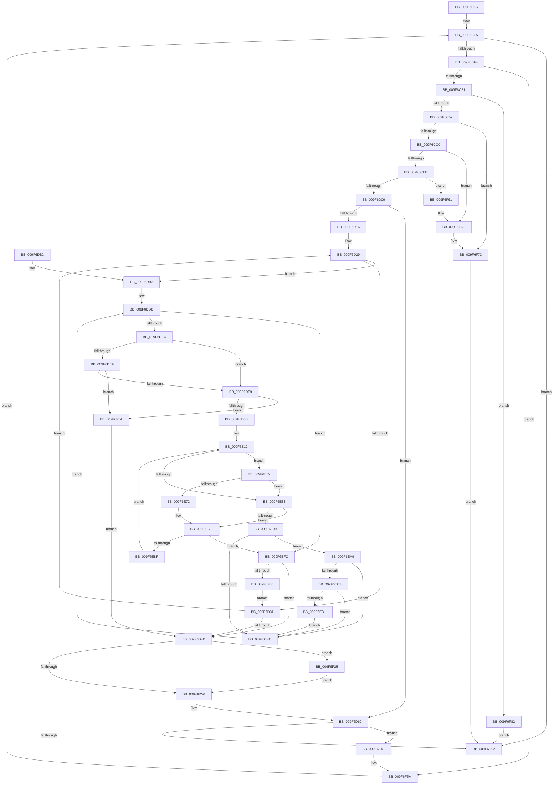

# MiCombineAllPhysicalMemory

- RVA: `0x009F6B6C`–`0x009F6F8D` (길이 `1,057` bytes)
- VA: `0x00000001409F6B6C`
- 실행 섹션: `PAGE`
- PDB 이름 있음: `예`; PDB Function 태그: `아니요`
- unwind 정보 RVA: `0x000A6CB4`
- 디코드: `274`개 명령, `1,057/1,057` bytes 표시
- 미해석 바이트: `0` (있으면 어셈블리에 `.byte`로 보존)

> 이 문서는 커널 이미지의 기계어와 PDB 기호를 분석해 생성했습니다. 4번과 5번은 함수 원형과 자료형을 바이너리 사용 방식에서 추정한 C 해석이며 원본 소스 복구 결과는 아닙니다.

## 1. Dependencies

- 직접 호출 지점: **21**; 고유 호출 대상: **15**
- 직접 호출자로 확인된 함수: **1**
- RIP 상대 이미지 참조: **2**

### Outgoing calls
- `0x009F6BC4` → [MiReferencePageRuns](../../text/37/MiReferencePageRuns_function_00379540.md) (function, `0x00379540`)
- `0x009F6C41` → [MiAllocateCrcList](MiAllocateCrcList_function_009F7564.md) (function, `0x009F7564`)
- `0x009F6C75` → [MiGetClosestNodeWithProcessors](../../text/43/MiGetClosestNodeWithProcessors_function_0043EEE0.md) (function, `0x0043EEE0`)
- `0x009F6C88` → [KeQueryNodeActiveAffinity2](../../text/41/KeQueryNodeActiveAffinity2_function_004189C0.md) (function, `0x004189C0`)
- `0x009F6CAB` → [ExAllocatePoolMm](../../text/35/ExAllocatePoolMm_function_0035B690.md) (function, `0x0035B690`)
- `0x009F6CCF` → [KeQueryNodeActiveAffinity2](../../text/41/KeQueryNodeActiveAffinity2_function_004189C0.md) (function, `0x004189C0`)
- `0x009F6CD8` → [PsAllocateAffinityToken](../../text/4D/PsAllocateAffinityToken_function_004DA4E0.md) (function, `0x004DA4E0`)
- `0x009F6CF6` → [KeSetSystemMultipleGroupAffinityThread](../../text/4D/KeSetSystemMultipleGroupAffinityThread_function_004D0C88.md) (function, `0x004D0C88`)
- `0x009F6D65` → [KeRevertToUserMultipleGroupAffinityThread](../../text/4D/KeRevertToUserMultipleGroupAffinityThread_function_004D8A90.md) (function, `0x004D8A90`)
- `0x009F6D6D` → [PsFreeAffinityToken](../../text/4F/PsFreeAffinityToken_function_004F9970.md) (function, `0x004F9970`)
- `0x009F6D77` → [ExFreePoolWithTag](../../poolcode/B8/ExFreePoolWithTag_function_00B82870.md) (function, `0x00B82870`)
- `0x009F6D81` → [ExFreePoolWithTag](../../poolcode/B8/ExFreePoolWithTag_function_00B82870.md) (function, `0x00B82870`)
- `0x009F6D96` → [MiDereferencePageRuns](../../text/3B/MiDereferencePageRuns_function_003BD388.md) (function, `0x003BD388`)
- `0x009F6E43` → [MiCombineCandidate](../../text/31/MiCombineCandidate_function_00316290.md) (function, `0x00316290`)
- `0x009F6E64` → [MiGetPfnPageSizeIndexUnsynchronized](../../text/46/MiGetPfnPageSizeIndexUnsynchronized_function_0046C008.md) (function, `0x0046C008`)
- `0x009F6EBA` → [MiComputeCombineHash](../../text/32/MiComputeCombineHash_function_003227C0.md) (function, `0x003227C0`)
- `0x009F6EEF` → [MiProcessCrcList](MiProcessCrcList_function_009F6F94.md) (function, `0x009F6F94`)
- `0x009F6F44` → [MiProcessCrcList](MiProcessCrcList_function_009F6F94.md) (function, `0x009F6F94`)
- `0x009F6F64` → [PsFreeAffinityToken](../../text/4F/PsFreeAffinityToken_function_004F9970.md) (function, `0x004F9970`)
- `0x009F6F6E` → [ExFreePoolWithTag](../../poolcode/B8/ExFreePoolWithTag_function_00B82870.md) (function, `0x00B82870`)
- `0x009F6F78` → [ExFreePoolWithTag](../../poolcode/B8/ExFreePoolWithTag_function_00B82870.md) (function, `0x00B82870`)

### Direct callers
- [MiCombineIdenticalPages](../AB/MiCombineIdenticalPages_function_00AB2324.md) at `0x00AB25CA`

### Static image references
- `0x009F6BE5` → RVA `0x00FC5000` (`ALMOSTRO`; read)
- `0x009F6E74` → RVA `0x00011C60` (`.rdata`; read)

## 2. Other-region calls and transfers

- 다른 실행 섹션으로 향하는 call: **18**
  - `0x009F6BC4` → [MiReferencePageRuns](../../text/37/MiReferencePageRuns_function_00379540.md) (`PAGE` → `.text`)
  - `0x009F6C75` → [MiGetClosestNodeWithProcessors](../../text/43/MiGetClosestNodeWithProcessors_function_0043EEE0.md) (`PAGE` → `.text`)
  - `0x009F6C88` → [KeQueryNodeActiveAffinity2](../../text/41/KeQueryNodeActiveAffinity2_function_004189C0.md) (`PAGE` → `.text`)
  - `0x009F6CAB` → [ExAllocatePoolMm](../../text/35/ExAllocatePoolMm_function_0035B690.md) (`PAGE` → `.text`)
  - `0x009F6CCF` → [KeQueryNodeActiveAffinity2](../../text/41/KeQueryNodeActiveAffinity2_function_004189C0.md) (`PAGE` → `.text`)
  - `0x009F6CD8` → [PsAllocateAffinityToken](../../text/4D/PsAllocateAffinityToken_function_004DA4E0.md) (`PAGE` → `.text`)
  - `0x009F6CF6` → [KeSetSystemMultipleGroupAffinityThread](../../text/4D/KeSetSystemMultipleGroupAffinityThread_function_004D0C88.md) (`PAGE` → `.text`)
  - `0x009F6D65` → [KeRevertToUserMultipleGroupAffinityThread](../../text/4D/KeRevertToUserMultipleGroupAffinityThread_function_004D8A90.md) (`PAGE` → `.text`)
  - `0x009F6D6D` → [PsFreeAffinityToken](../../text/4F/PsFreeAffinityToken_function_004F9970.md) (`PAGE` → `.text`)
  - `0x009F6D77` → [ExFreePoolWithTag](../../poolcode/B8/ExFreePoolWithTag_function_00B82870.md) (`PAGE` → `POOLCODE`)
  - `0x009F6D81` → [ExFreePoolWithTag](../../poolcode/B8/ExFreePoolWithTag_function_00B82870.md) (`PAGE` → `POOLCODE`)
  - `0x009F6D96` → [MiDereferencePageRuns](../../text/3B/MiDereferencePageRuns_function_003BD388.md) (`PAGE` → `.text`)
  - `0x009F6E43` → [MiCombineCandidate](../../text/31/MiCombineCandidate_function_00316290.md) (`PAGE` → `.text`)
  - `0x009F6E64` → [MiGetPfnPageSizeIndexUnsynchronized](../../text/46/MiGetPfnPageSizeIndexUnsynchronized_function_0046C008.md) (`PAGE` → `.text`)
  - `0x009F6EBA` → [MiComputeCombineHash](../../text/32/MiComputeCombineHash_function_003227C0.md) (`PAGE` → `.text`)
  - `0x009F6F64` → [PsFreeAffinityToken](../../text/4F/PsFreeAffinityToken_function_004F9970.md) (`PAGE` → `.text`)
  - `0x009F6F6E` → [ExFreePoolWithTag](../../poolcode/B8/ExFreePoolWithTag_function_00B82870.md) (`PAGE` → `POOLCODE`)
  - `0x009F6F78` → [ExFreePoolWithTag](../../poolcode/B8/ExFreePoolWithTag_function_00B82870.md) (`PAGE` → `POOLCODE`)
- 별도 외부 분기/꼬리 이동을 확인하지 못했습니다.

## 3. Assembly (complete function range)

```asm
009F6B6C  48 89 4C 24 08                  mov qword ptr [rsp + 8], rcx
009F6B71  55                              push rbp
009F6B72  53                              push rbx
009F6B73  56                              push rsi
009F6B74  57                              push rdi
009F6B75  41 54                           push r12
009F6B77  41 55                           push r13
009F6B79  41 56                           push r14
009F6B7B  41 57                           push r15
009F6B7D  48 8D 6C 24 E1                  lea rbp, [rsp - 0x1f]
009F6B82  48 81 EC 98 00 00 00            sub rsp, 0x98
009F6B89  48 8B 39                        mov rdi, qword ptr [rcx]
009F6B8C  45 33 ED                        xor r13d, r13d
009F6B8F  44 8B B1 8C 00 00 00            mov r14d, dword ptr [rcx + 0x8c]
009F6B96  45 8B FD                        mov r15d, r13d
009F6B99  48 8B 49 08                     mov rcx, qword ptr [rcx + 8]
009F6B9D  65 48 8B 04 25 88 01 00 00      mov rax, qword ptr gs:[0x188]
009F6BA6  48 8B 37                        mov rsi, qword ptr [rdi]
009F6BA9  41 8D 55 01                     lea edx, [r13 + 1]
009F6BAD  48 89 4D F7                     mov qword ptr [rbp - 9], rcx
009F6BB1  48 8B CE                        mov rcx, rsi
009F6BB4  48 89 7D E7                     mov qword ptr [rbp - 0x19], rdi
009F6BB8  44 89 75 7F                     mov dword ptr [rbp + 0x7f], r14d
009F6BBC  48 89 45 FF                     mov qword ptr [rbp - 1], rax
009F6BC0  48 89 75 0F                     mov qword ptr [rbp + 0xf], rsi
009F6BC4  E8 77 29 98 FF                  call 0x140379540
009F6BC9  48 89 45 EF                     mov qword ptr [rbp - 0x11], rax
009F6BCD  41 8B DD                        mov ebx, r13d
009F6BD0  8B 08                           mov ecx, dword ptr [rax]
009F6BD2  48 89 4D BF                     mov qword ptr [rbp - 0x41], rcx
009F6BD6  4C 8D 61 01                     lea r12, [rcx + 1]
009F6BDA  49 C1 E4 04                     shl r12, 4
009F6BDE  4C 03 E0                        add r12, rax
009F6BE1  4C 89 65 D7                     mov qword ptr [rbp - 0x29], r12
009F6BE5  0F B7 05 14 E4 5C 00            movzx eax, word ptr [rip + 0x5ce414]
009F6BEC  3B D8                           cmp ebx, eax
009F6BEE  0F 84 9E 01 00 00               je 0x1409f6d92
009F6BF4  8B C3                           mov eax, ebx
009F6BF6  48 69 C8 80 DF 00 00            imul rcx, rax, 0xdf80
009F6BFD  48 8B 46 10                     mov rax, qword ptr [rsi + 0x10]
009F6C01  66 44 89 6D 77                  mov word ptr [rbp + 0x77], r13w
009F6C06  4C 89 6D AF                     mov qword ptr [rbp - 0x51], r13
009F6C0A  66 44 89 6D 6F                  mov word ptr [rbp + 0x6f], r13w
009F6C0F  48 8B 94 01 80 3A 00 00         mov rdx, qword ptr [rcx + rax + 0x3a80]
009F6C17  48 83 FA 10                     cmp rdx, 0x10
009F6C1B  0F 82 39 03 00 00               jb 0x1409f6f5a
009F6C21  48 8D 04 92                     lea rax, [rdx + rdx*4]
009F6C25  48 8B CF                        mov rcx, rdi
009F6C28  48 8D 04 C5 FF 0F 00 00         lea rax, [rax*8 + 0xfff]
009F6C30  41 8B D6                        mov edx, r14d
009F6C33  48 25 00 F0 FF FF               and rax, 0xfffffffffffff000
009F6C39  4C 8D 45 A7                     lea r8, [rbp - 0x59]
009F6C3D  48 89 45 A7                     mov qword ptr [rbp - 0x59], rax
009F6C41  E8 1E 09 00 00                  call 0x1409f7564
009F6C46  4C 8B F0                        mov r14, rax
009F6C49  48 85 C0                        test rax, rax
009F6C4C  0F 84 30 03 00 00               je 0x1409f6f82
009F6C52  48 8B F0                        mov rsi, rax
009F6C55  8B CB                           mov ecx, ebx
009F6C57  48 B8 CD CC CC CC CC CC CC CC   movabs rax, 0xcccccccccccccccd
009F6C61  48 F7 65 A7                     mul qword ptr [rbp - 0x59]
009F6C65  48 C1 EA 05                     shr rdx, 5
009F6C69  48 8D 04 92                     lea rax, [rdx + rdx*4]
009F6C6D  48 8D 04 C6                     lea rax, [rsi + rax*8]
009F6C71  48 89 45 07                     mov qword ptr [rbp + 7], rax
009F6C75  E8 66 82 A4 FF                  call 0x14043eee0
009F6C7A  45 33 C0                        xor r8d, r8d
009F6C7D  4C 8D 4D 6F                     lea r9, [rbp + 0x6f]
009F6C81  33 D2                           xor edx, edx
009F6C83  0F B7 C8                        movzx ecx, ax
009F6C86  8B F8                           mov edi, eax
009F6C88  E8 33 1D A2 FF                  call 0x1404189c0
009F6C8D  0F B7 55 6F                     movzx edx, word ptr [rbp + 0x6f]
009F6C91  44 8B CF                        mov r9d, edi
009F6C94  48 C1 E2 04                     shl rdx, 4
009F6C98  41 0F BA E9 1F                  bts r9d, 0x1f
009F6C9D  B9 40 00 00 00                  mov ecx, 0x40
009F6CA2  41 B8 4D 69 47 61               mov r8d, 0x6147694d
009F6CA8  44 8B F8                        mov r15d, eax
009F6CAB  E8 E0 49 96 FF                  call 0x14035b690
009F6CB0  48 89 45 DF                     mov qword ptr [rbp - 0x21], rax
009F6CB4  4C 8B E8                        mov r13, rax
009F6CB7  48 85 C0                        test rax, rax
009F6CBA  0F 84 B3 02 00 00               je 0x1409f6f73
009F6CC0  44 0F B7 45 6F                  movzx r8d, word ptr [rbp + 0x6f]
009F6CC5  4C 8D 4D 77                     lea r9, [rbp + 0x77]
009F6CC9  48 8B D0                        mov rdx, rax
009F6CCC  0F B7 CF                        movzx ecx, di
009F6CCF  E8 EC 1C A2 FF                  call 0x1404189c0
009F6CD4  48 8D 4D AF                     lea rcx, [rbp - 0x51]
009F6CD8  E8 03 38 AE FF                  call 0x1404da4e0
009F6CDD  44 8B F8                        mov r15d, eax
009F6CE0  49 8B CD                        mov rcx, r13
009F6CE3  85 C0                           test eax, eax
009F6CE5  0F 88 81 02 00 00               js 0x1409f6f6c
009F6CEB  48 8B 7D AF                     mov rdi, qword ptr [rbp - 0x51]
009F6CEF  0F B7 55 6F                     movzx edx, word ptr [rbp + 0x6f]
009F6CF3  4C 8B C7                        mov r8, rdi
009F6CF6  E8 8D 9F AD FF                  call 0x1404d0c88
009F6CFB  44 8B F8                        mov r15d, eax
009F6CFE  85 C0                           test eax, eax
009F6D00  0F 88 5B 02 00 00               js 0x1409f6f61
009F6D06  4C 8B 4D BF                     mov r9, qword ptr [rbp - 0x41]
009F6D0A  45 33 C0                        xor r8d, r8d
009F6D0D  44 89 45 77                     mov dword ptr [rbp + 0x77], r8d
009F6D11  45 85 C9                        test r9d, r9d
009F6D14  74 4C                           je 0x1409f6d62
009F6D16  48 8B 45 EF                     mov rax, qword ptr [rbp - 0x11]
009F6D1A  49 8B D4                        mov rdx, r12
009F6D1D  48 83 C0 18                     add rax, 0x18
009F6D21  48 89 55 C7                     mov qword ptr [rbp - 0x39], rdx
009F6D25  48 89 45 CF                     mov qword ptr [rbp - 0x31], rax
009F6D29  39 1A                           cmp dword ptr [rdx], ebx
009F6D2B  0F 84 82 00 00 00               je 0x1409f6db3
009F6D31  41 FF C0                        inc r8d
009F6D34  48 83 C2 08                     add rdx, 8
009F6D38  48 83 C0 10                     add rax, 0x10
009F6D3C  44 89 45 77                     mov dword ptr [rbp + 0x77], r8d
009F6D40  48 89 55 C7                     mov qword ptr [rbp - 0x39], rdx
009F6D44  48 89 45 CF                     mov qword ptr [rbp - 0x31], rax
009F6D48  45 3B C1                        cmp r8d, r9d
009F6D4B  72 DC                           jb 0x1409f6d29
009F6D4D  49 3B F6                        cmp rsi, r14
009F6D50  0F 85 CF 01 00 00               jne 0x1409f6f25
009F6D56  4C 8B 6D DF                     mov r13, qword ptr [rbp - 0x21]
009F6D5A  4C 8B 65 D7                     mov r12, qword ptr [rbp - 0x29]
009F6D5E  48 8B 7D AF                     mov rdi, qword ptr [rbp - 0x51]
009F6D62  48 8B CF                        mov rcx, rdi
009F6D65  E8 26 1D AE FF                  call 0x1404d8a90
009F6D6A  48 8B CF                        mov rcx, rdi
009F6D6D  E8 FE 2B B0 FF                  call 0x1404f9970
009F6D72  33 D2                           xor edx, edx
009F6D74  49 8B CD                        mov rcx, r13
009F6D77  E8 F4 BA 18 00                  call 0x140b82870
009F6D7C  33 D2                           xor edx, edx
009F6D7E  49 8B CE                        mov rcx, r14
009F6D81  E8 EA BA 18 00                  call 0x140b82870
009F6D86  45 33 ED                        xor r13d, r13d
009F6D89  45 85 FF                        test r15d, r15d
009F6D8C  0F 89 BC 01 00 00               jns 0x1409f6f4e
009F6D92  48 8B 4D EF                     mov rcx, qword ptr [rbp - 0x11]
009F6D96  E8 ED 65 9C FF                  call 0x1403bd388
009F6D9B  41 8B C7                        mov eax, r15d
009F6D9E  48 81 C4 98 00 00 00            add rsp, 0x98
009F6DA5  41 5F                           pop r15
009F6DA7  41 5E                           pop r14
009F6DA9  41 5D                           pop r13
009F6DAB  41 5C                           pop r12
009F6DAD  5F                              pop rdi
009F6DAE  5E                              pop rsi
009F6DAF  5B                              pop rbx
009F6DB0  5D                              pop rbp
009F6DB1  C3                              ret
009F6DB2  CC                              int3
009F6DB3  4C 8B 68 F8                     mov r13, qword ptr [rax - 8]
009F6DB7  48 8B 08                        mov rcx, qword ptr [rax]
009F6DBA  49 FF CD                        dec r13
009F6DBD  48 89 4D A7                     mov qword ptr [rbp - 0x59], rcx
009F6DC1  4A 8D 3C 6D 00 00 00 00         lea rdi, [r13*2]
009F6DC9  49 03 FD                        add rdi, r13
009F6DCC  48 C1 E7 04                     shl rdi, 4
009F6DD0  48 B8 00 00 00 00 00 DE FF FF   movabs rax, 0xffffde0000000000
009F6DDA  48 03 F8                        add rdi, rax
009F6DDD  48 85 C9                        test rcx, rcx
009F6DE0  0F 84 16 01 00 00               je 0x1409f6efc
009F6DE6  48 8B 45 F7                     mov rax, qword ptr [rbp - 9]
009F6DEA  48 85 C0                        test rax, rax
009F6DED  74 0A                           je 0x1409f6df9
009F6DEF  83 78 04 00                     cmp dword ptr [rax + 4], 0
009F6DF3  0F 85 21 01 00 00               jne 0x1409f6f1a
009F6DF9  48 8B 45 FF                     mov rax, qword ptr [rbp - 1]
009F6DFD  8B 80 A0 05 00 00               mov eax, dword ptr [rax + 0x5a0]
009F6E03  A8 01                           test al, 1
009F6E05  0F 85 0F 01 00 00               jne 0x1409f6f1a
009F6E0B  48 83 C7 30                     add rdi, 0x30
009F6E0F  49 FF C5                        inc r13
009F6E12  8B 47 20                        mov eax, dword ptr [rdi + 0x20]
009F6E15  41 BC 01 00 00 00               mov r12d, 1
009F6E1B  83 65 B7 00                     and dword ptr [rbp - 0x49], 0
009F6E1F  C1 E8 10                        shr eax, 0x10
009F6E22  83 E0 07                        and eax, 7
009F6E25  89 45 6F                        mov dword ptr [rbp + 0x6f], eax
009F6E28  48 8B 47 28                     mov rax, qword ptr [rdi + 0x28]
009F6E2C  48 0F BA E0 28                  bt rax, 0x28
009F6E31  72 26                           jb 0x1409f6e59
009F6E33  44 39 65 6F                     cmp dword ptr [rbp + 0x6f], r12d
009F6E37  7E 46                           jle 0x1409f6e7f
009F6E39  8B 55 7F                        mov edx, dword ptr [rbp + 0x7f]
009F6E3C  4C 8B C7                        mov r8, rdi
009F6E3F  48 8B 4D E7                     mov rcx, qword ptr [rbp - 0x19]
009F6E43  E8 48 F4 91 FF                  call 0x140316290
009F6E48  85 C0                           test eax, eax
009F6E4A  75 5D                           jne 0x1409f6ea9
009F6E4C  48 8B 4D A7                     mov rcx, qword ptr [rbp - 0x59]
009F6E50  48 FF C9                        dec rcx
009F6E53  48 89 4D A7                     mov qword ptr [rbp - 0x59], rcx
009F6E57  EB 84                           jmp 0x1409f6ddd
009F6E59  4C 8D 45 B7                     lea r8, [rbp - 0x49]
009F6E5D  48 8B CF                        mov rcx, rdi
009F6E60  48 8D 55 6F                     lea rdx, [rbp + 0x6f]
009F6E64  E8 9F 51 A7 FF                  call 0x14046c008
009F6E69  48 8B 4D A7                     mov rcx, qword ptr [rbp - 0x59]
009F6E6D  83 F8 03                        cmp eax, 3
009F6E70  74 C1                           je 0x1409f6e33
009F6E72  8B C0                           mov eax, eax
009F6E74  4C 8D 25 E5 AD 61 FF            lea r12, [rip - 0x9e521b]
009F6E7B  4D 8B 24 C4                     mov r12, qword ptr [r12 + rax*8]
009F6E7F  49 8D 44 24 FF                  lea rax, [r12 - 1]
009F6E84  49 23 C5                        and rax, r13
009F6E87  4C 2B E0                        sub r12, rax
009F6E8A  4C 3B E1                        cmp r12, rcx
009F6E8D  73 6D                           jae 0x1409f6efc
009F6E8F  4B 8D 04 64                     lea rax, [r12 + r12*2]
009F6E93  4D 03 EC                        add r13, r12
009F6E96  48 C1 E0 04                     shl rax, 4
009F6E9A  48 03 F8                        add rdi, rax
009F6E9D  49 2B CC                        sub rcx, r12
009F6EA0  48 89 4D A7                     mov qword ptr [rbp - 0x59], rcx
009F6EA4  E9 69 FF FF FF                  jmp 0x1409f6e12
009F6EA9  4C 8B 65 67                     mov r12, qword ptr [rbp + 0x67]
009F6EAD  45 33 C0                        xor r8d, r8d
009F6EB0  49 8B CC                        mov rcx, r12
009F6EB3  4C 89 6E 10                     mov qword ptr [rsi + 0x10], r13
009F6EB7  48 8B D6                        mov rdx, rsi
009F6EBA  E8 01 B9 92 FF                  call 0x1403227c0
009F6EBF  85 C0                           test eax, eax
009F6EC1  74 89                           je 0x1409f6e4c
009F6EC3  48 83 C6 28                     add rsi, 0x28
009F6EC7  48 3B 75 07                     cmp rsi, qword ptr [rbp + 7]
009F6ECB  0F 85 7B FF FF FF               jne 0x1409f6e4c
009F6ED1  49 2B F6                        sub rsi, r14
009F6ED4  49 B8 CD CC CC CC CC CC CC CC   movabs r8, 0xcccccccccccccccd
009F6EDE  48 C1 FE 03                     sar rsi, 3
009F6EE2  44 8B CB                        mov r9d, ebx
009F6EE5  4C 0F AF C6                     imul r8, rsi
009F6EE9  49 8B D6                        mov rdx, r14
009F6EEC  49 8B CC                        mov rcx, r12
009F6EEF  E8 A0 00 00 00                  call 0x1409f6f94
009F6EF4  49 8B F6                        mov rsi, r14
009F6EF7  E9 50 FF FF FF                  jmp 0x1409f6e4c
009F6EFC  45 85 FF                        test r15d, r15d
009F6EFF  0F 88 48 FE FF FF               js 0x1409f6d4d
009F6F05  48 8B 45 CF                     mov rax, qword ptr [rbp - 0x31]
009F6F09  48 8B 55 C7                     mov rdx, qword ptr [rbp - 0x39]
009F6F0D  44 8B 45 77                     mov r8d, dword ptr [rbp + 0x77]
009F6F11  4C 8B 4D BF                     mov r9, qword ptr [rbp - 0x41]
009F6F15  E9 17 FE FF FF                  jmp 0x1409f6d31
009F6F1A  41 BF 40 02 00 C0               mov r15d, 0xc0000240
009F6F20  E9 28 FE FF FF                  jmp 0x1409f6d4d
009F6F25  48 8B 4D 67                     mov rcx, qword ptr [rbp + 0x67]
009F6F29  49 2B F6                        sub rsi, r14
009F6F2C  48 C1 FE 03                     sar rsi, 3
009F6F30  49 B8 CD CC CC CC CC CC CC CC   movabs r8, 0xcccccccccccccccd
009F6F3A  4C 0F AF C6                     imul r8, rsi
009F6F3E  44 8B CB                        mov r9d, ebx
009F6F41  49 8B D6                        mov rdx, r14
009F6F44  E8 4B 00 00 00                  call 0x1409f6f94
009F6F49  E9 08 FE FF FF                  jmp 0x1409f6d56
009F6F4E  48 8B 7D E7                     mov rdi, qword ptr [rbp - 0x19]
009F6F52  48 8B 75 0F                     mov rsi, qword ptr [rbp + 0xf]
009F6F56  44 8B 75 7F                     mov r14d, dword ptr [rbp + 0x7f]
009F6F5A  FF C3                           inc ebx
009F6F5C  E9 84 FC FF FF                  jmp 0x1409f6be5
009F6F61  48 8B CF                        mov rcx, rdi
009F6F64  E8 07 2A B0 FF                  call 0x1404f9970
009F6F69  49 8B CD                        mov rcx, r13
009F6F6C  33 D2                           xor edx, edx
009F6F6E  E8 FD B8 18 00                  call 0x140b82870
009F6F73  33 D2                           xor edx, edx
009F6F75  49 8B CE                        mov rcx, r14
009F6F78  E8 F3 B8 18 00                  call 0x140b82870
009F6F7D  E9 10 FE FF FF                  jmp 0x1409f6d92
009F6F82  41 BF 9A 00 00 C0               mov r15d, 0xc000009a
009F6F88  E9 05 FE FF FF                  jmp 0x1409f6d92
```

## 4. C-style interpretation (structured pseudocode)

```c
__int64 __fastcall MiCombineAllPhysicalMemory(__int64 a1)
{
    __int64 result;
    __int64 v_r12;
    __int64 v_r13;
    __int64 v_rbx;
    __int64 v_rdi;
    __int64 v_rsi;
    __int64 v_rsp;
    unsigned __int64 v_stack_m50;
    unsigned __int64 v_stack_m58;
    unsigned __int64 v_stack_m5F;
    unsigned __int64 v_stack_m60;
    unsigned __int64 v_stack_m68;
    unsigned __int64 v_stack_m70;
    unsigned __int64 v_stack_m78;
    unsigned __int64 v_stack_m80;
    unsigned __int64 v_stack_m88;
    unsigned __int64 v_stack_m90;
    unsigned __int64 v_stack_m98;
    unsigned __int64 v_stack_mA0;
    unsigned int v_stack_mA8;
    unsigned __int64 v_stack_mB0;
    unsigned __int64 v_stack_mB8;
    unsigned __int16 v_stack_p10;
    unsigned __int16 v_stack_p18;
    unsigned int v_stack_p20;
    unsigned __int64 v_stack_p8;

    v_stack_p8 = a1;
    v_rsp = (v_rsp) - (152);
    v_r13 = 0;
    v_stack_m68 = *(unsigned __int64 *)(a1 + 8);
    v_stack_m78 = *(unsigned __int64 *)(a1);
    v_stack_p20 = (unsigned int)((unsigned int)(*(unsigned int *)(a1 + 140)));
    v_stack_m60 = *(unsigned __int64 *)(gs_base + (0 + 392));
    v_stack_m50 = *(unsigned __int64 *)(*(unsigned __int64 *)(a1));
    result = MiReferencePageRuns(*(unsigned __int64 *)(*(unsigned __int64 *)(a1)), v_r13 + 1, a3, a4);
    v_stack_m70 = result;
    v_stack_mA0 = (unsigned int)(*(unsigned int *)(result));
    v_r12 = ((unsigned int)(*(unsigned int *)(result)) + 1) << (4);
    v_r12 = (v_r12) + (result);
    v_stack_m88 = v_r12;
loc_009F6BE5:
    if (0 == ((unsigned int)(*(unsigned __int16 *)(v_rip + 6087700)))) goto loc_009F6D92;
    a1 = ((unsigned int)(*(unsigned int *)(result))) * (0);
    v_stack_p18 = 0;
    v_stack_mB0 = 0;
    v_stack_p10 = 0;
    if ((*(unsigned __int64 *)(a1 + *(unsigned __int64 *)(*(unsigned __int64 *)(*(unsigned __int64 *)(a1)) + 16) * 1 + 14976)) < 16) goto loc_009F6F5A;
    result = (*(unsigned __int64 *)(a1 + *(unsigned __int64 *)(*(unsigned __int64 *)(*(unsigned __int64 *)(a1)) + 16) * 1 + 14976) + *(unsigned __int64 *)(a1 + *(unsigned __int64 *)(*(unsigned __int64 *)(*(unsigned __int64 *)(a1)) + 16) * 1 + 14976) * 4 * 8 + 4095) & (0xFFFFFFFFFFFFF000ULL);
    v_stack_mB8 = result;
    result = MiAllocateCrcList(*(unsigned __int64 *)(a1), (unsigned int)((unsigned int)((unsigned int)(*(unsigned int *)(a1 + 140)))), v_stack_mB8, a4);
    if (result == 0) goto loc_009F6F82;
    a2 = ((unsigned int)((unsigned int)((unsigned int)(*(unsigned int *)(a1 + 140))))) >> (5);
    v_stack_m58 = result + a2 + a2 * 4 * 8;
    result = MiGetClosestNodeWithProcessors(0, a2, v_stack_mB8, a4);
    a3 = 0;
    a2 = 0;
    result = KeQueryNodeActiveAffinity2((unsigned __int16)(result), a2, a3, v_stack_p10);
    a2 = (v_stack_p10) << (4);
    result = ExAllocatePoolMm(64, a2, (unsigned int)(0x6147694DULL), (unsigned int)((unsigned int)((unsigned int)((unsigned int)(result)))));
    v_stack_m80 = result;
    if (result == 0) goto loc_009F6F73;
    result = KeQueryNodeActiveAffinity2((unsigned __int16)((unsigned int)((unsigned int)(result))), result, v_stack_p10, v_stack_p18);
    result = PsAllocateAffinityToken(v_stack_mB0, result, v_stack_p10, v_stack_p18);
    if (sign_flag) goto loc_009F6F6C;
    result = KeSetSystemMultipleGroupAffinityThread(result, v_stack_p10, v_stack_mB0, v_stack_p18);
    if (sign_flag) goto loc_009F6F61;
    a3 = 0;
    v_stack_p18 = 0;
    if ((unsigned int)(v_stack_mA0) == 0) goto loc_009F6D62;
    result = (v_stack_m70) + (24);
    v_stack_m98 = v_r12;
    v_stack_m90 = result;
loc_009F6D29:
    if ((*(unsigned int *)(v_r12)) == 0) goto loc_009F6DB3;
loc_009F6D31:
    a3 = (unsigned int)((a3) + 1);
    a2 = (v_r12) + (8);
    result = (result) + (16);
    v_stack_p18 = (unsigned int)(a3);
    v_stack_m98 = a2;
    v_stack_m90 = result;
    if (((unsigned int)(a3)) < ((unsigned int)(v_stack_mA0))) goto loc_009F6D29;
loc_009F6D4D:
    if (result != result) goto loc_009F6F25;
loc_009F6D56:
loc_009F6D62:
    result = KeRevertToUserMultipleGroupAffinityThread(v_stack_mB0, a2, a3, v_stack_mA0);
    result = PsFreeAffinityToken(v_stack_mB0, a2, a3, v_stack_mA0);
    a2 = 0;
    result = ExFreePoolWithTag(v_stack_m80, a2, a3, v_stack_mA0);
    a2 = 0;
    result = ExFreePoolWithTag(result, a2, a3, v_stack_mA0);
    v_r13 = 0;
    if (!sign_flag) goto loc_009F6F4E;
loc_009F6D92:
    result = MiDereferencePageRuns(v_stack_m70, a2, a3, v_stack_mA0);
    v_rsp = (v_rsp) + (152);
    return (unsigned int)((unsigned int)((unsigned int)((unsigned int)(result))));
loc_009F6DB3:
    v_r13 = (*(unsigned __int64 *)((unsigned int)((unsigned int)((unsigned int)((unsigned int)(result)))) - 8)) - 1;
    v_stack_mB8 = *(unsigned __int64 *)((unsigned int)((unsigned int)((unsigned int)((unsigned int)(result)))));
    v_rdi = (v_r13 * 2) + (v_r13);
    v_rdi = (v_rdi) << (4);
    v_rdi = (v_rdi) + ((unsigned int)((unsigned int)((unsigned int)((unsigned int)(result)))));
loc_009F6DDD:
    if (*(unsigned __int64 *)((unsigned int)((unsigned int)((unsigned int)((unsigned int)(result))))) == 0) goto loc_009F6EFC;
    if (v_stack_m68 == 0) goto loc_009F6DF9;
    if ((*(unsigned int *)(v_stack_m68 + 4)) != 0) goto loc_009F6F1A;
loc_009F6DF9:
    if ((((unsigned __int8)((unsigned int)(*(unsigned int *)(v_stack_m60 + 1440)))) & (1)) != 0) goto loc_009F6F1A;
    v_rdi = (v_rdi) + (48);
    v_r13 = (v_r13) + 1;
loc_009F6E12:
    result = (unsigned int)(((unsigned int)(*(unsigned int *)(v_rdi + 32))) >> (16));
    result = (unsigned int)((result) & (7));
    v_stack_p10 = (unsigned int)(result);
    if (condition_is_below) goto loc_009F6E59;
loc_009F6E33:
    if (v_stack_p10 <= 1) goto loc_009F6E7F;
    result = MiCombineCandidate(v_stack_m78, (unsigned int)(v_stack_p20), v_rdi, v_stack_mA0);
    if ((unsigned int)(result) != 0) goto loc_009F6EA9;
loc_009F6E4C:
    a1 = (v_stack_mB8) - 1;
    v_stack_mB8 = a1;
    goto loc_009F6DDD;
loc_009F6E59:
    result = MiGetPfnPageSizeIndexUnsynchronized(v_rdi, v_stack_p10, v_stack_mA8, v_stack_mA0);
    if (((unsigned int)(result)) == 3) goto loc_009F6E33;
loc_009F6E7F:
    result = (*(unsigned __int64 *)(v_rip - 10375707 + (unsigned int)((unsigned int)(result)) * 8) - 1) & (v_r13);
    v_r12 = (*(unsigned __int64 *)(v_rip - 10375707 + (unsigned int)((unsigned int)(result)) * 8)) - (result);
    if (v_r12 >= v_stack_mB8) goto loc_009F6EFC;
    v_r13 = (v_r13) + (v_r12);
    result = (v_r12 + v_r12 * 2) << (4);
    v_rdi = (v_rdi) + (result);
    a1 = (v_stack_mB8) - (v_r12);
    v_stack_mB8 = a1;
    goto loc_009F6E12;
loc_009F6EA9:
    a3 = 0;
    *(unsigned __int64 *)(result + 16) = v_r13;
    result = MiComputeCombineHash(v_stack_p8, result, a3, v_stack_mA0);
    if ((unsigned int)(result) == 0) goto loc_009F6E4C;
    v_rsi = (result) + (40);
    if (v_rsi != v_stack_m58) goto loc_009F6E4C;
    v_rsi = (v_rsi) - (result);
    v_rsi = (v_rsi) >> (3);
    a3 = (a3) * (v_rsi);
    result = MiProcessCrcList(v_stack_p8, result, a3, 0);
    goto loc_009F6E4C;
loc_009F6EFC:
    if (sign_flag) goto loc_009F6D4D;
    goto loc_009F6D31;
loc_009F6F1A:
    goto loc_009F6D4D;
loc_009F6F25:
    v_rsi = (result) - (result);
    v_rsi = (v_rsi) >> (3);
    a3 = ((unsigned int)(v_stack_p18)) * (v_rsi);
    result = MiProcessCrcList(v_stack_p8, result, a3, 0);
    goto loc_009F6D56;
loc_009F6F4E:
loc_009F6F5A:
    v_rbx = (unsigned int)((0) + 1);
    goto loc_009F6BE5;
loc_009F6F61:
    result = PsFreeAffinityToken(v_stack_m78, result, a3, 0);
loc_009F6F6C:
    a2 = 0;
    result = ExFreePoolWithTag(v_r13, a2, a3, 0);
loc_009F6F73:
    a2 = 0;
    result = ExFreePoolWithTag((unsigned int)(v_stack_p20), a2, a3, 0);
    goto loc_009F6D92;
loc_009F6F82:
    goto loc_009F6D92;
}
```

## 5. (Beta) C Style

```c
int64_t MiCombineAllPhysicalMemory(void *Arg1)
{
    uint8_t *arg1 = (uint8_t *)Arg1;

    int64_t result;
    int64_t local_r12;
    int64_t local_r13;
    int64_t local_rbx;
    int64_t local_rdi;
    int64_t local_rsi;
    int64_t local_rsp;
    uint64_t v_stack_m50;
    uint64_t v_stack_m58;
    uint64_t v_stack_m5F;
    uint64_t v_stack_m60;
    uint64_t v_stack_m68;
    uint64_t v_stack_m70;
    uint64_t v_stack_m78;
    uint64_t v_stack_m80;
    uint64_t v_stack_m88;
    uint64_t v_stack_m90;
    uint64_t v_stack_m98;
    uint64_t v_stack_mA0;
    uint32_t v_stack_mA8;
    uint64_t v_stack_mB0;
    uint64_t v_stack_mB8;
    uint16_t v_stack_p10;
    uint16_t v_stack_p18;
    uint32_t v_stack_p20;
    uint64_t v_stack_p8;

    v_stack_p8 = Arg1;
    local_rsp = (local_rsp) - (152);
    local_r13 = 0;
    v_stack_m68 = *(uint64_t *)(arg1 + 0x8);
    v_stack_m78 = *(uint64_t *)(arg1);
    v_stack_p20 = (uint32_t)((uint32_t)(*(uint32_t *)(arg1 + 0x8C)));
    v_stack_m60 = *(uint64_t *)(gs_base + (0 + 0x188));
    v_stack_m50 = *(uint64_t *)(*(uint64_t *)(arg1));
    result = MiReferencePageRuns(*(uint64_t *)(*(uint64_t *)(arg1)), local_r13 + 1, a3, a4);
    v_stack_m70 = result;
    v_stack_mA0 = (uint32_t)(*(uint32_t *)(result));
    local_r12 = ((uint32_t)(*(uint32_t *)(result)) + 1) << (4);
    local_r12 = (local_r12) + (result);
    v_stack_m88 = local_r12;
loc_009F6BE5:
    if (0 == ((uint32_t)(*(uint16_t *)(v_rip + 0x5CE414)))) goto loc_009F6D92;
    Arg1 = ((uint32_t)(*(uint32_t *)(result))) * (0);
    v_stack_p18 = 0;
    v_stack_mB0 = 0;
    v_stack_p10 = 0;
    if ((*(uint64_t *)(arg1 + *(uint64_t *)(*(uint64_t *)(*(uint64_t *)(arg1)) + 0x10) * 1 + 0x3A80)) < 16) goto loc_009F6F5A;
    result = (*(uint64_t *)(arg1 + *(uint64_t *)(*(uint64_t *)(*(uint64_t *)(arg1)) + 0x10) * 1 + 0x3A80) + *(uint64_t *)(arg1 + *(uint64_t *)(*(uint64_t *)(*(uint64_t *)(arg1)) + 0x10) * 1 + 0x3A80) * 4 * 8 + 4095) & (0xFFFFFFFFFFFFF000ULL);
    v_stack_mB8 = result;
    result = MiAllocateCrcList(*(uint64_t *)(arg1), (uint32_t)((uint32_t)((uint32_t)(*(uint32_t *)(arg1 + 0x8C)))), v_stack_mB8, a4);
    if (result == 0) goto loc_009F6F82;
    a2 = ((uint32_t)((uint32_t)((uint32_t)(*(uint32_t *)(arg1 + 0x8C))))) >> (5);
    v_stack_m58 = result + a2 + a2 * 4 * 8;
    result = MiGetClosestNodeWithProcessors(0, a2, v_stack_mB8, a4);
    a3 = 0;
    a2 = 0;
    result = KeQueryNodeActiveAffinity2((uint16_t)(result), a2, a3, v_stack_p10);
    a2 = (v_stack_p10) << (4);
    result = ExAllocatePoolMm(64, a2, (uint32_t)(0x6147694DULL), (uint32_t)((uint32_t)((uint32_t)((uint32_t)(result)))));
    v_stack_m80 = result;
    if (result == 0) goto loc_009F6F73;
    result = KeQueryNodeActiveAffinity2((uint16_t)((uint32_t)((uint32_t)(result))), result, v_stack_p10, v_stack_p18);
    result = PsAllocateAffinityToken(v_stack_mB0, result, v_stack_p10, v_stack_p18);
    if (sign_flag) goto loc_009F6F6C;
    result = KeSetSystemMultipleGroupAffinityThread(result, v_stack_p10, v_stack_mB0, v_stack_p18);
    if (sign_flag) goto loc_009F6F61;
    a3 = 0;
    v_stack_p18 = 0;
    if ((uint32_t)(v_stack_mA0) == 0) goto loc_009F6D62;
    result = (v_stack_m70) + (24);
    v_stack_m98 = local_r12;
    v_stack_m90 = result;
loc_009F6D29:
    if ((*(uint32_t *)(local_r12)) == 0) goto loc_009F6DB3;
loc_009F6D31:
    a3 = (uint32_t)((a3) + 1);
    a2 = (local_r12) + (8);
    result = (result) + (16);
    v_stack_p18 = (uint32_t)(a3);
    v_stack_m98 = a2;
    v_stack_m90 = result;
    if (((uint32_t)(a3)) < ((uint32_t)(v_stack_mA0))) goto loc_009F6D29;
loc_009F6D4D:
    if (result != result) goto loc_009F6F25;
loc_009F6D56:
loc_009F6D62:
    result = KeRevertToUserMultipleGroupAffinityThread(v_stack_mB0, a2, a3, v_stack_mA0);
    result = PsFreeAffinityToken(v_stack_mB0, a2, a3, v_stack_mA0);
    a2 = 0;
    result = ExFreePoolWithTag(v_stack_m80, a2, a3, v_stack_mA0);
    a2 = 0;
    result = ExFreePoolWithTag(result, a2, a3, v_stack_mA0);
    local_r13 = 0;
    if (!sign_flag) goto loc_009F6F4E;
loc_009F6D92:
    result = MiDereferencePageRuns(v_stack_m70, a2, a3, v_stack_mA0);
    local_rsp = (local_rsp) + (152);
    return (uint32_t)((uint32_t)((uint32_t)((uint32_t)(result))));
loc_009F6DB3:
    local_r13 = (*(uint64_t *)((uint32_t)((uint32_t)((uint32_t)((uint32_t)(result)))) - 0x8)) - 1;
    v_stack_mB8 = *(uint64_t *)((uint32_t)((uint32_t)((uint32_t)((uint32_t)(result)))));
    local_rdi = (local_r13 * 2) + (local_r13);
    local_rdi = (local_rdi) << (4);
    local_rdi = (local_rdi) + ((uint32_t)((uint32_t)((uint32_t)((uint32_t)(result)))));
loc_009F6DDD:
    if (*(uint64_t *)((uint32_t)((uint32_t)((uint32_t)((uint32_t)(result))))) == 0) goto loc_009F6EFC;
    if (v_stack_m68 == 0) goto loc_009F6DF9;
    if ((*(uint32_t *)(v_stack_m68 + 0x4)) != 0) goto loc_009F6F1A;
loc_009F6DF9:
    if ((((uint8_t)((uint32_t)(*(uint32_t *)(v_stack_m60 + 0x5A0)))) & (1)) != 0) goto loc_009F6F1A;
    local_rdi = (local_rdi) + (48);
    local_r13 = (local_r13) + 1;
loc_009F6E12:
    result = (uint32_t)(((uint32_t)(*(uint32_t *)(local_rdi + 0x20))) >> (16));
    result = (uint32_t)((result) & (7));
    v_stack_p10 = (uint32_t)(result);
    if (condition_is_below) goto loc_009F6E59;
loc_009F6E33:
    if (v_stack_p10 <= 1) goto loc_009F6E7F;
    result = MiCombineCandidate(v_stack_m78, (uint32_t)(v_stack_p20), local_rdi, v_stack_mA0);
    if ((uint32_t)(result) != 0) goto loc_009F6EA9;
loc_009F6E4C:
    Arg1 = (v_stack_mB8) - 1;
    v_stack_mB8 = Arg1;
    goto loc_009F6DDD;
loc_009F6E59:
    result = MiGetPfnPageSizeIndexUnsynchronized(local_rdi, v_stack_p10, v_stack_mA8, v_stack_mA0);
    if (((uint32_t)(result)) == 3) goto loc_009F6E33;
loc_009F6E7F:
    result = (*(uint64_t *)(v_rip - 0x9E521B + (uint32_t)((uint32_t)(result)) * 8) - 1) & (local_r13);
    local_r12 = (*(uint64_t *)(v_rip - 0x9E521B + (uint32_t)((uint32_t)(result)) * 8)) - (result);
    if (local_r12 >= v_stack_mB8) goto loc_009F6EFC;
    local_r13 = (local_r13) + (local_r12);
    result = (local_r12 + local_r12 * 2) << (4);
    local_rdi = (local_rdi) + (result);
    Arg1 = (v_stack_mB8) - (local_r12);
    v_stack_mB8 = Arg1;
    goto loc_009F6E12;
loc_009F6EA9:
    a3 = 0;
    *(uint64_t *)(result + 0x10) = local_r13;
    result = MiComputeCombineHash(v_stack_p8, result, a3, v_stack_mA0);
    if ((uint32_t)(result) == 0) goto loc_009F6E4C;
    local_rsi = (result) + (40);
    if (local_rsi != v_stack_m58) goto loc_009F6E4C;
    local_rsi = (local_rsi) - (result);
    local_rsi = (local_rsi) >> (3);
    a3 = (a3) * (local_rsi);
    result = MiProcessCrcList(v_stack_p8, result, a3, 0);
    goto loc_009F6E4C;
loc_009F6EFC:
    if (sign_flag) goto loc_009F6D4D;
    goto loc_009F6D31;
loc_009F6F1A:
    goto loc_009F6D4D;
loc_009F6F25:
    local_rsi = (result) - (result);
    local_rsi = (local_rsi) >> (3);
    a3 = ((uint32_t)(v_stack_p18)) * (local_rsi);
    result = MiProcessCrcList(v_stack_p8, result, a3, 0);
    goto loc_009F6D56;
loc_009F6F4E:
loc_009F6F5A:
    local_rbx = (uint32_t)((0) + 1);
    goto loc_009F6BE5;
loc_009F6F61:
    result = PsFreeAffinityToken(v_stack_m78, result, a3, 0);
loc_009F6F6C:
    a2 = 0;
    result = ExFreePoolWithTag(local_r13, a2, a3, 0);
loc_009F6F73:
    a2 = 0;
    result = ExFreePoolWithTag((uint32_t)(v_stack_p20), a2, a3, 0);
    goto loc_009F6D92;
loc_009F6F82:
    goto loc_009F6D92;
}
```

### 관측된 메모리 오프셋

구조체 형식이 확인되지 않은 접근은 인자 기준의 오프셋으로만 기록했습니다.

| 기준 인자 | 오프셋 표현 | 폭 (bit) | 접근 |
|---|---:|---:|---|
| `Arg1` | `+ 0x0` | `64` | `R` |
| `Arg1` | `+ 0x8` | `64` | `R` |
| `Arg1` | `+ 0x8C` | `32` | `R` |

## 6. Execution-region graph

[열기: 2D/3D 그래프와 함수 탐색 컨트롤 패널](../../../control-panel.html?section=page&rva=0x009F6B6C&view=graph)

- 2D 그래프는 위에서 아래로 흐르고, 3D 그래프는 빈 공간을 드래그해 회전합니다. Shift+드래그는 이동, 휠은 확대·축소, 함수 노드 선택은 대상 보고서 이동입니다.

### Static fallback


