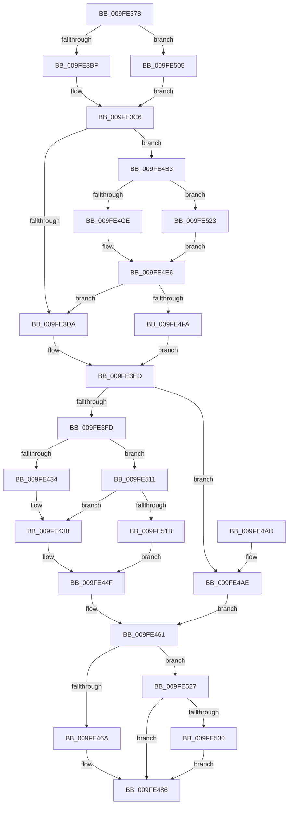

# MiIsUserQueryVmCallerTrusted

- RVA: `0x009FE378`–`0x009FE542` (길이 `458` bytes)
- VA: `0x00000001409FE378`
- 실행 섹션: `PAGE`
- PDB 이름 있음: `예`; PDB Function 태그: `아니요`
- unwind 정보 RVA: `0x000A7548`
- 디코드: `113`개 명령, `458/458` bytes 표시
- 미해석 바이트: `0` (있으면 어셈블리에 `.byte`로 보존)

> 이 문서는 커널 이미지의 기계어와 PDB 기호를 분석해 생성했습니다. 4번과 5번은 함수 원형과 자료형을 바이너리 사용 방식에서 추정한 C 해석이며 원본 소스 복구 결과는 아닙니다.

## 1. Dependencies

- 직접 호출 지점: **11**; 고유 호출 대상: **11**
- 직접 호출자로 확인된 함수: **1**
- RIP 상대 이미지 참조: **2**

### Outgoing calls
- `0x009FE3E2` → [PsReferencePrimaryTokenWithTag](../../text/20/PsReferencePrimaryTokenWithTag_function_0020FF80.md) (function, `0x0020FF80`)
- `0x009FE3F0` → [SeTokenIsAdmin](SeTokenIsAdmin_function_009FE650.md) (function, `0x009FE650`)
- `0x009FE422` → [SeCaptureSubjectContextEx](../8C/SeCaptureSubjectContextEx_function_008C4C90.md) (function, `0x008C4C90`)
- `0x009FE447` → [SepPrivilegeCheck](../../text/40/SepPrivilegeCheck_function_0040B6B0.md) (function, `0x0040B6B0`)
- `0x009FE453` → [SeReleaseSubjectContext](../86/SeReleaseSubjectContext_function_0086B710.md) (function, `0x0086B710`)
- `0x009FE481` → [ObFastDereferenceObject](../../text/3E/ObFastDereferenceObject_function_003ED5F0.md) (function, `0x003ED5F0`)
- `0x009FE48F` → [_security_check_cookie](../../text/6A/_security_check_cookie_function_006AC640.md) (function, `0x006AC640`)
- `0x009FE4BF` → [PspLockThreadSecurityShared](../../text/3C/PspLockThreadSecurityShared_function_003C4720.md) (function, `0x003C4720`)
- `0x009FE4E1` → [ObfReferenceObjectWithTag](../../text/21/ObfReferenceObjectWithTag_function_00210710.md) (function, `0x00210710`)
- `0x009FE4EC` → [PspUnlockThreadSecurityShared](../../text/3C/PspUnlockThreadSecurityShared_function_003C2E40.md) (function, `0x003C2E40`)
- `0x009FE538` → [ObfDereferenceObjectWithTag](../../text/2F/ObfDereferenceObjectWithTag_function_002F78E0.md) (function, `0x002F78E0`)

### Direct callers
- [MmQueryVirtualMemory](../9D/MmQueryVirtualMemory_function_009D9280.md) at `0x009D9440`

### Static image references
- `0x009FE391` → RVA `0x00E0A740` (`.data`; read)
- `0x009FE3FD` → RVA `0x00FD9B08` (`PAGEDATA`; read)

## 2. Other-region calls and transfers

- 다른 실행 섹션으로 향하는 call: **8**
  - `0x009FE3E2` → [PsReferencePrimaryTokenWithTag](../../text/20/PsReferencePrimaryTokenWithTag_function_0020FF80.md) (`PAGE` → `.text`)
  - `0x009FE447` → [SepPrivilegeCheck](../../text/40/SepPrivilegeCheck_function_0040B6B0.md) (`PAGE` → `.text`)
  - `0x009FE481` → [ObFastDereferenceObject](../../text/3E/ObFastDereferenceObject_function_003ED5F0.md) (`PAGE` → `.text`)
  - `0x009FE48F` → [_security_check_cookie](../../text/6A/_security_check_cookie_function_006AC640.md) (`PAGE` → `.text`)
  - `0x009FE4BF` → [PspLockThreadSecurityShared](../../text/3C/PspLockThreadSecurityShared_function_003C4720.md) (`PAGE` → `.text`)
  - `0x009FE4E1` → [ObfReferenceObjectWithTag](../../text/21/ObfReferenceObjectWithTag_function_00210710.md) (`PAGE` → `.text`)
  - `0x009FE4EC` → [PspUnlockThreadSecurityShared](../../text/3C/PspUnlockThreadSecurityShared_function_003C2E40.md) (`PAGE` → `.text`)
  - `0x009FE538` → [ObfDereferenceObjectWithTag](../../text/2F/ObfDereferenceObjectWithTag_function_002F78E0.md) (`PAGE` → `.text`)
- 별도 외부 분기/꼬리 이동을 확인하지 못했습니다.

## 3. Assembly (complete function range)

```asm
009FE378  48 89 5C 24 10                  mov qword ptr [rsp + 0x10], rbx
009FE37D  48 89 74 24 18                  mov qword ptr [rsp + 0x18], rsi
009FE382  55                              push rbp
009FE383  57                              push rdi
009FE384  41 54                           push r12
009FE386  41 56                           push r14
009FE388  41 57                           push r15
009FE38A  48 8B EC                        mov rbp, rsp
009FE38D  48 83 EC 70                     sub rsp, 0x70
009FE391  48 8B 05 A8 C3 40 00            mov rax, qword ptr [rip + 0x40c3a8]
009FE398  48 33 C4                        xor rax, rsp
009FE39B  48 89 45 F8                     mov qword ptr [rbp - 8], rax
009FE39F  65 48 8B 04 25 88 01 00 00      mov rax, qword ptr gs:[0x188]
009FE3A8  0F 57 C0                        xorps xmm0, xmm0
009FE3AB  48 8B F9                        mov rdi, rcx
009FE3AE  0F 11 45 C0                     movups xmmword ptr [rbp - 0x40], xmm0
009FE3B2  0F 11 45 D0                     movups xmmword ptr [rbp - 0x30], xmm0
009FE3B6  48 3B C8                        cmp rcx, rax
009FE3B9  0F 85 46 01 00 00               jne 0x1409fe505
009FE3BF  48 8B B0 B8 00 00 00            mov rsi, qword ptr [rax + 0xb8]
009FE3C6  8B 81 A0 05 00 00               mov eax, dword ptr [rcx + 0x5a0]
009FE3CC  41 BC 01 00 00 00               mov r12d, 1
009FE3D2  A8 08                           test al, 8
009FE3D4  0F 85 D9 00 00 00               jne 0x1409fe4b3
009FE3DA  BA 53 68 72 74                  mov edx, 0x74726853
009FE3DF  48 8B CE                        mov rcx, rsi
009FE3E2  E8 99 1B 81 FF                  call 0x14020ff80
009FE3E7  48 8B D8                        mov rbx, rax
009FE3EA  45 8B FC                        mov r15d, r12d
009FE3ED  48 8B CB                        mov rcx, rbx
009FE3F0  E8 5B 02 00 00                  call 0x1409fe650
009FE3F5  84 C0                           test al, al
009FE3F7  0F 85 B1 00 00 00               jne 0x1409fe4ae
009FE3FD  48 8B 05 04 B7 5D 00            mov rax, qword ptr [rip + 0x5db704]
009FE404  4C 8D 45 C0                     lea r8, [rbp - 0x40]
009FE408  48 8B 97 B8 00 00 00            mov rdx, qword ptr [rdi + 0xb8]
009FE40F  48 8B CF                        mov rcx, rdi
009FE412  83 65 F0 00                     and dword ptr [rbp - 0x10], 0
009FE416  48 89 45 E8                     mov qword ptr [rbp - 0x18], rax
009FE41A  44 89 65 E0                     mov dword ptr [rbp - 0x20], r12d
009FE41E  44 89 65 E4                     mov dword ptr [rbp - 0x1c], r12d
009FE422  E8 69 68 EC FF                  call 0x1408c4c90
009FE427  48 8B 4D C0                     mov rcx, qword ptr [rbp - 0x40]
009FE42B  48 85 C9                        test rcx, rcx
009FE42E  0F 85 DD 00 00 00               jne 0x1409fe511
009FE434  48 8B 4D D0                     mov rcx, qword ptr [rbp - 0x30]
009FE438  45 8B CC                        mov r9d, r12d
009FE43B  44 88 64 24 20                  mov byte ptr [rsp + 0x20], r12b
009FE440  45 8B C4                        mov r8d, r12d
009FE443  48 8D 55 E8                     lea rdx, [rbp - 0x18]
009FE447  E8 64 D2 A0 FF                  call 0x14040b6b0
009FE44C  44 8A F0                        mov r14b, al
009FE44F  48 8D 4D C0                     lea rcx, [rbp - 0x40]
009FE453  E8 B8 D2 E6 FF                  call 0x14086b710
009FE458  33 F6                           xor esi, esi
009FE45A  45 84 F6                        test r14b, r14b
009FE45D  40 0F 95 C6                     setne sil
009FE461  45 3B FC                        cmp r15d, r12d
009FE464  0F 85 BD 00 00 00               jne 0x1409fe527
009FE46A  48 8B 8F 20 02 00 00            mov rcx, qword ptr [rdi + 0x220]
009FE471  41 B8 53 68 72 74               mov r8d, 0x74726853
009FE477  48 81 C1 48 02 00 00            add rcx, 0x248
009FE47E  48 8B D3                        mov rdx, rbx
009FE481  E8 6A F1 9E FF                  call 0x1403ed5f0
009FE486  8B C6                           mov eax, esi
009FE488  48 8B 4D F8                     mov rcx, qword ptr [rbp - 8]
009FE48C  48 33 CC                        xor rcx, rsp
009FE48F  E8 AC E1 CA FF                  call 0x1406ac640
009FE494  4C 8D 5C 24 70                  lea r11, [rsp + 0x70]
009FE499  49 8B 5B 38                     mov rbx, qword ptr [r11 + 0x38]
009FE49D  49 8B 73 40                     mov rsi, qword ptr [r11 + 0x40]
009FE4A1  49 8B E3                        mov rsp, r11
009FE4A4  41 5F                           pop r15
009FE4A6  41 5E                           pop r14
009FE4A8  41 5C                           pop r12
009FE4AA  5F                              pop rdi
009FE4AB  5D                              pop rbp
009FE4AC  C3                              ret
009FE4AD  CC                              int3
009FE4AE  41 8B F4                        mov esi, r12d
009FE4B1  EB AE                           jmp 0x1409fe461
009FE4B3  65 4C 8B 34 25 88 01 00 00      mov r14, qword ptr gs:[0x188]
009FE4BC  49 8B D6                        mov rdx, r14
009FE4BF  E8 5C 62 9C FF                  call 0x1403c4720
009FE4C4  8B 87 A0 05 00 00               mov eax, dword ptr [rdi + 0x5a0]
009FE4CA  A8 08                           test al, 8
009FE4CC  74 55                           je 0x1409fe523
009FE4CE  48 8B 9F 38 05 00 00            mov rbx, qword ptr [rdi + 0x538]
009FE4D5  BA 53 68 72 74                  mov edx, 0x74726853
009FE4DA  48 83 E3 F8                     and rbx, 0xfffffffffffffff8
009FE4DE  48 8B CB                        mov rcx, rbx
009FE4E1  E8 2A 22 81 FF                  call 0x140210710
009FE4E6  49 8B D6                        mov rdx, r14
009FE4E9  48 8B CF                        mov rcx, rdi
009FE4EC  E8 4F 49 9C FF                  call 0x1403c2e40
009FE4F1  48 85 DB                        test rbx, rbx
009FE4F4  0F 84 E0 FE FF FF               je 0x1409fe3da
009FE4FA  41 BF 02 00 00 00               mov r15d, 2
009FE500  E9 E8 FE FF FF                  jmp 0x1409fe3ed
009FE505  48 8B B1 20 02 00 00            mov rsi, qword ptr [rcx + 0x220]
009FE50C  E9 B5 FE FF FF                  jmp 0x1409fe3c6
009FE511  83 7D C8 02                     cmp dword ptr [rbp - 0x38], 2
009FE515  0F 8D 1D FF FF FF               jge 0x1409fe438
009FE51B  45 32 F6                        xor r14b, r14b
009FE51E  E9 2C FF FF FF                  jmp 0x1409fe44f
009FE523  33 DB                           xor ebx, ebx
009FE525  EB BF                           jmp 0x1409fe4e6
009FE527  48 85 DB                        test rbx, rbx
009FE52A  0F 84 56 FF FF FF               je 0x1409fe486
009FE530  BA 53 68 72 74                  mov edx, 0x74726853
009FE535  48 8B CB                        mov rcx, rbx
009FE538  E8 A3 93 8F FF                  call 0x1402f78e0
009FE53D  E9 44 FF FF FF                  jmp 0x1409fe486
```

## 4. C-style interpretation (structured pseudocode)

```c
__int64 __fastcall MiIsUserQueryVmCallerTrusted(__int64 a1)
{
    __int64 result;
    __int64 v_r14;
    __int64 v_rbx;
    __int64 v_rsi;
    __int64 v_rsp;
    unsigned __int64 v_stack_m28;
    unsigned __int64 v_stack_m30;
    unsigned int v_stack_m38;
    unsigned __int64 v_stack_m40;
    unsigned int v_stack_m44;
    unsigned int v_stack_m48;
    unsigned __int64 v_stack_m58;
    unsigned int v_stack_m60;
    unsigned __int64 v_stack_m68;
    unsigned __int8 v_stack_m78;
    unsigned __int64 v_stack_p10;
    unsigned __int64 v_stack_p18;

    v_stack_p10 = v_rbx;
    v_stack_p18 = v_rsi;
    v_rsp = (v_rsp) - (112);
    result = (*(unsigned __int64 *)(v_rip + 4244392)) ^ (v_rsp);
    v_stack_m30 = result;
    v_stack_m68 = v_xmm0;
    v_stack_m58 = v_xmm0;
    if (a1 != (*(unsigned __int64 *)(gs_base + (0 + 392)))) goto loc_009FE505;
loc_009FE3C6:
    if ((((unsigned __int8)((unsigned int)(*(unsigned int *)(a1 + 1440)))) & (8)) != 0) goto loc_009FE4B3;
loc_009FE3DA:
    result = PsReferencePrimaryTokenWithTag(*(unsigned __int64 *)(*(unsigned __int64 *)(gs_base + (0 + 392)) + 184), (unsigned int)(0x74726853ULL), a3, a4);
loc_009FE3ED:
    result = SeTokenIsAdmin(result, (unsigned int)(0x74726853ULL), a3, a4);
    if ((unsigned __int8)(result) != 0) goto loc_009FE4AE;
    v_stack_m40 = *(unsigned __int64 *)(v_rip + 6141700);
    v_stack_m48 = 1;
    v_stack_m44 = 1;
    result = SeCaptureSubjectContextEx(a1, *(unsigned __int64 *)(a1 + 184), v_stack_m68, a4);
    if (v_stack_m68 != 0) goto loc_009FE511;
loc_009FE438:
    v_stack_m78 = 1;
    result = SepPrivilegeCheck(v_stack_m58, v_stack_m40, 1, 1);
loc_009FE44F:
    result = SeReleaseSubjectContext(v_stack_m68, v_stack_m40, 1, 1);
    v_rsi = 0;
    v_rsi = ((unsigned __int8)((unsigned __int8)(result)) != 0) ? 1 : 0;
loc_009FE461:
    if (1 != 1) goto loc_009FE527;
    a1 = (*(unsigned __int64 *)(a1 + 544)) + (584);
    result = ObFastDereferenceObject(a1, result, (unsigned int)(0x74726853ULL), 1);
loc_009FE486:
    a1 = (v_stack_m30) ^ (v_rsp);
    result = _security_check_cookie(a1, result, (unsigned int)(0x74726853ULL), 1);
    return result;
loc_009FE4AE:
    goto loc_009FE461;
loc_009FE4B3:
    result = PspLockThreadSecurityShared(a1, *(unsigned __int64 *)(gs_base + (0 + 392)), (unsigned int)(0x74726853ULL), 1);
    if ((((unsigned __int8)((unsigned int)(*(unsigned int *)(a1 + 1440)))) & (8)) == 0) goto loc_009FE523;
    v_rbx = (*(unsigned __int64 *)(a1 + 1336)) & (-8);
    result = ObfReferenceObjectWithTag(v_rbx, (unsigned int)(0x74726853ULL), (unsigned int)(0x74726853ULL), 1);
loc_009FE4E6:
    result = PspUnlockThreadSecurityShared(a1, *(unsigned __int64 *)(gs_base + (0 + 392)), (unsigned int)(0x74726853ULL), 1);
    if (v_rbx == 0) goto loc_009FE3DA;
    goto loc_009FE3ED;
loc_009FE505:
    goto loc_009FE3C6;
loc_009FE511:
    if (v_stack_m60 >= 2) goto loc_009FE438;
    v_r14 = 0;
    goto loc_009FE44F;
loc_009FE523:
    v_rbx = 0;
    goto loc_009FE4E6;
loc_009FE527:
    if (0 == 0) goto loc_009FE486;
    result = ObfDereferenceObjectWithTag(0, (unsigned int)(0x74726853ULL), (unsigned int)(0x74726853ULL), 1);
    goto loc_009FE486;
}
```

## 5. (Beta) C Style

```c
int64_t MiIsUserQueryVmCallerTrusted(void *Arg1)
{
    uint8_t *arg1 = (uint8_t *)Arg1;

    int64_t result;
    int64_t local_r14;
    int64_t local_rbx;
    int64_t local_rsi;
    int64_t local_rsp;
    uint64_t v_stack_m28;
    uint64_t v_stack_m30;
    uint32_t v_stack_m38;
    uint64_t v_stack_m40;
    uint32_t v_stack_m44;
    uint32_t v_stack_m48;
    uint64_t v_stack_m58;
    uint32_t v_stack_m60;
    uint64_t v_stack_m68;
    uint8_t v_stack_m78;
    uint64_t v_stack_p10;
    uint64_t v_stack_p18;

    v_stack_p10 = local_rbx;
    v_stack_p18 = local_rsi;
    local_rsp = (local_rsp) - (112);
    result = (*(uint64_t *)(v_rip + 0x40C3A8)) ^ (local_rsp);
    v_stack_m30 = result;
    v_stack_m68 = v_xmm0;
    v_stack_m58 = v_xmm0;
    if (Arg1 != (*(uint64_t *)(gs_base + (0 + 0x188)))) goto loc_009FE505;
loc_009FE3C6:
    if ((((uint8_t)((uint32_t)(*(uint32_t *)(arg1 + 0x5A0)))) & (8)) != 0) goto loc_009FE4B3;
loc_009FE3DA:
    result = PsReferencePrimaryTokenWithTag(*(uint64_t *)(*(uint64_t *)(gs_base + (0 + 0x188)) + 0xB8), (uint32_t)(0x74726853ULL), a3, a4);
loc_009FE3ED:
    result = SeTokenIsAdmin(result, (uint32_t)(0x74726853ULL), a3, a4);
    if ((uint8_t)(result) != 0) goto loc_009FE4AE;
    v_stack_m40 = *(uint64_t *)(v_rip + 0x5DB704);
    v_stack_m48 = 1;
    v_stack_m44 = 1;
    result = SeCaptureSubjectContextEx(Arg1, *(uint64_t *)(arg1 + 0xB8), v_stack_m68, a4);
    if (v_stack_m68 != 0) goto loc_009FE511;
loc_009FE438:
    v_stack_m78 = 1;
    result = SepPrivilegeCheck(v_stack_m58, v_stack_m40, 1, 1);
loc_009FE44F:
    result = SeReleaseSubjectContext(v_stack_m68, v_stack_m40, 1, 1);
    local_rsi = 0;
    local_rsi = ((uint8_t)((uint8_t)(result)) != 0) ? 1 : 0;
loc_009FE461:
    if (1 != 1) goto loc_009FE527;
    Arg1 = (*(uint64_t *)(arg1 + 0x220)) + (584);
    result = ObFastDereferenceObject(Arg1, result, (uint32_t)(0x74726853ULL), 1);
loc_009FE486:
    Arg1 = (v_stack_m30) ^ (local_rsp);
    result = _security_check_cookie(Arg1, result, (uint32_t)(0x74726853ULL), 1);
    return result;
loc_009FE4AE:
    goto loc_009FE461;
loc_009FE4B3:
    result = PspLockThreadSecurityShared(Arg1, *(uint64_t *)(gs_base + (0 + 0x188)), (uint32_t)(0x74726853ULL), 1);
    if ((((uint8_t)((uint32_t)(*(uint32_t *)(arg1 + 0x5A0)))) & (8)) == 0) goto loc_009FE523;
    local_rbx = (*(uint64_t *)(arg1 + 0x538)) & (-8);
    result = ObfReferenceObjectWithTag(local_rbx, (uint32_t)(0x74726853ULL), (uint32_t)(0x74726853ULL), 1);
loc_009FE4E6:
    result = PspUnlockThreadSecurityShared(Arg1, *(uint64_t *)(gs_base + (0 + 0x188)), (uint32_t)(0x74726853ULL), 1);
    if (local_rbx == 0) goto loc_009FE3DA;
    goto loc_009FE3ED;
loc_009FE505:
    goto loc_009FE3C6;
loc_009FE511:
    if (v_stack_m60 >= 2) goto loc_009FE438;
    local_r14 = 0;
    goto loc_009FE44F;
loc_009FE523:
    local_rbx = 0;
    goto loc_009FE4E6;
loc_009FE527:
    if (0 == 0) goto loc_009FE486;
    result = ObfDereferenceObjectWithTag(0, (uint32_t)(0x74726853ULL), (uint32_t)(0x74726853ULL), 1);
    goto loc_009FE486;
}
```

### 관측된 메모리 오프셋

구조체 형식이 확인되지 않은 접근은 인자 기준의 오프셋으로만 기록했습니다.

| 기준 인자 | 오프셋 표현 | 폭 (bit) | 접근 |
|---|---:|---:|---|
| `Arg1` | `+ 0xB8` | `64` | `R` |
| `Arg1` | `+ 0x220` | `64` | `R` |
| `Arg1` | `+ 0x538` | `64` | `R` |
| `Arg1` | `+ 0x5A0` | `32` | `R` |

## 6. Execution-region graph

[열기: 2D/3D 그래프와 함수 탐색 컨트롤 패널](../../../control-panel.html?section=page&rva=0x009FE378&view=graph)

- 2D 그래프는 위에서 아래로 흐르고, 3D 그래프는 빈 공간을 드래그해 회전합니다. Shift+드래그는 이동, 휠은 확대·축소, 함수 노드 선택은 대상 보고서 이동입니다.

### Static fallback


