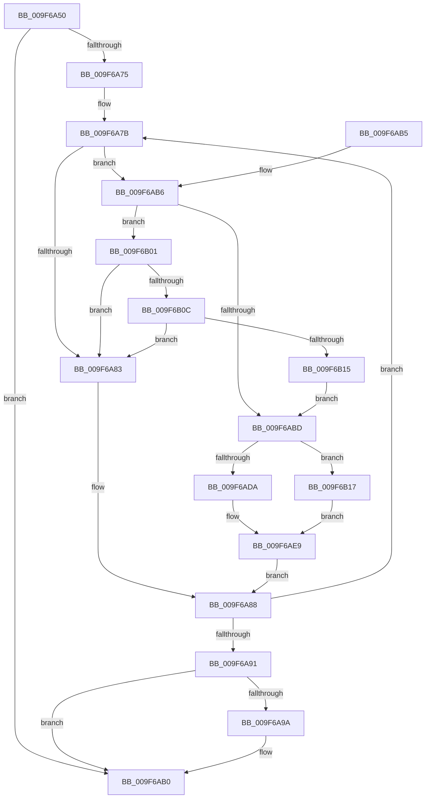

# MiPrefetchDriverPages

- RVA: `0x009F6A50`–`0x009F6B1E` (길이 `206` bytes)
- VA: `0x00000001409F6A50`
- 실행 섹션: `PAGE`
- PDB 이름 있음: `예`; PDB Function 태그: `아니요`
- unwind 정보 RVA: `0x000A6C64`
- 디코드: `52`개 명령, `206/206` bytes 표시
- 미해석 바이트: `0` (있으면 어셈블리에 `.byte`로 보존)

> 이 문서는 커널 이미지의 기계어와 PDB 기호를 분석해 생성했습니다. 4번과 5번은 함수 원형과 자료형을 바이너리 사용 방식에서 추정한 C 해석이며 원본 소스 복구 결과는 아닙니다.

## 1. Dependencies

- 직접 호출 지점: **2**; 고유 호출 대상: **2**
- 직접 호출자로 확인된 함수: **1**
- RIP 상대 이미지 참조: **0**

### Outgoing calls
- `0x009F6A5F` → [MiMakeDemandZeroPte](../../text/33/MiMakeDemandZeroPte_function_00337A00.md) (function, `0x00337A00`)
- `0x009F6AAB` → [MiPrefetchVirtualMemory](../../text/36/MiPrefetchVirtualMemory_function_0036C560.md) (function, `0x0036C560`)

### Direct callers
- [MiLockCode](../../text/36/MiLockCode_function_0036F91C.md) at `0x0036F9BF`

### Static image references
- 디코드된 RIP-relative 메모리 참조가 없습니다.

## 2. Other-region calls and transfers

- 다른 실행 섹션으로 향하는 call: **2**
  - `0x009F6A5F` → [MiMakeDemandZeroPte](../../text/33/MiMakeDemandZeroPte_function_00337A00.md) (`PAGE` → `.text`)
  - `0x009F6AAB` → [MiPrefetchVirtualMemory](../../text/36/MiPrefetchVirtualMemory_function_0036C560.md) (`PAGE` → `.text`)
- 별도 외부 분기/꼬리 이동을 확인하지 못했습니다.

## 3. Assembly (complete function range)

```asm
009F6A50  48 83 EC 38                     sub rsp, 0x38
009F6A54  4C 8B C1                        mov r8, rcx
009F6A57  4C 8B D2                        mov r10, rdx
009F6A5A  B9 04 00 00 00                  mov ecx, 4
009F6A5F  E8 9C 0F 94 FF                  call 0x140337a00
009F6A64  48 83 64 24 28 00               and qword ptr [rsp + 0x28], 0
009F6A6A  48 83 64 24 20 00               and qword ptr [rsp + 0x20], 0
009F6A70  4C 3B C2                        cmp r8, rdx
009F6A73  77 3B                           ja 0x1409f6ab0
009F6A75  41 BB 01 00 00 00               mov r11d, 1
009F6A7B  49 8B 08                        mov rcx, qword ptr [r8]
009F6A7E  41 84 CB                        test r11b, cl
009F6A81  74 33                           je 0x1409f6ab6
009F6A83  48 8B 4C 24 28                  mov rcx, qword ptr [rsp + 0x28]
009F6A88  49 83 C0 08                     add r8, 8
009F6A8C  4D 3B C2                        cmp r8, r10
009F6A8F  76 EA                           jbe 0x1409f6a7b
009F6A91  48 81 F9 00 10 00 00            cmp rcx, 0x1000
009F6A98  76 16                           jbe 0x1409f6ab0
009F6A9A  41 B9 2D 00 00 00               mov r9d, 0x2d
009F6AA0  48 8D 54 24 20                  lea rdx, [rsp + 0x20]
009F6AA5  4D 8B C3                        mov r8, r11
009F6AA8  49 8B CB                        mov rcx, r11
009F6AAB  E8 B0 5A 97 FF                  call 0x14036c560
009F6AB0  48 83 C4 38                     add rsp, 0x38
009F6AB4  C3                              ret
009F6AB5  CC                              int3
009F6AB6  48 0F BA E1 0A                  bt rcx, 0xa
009F6ABB  73 44                           jae 0x1409f6b01
009F6ABD  49 B9 00 00 00 00 80 F6 FF FF   movabs r9, 0xfffff68000000000
009F6AC7  49 8B C8                        mov rcx, r8
009F6ACA  49 C1 E1 19                     shl r9, 0x19
009F6ACE  48 C1 E1 19                     shl rcx, 0x19
009F6AD2  48 83 7C 24 28 00               cmp qword ptr [rsp + 0x28], 0
009F6AD8  75 3D                           jne 0x1409f6b17
009F6ADA  48 8B D1                        mov rdx, rcx
009F6ADD  49 2B D1                        sub rdx, r9
009F6AE0  48 C1 FA 10                     sar rdx, 0x10
009F6AE4  48 89 54 24 20                  mov qword ptr [rsp + 0x20], rdx
009F6AE9  49 2B C9                        sub rcx, r9
009F6AEC  48 81 C1 00 00 00 10            add rcx, 0x10000000
009F6AF3  48 C1 F9 10                     sar rcx, 0x10
009F6AF7  48 2B CA                        sub rcx, rdx
009F6AFA  48 89 4C 24 28                  mov qword ptr [rsp + 0x28], rcx
009F6AFF  EB 87                           jmp 0x1409f6a88
009F6B01  48 0F BA E1 0B                  bt rcx, 0xb
009F6B06  0F 82 77 FF FF FF               jb 0x1409f6a83
009F6B0C  48 3B C8                        cmp rcx, rax
009F6B0F  0F 84 6E FF FF FF               je 0x1409f6a83
009F6B15  EB A6                           jmp 0x1409f6abd
009F6B17  48 8B 54 24 20                  mov rdx, qword ptr [rsp + 0x20]
009F6B1C  EB CB                           jmp 0x1409f6ae9
```

## 4. C-style interpretation (structured pseudocode)

```c
__int64 __fastcall MiPrefetchDriverPages(__int64 a1, __int64 a2)
{
    __int64 result;
    __int64 v_rsp;
    unsigned __int64 v_stack_m10;
    unsigned __int64 v_stack_m18;
    unsigned __int64 v_stack_p20;
    unsigned __int64 v_stack_p28;

    v_rsp = (v_rsp) - (56);
    result = MiMakeDemandZeroPte(4, a2, a1, a4);
    if (a1 > a2) goto loc_009F6AB0;
loc_009F6A7B:
    if (((1) & ((unsigned __int8)(*(unsigned __int64 *)(a1)))) == 0) goto loc_009F6AB6;
loc_009F6A83:
loc_009F6A88:
    a3 = (a1) + (8);
    if (a3 <= a2) goto loc_009F6A7B;
    if (v_stack_m10 >= = 0x1000ULL) {
        a4 = 45;
        a2 = v_stack_m18;
        a3 = 1;
        a1 = 1;
        result = MiPrefetchVirtualMemory(a1, a2, a3, a4);
    }
    v_rsp = (v_rsp) + (56);
    return result;
loc_009F6AB6:
    if (condition_is_above_or_equal) goto loc_009F6B01;
loc_009F6ABD:
    a4 = (a4) << (25);
    a1 = (a3) << (25);
    if (v_stack_p28 != 0) goto loc_009F6B17;
    a2 = (a1) - (a4);
    a2 = (a2) >> (16);
    v_stack_p20 = a2;
loc_009F6AE9:
    a1 = (a1) - (a4);
    a1 = (a1) + (0x10000000ULL);
    a1 = (a1) >> (16);
    a1 = (a1) - (a2);
    v_stack_p28 = a1;
    goto loc_009F6A88;
loc_009F6B01:
    if (condition_is_below) goto loc_009F6A83;
    if (a1 == result) goto loc_009F6A83;
    goto loc_009F6ABD;
loc_009F6B17:
    goto loc_009F6AE9;
}
```

## 5. (Beta) C Style

```c
int64_t MiPrefetchDriverPages(int64_t Arg1, int64_t Arg2)
{
    int64_t result;
    int64_t local_rsp;
    uint64_t v_stack_m10;
    uint64_t v_stack_m18;
    uint64_t v_stack_p20;
    uint64_t v_stack_p28;

    local_rsp = (local_rsp) - (56);
    result = MiMakeDemandZeroPte(4, Arg2, Arg1, a4);
    if (Arg1 > Arg2) goto loc_009F6AB0;
loc_009F6A7B:
    if (((1) & ((uint8_t)(*(uint64_t *)(Arg1)))) == 0) goto loc_009F6AB6;
loc_009F6A83:
loc_009F6A88:
    a3 = (Arg1) + (8);
    if (a3 <= Arg2) goto loc_009F6A7B;
    if (v_stack_m10 >= = 0x1000ULL) {
        a4 = 45;
        Arg2 = v_stack_m18;
        a3 = 1;
        Arg1 = 1;
        result = MiPrefetchVirtualMemory(Arg1, Arg2, a3, a4);
    }
    local_rsp = (local_rsp) + (56);
    return result;
loc_009F6AB6:
    if (condition_is_above_or_equal) goto loc_009F6B01;
loc_009F6ABD:
    a4 = (a4) << (25);
    Arg1 = (a3) << (25);
    if (v_stack_p28 != 0) goto loc_009F6B17;
    Arg2 = (Arg1) - (a4);
    Arg2 = (Arg2) >> (16);
    v_stack_p20 = Arg2;
loc_009F6AE9:
    Arg1 = (Arg1) - (a4);
    Arg1 = (Arg1) + (0x10000000ULL);
    Arg1 = (Arg1) >> (16);
    Arg1 = (Arg1) - (Arg2);
    v_stack_p28 = Arg1;
    goto loc_009F6A88;
loc_009F6B01:
    if (condition_is_below) goto loc_009F6A83;
    if (Arg1 == result) goto loc_009F6A83;
    goto loc_009F6ABD;
loc_009F6B17:
    goto loc_009F6AE9;
}
```

## 6. Execution-region graph

[열기: 2D/3D 그래프와 함수 탐색 컨트롤 패널](../../../control-panel.html?section=page&rva=0x009F6A50&view=graph)

- 2D 그래프는 위에서 아래로 흐르고, 3D 그래프는 빈 공간을 드래그해 회전합니다. Shift+드래그는 이동, 휠은 확대·축소, 함수 노드 선택은 대상 보고서 이동입니다.

### Static fallback


