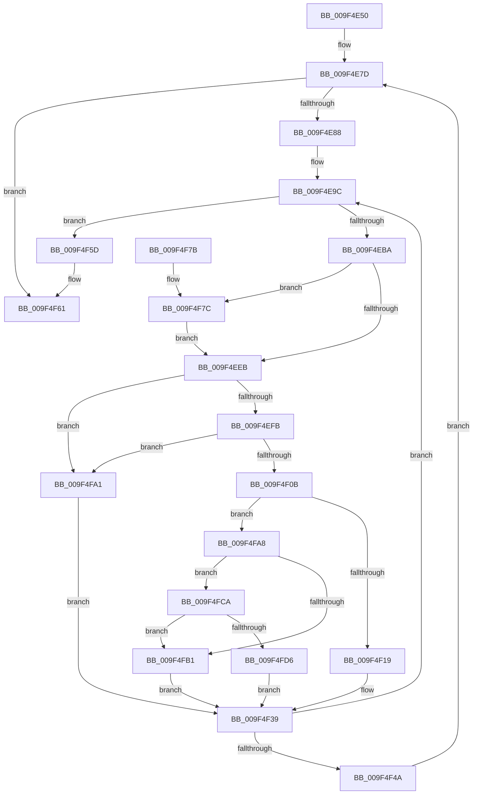

# MiProcessVaRangesInfoClass

- RVA: `0x009F4E50`–`0x009F4FE0` (길이 `400` bytes)
- VA: `0x00000001409F4E50`
- 실행 섹션: `PAGE`
- PDB 이름 있음: `예`; PDB Function 태그: `아니요`
- unwind 정보 RVA: `0x000A662C`
- 디코드: `109`개 명령, `400/400` bytes 표시
- 미해석 바이트: `0` (있으면 어셈블리에 `.byte`로 보존)

> 이 문서는 커널 이미지의 기계어와 PDB 기호를 분석해 생성했습니다. 4번과 5번은 함수 원형과 자료형을 바이너리 사용 방식에서 추정한 C 해석이며 원본 소스 복구 결과는 아닙니다.

## 1. Dependencies

- 직접 호출 지점: **6**; 고유 호출 대상: **6**
- 직접 호출자로 확인된 함수: **2**
- RIP 상대 이미지 참조: **0**

### Outgoing calls
- `0x009F4EA9` → [MiObtainReferencedVadEx](../../text/31/MiObtainReferencedVadEx_function_00316690.md) (function, `0x00316690`)
- `0x009F4EEE` → [MiVadSupportsPrivateCommit](../../text/31/MiVadSupportsPrivateCommit_function_00316FD0.md) (function, `0x00316FD0`)
- `0x009F4EFE` → [MiIsVadLarge](../../text/3F/MiIsVadLarge_function_003F0190.md) (function, `0x003F0190`)
- `0x009F4F34` → [MiWalkVaRange](../../text/24/MiWalkVaRange_function_00243BF0.md) (function, `0x00243BF0`)
- `0x009F4F3C` → [MiUnlockAndDereferenceVad](../../text/31/MiUnlockAndDereferenceVad_function_00316E60.md) (function, `0x00316E60`)
- `0x009F4FC0` → [MiMoveDirtyBitsToPfns](../../text/2A/MiMoveDirtyBitsToPfns_function_002A8624.md) (function, `0x002A8624`)

### Direct callers
- [MmSetPriorityVaRanges](MmSetPriorityVaRanges_function_009F455C.md) at `0x009F4569`
- [NtSetInformationVirtualMemory](NtSetInformationVirtualMemory_function_009F4580.md) at `0x009F4BAA`

### Static image references
- 디코드된 RIP-relative 메모리 참조가 없습니다.

## 2. Other-region calls and transfers

- 다른 실행 섹션으로 향하는 call: **6**
  - `0x009F4EA9` → [MiObtainReferencedVadEx](../../text/31/MiObtainReferencedVadEx_function_00316690.md) (`PAGE` → `.text`)
  - `0x009F4EEE` → [MiVadSupportsPrivateCommit](../../text/31/MiVadSupportsPrivateCommit_function_00316FD0.md) (`PAGE` → `.text`)
  - `0x009F4EFE` → [MiIsVadLarge](../../text/3F/MiIsVadLarge_function_003F0190.md) (`PAGE` → `.text`)
  - `0x009F4F34` → [MiWalkVaRange](../../text/24/MiWalkVaRange_function_00243BF0.md) (`PAGE` → `.text`)
  - `0x009F4F3C` → [MiUnlockAndDereferenceVad](../../text/31/MiUnlockAndDereferenceVad_function_00316E60.md) (`PAGE` → `.text`)
  - `0x009F4FC0` → [MiMoveDirtyBitsToPfns](../../text/2A/MiMoveDirtyBitsToPfns_function_002A8624.md) (`PAGE` → `.text`)
- 별도 외부 분기/꼬리 이동을 확인하지 못했습니다.

## 3. Assembly (complete function range)

```asm
009F4E50  48 8B C4                        mov rax, rsp
009F4E53  48 89 58 10                     mov qword ptr [rax + 0x10], rbx
009F4E57  44 89 48 20                     mov dword ptr [rax + 0x20], r9d
009F4E5B  44 89 40 18                     mov dword ptr [rax + 0x18], r8d
009F4E5F  48 89 48 08                     mov qword ptr [rax + 8], rcx
009F4E63  55                              push rbp
009F4E64  56                              push rsi
009F4E65  57                              push rdi
009F4E66  41 54                           push r12
009F4E68  41 55                           push r13
009F4E6A  41 56                           push r14
009F4E6C  41 57                           push r15
009F4E6E  48 83 EC 50                     sub rsp, 0x50
009F4E72  83 60 A8 00                     and dword ptr [rax - 0x58], 0
009F4E76  33 DB                           xor ebx, ebx
009F4E78  33 F6                           xor esi, esi
009F4E7A  48 8B EA                        mov rbp, rdx
009F4E7D  8B C6                           mov eax, esi
009F4E7F  48 3B C1                        cmp rax, rcx
009F4E82  0F 83 D9 00 00 00               jae 0x1409f4f61
009F4E88  0F 10 45 00                     movups xmm0, xmmword ptr [rbp]
009F4E8C  F3 0F 7F 44 24 38               movdqu xmmword ptr [rsp + 0x38], xmm0
009F4E92  4C 8B 64 24 40                  mov r12, qword ptr [rsp + 0x40]
009F4E97  4C 8B 7C 24 38                  mov r15, qword ptr [rsp + 0x38]
009F4E9C  4C 8D 44 24 30                  lea r8, [rsp + 0x30]
009F4EA1  33 D2                           xor edx, edx
009F4EA3  49 8B CF                        mov rcx, r15
009F4EA6  4D 8B F7                        mov r14, r15
009F4EA9  E8 E2 17 92 FF                  call 0x140316690
009F4EAE  48 8B F8                        mov rdi, rax
009F4EB1  48 85 C0                        test rax, rax
009F4EB4  0F 84 A3 00 00 00               je 0x1409f4f5d
009F4EBA  0F B6 48 21                     movzx ecx, byte ptr [rax + 0x21]
009F4EBE  4D 8D 54 24 FF                  lea r10, [r12 - 1]
009F4EC3  8B 40 1C                        mov eax, dword ptr [rax + 0x1c]
009F4EC6  4D 03 D7                        add r10, r15
009F4EC9  48 C1 E1 20                     shl rcx, 0x20
009F4ECD  BA FF 0F 00 00                  mov edx, 0xfff
009F4ED2  48 0B C8                        or rcx, rax
009F4ED5  4C 0B D2                        or r10, rdx
009F4ED8  49 8B C2                        mov rax, r10
009F4EDB  45 33 ED                        xor r13d, r13d
009F4EDE  48 C1 E8 0C                     shr rax, 0xc
009F4EE2  48 3B C1                        cmp rax, rcx
009F4EE5  0F 87 91 00 00 00               ja 0x1409f4f7c
009F4EEB  48 8B CF                        mov rcx, rdi
009F4EEE  E8 DD 20 92 FF                  call 0x140316fd0
009F4EF3  85 C0                           test eax, eax
009F4EF5  0F 84 A6 00 00 00               je 0x1409f4fa1
009F4EFB  48 8B CF                        mov rcx, rdi
009F4EFE  E8 8D B2 9F FF                  call 0x1403f0190
009F4F03  85 C0                           test eax, eax
009F4F05  0F 85 96 00 00 00               jne 0x1409f4fa1
009F4F0B  83 BC 24 A0 00 00 00 01         cmp dword ptr [rsp + 0xa0], 1
009F4F13  0F 85 8F 00 00 00               jne 0x1409f4fa8
009F4F19  8B 84 24 A8 00 00 00            mov eax, dword ptr [rsp + 0xa8]
009F4F20  41 B9 02 00 00 00               mov r9d, 2
009F4F26  4C 8B C7                        mov r8, rdi
009F4F29  48 89 44 24 20                  mov qword ptr [rsp + 0x20], rax
009F4F2E  49 8B D2                        mov rdx, r10
009F4F31  49 8B CE                        mov rcx, r14
009F4F34  E8 B7 EC 84 FF                  call 0x140243bf0
009F4F39  48 8B CF                        mov rcx, rdi
009F4F3C  E8 1F 1F 92 FF                  call 0x140316e60
009F4F41  45 85 ED                        test r13d, r13d
009F4F44  0F 85 52 FF FF FF               jne 0x1409f4e9c
009F4F4A  48 8B 8C 24 90 00 00 00         mov rcx, qword ptr [rsp + 0x90]
009F4F52  FF C6                           inc esi
009F4F54  48 83 C5 10                     add rbp, 0x10
009F4F58  E9 20 FF FF FF                  jmp 0x1409f4e7d
009F4F5D  8B 5C 24 30                     mov ebx, dword ptr [rsp + 0x30]
009F4F61  8B C3                           mov eax, ebx
009F4F63  48 8B 9C 24 98 00 00 00         mov rbx, qword ptr [rsp + 0x98]
009F4F6B  48 83 C4 50                     add rsp, 0x50
009F4F6F  41 5F                           pop r15
009F4F71  41 5E                           pop r14
009F4F73  41 5D                           pop r13
009F4F75  41 5C                           pop r12
009F4F77  5F                              pop rdi
009F4F78  5E                              pop rsi
009F4F79  5D                              pop rbp
009F4F7A  C3                              ret
009F4F7B  CC                              int3
009F4F7C  4C 8B D1                        mov r10, rcx
009F4F7F  49 8B C6                        mov rax, r14
009F4F82  49 C1 E2 0C                     shl r10, 0xc
009F4F86  49 FF CC                        dec r12
009F4F89  4C 0B D2                        or r10, rdx
009F4F8C  41 BD 01 00 00 00               mov r13d, 1
009F4F92  49 2B C2                        sub rax, r10
009F4F95  4C 03 E0                        add r12, rax
009F4F98  4D 8D 7A 01                     lea r15, [r10 + 1]
009F4F9C  E9 4A FF FF FF                  jmp 0x1409f4eeb
009F4FA1  BB 19 00 00 40                  mov ebx, 0x40000019
009F4FA6  EB 91                           jmp 0x1409f4f39
009F4FA8  8B 47 30                        mov eax, dword ptr [rdi + 0x30]
009F4FAB  0F BA E0 15                     bt eax, 0x15
009F4FAF  72 19                           jb 0x1409f4fca
009F4FB1  41 B9 02 00 00 00               mov r9d, 2
009F4FB7  45 33 C0                        xor r8d, r8d
009F4FBA  49 8B D2                        mov rdx, r10
009F4FBD  49 8B CE                        mov rcx, r14
009F4FC0  E8 5F 36 8B FF                  call 0x1402a8624
009F4FC5  E9 6F FF FF FF                  jmp 0x1409f4f39
009F4FCA  25 00 00 00 14                  and eax, 0x14000000
009F4FCF  3D 00 00 00 10                  cmp eax, 0x10000000
009F4FD4  75 DB                           jne 0x1409f4fb1
009F4FD6  BB BB 00 00 C0                  mov ebx, 0xc00000bb
009F4FDB  E9 59 FF FF FF                  jmp 0x1409f4f39
```

## 4. C-style interpretation (structured pseudocode)

```c
__int64 __fastcall MiProcessVaRangesInfoClass(__int64 a1, __int64 a2, int a3, int a4)
{
    __int64 result;
    __int64 v_r10;
    __int64 v_r12;
    __int64 v_r13;
    __int64 v_rbp;
    __int64 v_rbx;
    __int64 v_rsi;
    __int64 v_rsp;
    unsigned __int64 v_stack_m48;
    unsigned __int64 v_stack_m50;
    unsigned __int64 v_stack_m58;
    unsigned __int64 v_stack_m68;
    unsigned __int64 v_stack_p10;
    unsigned int v_stack_p18;
    unsigned int v_stack_p20;
    unsigned __int64 v_stack_p8;

    *(unsigned __int64 *)(v_rsp + 16) = v_rbx;
    *(unsigned int *)(v_rsp + 32) = a4;
    *(unsigned int *)(v_rsp + 24) = a3;
    *(unsigned __int64 *)(v_rsp + 8) = a1;
    v_rsp = (v_rsp) - (80);
    v_rbx = 0;
    v_rsi = 0;
loc_009F4E7D:
    if (0 >= a1) goto loc_009F4F61;
    v_stack_m50 = v_xmm0;
loc_009F4E9C:
    a2 = 0;
    result = MiObtainReferencedVadEx(v_stack_m50, a2, v_stack_m58, a4);
    if (result == 0) goto loc_009F4F5D;
    v_r10 = (v_stack_m48 - 1) + (v_stack_m50);
    a1 = (*(unsigned __int8 *)(result + 33)) << (32);
    a1 = (a1) | ((unsigned int)(*(unsigned int *)(result + 28)));
    v_r10 = (v_r10) | ((unsigned int)(0xFFFULL));
    v_r13 = 0;
    result = (v_r10) >> (12);
    if (result > a1) goto loc_009F4F7C;
loc_009F4EEB:
    result = MiVadSupportsPrivateCommit(result, (unsigned int)(0xFFFULL), v_stack_m58, a4);
    if ((unsigned int)(result) == 0) goto loc_009F4FA1;
    result = MiIsVadLarge(result, (unsigned int)(0xFFFULL), v_stack_m58, a4);
    if ((unsigned int)(result) != 0) goto loc_009F4FA1;
    if (v_stack_p18 != 1) goto loc_009F4FA8;
    v_stack_m68 = (unsigned int)(v_stack_p20);
    result = MiWalkVaRange(v_stack_m50, v_r10, result, 2);
loc_009F4F39:
    result = MiUnlockAndDereferenceVad(result, v_r10, result, 2);
    if (0 != 0) goto loc_009F4E9C;
    v_rsi = (unsigned int)((v_rsi) + 1);
    v_rbp = (a2) + (16);
    goto loc_009F4E7D;
loc_009F4F5D:
loc_009F4F61:
    v_rsp = (v_rsp) + (80);
    return (unsigned int)((unsigned int)((unsigned int)(v_stack_m58)));
loc_009F4F7C:
    v_r10 = (v_stack_p8) << (12);
    v_r12 = (v_stack_m48) - 1;
    v_r10 = (v_r10) | (v_r10);
    result = (v_stack_m50) - (v_r10);
    v_r12 = (v_r12) + (result);
    goto loc_009F4EEB;
loc_009F4FA1:
    goto loc_009F4F39;
loc_009F4FA8:
    if (condition_is_below) goto loc_009F4FCA;
loc_009F4FB1:
    a3 = 0;
    result = MiMoveDirtyBitsToPfns(v_stack_m50, v_r10, a3, 2);
    goto loc_009F4F39;
loc_009F4FCA:
    result = (unsigned int)((result) & (0x14000000ULL));
    if (((unsigned int)(result)) != 0x10000000ULL) goto loc_009F4FB1;
    goto loc_009F4F39;
}
```

## 5. (Beta) C Style

```c
int64_t MiProcessVaRangesInfoClass(int64_t Arg1, void *Arg2, int32_t Arg3, int32_t Arg4)
{
    uint8_t *arg2 = (uint8_t *)Arg2;

    int64_t result;
    int64_t local_r10;
    int64_t local_r12;
    int64_t local_r13;
    int64_t local_rbp;
    int64_t local_rbx;
    int64_t local_rsi;
    int64_t local_rsp;
    uint64_t v_stack_m48;
    uint64_t v_stack_m50;
    uint64_t v_stack_m58;
    uint64_t v_stack_m68;
    uint64_t v_stack_p10;
    uint32_t v_stack_p18;
    uint32_t v_stack_p20;
    uint64_t v_stack_p8;

    *(uint64_t *)(local_rsp + 0x10) = local_rbx;
    *(uint32_t *)(local_rsp + 0x20) = Arg4;
    *(uint32_t *)(local_rsp + 0x18) = Arg3;
    *(uint64_t *)(local_rsp + 0x8) = Arg1;
    local_rsp = (local_rsp) - (80);
    local_rbx = 0;
    local_rsi = 0;
loc_009F4E7D:
    if (0 >= Arg1) goto loc_009F4F61;
    v_stack_m50 = v_xmm0;
loc_009F4E9C:
    Arg2 = 0;
    result = MiObtainReferencedVadEx(v_stack_m50, Arg2, v_stack_m58, Arg4);
    if (result == 0) goto loc_009F4F5D;
    local_r10 = (v_stack_m48 - 1) + (v_stack_m50);
    Arg1 = (*(uint8_t *)(result + 0x21)) << (32);
    Arg1 = (Arg1) | ((uint32_t)(*(uint32_t *)(result + 0x1C)));
    local_r10 = (local_r10) | ((uint32_t)(0xFFFULL));
    local_r13 = 0;
    result = (local_r10) >> (12);
    if (result > Arg1) goto loc_009F4F7C;
loc_009F4EEB:
    result = MiVadSupportsPrivateCommit(result, (uint32_t)(0xFFFULL), v_stack_m58, Arg4);
    if ((uint32_t)(result) == 0) goto loc_009F4FA1;
    result = MiIsVadLarge(result, (uint32_t)(0xFFFULL), v_stack_m58, Arg4);
    if ((uint32_t)(result) != 0) goto loc_009F4FA1;
    if (v_stack_p18 != 1) goto loc_009F4FA8;
    v_stack_m68 = (uint32_t)(v_stack_p20);
    result = MiWalkVaRange(v_stack_m50, local_r10, result, 2);
loc_009F4F39:
    result = MiUnlockAndDereferenceVad(result, local_r10, result, 2);
    if (0 != 0) goto loc_009F4E9C;
    local_rsi = (uint32_t)((local_rsi) + 1);
    local_rbp = (Arg2) + (16);
    goto loc_009F4E7D;
loc_009F4F5D:
loc_009F4F61:
    local_rsp = (local_rsp) + (80);
    return (uint32_t)((uint32_t)((uint32_t)(v_stack_m58)));
loc_009F4F7C:
    local_r10 = (v_stack_p8) << (12);
    local_r12 = (v_stack_m48) - 1;
    local_r10 = (local_r10) | (local_r10);
    result = (v_stack_m50) - (local_r10);
    local_r12 = (local_r12) + (result);
    goto loc_009F4EEB;
loc_009F4FA1:
    goto loc_009F4F39;
loc_009F4FA8:
    if (condition_is_below) goto loc_009F4FCA;
loc_009F4FB1:
    Arg3 = 0;
    result = MiMoveDirtyBitsToPfns(v_stack_m50, local_r10, Arg3, 2);
    goto loc_009F4F39;
loc_009F4FCA:
    result = (uint32_t)((result) & (0x14000000ULL));
    if (((uint32_t)(result)) != 0x10000000ULL) goto loc_009F4FB1;
    goto loc_009F4F39;
}
```

### 관측된 메모리 오프셋

구조체 형식이 확인되지 않은 접근은 인자 기준의 오프셋으로만 기록했습니다.

| 기준 인자 | 오프셋 표현 | 폭 (bit) | 접근 |
|---|---:|---:|---|
| `Arg2` | `+ 0x0` | `128` | `R` |

## 6. Execution-region graph

[열기: 2D/3D 그래프와 함수 탐색 컨트롤 패널](../../../control-panel.html?section=page&rva=0x009F4E50&view=graph)

- 2D 그래프는 위에서 아래로 흐르고, 3D 그래프는 빈 공간을 드래그해 회전합니다. Shift+드래그는 이동, 휠은 확대·축소, 함수 노드 선택은 대상 보고서 이동입니다.

### Static fallback


