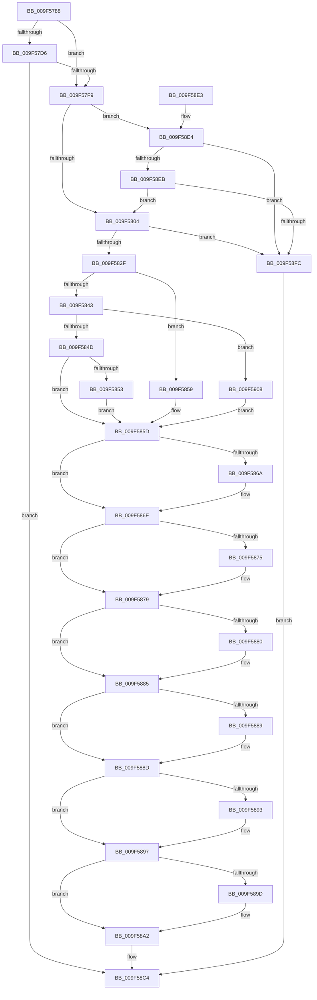

# MiSecureVad

- RVA: `0x009F5788`–`0x009F5911` (길이 `393` bytes)
- VA: `0x00000001409F5788`
- 실행 섹션: `PAGE`
- PDB 이름 있음: `예`; PDB Function 태그: `아니요`
- unwind 정보 RVA: `0x000A6968`
- 디코드: `105`개 명령, `393/393` bytes 표시
- 미해석 바이트: `0` (있으면 어셈블리에 `.byte`로 보존)

> 이 문서는 커널 이미지의 기계어와 PDB 기호를 분석해 생성했습니다. 4번과 5번은 함수 원형과 자료형을 바이너리 사용 방식에서 추정한 C 해석이며 원본 소스 복구 결과는 아닙니다.

## 1. Dependencies

- 직접 호출 지점: **6**; 고유 호출 대상: **6**
- 직접 호출자로 확인된 함수: **4**
- RIP 상대 이미지 참조: **0**

### Outgoing calls
- `0x009F57EC` → [MiComparePteProtections](../../text/44/MiComparePteProtections_function_0044F4FC.md) (function, `0x0044F4FC`)
- `0x009F5804` → [MmGetCurrentProcessorColor](../../text/41/MmGetCurrentProcessorColor_function_00418930.md) (function, `0x00418930`)
- `0x009F581E` → [ExAllocatePoolMm](../../text/35/ExAllocatePoolMm_function_0035B690.md) (function, `0x0035B690`)
- `0x009F58AB` → [MiInsertVadEvent](../../text/43/MiInsertVadEvent_function_00430E74.md) (function, `0x00430E74`)
- `0x009F58B9` → [MiSetVadFlags](../../text/43/MiSetVadFlags_function_004311FC.md) (function, `0x004311FC`)
- `0x009F58EE` → [MiLocateExclusiveSecure](../../text/48/MiLocateExclusiveSecure_function_0048C610.md) (function, `0x0048C610`)

### Direct callers
- [MiReserveUserMemory](../88/MiReserveUserMemory_function_00884498.md) at `0x008849B5`
- [sub_0088535F](../88/Unknown_function_0088535F.md) at `0x008855CA`
- [MmSecureVirtualMemoryEx](MmSecureVirtualMemoryEx_function_009F5620.md) at `0x009F5728`
- [sub_00B2A146](../B2/Unknown_function_00B2A146.md) at `0x00B2A3E2`

### Static image references
- 디코드된 RIP-relative 메모리 참조가 없습니다.

## 2. Other-region calls and transfers

- 다른 실행 섹션으로 향하는 call: **6**
  - `0x009F57EC` → [MiComparePteProtections](../../text/44/MiComparePteProtections_function_0044F4FC.md) (`PAGE` → `.text`)
  - `0x009F5804` → [MmGetCurrentProcessorColor](../../text/41/MmGetCurrentProcessorColor_function_00418930.md) (`PAGE` → `.text`)
  - `0x009F581E` → [ExAllocatePoolMm](../../text/35/ExAllocatePoolMm_function_0035B690.md) (`PAGE` → `.text`)
  - `0x009F58AB` → [MiInsertVadEvent](../../text/43/MiInsertVadEvent_function_00430E74.md) (`PAGE` → `.text`)
  - `0x009F58B9` → [MiSetVadFlags](../../text/43/MiSetVadFlags_function_004311FC.md) (`PAGE` → `.text`)
  - `0x009F58EE` → [MiLocateExclusiveSecure](../../text/48/MiLocateExclusiveSecure_function_0048C610.md) (`PAGE` → `.text`)
- 별도 외부 분기/꼬리 이동을 확인하지 못했습니다.

## 3. Assembly (complete function range)

```asm
009F5788  48 8B C4                        mov rax, rsp
009F578B  48 89 58 08                     mov qword ptr [rax + 8], rbx
009F578F  48 89 68 10                     mov qword ptr [rax + 0x10], rbp
009F5793  48 89 78 18                     mov qword ptr [rax + 0x18], rdi
009F5797  4C 89 60 20                     mov qword ptr [rax + 0x20], r12
009F579B  41 55                           push r13
009F579D  41 56                           push r14
009F579F  41 57                           push r15
009F57A1  48 83 EC 30                     sub rsp, 0x30
009F57A5  4C 8B 6C 24 78                  mov r13, qword ptr [rsp + 0x78]
009F57AA  4D 8D 78 FF                     lea r15, [r8 - 1]
009F57AE  4C 03 FA                        add r15, rdx
009F57B1  4C 8B F2                        mov r14, rdx
009F57B4  49 81 CF FF 0F 00 00            or r15, 0xfff
009F57BB  49 81 E6 00 F0 FF FF            and r14, 0xfffffffffffff000
009F57C2  45 8B E1                        mov r12d, r9d
009F57C5  41 8B F9                        mov edi, r9d
009F57C8  48 8B E9                        mov rbp, rcx
009F57CB  B8 04 00 00 00                  mov eax, 4
009F57D0  41 83 E4 01                     and r12d, 1
009F57D4  75 23                           jne 0x1409f57f9
009F57D6  44 8D 48 FD                     lea r9d, [rax - 3]
009F57DA  83 FF 02                        cmp edi, 2
009F57DD  4D 8B C7                        mov r8, r15
009F57E0  49 8B D6                        mov rdx, r14
009F57E3  44 0F 45 C8                     cmovne r9d, eax
009F57E7  44 21 64 24 20                  and dword ptr [rsp + 0x20], r12d
009F57EC  E8 0B 9D A5 FF                  call 0x14044f4fc
009F57F1  85 C0                           test eax, eax
009F57F3  0F 88 CB 00 00 00               js 0x1409f58c4
009F57F9  8B 45 30                        mov eax, dword ptr [rbp + 0x30]
009F57FC  A8 08                           test al, 8
009F57FE  0F 85 E0 00 00 00               jne 0x1409f58e4
009F5804  E8 27 31 A2 FF                  call 0x140418930
009F5809  BA 58 00 00 00                  mov edx, 0x58
009F580E  0F BA E8 1F                     bts eax, 0x1f
009F5812  44 8B C8                        mov r9d, eax
009F5815  41 B8 4D 6D 53 65               mov r8d, 0x65536d4d
009F581B  8D 4A E8                        lea ecx, [rdx - 0x18]
009F581E  E8 6D 5E 96 FF                  call 0x14035b690
009F5823  48 8B D8                        mov rbx, rax
009F5826  48 85 C0                        test rax, rax
009F5829  0F 84 CD 00 00 00               je 0x1409f58fc
009F582F  C7 40 50 02 00 00 00            mov dword ptr [rax + 0x50], 2
009F5836  4C 89 70 08                     mov qword ptr [rax + 8], r14
009F583A  4C 89 78 10                     mov qword ptr [rax + 0x10], r15
009F583E  45 85 E4                        test r12d, r12d
009F5841  75 16                           jne 0x1409f5859
009F5843  40 F6 C7 04                     test dil, 4
009F5847  0F 85 BB 00 00 00               jne 0x1409f5908
009F584D  40 F6 C7 02                     test dil, 2
009F5851  74 0A                           je 0x1409f585d
009F5853  83 48 08 09                     or dword ptr [rax + 8], 9
009F5857  EB 04                           jmp 0x1409f585d
009F5859  83 48 08 08                     or dword ptr [rax + 8], 8
009F585D  41 BE 01 00 00 00               mov r14d, 1
009F5863  44 84 74 24 70                  test byte ptr [rsp + 0x70], r14b
009F5868  74 04                           je 0x1409f586e
009F586A  83 48 08 20                     or dword ptr [rax + 8], 0x20
009F586E  F6 44 24 70 04                  test byte ptr [rsp + 0x70], 4
009F5873  74 04                           je 0x1409f5879
009F5875  83 48 08 40                     or dword ptr [rax + 8], 0x40
009F5879  F6 44 24 70 08                  test byte ptr [rsp + 0x70], 8
009F587E  74 05                           je 0x1409f5885
009F5880  0F BA 68 08 07                  bts dword ptr [rax + 8], 7
009F5885  85 FF                           test edi, edi
009F5887  79 04                           jns 0x1409f588d
009F5889  83 48 08 04                     or dword ptr [rax + 8], 4
009F588D  0F BA E7 1E                     bt edi, 0x1e
009F5891  73 04                           jae 0x1409f5897
009F5893  83 48 08 10                     or dword ptr [rax + 8], 0x10
009F5897  0F BA E7 1D                     bt edi, 0x1d
009F589B  73 05                           jae 0x1409f58a2
009F589D  0F BA 68 08 08                  bts dword ptr [rax + 8], 8
009F58A2  45 8B C6                        mov r8d, r14d
009F58A5  48 8B D3                        mov rdx, rbx
009F58A8  48 8B CD                        mov rcx, rbp
009F58AB  E8 C4 B5 A3 FF                  call 0x140430e74
009F58B0  45 8B C6                        mov r8d, r14d
009F58B3  41 8B D6                        mov edx, r14d
009F58B6  48 8B CD                        mov rcx, rbp
009F58B9  E8 3E B9 A3 FF                  call 0x1404311fc
009F58BE  33 C0                           xor eax, eax
009F58C0  49 89 5D 00                     mov qword ptr [r13], rbx
009F58C4  48 8B 5C 24 50                  mov rbx, qword ptr [rsp + 0x50]
009F58C9  48 8B 6C 24 58                  mov rbp, qword ptr [rsp + 0x58]
009F58CE  48 8B 7C 24 60                  mov rdi, qword ptr [rsp + 0x60]
009F58D3  4C 8B 64 24 68                  mov r12, qword ptr [rsp + 0x68]
009F58D8  48 83 C4 30                     add rsp, 0x30
009F58DC  41 5F                           pop r15
009F58DE  41 5E                           pop r14
009F58E0  41 5D                           pop r13
009F58E2  C3                              ret
009F58E3  CC                              int3
009F58E4  F6 44 24 70 01                  test byte ptr [rsp + 0x70], 1
009F58E9  75 11                           jne 0x1409f58fc
009F58EB  48 8B CD                        mov rcx, rbp
009F58EE  E8 1D 6D A9 FF                  call 0x14048c610
009F58F3  48 85 C0                        test rax, rax
009F58F6  0F 84 08 FF FF FF               je 0x1409f5804
009F58FC  49 83 65 00 00                  and qword ptr [r13], 0
009F5901  B8 9A 00 00 C0                  mov eax, 0xc000009a
009F5906  EB BC                           jmp 0x1409f58c4
009F5908  83 48 08 0A                     or dword ptr [rax + 8], 0xa
009F590C  E9 4C FF FF FF                  jmp 0x1409f585d
```

## 4. C-style interpretation (structured pseudocode)

```c
__int64 __fastcall MiSecureVad(__int64 a1, __int64 a2, __int64 a3, int a4, unsigned __int8 a5, __int64 a6)
{
    __int64 result;
    __int64 v_r12;
    __int64 v_r14;
    __int64 v_r15;
    __int64 v_rsp;
    unsigned int v_stack_m28;
    unsigned __int64 v_stack_p10;
    unsigned __int64 v_stack_p18;
    unsigned __int64 v_stack_p20;
    unsigned __int8 v_stack_p28;
    unsigned __int64 v_stack_p8;

    *(unsigned __int64 *)(v_rsp + 8) = v_rbx;
    *(unsigned __int64 *)(v_rsp + 16) = v_rbp;
    *(unsigned __int64 *)(v_rsp + 24) = v_rdi;
    *(unsigned __int64 *)(v_rsp + 32) = v_r12;
    v_rsp = (v_rsp) - (48);
    v_r15 = (a3 - 1) + (a2);
    v_r15 = (v_r15) | (0xFFFULL);
    v_r14 = (a2) & (0xFFFFFFFFFFFFF000ULL);
    v_r12 = (unsigned int)(((unsigned int)(a4)) & (1));
    if (condition_is_not_equal) goto loc_009F57F9;
    a4 = 4 - 3;
    if (((unsigned int)((unsigned int)(a4))) != 2) { a4 = 4; }
    result = MiComparePteProtections(a1, v_r14, v_r15, a4);
    if (sign_flag) goto loc_009F58C4;
loc_009F57F9:
    if ((((unsigned __int8)((unsigned int)(*(unsigned int *)(a1 + 48)))) & (8)) != 0) goto loc_009F58E4;
loc_009F5804:
    result = MmGetCurrentProcessorColor(a1, v_r14, v_r15, a4);
    result = ExAllocatePoolMm(88 - 24, 88, (unsigned int)(0x65536D4DULL), (unsigned int)((unsigned int)(result)));
    if (result == 0) goto loc_009F58FC;
    *(unsigned int *)(result + 80) = 2;
    *(unsigned __int64 *)(result + 8) = v_r14;
    *(unsigned __int64 *)(result + 16) = v_r15;
    if ((unsigned int)(v_r12) != 0) goto loc_009F5859;
    if ((((unsigned __int8)((unsigned int)(a4))) & (4)) != 0) goto loc_009F5908;
    if ((((unsigned __int8)((unsigned int)(a4))) & (2)) == 0) goto loc_009F585D;
    goto loc_009F585D;
loc_009F5859:
loc_009F585D:
    if (((v_stack_p28) & (1)) != 0) {
    }
    if (((a5) & (4)) != 0) {
    }
    if (((a5) & (8)) != 0) {
    }
    if (sign_flag) {
    }
    if (!(condition_is_above_or_equal)) {
    }
    if (!(condition_is_above_or_equal)) {
    }
    result = MiInsertVadEvent(a1, result, 1, (unsigned int)((unsigned int)(result)));
    result = MiSetVadFlags(a1, 1, 1, (unsigned int)((unsigned int)(result)));
    result = 0;
    *(unsigned __int64 *)(a6) = 0;
loc_009F58C4:
    v_rsp = (v_rsp) + (48);
    return result;
loc_009F58E4:
    if (((a5) & (1)) != 0) goto loc_009F58FC;
    result = MiLocateExclusiveSecure(v_stack_p10, 1, 1, (unsigned int)((unsigned int)(result)));
    if (result == 0) goto loc_009F5804;
loc_009F58FC:
    goto loc_009F58C4;
loc_009F5908:
    goto loc_009F585D;
}
```

## 5. (Beta) C Style

```c
int64_t MiSecureVad(void *Arg1, int64_t Arg2, void *Arg3, int32_t Arg4, uint8_t Arg5, void *Arg6)
{
    uint8_t *arg1 = (uint8_t *)Arg1;
    uint8_t *arg3 = (uint8_t *)Arg3;
    uint8_t *arg6 = (uint8_t *)Arg6;

    int64_t result;
    int64_t local_r12;
    int64_t local_r14;
    int64_t local_r15;
    int64_t local_rsp;
    uint32_t v_stack_m28;
    uint64_t v_stack_p10;
    uint64_t v_stack_p18;
    uint64_t v_stack_p20;
    uint8_t v_stack_p28;
    uint64_t v_stack_p8;

    *(uint64_t *)(local_rsp + 0x8) = local_rbx;
    *(uint64_t *)(local_rsp + 0x10) = local_rbp;
    *(uint64_t *)(local_rsp + 0x18) = local_rdi;
    *(uint64_t *)(local_rsp + 0x20) = local_r12;
    local_rsp = (local_rsp) - (48);
    local_r15 = (Arg3 - 1) + (Arg2);
    local_r15 = (local_r15) | (0xFFFULL);
    local_r14 = (Arg2) & (0xFFFFFFFFFFFFF000ULL);
    local_r12 = (uint32_t)(((uint32_t)(Arg4)) & (1));
    if (condition_is_not_equal) goto loc_009F57F9;
    Arg4 = 4 - 3;
    if (((uint32_t)((uint32_t)(Arg4))) != 2) { Arg4 = 4; }
    result = MiComparePteProtections(Arg1, local_r14, local_r15, Arg4);
    if (sign_flag) goto loc_009F58C4;
loc_009F57F9:
    if ((((uint8_t)((uint32_t)(*(uint32_t *)(arg1 + 0x30)))) & (8)) != 0) goto loc_009F58E4;
loc_009F5804:
    result = MmGetCurrentProcessorColor(Arg1, local_r14, local_r15, Arg4);
    result = ExAllocatePoolMm(88 - 24, 88, (uint32_t)(0x65536D4DULL), (uint32_t)((uint32_t)(result)));
    if (result == 0) goto loc_009F58FC;
    *(uint32_t *)(result + 0x50) = 2;
    *(uint64_t *)(result + 0x8) = local_r14;
    *(uint64_t *)(result + 0x10) = local_r15;
    if ((uint32_t)(local_r12) != 0) goto loc_009F5859;
    if ((((uint8_t)((uint32_t)(Arg4))) & (4)) != 0) goto loc_009F5908;
    if ((((uint8_t)((uint32_t)(Arg4))) & (2)) == 0) goto loc_009F585D;
    goto loc_009F585D;
loc_009F5859:
loc_009F585D:
    if (((v_stack_p28) & (1)) != 0) {
    }
    if (((Arg5) & (4)) != 0) {
    }
    if (((Arg5) & (8)) != 0) {
    }
    if (sign_flag) {
    }
    if (!(condition_is_above_or_equal)) {
    }
    if (!(condition_is_above_or_equal)) {
    }
    result = MiInsertVadEvent(Arg1, result, 1, (uint32_t)((uint32_t)(result)));
    result = MiSetVadFlags(Arg1, 1, 1, (uint32_t)((uint32_t)(result)));
    result = 0;
    *(uint64_t *)(arg6) = 0;
loc_009F58C4:
    local_rsp = (local_rsp) + (48);
    return result;
loc_009F58E4:
    if (((Arg5) & (1)) != 0) goto loc_009F58FC;
    result = MiLocateExclusiveSecure(v_stack_p10, 1, 1, (uint32_t)((uint32_t)(result)));
    if (result == 0) goto loc_009F5804;
loc_009F58FC:
    goto loc_009F58C4;
loc_009F5908:
    goto loc_009F585D;
}
```

### 관측된 메모리 오프셋

구조체 형식이 확인되지 않은 접근은 인자 기준의 오프셋으로만 기록했습니다.

| 기준 인자 | 오프셋 표현 | 폭 (bit) | 접근 |
|---|---:|---:|---|
| `Arg1` | `+ 0x30` | `32` | `R` |
| `Arg3` | `- 0x1` | `64` | `R` |
| `Arg6` | `+ 0x0` | `64` | `R/W` |
| `Arg6` | `+ 0x0` | `64` | `W` |

## 6. Execution-region graph

[열기: 2D/3D 그래프와 함수 탐색 컨트롤 패널](../../../control-panel.html?section=page&rva=0x009F5788&view=graph)

- 2D 그래프는 위에서 아래로 흐르고, 3D 그래프는 빈 공간을 드래그해 회전합니다. Shift+드래그는 이동, 휠은 확대·축소, 함수 노드 선택은 대상 보고서 이동입니다.

### Static fallback


