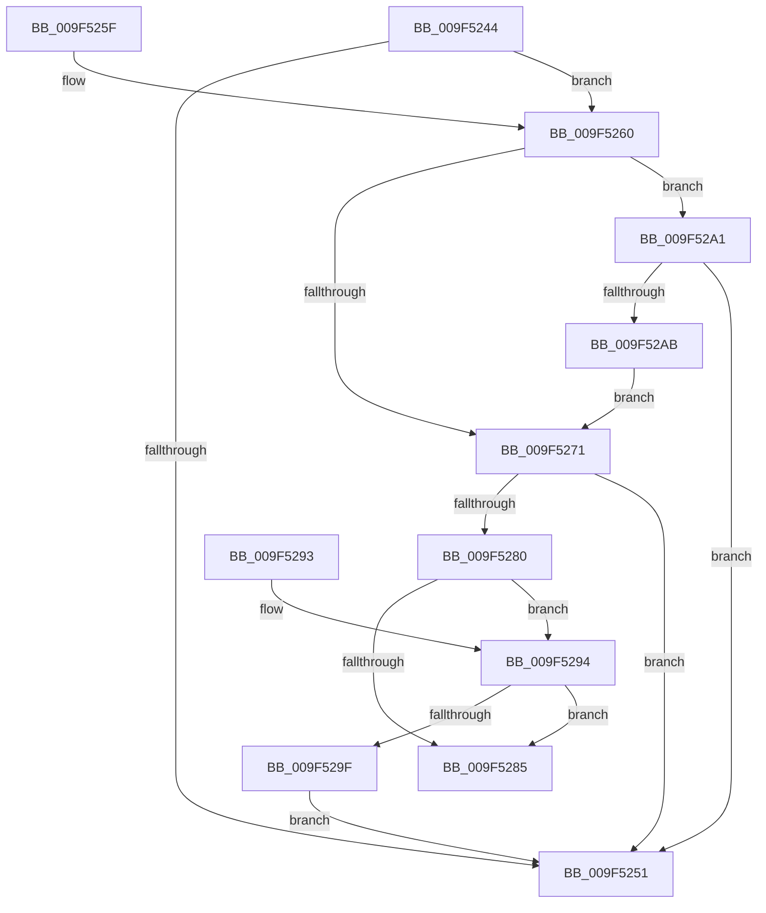

# MiSelectCfgBitMap

- RVA: `0x009F5244`–`0x009F52AD` (길이 `105` bytes)
- VA: `0x00000001409F5244`
- 실행 섹션: `PAGE`
- PDB 이름 있음: `예`; PDB Function 태그: `아니요`
- unwind 정보 RVA: `0x000DB714`
- 디코드: `28`개 명령, `105/105` bytes 표시
- 미해석 바이트: `0` (있으면 어셈블리에 `.byte`로 보존)

> 이 문서는 커널 이미지의 기계어와 PDB 기호를 분석해 생성했습니다. 4번과 5번은 함수 원형과 자료형을 바이너리 사용 방식에서 추정한 C 해석이며 원본 소스 복구 결과는 아닙니다.

## 1. Dependencies

- 직접 호출 지점: **0**; 고유 호출 대상: **0**
- 직접 호출자로 확인된 함수: **2**
- RIP 상대 이미지 참조: **0**

### Outgoing calls
- 직접 디코드된 call 명령이 없습니다.

### Direct callers
- [MiProcessPatchImageCfg](../80/MiProcessPatchImageCfg_function_00806F9C.md) at `0x008070B2`
- [MiCfgMarkValidEntries](MiCfgMarkValidEntries_function_009F4FE8.md) at `0x009F5074`

### Static image references
- 디코드된 RIP-relative 메모리 참조가 없습니다.

## 2. Other-region calls and transfers

- 다른 실행 섹션으로 향하는 call: **0**
- 별도 외부 분기/꼬리 이동을 확인하지 못했습니다.

## 3. Assembly (complete function range)

```asm
009F5244  48 83 B9 10 03 00 00 00         cmp qword ptr [rcx + 0x310], 0
009F524C  4C 8B C9                        mov r9, rcx
009F524F  75 0F                           jne 0x1409f5260
009F5251  49 8B 81 10 04 00 00            mov rax, qword ptr [r9 + 0x410]
009F5258  48 05 A0 04 00 00               add rax, 0x4a0
009F525E  C3                              ret
009F525F  CC                              int3
009F5260  0F B7 81 EC 06 00 00            movzx eax, word ptr [rcx + 0x6ec]
009F5267  B9 4C 01 00 00                  mov ecx, 0x14c
009F526C  66 3B C1                        cmp ax, cx
009F526F  75 30                           jne 0x1409f52a1
009F5271  48 B8 00 00 00 00 01 00 00 00   movabs rax, 0x100000000
009F527B  48 3B D0                        cmp rdx, rax
009F527E  73 D1                           jae 0x1409f5251
009F5280  4D 85 C0                        test r8, r8
009F5283  75 0F                           jne 0x1409f5294
009F5285  49 8B 81 10 04 00 00            mov rax, qword ptr [r9 + 0x410]
009F528C  48 05 C0 04 00 00               add rax, 0x4c0
009F5292  C3                              ret
009F5293  CC                              int3
009F5294  49 8B 00                        mov rax, qword ptr [r8]
009F5297  66 0F BA 60 0C 0F               bt word ptr [rax + 0xc], 0xf
009F529D  72 E6                           jb 0x1409f5285
009F529F  EB B0                           jmp 0x1409f5251
009F52A1  B9 C4 01 00 00                  mov ecx, 0x1c4
009F52A6  66 3B C1                        cmp ax, cx
009F52A9  75 A6                           jne 0x1409f5251
009F52AB  EB C4                           jmp 0x1409f5271
```

## 4. C-style interpretation (structured pseudocode)

```c
__int64 __fastcall MiSelectCfgBitMap(__int64 a1, __int64 a2, __int64 a3)
{
    __int64 result;

    if ((*(unsigned __int64 *)(a1 + 784)) != 0) goto loc_009F5260;
loc_009F5251:
    result = (*(unsigned __int64 *)(a1 + 1040)) + (0x4A0ULL);
    return result;
loc_009F5260:
    if (((unsigned __int16)(*(unsigned __int16 *)(a1 + 1772))) != 332) goto loc_009F52A1;
loc_009F5271:
    if (a2 >= (*(unsigned __int16 *)(a1 + 1772))) goto loc_009F5251;
    if (a3 != 0) goto loc_009F5294;
loc_009F5285:
    result = (*(unsigned __int64 *)(a1 + 1040)) + (0x4C0ULL);
    return result;
loc_009F5294:
    if (condition_is_below) goto loc_009F5285;
    goto loc_009F5251;
loc_009F52A1:
    if (((unsigned __int16)(*(unsigned __int64 *)(a3))) != 452) goto loc_009F5251;
    goto loc_009F5271;
}
```

## 5. (Beta) C Style

```c
int64_t MiSelectCfgBitMap(void *Arg1, int64_t Arg2, int64_t Arg3)
{
    uint8_t *arg1 = (uint8_t *)Arg1;

    int64_t result;

    if ((*(uint64_t *)(arg1 + 0x310)) != 0) goto loc_009F5260;
loc_009F5251:
    result = (*(uint64_t *)(arg1 + 0x410)) + (0x4A0ULL);
    return result;
loc_009F5260:
    if (((uint16_t)(*(uint16_t *)(arg1 + 0x6EC))) != 332) goto loc_009F52A1;
loc_009F5271:
    if (Arg2 >= (*(uint16_t *)(arg1 + 0x6EC))) goto loc_009F5251;
    if (Arg3 != 0) goto loc_009F5294;
loc_009F5285:
    result = (*(uint64_t *)(arg1 + 0x410)) + (0x4C0ULL);
    return result;
loc_009F5294:
    if (condition_is_below) goto loc_009F5285;
    goto loc_009F5251;
loc_009F52A1:
    if (((uint16_t)(*(uint64_t *)(Arg3))) != 452) goto loc_009F5251;
    goto loc_009F5271;
}
```

### 관측된 메모리 오프셋

구조체 형식이 확인되지 않은 접근은 인자 기준의 오프셋으로만 기록했습니다.

| 기준 인자 | 오프셋 표현 | 폭 (bit) | 접근 |
|---|---:|---:|---|
| `Arg1` | `+ 0x310` | `64` | `R` |
| `Arg1` | `+ 0x410` | `64` | `R` |
| `Arg1` | `+ 0x6EC` | `16` | `R` |

## 6. Execution-region graph

[열기: 2D/3D 그래프와 함수 탐색 컨트롤 패널](../../../control-panel.html?section=page&rva=0x009F5244&view=graph)

- 2D 그래프는 위에서 아래로 흐르고, 3D 그래프는 빈 공간을 드래그해 회전합니다. Shift+드래그는 이동, 휠은 확대·축소, 함수 노드 선택은 대상 보고서 이동입니다.

### Static fallback


