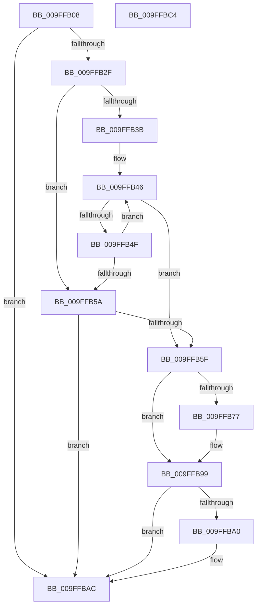

# MmBuildLargePages

- RVA: `0x009FFB08`–`0x009FFBC5` (길이 `189` bytes)
- VA: `0x00000001409FFB08`
- 실행 섹션: `PAGE`
- PDB 이름 있음: `예`; PDB Function 태그: `아니요`
- unwind 정보 RVA: `0x000A7960`
- 디코드: `53`개 명령, `189/189` bytes 표시
- 미해석 바이트: `0` (있으면 어셈블리에 `.byte`로 보존)

> 이 문서는 커널 이미지의 기계어와 PDB 기호를 분석해 생성했습니다. 4번과 5번은 함수 원형과 자료형을 바이너리 사용 방식에서 추정한 C 해석이며 원본 소스 복구 결과는 아닙니다.

## 1. Dependencies

- 직접 호출 지점: **4**; 고유 호출 대상: **4**
- 직접 호출자로 확인된 함수: **1**
- RIP 상대 이미지 참조: **2**

### Outgoing calls
- `0x009FFB2F` → [MiGetLargestPageIndex](../../text/49/MiGetLargestPageIndex_function_0049F730.md) (function, `0x0049F730`)
- `0x009FFB6A` → [MiPartitionObjectToPartition](../../text/3E/MiPartitionObjectToPartition_function_003EAB0C.md) (function, `0x003EAB0C`)
- `0x009FFB8D` → [MiRebuildLargePage](../../text/3B/MiRebuildLargePage_function_003BBAEC.md) (function, `0x003BBAEC`)
- `0x009FFBA7` → [PsDereferencePartition](../../text/34/PsDereferencePartition_function_00342E70.md) (function, `0x00342E70`)

### Direct callers
- [VmpAccessFaultBatchResolve](VmpAccessFaultBatchResolve_function_009FF710.md) at `0x009FF96E`

### Static image references
- `0x009FFB22` → RVA `0x00FC5000` (`ALMOSTRO`; read)
- `0x009FFB3B` → RVA `0x00011C60` (`.rdata`; read)

## 2. Other-region calls and transfers

- 다른 실행 섹션으로 향하는 call: **4**
  - `0x009FFB2F` → [MiGetLargestPageIndex](../../text/49/MiGetLargestPageIndex_function_0049F730.md) (`PAGE` → `.text`)
  - `0x009FFB6A` → [MiPartitionObjectToPartition](../../text/3E/MiPartitionObjectToPartition_function_003EAB0C.md) (`PAGE` → `.text`)
  - `0x009FFB8D` → [MiRebuildLargePage](../../text/3B/MiRebuildLargePage_function_003BBAEC.md) (`PAGE` → `.text`)
  - `0x009FFBA7` → [PsDereferencePartition](../../text/34/PsDereferencePartition_function_00342E70.md) (`PAGE` → `.text`)
- 별도 외부 분기/꼬리 이동을 확인하지 못했습니다.

## 3. Assembly (complete function range)

```asm
009FFB08  48 8B C4                        mov rax, rsp
009FFB0B  48 89 58 08                     mov qword ptr [rax + 8], rbx
009FFB0F  48 89 68 18                     mov qword ptr [rax + 0x18], rbp
009FFB13  48 89 70 20                     mov qword ptr [rax + 0x20], rsi
009FFB17  57                              push rdi
009FFB18  48 83 EC 30                     sub rsp, 0x30
009FFB1C  C6 40 10 00                     mov byte ptr [rax + 0x10], 0
009FFB20  33 F6                           xor esi, esi
009FFB22  0F B7 05 D7 54 5C 00            movzx eax, word ptr [rip + 0x5c54d7]
009FFB29  8B EA                           mov ebp, edx
009FFB2B  3B D0                           cmp edx, eax
009FFB2D  73 7D                           jae 0x1409ffbac
009FFB2F  E8 FC FB A9 FF                  call 0x14049f730
009FFB34  8B D8                           mov ebx, eax
009FFB36  83 F8 03                        cmp eax, 3
009FFB39  73 1F                           jae 0x1409ffb5a
009FFB3B  48 8D 0D 1E 21 61 FF            lea rcx, [rip - 0x9edee2]
009FFB42  48 8D 0C D9                     lea rcx, [rcx + rbx*8]
009FFB46  48 81 39 00 02 00 00            cmp qword ptr [rcx], 0x200
009FFB4D  74 10                           je 0x1409ffb5f
009FFB4F  FF C3                           inc ebx
009FFB51  48 83 C1 08                     add rcx, 8
009FFB55  83 FB 03                        cmp ebx, 3
009FFB58  72 EC                           jb 0x1409ffb46
009FFB5A  83 FB 03                        cmp ebx, 3
009FFB5D  74 4D                           je 0x1409ffbac
009FFB5F  4C 8D 44 24 48                  lea r8, [rsp + 0x48]
009FFB64  33 D2                           xor edx, edx
009FFB66  48 83 C9 FF                     or rcx, 0xffffffffffffffff
009FFB6A  E8 9D AF 9E FF                  call 0x1403eab0c
009FFB6F  48 8B F8                        mov rdi, rax
009FFB72  48 85 C0                        test rax, rax
009FFB75  74 22                           je 0x1409ffb99
009FFB77  41 B9 00 02 00 00               mov r9d, 0x200
009FFB7D  C7 44 24 20 01 00 00 00         mov dword ptr [rsp + 0x20], 1
009FFB85  44 8B C3                        mov r8d, ebx
009FFB88  8B D5                           mov edx, ebp
009FFB8A  48 8B C8                        mov rcx, rax
009FFB8D  E8 5A BF 9B FF                  call 0x1403bbaec
009FFB92  48 8B F0                        mov rsi, rax
009FFB95  48 C1 EE 09                     shr rsi, 9
009FFB99  80 7C 24 48 00                  cmp byte ptr [rsp + 0x48], 0
009FFB9E  74 0C                           je 0x1409ffbac
009FFBA0  48 8B 8F B8 00 00 00            mov rcx, qword ptr [rdi + 0xb8]
009FFBA7  E8 C4 32 94 FF                  call 0x140342e70
009FFBAC  48 8B 5C 24 40                  mov rbx, qword ptr [rsp + 0x40]
009FFBB1  48 8B C6                        mov rax, rsi
009FFBB4  48 8B 74 24 58                  mov rsi, qword ptr [rsp + 0x58]
009FFBB9  48 8B 6C 24 50                  mov rbp, qword ptr [rsp + 0x50]
009FFBBE  48 83 C4 30                     add rsp, 0x30
009FFBC2  5F                              pop rdi
009FFBC3  C3                              ret
009FFBC4  CC                              int3
```

## 4. C-style interpretation (structured pseudocode)

```c
__int64 __fastcall MmBuildLargePages(__int64 a1, int a2)
{
    __int64 result;
    __int64 v_rbx;
    __int64 v_rsi;
    __int64 v_rsp;
    unsigned int v_stack_m18;
    unsigned __int64 v_stack_p10;
    unsigned __int64 v_stack_p18;
    unsigned __int64 v_stack_p20;
    unsigned __int64 v_stack_p8;

    *(unsigned __int64 *)(v_rsp + 8) = v_rbx;
    *(unsigned __int64 *)(v_rsp + 24) = v_rbp;
    *(unsigned __int64 *)(v_rsp + 32) = v_rsi;
    v_rsp = (v_rsp) - (48);
    *(unsigned __int8 *)(v_rsp + 16) = 0;
    v_rsi = 0;
    if (a2 >= ((unsigned int)(*(unsigned __int16 *)(v_rip + 6051031)))) goto loc_009FFBAC;
    result = MiGetLargestPageIndex(a1, a2, a3, a4);
    if (((unsigned int)(result)) >= 3) goto loc_009FFB5A;
loc_009FFB46:
    if ((*(unsigned __int64 *)(v_rip - 10411746 + (unsigned int)((unsigned int)(result)) * 8)) == 512) goto loc_009FFB5F;
    v_rbx = (unsigned int)(((unsigned int)((unsigned int)(result))) + 1);
    a1 = (v_rip - 10411746 + (unsigned int)((unsigned int)(result)) * 8) + (8);
    if (((unsigned int)(v_rbx)) < 3) goto loc_009FFB46;
loc_009FFB5A:
    if (((unsigned int)(v_rbx)) == 3) goto loc_009FFBAC;
loc_009FFB5F:
    a2 = 0;
    a1 = (a1) | (-1);
    result = MiPartitionObjectToPartition(a1, a2, v_stack_p10, a4);
    if (result != 0) {
        a4 = 512;
        v_stack_m18 = 1;
        a3 = (unsigned int)(v_rbx);
        a2 = (unsigned int)((unsigned int)(a2));
        a1 = result;
        result = MiRebuildLargePage(a1, a2, a3, a4);
        v_rsi = result;
        v_rsi = (v_rsi) >> (9);
    }
    if (v_stack_p10 != 0) {
        a1 = *(unsigned __int64 *)(result + 184);
        result = PsDereferencePartition(a1, a2, a3, a4);
    }
    v_rsp = (v_rsp) + (48);
    return v_rsi;
}
```

## 5. (Beta) C Style

```c
int64_t MmBuildLargePages(int64_t Arg1, int32_t Arg2)
{
    int64_t result;
    int64_t local_rbx;
    int64_t local_rsi;
    int64_t local_rsp;
    uint32_t v_stack_m18;
    uint64_t v_stack_p10;
    uint64_t v_stack_p18;
    uint64_t v_stack_p20;
    uint64_t v_stack_p8;

    *(uint64_t *)(local_rsp + 0x8) = local_rbx;
    *(uint64_t *)(local_rsp + 0x18) = local_rbp;
    *(uint64_t *)(local_rsp + 0x20) = local_rsi;
    local_rsp = (local_rsp) - (48);
    *(uint8_t *)(local_rsp + 0x10) = 0;
    local_rsi = 0;
    if (Arg2 >= ((uint32_t)(*(uint16_t *)(v_rip + 0x5C54D7)))) goto loc_009FFBAC;
    result = MiGetLargestPageIndex(Arg1, Arg2, a3, a4);
    if (((uint32_t)(result)) >= 3) goto loc_009FFB5A;
loc_009FFB46:
    if ((*(uint64_t *)(v_rip - 0x9EDEE2 + (uint32_t)((uint32_t)(result)) * 8)) == 512) goto loc_009FFB5F;
    local_rbx = (uint32_t)(((uint32_t)((uint32_t)(result))) + 1);
    Arg1 = (v_rip - 10411746 + (uint32_t)((uint32_t)(result)) * 8) + (8);
    if (((uint32_t)(local_rbx)) < 3) goto loc_009FFB46;
loc_009FFB5A:
    if (((uint32_t)(local_rbx)) == 3) goto loc_009FFBAC;
loc_009FFB5F:
    Arg2 = 0;
    Arg1 = (Arg1) | (-1);
    result = MiPartitionObjectToPartition(Arg1, Arg2, v_stack_p10, a4);
    if (result != 0) {
        a4 = 512;
        v_stack_m18 = 1;
        a3 = (uint32_t)(local_rbx);
        Arg2 = (uint32_t)((uint32_t)(Arg2));
        Arg1 = result;
        result = MiRebuildLargePage(Arg1, Arg2, a3, a4);
        local_rsi = result;
        local_rsi = (local_rsi) >> (9);
    }
    if (v_stack_p10 != 0) {
        Arg1 = *(uint64_t *)(result + 0xB8);
        result = PsDereferencePartition(Arg1, Arg2, a3, a4);
    }
    local_rsp = (local_rsp) + (48);
    return local_rsi;
}
```

## 6. Execution-region graph

[열기: 2D/3D 그래프와 함수 탐색 컨트롤 패널](../../../control-panel.html?section=page&rva=0x009FFB08&view=graph)

- 2D 그래프는 위에서 아래로 흐르고, 3D 그래프는 빈 공간을 드래그해 회전합니다. Shift+드래그는 이동, 휠은 확대·축소, 함수 노드 선택은 대상 보고서 이동입니다.

### Static fallback


