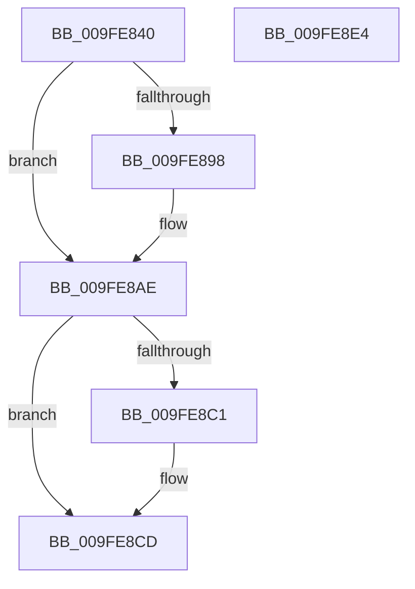

# MmProbeAndLockProcessPages

- RVA: `0x009FE840`–`0x009FE8E5` (길이 `165` bytes)
- VA: `0x00000001409FE840`
- 실행 섹션: `PAGE`
- PDB 이름 있음: `예`; PDB Function 태그: `아니요`
- unwind 정보 RVA: `0x000A7614`
- 디코드: `51`개 명령, `165/165` bytes 표시
- 미해석 바이트: `0` (있으면 어셈블리에 `.byte`로 보존)

> 이 문서는 커널 이미지의 기계어와 PDB 기호를 분석해 생성했습니다. 4번과 5번은 함수 원형과 자료형을 바이너리 사용 방식에서 추정한 C 해석이며 원본 소스 복구 결과는 아닙니다.

## 1. Dependencies

- 직접 호출 지점: **4**; 고유 호출 대상: **4**
- 직접 호출자로 확인된 함수: **2**
- RIP 상대 이미지 참조: **1**

### Outgoing calls
- `0x009FE8A8` → [KiStackAttachProcess](../../text/21/KiStackAttachProcess_function_00216820.md) (function, `0x00216820`)
- `0x009FE8B7` → [MmProbeAndLockPages](../../text/23/MmProbeAndLockPages_function_0023B990.md) (function, `0x0023B990`)
- `0x009FE8C8` → [KiUnstackDetachProcess](../../text/21/KiUnstackDetachProcess_function_00217D30.md) (function, `0x00217D30`)
- `0x009FE8D5` → [_security_check_cookie](../../text/6A/_security_check_cookie_function_006AC640.md) (function, `0x006AC640`)

### Direct callers
- [CcAsyncReadPrefetch](../../text/45/CcAsyncReadPrefetch_function_0045E540.md) at `0x0045E5B1`
- [DifMmProbeAndLockProcessPagesWrapper](../../text/63/DifMmProbeAndLockProcessPagesWrapper_function_00636580.md) at `0x0063666E`

### Static image references
- `0x009FE84A` → RVA `0x00E0A740` (`.data`; read)

## 2. Other-region calls and transfers

- 다른 실행 섹션으로 향하는 call: **4**
  - `0x009FE8A8` → [KiStackAttachProcess](../../text/21/KiStackAttachProcess_function_00216820.md) (`PAGE` → `.text`)
  - `0x009FE8B7` → [MmProbeAndLockPages](../../text/23/MmProbeAndLockPages_function_0023B990.md) (`PAGE` → `.text`)
  - `0x009FE8C8` → [KiUnstackDetachProcess](../../text/21/KiUnstackDetachProcess_function_00217D30.md) (`PAGE` → `.text`)
  - `0x009FE8D5` → [_security_check_cookie](../../text/6A/_security_check_cookie_function_006AC640.md) (`PAGE` → `.text`)
- 별도 외부 분기/꼬리 이동을 확인하지 못했습니다.

## 3. Assembly (complete function range)

```asm
009FE840  40 53                           push rbx
009FE842  56                              push rsi
009FE843  57                              push rdi
009FE844  41 56                           push r14
009FE846  48 83 EC 68                     sub rsp, 0x68
009FE84A  48 8B 05 EF BE 40 00            mov rax, qword ptr [rip + 0x40beef]
009FE851  48 33 C4                        xor rax, rsp
009FE854  48 89 44 24 58                  mov qword ptr [rsp + 0x58], rax
009FE859  45 8A F0                        mov r14b, r8b
009FE85C  4C 8B D2                        mov r10, rdx
009FE85F  48 8B F1                        mov rsi, rcx
009FE862  0F 57 C0                        xorps xmm0, xmm0
009FE865  0F 11 44 24 28                  movups xmmword ptr [rsp + 0x28], xmm0
009FE86A  0F 11 44 24 38                  movups xmmword ptr [rsp + 0x38], xmm0
009FE86F  0F 11 44 24 48                  movups xmmword ptr [rsp + 0x48], xmm0
009FE874  33 DB                           xor ebx, ebx
009FE876  89 5C 24 20                     mov dword ptr [rsp + 0x20], ebx
009FE87A  8D 53 01                        lea edx, [rbx + 1]
009FE87D  8B FA                           mov edi, edx
009FE87F  45 85 C9                        test r9d, r9d
009FE882  41 0F 44 F9                     cmove edi, r9d
009FE886  65 48 8B 04 25 88 01 00 00      mov rax, qword ptr gs:[0x188]
009FE88F  4C 3B 90 B8 00 00 00            cmp r10, qword ptr [rax + 0xb8]
009FE896  74 16                           je 0x1409fe8ae
009FE898  8B DA                           mov ebx, edx
009FE89A  89 54 24 20                     mov dword ptr [rsp + 0x20], edx
009FE89E  4C 8D 44 24 28                  lea r8, [rsp + 0x28]
009FE8A3  33 D2                           xor edx, edx
009FE8A5  49 8B CA                        mov rcx, r10
009FE8A8  E8 73 7F 81 FF                  call 0x140216820
009FE8AD  90                              nop
009FE8AE  44 8B C7                        mov r8d, edi
009FE8B1  41 8A D6                        mov dl, r14b
009FE8B4  48 8B CE                        mov rcx, rsi
009FE8B7  E8 D4 D0 83 FF                  call 0x14023b990
009FE8BC  90                              nop
009FE8BD  85 DB                           test ebx, ebx
009FE8BF  74 0C                           je 0x1409fe8cd
009FE8C1  33 D2                           xor edx, edx
009FE8C3  48 8D 4C 24 28                  lea rcx, [rsp + 0x28]
009FE8C8  E8 63 94 81 FF                  call 0x140217d30
009FE8CD  48 8B 4C 24 58                  mov rcx, qword ptr [rsp + 0x58]
009FE8D2  48 33 CC                        xor rcx, rsp
009FE8D5  E8 66 DD CA FF                  call 0x1406ac640
009FE8DA  48 83 C4 68                     add rsp, 0x68
009FE8DE  41 5E                           pop r14
009FE8E0  5F                              pop rdi
009FE8E1  5E                              pop rsi
009FE8E2  5B                              pop rbx
009FE8E3  C3                              ret
009FE8E4  CC                              int3
```

## 4. C-style interpretation (structured pseudocode)

```c
__int64 __fastcall MmProbeAndLockProcessPages(__int64 a1, __int64 a2, unsigned __int8 a3, int a4)
{
    __int64 result;
    __int64 v_rbx;
    __int64 v_rdi;
    __int64 v_rsp;
    unsigned __int64 v_stack_m30;
    unsigned __int64 v_stack_m40;
    unsigned __int64 v_stack_m50;
    unsigned __int64 v_stack_m60;
    unsigned int v_stack_m68;

    v_rsp = (v_rsp) - (104);
    result = (*(unsigned __int64 *)(v_rip + 4243183)) ^ (v_rsp);
    v_stack_m30 = result;
    v_stack_m60 = v_xmm0;
    v_stack_m50 = v_xmm0;
    v_stack_m40 = v_xmm0;
    v_rbx = 0;
    v_stack_m68 = 0;
    v_rdi = (unsigned int)((unsigned int)(v_rbx + 1));
    if (a4 == 0) { v_rdi = a4; }
    result = *(unsigned __int64 *)(gs_base + (0 + 392));
    if (a2 != (*(unsigned __int64 *)(*(unsigned __int64 *)(gs_base + (0 + 392)) + 184))) {
        v_rbx = (unsigned int)(v_rbx + 1);
        v_stack_m68 = (unsigned int)(v_rbx + 1);
        a3 = v_stack_m60;
        a2 = 0;
        a1 = 0;
        result = KiStackAttachProcess(a1, a2, a3, a4);
    }
    result = MmProbeAndLockPages(a1, a3, (unsigned int)((unsigned int)(v_rdi)), a4);
    if ((unsigned int)(v_rbx) != 0) {
        a2 = 0;
        a1 = v_stack_m60;
        result = KiUnstackDetachProcess(a1, a2, (unsigned int)((unsigned int)(v_rdi)), a4);
    }
    a1 = (v_stack_m30) ^ (v_rsp);
    result = _security_check_cookie(a1, a2, (unsigned int)((unsigned int)(v_rdi)), a4);
    v_rsp = (v_rsp) + (104);
    return result;
}
```

## 5. (Beta) C Style

```c
int64_t MmProbeAndLockProcessPages(int64_t Arg1, int64_t Arg2, uint8_t Arg3, int32_t Arg4)
{
    int64_t result;
    int64_t local_rbx;
    int64_t local_rdi;
    int64_t local_rsp;
    uint64_t v_stack_m30;
    uint64_t v_stack_m40;
    uint64_t v_stack_m50;
    uint64_t v_stack_m60;
    uint32_t v_stack_m68;

    local_rsp = (local_rsp) - (104);
    result = (*(uint64_t *)(v_rip + 0x40BEEF)) ^ (local_rsp);
    v_stack_m30 = result;
    v_stack_m60 = v_xmm0;
    v_stack_m50 = v_xmm0;
    v_stack_m40 = v_xmm0;
    local_rbx = 0;
    v_stack_m68 = 0;
    local_rdi = (uint32_t)((uint32_t)(local_rbx + 1));
    if (Arg4 == 0) { local_rdi = Arg4; }
    result = *(uint64_t *)(gs_base + (0 + 0x188));
    if (Arg2 != (*(uint64_t *)(*(uint64_t *)(gs_base + (0 + 0x188)) + 0xB8))) {
        local_rbx = (uint32_t)(local_rbx + 1);
        v_stack_m68 = (uint32_t)(local_rbx + 1);
        Arg3 = v_stack_m60;
        Arg2 = 0;
        Arg1 = 0;
        result = KiStackAttachProcess(Arg1, Arg2, Arg3, Arg4);
    }
    result = MmProbeAndLockPages(Arg1, Arg3, (uint32_t)((uint32_t)(local_rdi)), Arg4);
    if ((uint32_t)(local_rbx) != 0) {
        Arg2 = 0;
        Arg1 = v_stack_m60;
        result = KiUnstackDetachProcess(Arg1, Arg2, (uint32_t)((uint32_t)(local_rdi)), Arg4);
    }
    Arg1 = (v_stack_m30) ^ (local_rsp);
    result = _security_check_cookie(Arg1, Arg2, (uint32_t)((uint32_t)(local_rdi)), Arg4);
    local_rsp = (local_rsp) + (104);
    return result;
}
```

## 6. Execution-region graph

[열기: 2D/3D 그래프와 함수 탐색 컨트롤 패널](../../../control-panel.html?section=page&rva=0x009FE840&view=graph)

- 2D 그래프는 위에서 아래로 흐르고, 3D 그래프는 빈 공간을 드래그해 회전합니다. Shift+드래그는 이동, 휠은 확대·축소, 함수 노드 선택은 대상 보고서 이동입니다.

### Static fallback


