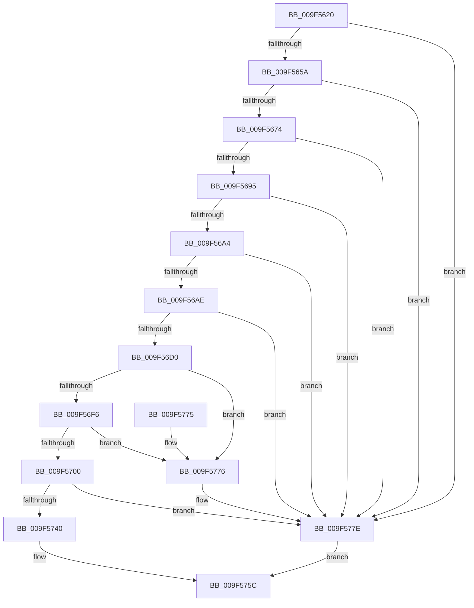

# MmSecureVirtualMemoryEx

- RVA: `0x009F5620`–`0x009F5782` (길이 `354` bytes)
- VA: `0x00000001409F5620`
- 실행 섹션: `PAGE`
- PDB 이름 있음: `예`; PDB Function 태그: `아니요`
- unwind 정보 RVA: `0x0008671C`
- 디코드: `90`개 명령, `354/354` bytes 표시
- 미해석 바이트: `0` (있으면 어셈블리에 `.byte`로 보존)

> 이 문서는 커널 이미지의 기계어와 PDB 기호를 분석해 생성했습니다. 4번과 5번은 함수 원형과 자료형을 바이너리 사용 방식에서 추정한 C 해석이며 원본 소스 복구 결과는 아닙니다.

## 1. Dependencies

- 직접 호출 지점: **4**; 고유 호출 대상: **3**
- 직접 호출자로 확인된 함수: **3**
- RIP 상대 이미지 참조: **1**

### Outgoing calls
- `0x009F56BF` → [MiObtainReferencedVadEx](../../text/31/MiObtainReferencedVadEx_function_00316690.md) (function, `0x00316690`)
- `0x009F5728` → [MiSecureVad](MiSecureVad_function_009F5788.md) (function, `0x009F5788`)
- `0x009F5734` → [MiUnlockAndDereferenceVad](../../text/31/MiUnlockAndDereferenceVad_function_00316E60.md) (function, `0x00316E60`)
- `0x009F5779` → [MiUnlockAndDereferenceVad](../../text/31/MiUnlockAndDereferenceVad_function_00316E60.md) (function, `0x00316E60`)

### Direct callers
- [VmpSecureMemoryForPin](../7A/VmpSecureMemoryForPin_function_007ADED4.md) at `0x007ADF2A`
- [MmSecureVirtualMemory](MmSecureVirtualMemory_function_009F55F0.md) at `0x009F5607`
- [VmSecureBackingMemory](../AB/VmSecureBackingMemory_function_00AB0CA0.md) at `0x00AB0CCB`

### Static image references
- `0x009F5750` → RVA `0x00E2DB80` (`.data`; read)

## 2. Other-region calls and transfers

- 다른 실행 섹션으로 향하는 call: **3**
  - `0x009F56BF` → [MiObtainReferencedVadEx](../../text/31/MiObtainReferencedVadEx_function_00316690.md) (`PAGE` → `.text`)
  - `0x009F5734` → [MiUnlockAndDereferenceVad](../../text/31/MiUnlockAndDereferenceVad_function_00316E60.md) (`PAGE` → `.text`)
  - `0x009F5779` → [MiUnlockAndDereferenceVad](../../text/31/MiUnlockAndDereferenceVad_function_00316E60.md) (`PAGE` → `.text`)
- 별도 외부 분기/꼬리 이동을 확인하지 못했습니다.

## 3. Assembly (complete function range)

```asm
009F5620  48 8B C4                        mov rax, rsp
009F5623  48 89 58 08                     mov qword ptr [rax + 8], rbx
009F5627  48 89 68 10                     mov qword ptr [rax + 0x10], rbp
009F562B  48 89 70 18                     mov qword ptr [rax + 0x18], rsi
009F562F  57                              push rdi
009F5630  41 56                           push r14
009F5632  41 57                           push r15
009F5634  48 83 EC 40                     sub rsp, 0x40
009F5638  83 60 20 00                     and dword ptr [rax + 0x20], 0
009F563C  45 8B F9                        mov r15d, r9d
009F563F  48 83 60 D8 00                  and qword ptr [rax - 0x28], 0
009F5644  41 8B E8                        mov ebp, r8d
009F5647  48 8B F2                        mov rsi, rdx
009F564A  48 8B F9                        mov rdi, rcx
009F564D  41 F7 C1 F0 FF FF FF            test r9d, 0xfffffff0
009F5654  0F 85 24 01 00 00               jne 0x1409f577e
009F565A  4C 8D 72 FF                     lea r14, [rdx - 1]
009F565E  4C 03 F1                        add r14, rcx
009F5661  48 85 D2                        test rdx, rdx
009F5664  49 8B C6                        mov rax, r14
009F5667  48 0F 44 C1                     cmove rax, rcx
009F566B  48 3B C1                        cmp rax, rcx
009F566E  0F 82 0A 01 00 00               jb 0x1409f577e
009F5674  48 8D 41 FF                     lea rax, [rcx - 1]
009F5678  48 03 C2                        add rax, rdx
009F567B  48 85 D2                        test rdx, rdx
009F567E  48 0F 44 C1                     cmove rax, rcx
009F5682  48 B9 FF FF FE FF FF 7F 00 00   movabs rcx, 0x7ffffffeffff
009F568C  48 3B C1                        cmp rax, rcx
009F568F  0F 87 E9 00 00 00               ja 0x1409f577e
009F5695  41 8D 40 FF                     lea eax, [r8 - 1]
009F5699  A9 FC FF FF FF                  test eax, 0xfffffffc
009F569E  0F 85 DA 00 00 00               jne 0x1409f577e
009F56A4  41 83 F8 03                     cmp r8d, 3
009F56A8  0F 84 D0 00 00 00               je 0x1409f577e
009F56AE  48 8B CF                        mov rcx, rdi
009F56B1  4C 8D 44 24 78                  lea r8, [rsp + 0x78]
009F56B6  48 81 E1 00 F0 FF FF            and rcx, 0xfffffffffffff000
009F56BD  33 D2                           xor edx, edx
009F56BF  E8 CC 0F 92 FF                  call 0x140316690
009F56C4  48 8B D8                        mov rbx, rax
009F56C7  48 85 C0                        test rax, rax
009F56CA  0F 84 AE 00 00 00               je 0x1409f577e
009F56D0  0F B6 50 21                     movzx edx, byte ptr [rax + 0x21]
009F56D4  8B 48 1C                        mov ecx, dword ptr [rax + 0x1c]
009F56D7  B8 FF 0F 00 00                  mov eax, 0xfff
009F56DC  48 C1 E2 20                     shl rdx, 0x20
009F56E0  4C 0B F0                        or r14, rax
009F56E3  48 0B D1                        or rdx, rcx
009F56E6  48 C1 E2 0C                     shl rdx, 0xc
009F56EA  48 0B D0                        or rdx, rax
009F56ED  4C 3B F2                        cmp r14, rdx
009F56F0  0F 87 80 00 00 00               ja 0x1409f5776
009F56F6  8B 43 30                        mov eax, dword ptr [rbx + 0x30]
009F56F9  83 E0 70                        and eax, 0x70
009F56FC  3C 30                           cmp al, 0x30
009F56FE  74 76                           je 0x1409f5776
009F5700  44 8B CD                        mov r9d, ebp
009F5703  48 8D 44 24 30                  lea rax, [rsp + 0x30]
009F5708  41 0F BA E9 1F                  bts r9d, 0x1f
009F570D  48 89 44 24 28                  mov qword ptr [rsp + 0x28], rax
009F5712  41 F6 C7 02                     test r15b, 2
009F5716  44 89 7C 24 20                  mov dword ptr [rsp + 0x20], r15d
009F571B  4C 8B C6                        mov r8, rsi
009F571E  48 8B D7                        mov rdx, rdi
009F5721  44 0F 44 CD                     cmove r9d, ebp
009F5725  48 8B CB                        mov rcx, rbx
009F5728  E8 5B 00 00 00                  call 0x1409f5788
009F572D  48 8B CB                        mov rcx, rbx
009F5730  89 44 24 78                     mov dword ptr [rsp + 0x78], eax
009F5734  E8 27 17 92 FF                  call 0x140316e60
009F5739  83 7C 24 78 00                  cmp dword ptr [rsp + 0x78], 0
009F573E  7C 3E                           jl 0x1409f577e
009F5740  65 48 8B 04 25 88 01 00 00      mov rax, qword ptr gs:[0x188]
009F5749  48 8B 80 B8 00 00 00            mov rax, qword ptr [rax + 0xb8]
009F5750  48 33 05 29 84 43 00            xor rax, qword ptr [rip + 0x438429]
009F5757  48 33 44 24 30                  xor rax, qword ptr [rsp + 0x30]
009F575C  48 8B 5C 24 60                  mov rbx, qword ptr [rsp + 0x60]
009F5761  48 8B 6C 24 68                  mov rbp, qword ptr [rsp + 0x68]
009F5766  48 8B 74 24 70                  mov rsi, qword ptr [rsp + 0x70]
009F576B  48 83 C4 40                     add rsp, 0x40
009F576F  41 5F                           pop r15
009F5771  41 5E                           pop r14
009F5773  5F                              pop rdi
009F5774  C3                              ret
009F5775  CC                              int3
009F5776  48 8B CB                        mov rcx, rbx
009F5779  E8 E2 16 92 FF                  call 0x140316e60
009F577E  33 C0                           xor eax, eax
009F5780  EB DA                           jmp 0x1409f575c
```

## 4. C-style interpretation (structured pseudocode)

```c
__int64 __fastcall MmSecureVirtualMemoryEx(__int64 a1, __int64 a2, __int64 a3, int a4)
{
    __int64 result;
    __int64 v_r14;
    __int64 v_rsp;
    unsigned __int64 v_stack_m28;
    unsigned __int64 v_stack_m30;
    unsigned int v_stack_m38;
    unsigned __int64 v_stack_p10;
    unsigned __int64 v_stack_p18;
    unsigned __int64 v_stack_p20;
    unsigned __int64 v_stack_p8;

    *(unsigned __int64 *)(v_rsp + 8) = v_rbx;
    *(unsigned __int64 *)(v_rsp + 16) = v_rbp;
    *(unsigned __int64 *)(v_rsp + 24) = v_rsi;
    v_rsp = (v_rsp) - (64);
    if (((a4) & (0xFFFFFFF0ULL)) != 0) goto loc_009F577E;
    v_r14 = (a2 - 1) + (a1);
    result = v_r14;
    if (a2 == 0) { result = a1; }
    if (result < a1) goto loc_009F577E;
    result = (a1 - 1) + (a2);
    if (a2 == 0) { result = a1; }
    if (result > a1) goto loc_009F577E;
    if ((((unsigned int)(a3 - 1)) & (0xFFFFFFFCULL)) != 0) goto loc_009F577E;
    if (((unsigned int)(a3)) == 3) goto loc_009F577E;
    a1 = (a1) & (0xFFFFFFFFFFFFF000ULL);
    a2 = 0;
    result = MiObtainReferencedVadEx(a1, a2, v_stack_p20, a4);
    if (result == 0) goto loc_009F577E;
    a2 = (*(unsigned __int8 *)(result + 33)) << (32);
    v_r14 = (v_r14) | ((unsigned int)(0xFFFULL));
    a2 = (a2) | ((unsigned int)(*(unsigned int *)(result + 28)));
    a2 = (a2) << (12);
    a2 = (a2) | ((unsigned int)(0xFFFULL));
    if (v_r14 > a2) goto loc_009F5776;
    result = (unsigned int)(((unsigned int)(*(unsigned int *)(result + 48))) & (112));
    if (((unsigned __int8)(result)) == 48) goto loc_009F5776;
    v_stack_m30 = v_stack_m28;
    v_stack_m38 = (unsigned int)((unsigned int)(a4));
    a4 = (unsigned int)((unsigned int)((unsigned int)((unsigned int)(a3))));
    if ((((unsigned __int8)((unsigned int)(a4))) & (2)) == 0) { a4 = (unsigned int)((unsigned int)((unsigned int)(a3))); }
    result = MiSecureVad(result, a1, a2, a4);
    v_stack_p20 = (unsigned int)(result);
    result = MiUnlockAndDereferenceVad(result, a1, a2, a4);
    if (v_stack_p20 < 0) goto loc_009F577E;
    result = (*(unsigned __int64 *)(*(unsigned __int64 *)(gs_base + (0 + 392)) + 184)) ^ (*(unsigned __int64 *)(v_rip + 4424745));
    result = (result) ^ (v_stack_m28);
loc_009F575C:
    v_rsp = (v_rsp) + (64);
    return result;
loc_009F5776:
    result = MiUnlockAndDereferenceVad(v_stack_p8, a1, a2, a4);
loc_009F577E:
    result = 0;
    goto loc_009F575C;
}
```

## 5. (Beta) C Style

```c
int64_t MmSecureVirtualMemoryEx(void *Arg1, void *Arg2, void *Arg3, int32_t Arg4)
{
    uint8_t *arg1 = (uint8_t *)Arg1;
    uint8_t *arg2 = (uint8_t *)Arg2;
    uint8_t *arg3 = (uint8_t *)Arg3;

    int64_t result;
    int64_t local_r14;
    int64_t local_rsp;
    uint64_t v_stack_m28;
    uint64_t v_stack_m30;
    uint32_t v_stack_m38;
    uint64_t v_stack_p10;
    uint64_t v_stack_p18;
    uint64_t v_stack_p20;
    uint64_t v_stack_p8;

    *(uint64_t *)(local_rsp + 0x8) = local_rbx;
    *(uint64_t *)(local_rsp + 0x10) = local_rbp;
    *(uint64_t *)(local_rsp + 0x18) = local_rsi;
    local_rsp = (local_rsp) - (64);
    if (((Arg4) & (0xFFFFFFF0ULL)) != 0) goto loc_009F577E;
    local_r14 = (Arg2 - 1) + (Arg1);
    result = local_r14;
    if (Arg2 == NULL) { result = Arg1; }
    if (result < Arg1) goto loc_009F577E;
    result = (Arg1 - 1) + (Arg2);
    if (Arg2 == NULL) { result = Arg1; }
    if (result > Arg1) goto loc_009F577E;
    if ((((uint32_t)(Arg3 - 1)) & (0xFFFFFFFCULL)) != 0) goto loc_009F577E;
    if (((uint32_t)(Arg3)) == 3) goto loc_009F577E;
    Arg1 = (Arg1) & (0xFFFFFFFFFFFFF000ULL);
    Arg2 = 0;
    result = MiObtainReferencedVadEx(Arg1, Arg2, v_stack_p20, Arg4);
    if (result == 0) goto loc_009F577E;
    Arg2 = (*(uint8_t *)(result + 0x21)) << (32);
    local_r14 = (local_r14) | ((uint32_t)(0xFFFULL));
    Arg2 = (Arg2) | ((uint32_t)(*(uint32_t *)(result + 0x1C)));
    Arg2 = (Arg2) << (12);
    Arg2 = (Arg2) | ((uint32_t)(0xFFFULL));
    if (local_r14 > Arg2) goto loc_009F5776;
    result = (uint32_t)(((uint32_t)(*(uint32_t *)(result + 0x30))) & (112));
    if (((uint8_t)(result)) == 48) goto loc_009F5776;
    v_stack_m30 = v_stack_m28;
    v_stack_m38 = (uint32_t)((uint32_t)(Arg4));
    Arg4 = (uint32_t)((uint32_t)((uint32_t)((uint32_t)(Arg3))));
    if ((((uint8_t)((uint32_t)(Arg4))) & (2)) == 0) { Arg4 = (uint32_t)((uint32_t)((uint32_t)(Arg3))); }
    result = MiSecureVad(result, Arg1, Arg2, Arg4);
    v_stack_p20 = (uint32_t)(result);
    result = MiUnlockAndDereferenceVad(result, Arg1, Arg2, Arg4);
    if (v_stack_p20 < 0) goto loc_009F577E;
    result = (*(uint64_t *)(*(uint64_t *)(gs_base + (0 + 0x188)) + 0xB8)) ^ (*(uint64_t *)(v_rip + 0x438429));
    result = (result) ^ (v_stack_m28);
loc_009F575C:
    local_rsp = (local_rsp) + (64);
    return result;
loc_009F5776:
    result = MiUnlockAndDereferenceVad(v_stack_p8, Arg1, Arg2, Arg4);
loc_009F577E:
    result = 0;
    goto loc_009F575C;
}
```

### 관측된 메모리 오프셋

구조체 형식이 확인되지 않은 접근은 인자 기준의 오프셋으로만 기록했습니다.

| 기준 인자 | 오프셋 표현 | 폭 (bit) | 접근 |
|---|---:|---:|---|
| `Arg1` | `- 0x1` | `64` | `R` |
| `Arg2` | `- 0x1` | `64` | `R` |
| `Arg3` | `- 0x1` | `32` | `R` |

## 6. Execution-region graph

[열기: 2D/3D 그래프와 함수 탐색 컨트롤 패널](../../../control-panel.html?section=page&rva=0x009F5620&view=graph)

- 2D 그래프는 위에서 아래로 흐르고, 3D 그래프는 빈 공간을 드래그해 회전합니다. Shift+드래그는 이동, 휠은 확대·축소, 함수 노드 선택은 대상 보고서 이동입니다.

### Static fallback


