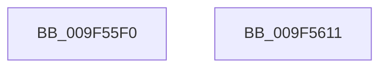

# MmSecureVirtualMemory

- RVA: `0x009F55F0`–`0x009F5612` (길이 `34` bytes)
- VA: `0x00000001409F55F0`
- 실행 섹션: `PAGE`
- PDB 이름 있음: `예`; PDB Function 태그: `아니요`
- unwind 정보 RVA: `0x0005C788`
- 디코드: `10`개 명령, `34/34` bytes 표시
- 미해석 바이트: `0` (있으면 어셈블리에 `.byte`로 보존)

> 이 문서는 커널 이미지의 기계어와 PDB 기호를 분석해 생성했습니다. 4번과 5번은 함수 원형과 자료형을 바이너리 사용 방식에서 추정한 C 해석이며 원본 소스 복구 결과는 아닙니다.

## 1. Dependencies

- 직접 호출 지점: **1**; 고유 호출 대상: **1**
- 직접 호출자로 확인된 함수: **5**
- RIP 상대 이미지 참조: **0**

### Outgoing calls
- `0x009F5607` → [MmSecureVirtualMemoryEx](MmSecureVirtualMemoryEx_function_009F5620.md) (function, `0x009F5620`)

### Direct callers
- [DifMmSecureVirtualMemoryWrapper](../../text/63/DifMmSecureVirtualMemoryWrapper_function_006369E0.md) at `0x00636AC5`
- [RtlFileMapMapView](../../text/69/RtlFileMapMapView_function_0069D048.md) at `0x0069D192`
- [AslpFileLargeMapCreate](../82/AslpFileLargeMapCreate_function_00821A88.md) at `0x00821BC4`
- [AslpFileLargeMapCreate](../82/AslpFileLargeMapCreate_function_00821A88.md) at `0x00821C8F`
- [PspAllocateProcess](../A1/PspAllocateProcess_function_00A13B3C.md) at `0x00A15F31`
- [PspAllocateProcess](../A1/PspAllocateProcess_function_00A13B3C.md) at `0x00A16007`
- [sub_00B30C5A](../B3/Unknown_function_00B30C5A.md) at `0x00B30F90`

### Static image references
- 디코드된 RIP-relative 메모리 참조가 없습니다.

## 2. Other-region calls and transfers

- 다른 실행 섹션으로 향하는 call: **0**
- 별도 외부 분기/꼬리 이동을 확인하지 못했습니다.

## 3. Assembly (complete function range)

```asm
009F55F0  48 83 EC 28                     sub rsp, 0x28
009F55F4  41 8B C0                        mov eax, r8d
009F55F7  41 B8 04 00 00 00               mov r8d, 4
009F55FD  83 F8 02                        cmp eax, 2
009F5600  44 0F 44 C0                     cmove r8d, eax
009F5604  45 33 C9                        xor r9d, r9d
009F5607  E8 14 00 00 00                  call 0x1409f5620
009F560C  48 83 C4 28                     add rsp, 0x28
009F5610  C3                              ret
009F5611  CC                              int3
```

## 4. C-style interpretation (structured pseudocode)

```c
__int64 __fastcall MmSecureVirtualMemory(__int64 a1, __int64 a2, int a3, int a4)
{
    __int64 result;
    __int64 v_rsp;

    v_rsp = (v_rsp) - (40);
    a3 = 4;
    if (((unsigned int)((unsigned int)(a3))) == 2) { a3 = (unsigned int)((unsigned int)(a3)); }
    a4 = 0;
    result = MmSecureVirtualMemoryEx(a1, a2, a3, a4);
    v_rsp = (v_rsp) + (40);
    return result;
}
```

## 5. (Beta) C Style

```c
int64_t MmSecureVirtualMemory(int64_t Arg1, int64_t Arg2, int32_t Arg3, int32_t Arg4)
{
    int64_t result;
    int64_t local_rsp;

    local_rsp = (local_rsp) - (40);
    Arg3 = 4;
    if (((uint32_t)((uint32_t)(Arg3))) == 2) { Arg3 = (uint32_t)((uint32_t)(Arg3)); }
    Arg4 = 0;
    result = MmSecureVirtualMemoryEx(Arg1, Arg2, Arg3, Arg4);
    local_rsp = (local_rsp) + (40);
    return result;
}
```

## 6. Execution-region graph

[열기: 2D/3D 그래프와 함수 탐색 컨트롤 패널](../../../control-panel.html?section=page&rva=0x009F55F0&view=graph)

- 2D 그래프는 위에서 아래로 흐르고, 3D 그래프는 빈 공간을 드래그해 회전합니다. Shift+드래그는 이동, 휠은 확대·축소, 함수 노드 선택은 대상 보고서 이동입니다.

### Static fallback


