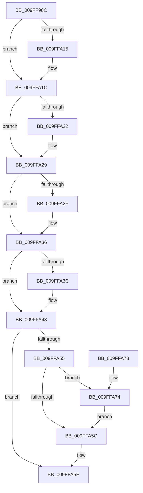

# MmVirtualAccessFault

- RVA: `0x009FF98C`–`0x009FFA80` (길이 `244` bytes)
- VA: `0x00000001409FF98C`
- 실행 섹션: `PAGE`
- PDB 이름 있음: `예`; PDB Function 태그: `아니요`
- unwind 정보 RVA: `0x000A7948`
- 디코드: `69`개 명령, `244/244` bytes 표시
- 미해석 바이트: `0` (있으면 어셈블리에 `.byte`로 보존)

> 이 문서는 커널 이미지의 기계어와 PDB 기호를 분석해 생성했습니다. 4번과 5번은 함수 원형과 자료형을 바이너리 사용 방식에서 추정한 C 해석이며 원본 소스 복구 결과는 아닙니다.

## 1. Dependencies

- 직접 호출 지점: **4**; 고유 호출 대상: **4**
- 직접 호출자로 확인된 함수: **2**
- RIP 상대 이미지 참조: **0**

### Outgoing calls
- `0x009FF9B2` → [memset](../../text/6C/memset_function_006C6C40.md) (function, `0x006C6C40`)
- `0x009FF9E6` → [MiInitializeFaultVaListCore](../../text/43/MiInitializeFaultVaListCore_function_0043E810.md) (function, `0x0043E810`)
- `0x009FFA4C` → [MmAccessFault](../../text/27/MmAccessFault_function_0027EE80.md) (function, `0x0027EE80`)
- `0x009FFA79` → [MiDelayFaultingThread](../../text/2A/MiDelayFaultingThread_function_002A3054.md) (function, `0x002A3054`)

### Direct callers
- [PspIumResolveVirtualFault](PspIumResolveVirtualFault_function_009FF5E4.md) at `0x009FF68C`
- [VmpAccessFaultBatchResolve](VmpAccessFaultBatchResolve_function_009FF710.md) at `0x009FF84E`

### Static image references
- 디코드된 RIP-relative 메모리 참조가 없습니다.

## 2. Other-region calls and transfers

- 다른 실행 섹션으로 향하는 call: **4**
  - `0x009FF9B2` → [memset](../../text/6C/memset_function_006C6C40.md) (`PAGE` → `.text`)
  - `0x009FF9E6` → [MiInitializeFaultVaListCore](../../text/43/MiInitializeFaultVaListCore_function_0043E810.md) (`PAGE` → `.text`)
  - `0x009FFA4C` → [MmAccessFault](../../text/27/MmAccessFault_function_0027EE80.md) (`PAGE` → `.text`)
  - `0x009FFA79` → [MiDelayFaultingThread](../../text/2A/MiDelayFaultingThread_function_002A3054.md) (`PAGE` → `.text`)
- 별도 외부 분기/꼬리 이동을 확인하지 못했습니다.

## 3. Assembly (complete function range)

```asm
009FF98C  48 89 5C 24 08                  mov qword ptr [rsp + 8], rbx
009FF991  48 89 74 24 10                  mov qword ptr [rsp + 0x10], rsi
009FF996  57                              push rdi
009FF997  48 81 EC A0 00 00 00            sub rsp, 0xa0
009FF99E  48 8B DA                        mov rbx, rdx
009FF9A1  41 8B F8                        mov edi, r8d
009FF9A4  33 D2                           xor edx, edx
009FF9A6  48 8B F1                        mov rsi, rcx
009FF9A9  48 8D 4C 24 20                  lea rcx, [rsp + 0x20]
009FF9AE  44 8D 42 78                     lea r8d, [rdx + 0x78]
009FF9B2  E8 89 72 CC FF                  call 0x1406c6c40
009FF9B7  44 8B CF                        mov r9d, edi
009FF9BA  4C 8D 5C 24 20                  lea r11, [rsp + 0x20]
009FF9BF  41 83 E1 02                     and r9d, 2
009FF9C3  48 8D 4C 24 20                  lea rcx, [rsp + 0x20]
009FF9C8  45 8B D1                        mov r10d, r9d
009FF9CB  41 B8 01 00 00 00               mov r8d, 1
009FF9D1  49 83 CA 10                     or r10, 0x10
009FF9D5  48 8B D6                        mov rdx, rsi
009FF9D8  40 F6 C7 04                     test dil, 4
009FF9DC  4D 0F 44 D1                     cmove r10, r9
009FF9E0  41 B1 05                        mov r9b, 5
009FF9E3  4D 0B D8                        or r11, r8
009FF9E6  E8 25 EE A3 FF                  call 0x14043e810
009FF9EB  48 83 64 24 50 00               and qword ptr [rsp + 0x50], 0
009FF9F1  49 8B C2                        mov rax, r10
009FF9F4  48 D1 E8                        shr rax, 1
009FF9F7  49 8B D2                        mov rdx, r10
009FF9FA  48 C1 EA 03                     shr rdx, 3
009FF9FE  41 23 C0                        and eax, r8d
009FFA01  83 E2 02                        and edx, 2
009FFA04  48 89 5C 24 48                  mov qword ptr [rsp + 0x48], rbx
009FFA09  0B D0                           or edx, eax
009FFA0B  89 54 24 58                     mov dword ptr [rsp + 0x58], edx
009FFA0F  40 F6 C7 08                     test dil, 8
009FFA13  74 07                           je 0x1409ffa1c
009FFA15  83 CA 04                        or edx, 4
009FFA18  89 54 24 58                     mov dword ptr [rsp + 0x58], edx
009FFA1C  40 F6 C7 10                     test dil, 0x10
009FFA20  74 07                           je 0x1409ffa29
009FFA22  83 CA 08                        or edx, 8
009FFA25  89 54 24 58                     mov dword ptr [rsp + 0x58], edx
009FFA29  40 F6 C7 20                     test dil, 0x20
009FFA2D  74 07                           je 0x1409ffa36
009FFA2F  83 CA 10                        or edx, 0x10
009FFA32  89 54 24 58                     mov dword ptr [rsp + 0x58], edx
009FFA36  40 F6 C7 40                     test dil, 0x40
009FFA3A  74 07                           je 0x1409ffa43
009FFA3C  83 CA 20                        or edx, 0x20
009FFA3F  89 54 24 58                     mov dword ptr [rsp + 0x58], edx
009FFA43  48 8B 16                        mov rdx, qword ptr [rsi]
009FFA46  4D 8B CB                        mov r9, r11
009FFA49  49 8B CA                        mov rcx, r10
009FFA4C  E8 2F F4 87 FF                  call 0x14027ee80
009FFA51  85 C0                           test eax, eax
009FFA53  78 09                           js 0x1409ffa5e
009FFA55  F6 44 24 58 40                  test byte ptr [rsp + 0x58], 0x40
009FFA5A  75 18                           jne 0x1409ffa74
009FFA5C  33 C0                           xor eax, eax
009FFA5E  4C 8D 9C 24 A0 00 00 00         lea r11, [rsp + 0xa0]
009FFA66  49 8B 5B 10                     mov rbx, qword ptr [r11 + 0x10]
009FFA6A  49 8B 73 18                     mov rsi, qword ptr [r11 + 0x18]
009FFA6E  49 8B E3                        mov rsp, r11
009FFA71  5F                              pop rdi
009FFA72  C3                              ret
009FFA73  CC                              int3
009FFA74  B9 0A 00 00 00                  mov ecx, 0xa
009FFA79  E8 D6 35 8A FF                  call 0x1402a3054
009FFA7E  EB DC                           jmp 0x1409ffa5c
```

## 4. C-style interpretation (structured pseudocode)

```c
__int64 __fastcall MmVirtualAccessFault(__int64 a1, __int64 a2, int a3)
{
    __int64 result;
    __int64 v_r10;
    __int64 v_r11;
    __int64 v_rsp;
    unsigned int v_stack_m50;
    unsigned __int64 v_stack_m58;
    unsigned __int64 v_stack_m60;
    unsigned __int64 v_stack_m8;
    unsigned __int64 v_stack_m88;
    unsigned __int64 v_stack_p10;
    unsigned __int64 v_stack_p8;

    v_stack_p8 = v_rbx;
    v_stack_p10 = v_rsi;
    v_rsp = (v_rsp) - (160);
    a2 = 0;
    result = memset(v_stack_m88, a2, a2 + 120, a4);
    a4 = (unsigned int)(((unsigned int)((unsigned int)((unsigned int)(a3)))) & (2));
    v_r10 = ((unsigned int)((unsigned int)(a4))) | (16);
    if ((((unsigned __int8)((unsigned int)(a3))) & (4)) == 0) { v_r10 = a4; }
    v_r11 = (v_stack_m88) | (1);
    result = MiInitializeFaultVaListCore(v_stack_m88, a1, 1, 5);
    result = (v_r10) >> (1);
    a2 = (v_r10) >> (3);
    result = (unsigned int)((result) & (1));
    a2 = (unsigned int)((a2) & (2));
    v_stack_m60 = a2;
    a2 = (unsigned int)((a2) | ((unsigned int)(result)));
    v_stack_m50 = (unsigned int)(a2);
    if ((((unsigned __int8)((unsigned int)(a3))) & (8)) != 0) {
        a2 = (unsigned int)((a2) | (4));
        v_stack_m50 = (unsigned int)(a2);
    }
    if ((((unsigned __int8)((unsigned int)(a3))) & (16)) != 0) {
        a2 = (unsigned int)((a2) | (8));
        v_stack_m50 = (unsigned int)(a2);
    }
    if ((((unsigned __int8)((unsigned int)(a3))) & (32)) != 0) {
        a2 = (unsigned int)((a2) | (16));
        v_stack_m50 = (unsigned int)(a2);
    }
    if ((((unsigned __int8)((unsigned int)(a3))) & (64)) != 0) {
        a2 = (unsigned int)((a2) | (32));
        v_stack_m50 = (unsigned int)(a2);
    }
    result = MmAccessFault(v_r10, *(unsigned __int64 *)(a1), 1, v_r11);
    if (sign_flag) goto loc_009FFA5E;
    if (((v_stack_m50) & (64)) != 0) goto loc_009FFA74;
loc_009FFA5C:
    result = 0;
loc_009FFA5E:
    return result;
loc_009FFA74:
    result = MiDelayFaultingThread(10, *(unsigned __int64 *)(a1), 1, v_r11);
    goto loc_009FFA5C;
}
```

## 5. (Beta) C Style

```c
int64_t MmVirtualAccessFault(void *Arg1, int64_t Arg2, int32_t Arg3)
{
    uint8_t *arg1 = (uint8_t *)Arg1;

    int64_t result;
    int64_t local_r10;
    int64_t local_r11;
    int64_t local_rsp;
    uint32_t v_stack_m50;
    uint64_t v_stack_m58;
    uint64_t v_stack_m60;
    uint64_t v_stack_m8;
    uint64_t v_stack_m88;
    uint64_t v_stack_p10;
    uint64_t v_stack_p8;

    v_stack_p8 = local_rbx;
    v_stack_p10 = local_rsi;
    local_rsp = (local_rsp) - (160);
    Arg2 = 0;
    result = memset(v_stack_m88, Arg2, Arg2 + 120, a4);
    a4 = (uint32_t)(((uint32_t)((uint32_t)((uint32_t)(Arg3)))) & (2));
    local_r10 = ((uint32_t)((uint32_t)(a4))) | (16);
    if ((((uint8_t)((uint32_t)(Arg3))) & (4)) == 0) { local_r10 = a4; }
    local_r11 = (v_stack_m88) | (1);
    result = MiInitializeFaultVaListCore(v_stack_m88, Arg1, 1, 5);
    result = (local_r10) >> (1);
    Arg2 = (local_r10) >> (3);
    result = (uint32_t)((result) & (1));
    Arg2 = (uint32_t)((Arg2) & (2));
    v_stack_m60 = Arg2;
    Arg2 = (uint32_t)((Arg2) | ((uint32_t)(result)));
    v_stack_m50 = (uint32_t)(Arg2);
    if ((((uint8_t)((uint32_t)(Arg3))) & (8)) != 0) {
        Arg2 = (uint32_t)((Arg2) | (4));
        v_stack_m50 = (uint32_t)(Arg2);
    }
    if ((((uint8_t)((uint32_t)(Arg3))) & (16)) != 0) {
        Arg2 = (uint32_t)((Arg2) | (8));
        v_stack_m50 = (uint32_t)(Arg2);
    }
    if ((((uint8_t)((uint32_t)(Arg3))) & (32)) != 0) {
        Arg2 = (uint32_t)((Arg2) | (16));
        v_stack_m50 = (uint32_t)(Arg2);
    }
    if ((((uint8_t)((uint32_t)(Arg3))) & (64)) != 0) {
        Arg2 = (uint32_t)((Arg2) | (32));
        v_stack_m50 = (uint32_t)(Arg2);
    }
    result = MmAccessFault(local_r10, *(uint64_t *)(arg1), 1, local_r11);
    if (sign_flag) goto loc_009FFA5E;
    if (((v_stack_m50) & (64)) != 0) goto loc_009FFA74;
loc_009FFA5C:
    result = 0;
loc_009FFA5E:
    return result;
loc_009FFA74:
    result = MiDelayFaultingThread(10, *(uint64_t *)(arg1), 1, local_r11);
    goto loc_009FFA5C;
}
```

### 관측된 메모리 오프셋

구조체 형식이 확인되지 않은 접근은 인자 기준의 오프셋으로만 기록했습니다.

| 기준 인자 | 오프셋 표현 | 폭 (bit) | 접근 |
|---|---:|---:|---|
| `Arg1` | `+ 0x0` | `64` | `R` |

## 6. Execution-region graph

[열기: 2D/3D 그래프와 함수 탐색 컨트롤 패널](../../../control-panel.html?section=page&rva=0x009FF98C&view=graph)

- 2D 그래프는 위에서 아래로 흐르고, 3D 그래프는 빈 공간을 드래그해 회전합니다. Shift+드래그는 이동, 휠은 확대·축소, 함수 노드 선택은 대상 보고서 이동입니다.

### Static fallback


