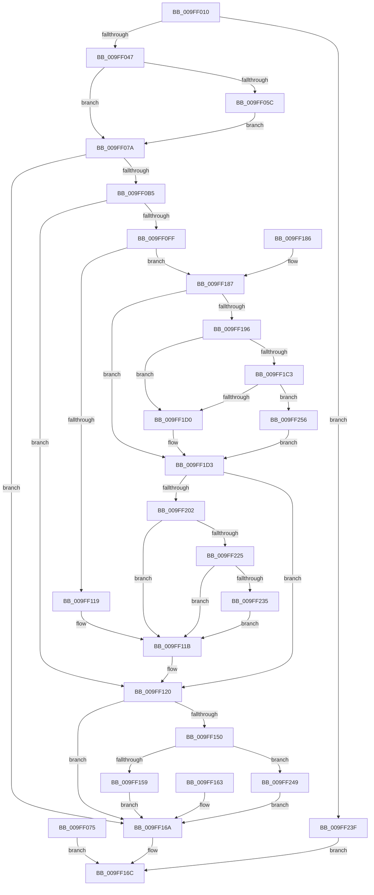

# NtCreateTimer

- RVA: `0x009FF010`–`0x009FF25E` (길이 `590` bytes)
- VA: `0x00000001409FF010`
- 실행 섹션: `PAGE`
- PDB 이름 있음: `예`; PDB Function 태그: `아니요`
- unwind 정보 RVA: `0x000A770C`
- 디코드: `141`개 명령, `590/590` bytes 표시
- 미해석 바이트: `0` (있으면 어셈블리에 `.byte`로 보존)

> 이 문서는 커널 이미지의 기계어와 PDB 기호를 분석해 생성했습니다. 4번과 5번은 함수 원형과 자료형을 바이너리 사용 방식에서 추정한 C 해석이며 원본 소스 복구 결과는 아닙니다.

## 1. Dependencies

- 직접 호출 지점: **8**; 고유 호출 대상: **8**
- 직접 호출자로 확인된 함수: **0**
- RIP 상대 이미지 참조: **2**

### Outgoing calls
- `0x009FF0A6` → [ObCreateObjectEx](../89/ObCreateObjectEx_function_0089B1E0.md) (function, `0x0089B1E0`)
- `0x009FF0CB` → [KeInitializeDpc](../../text/45/KeInitializeDpc_function_0045BBD0.md) (function, `0x0045BBD0`)
- `0x009FF0D5` → [KeInitializeTimerEx](../../text/45/KeInitializeTimerEx_function_004563F0.md) (function, `0x004563F0`)
- `0x009FF13E` → [ObInsertObjectEx](../8B/ObInsertObjectEx_function_008B97A0.md) (function, `0x008B97A0`)
- `0x009FF1B2` → [ExAcquireResourceExclusiveLite](../../text/21/ExAcquireResourceExclusiveLite_function_00214E20.md) (function, `0x00214E20`)
- `0x009FF1F2` → [PsInsertVirtualizedTimer](../../text/46/PsInsertVirtualizedTimer_function_0046C130.md) (function, `0x0046C130`)
- `0x009FF206` → [ExReleaseResourceLite](../../text/25/ExReleaseResourceLite_function_0025FA10.md) (function, `0x0025FA10`)
- `0x009FF235` → [KiCheckForKernelApcDelivery](../../text/2E/KiCheckForKernelApcDelivery_function_002E2C80.md) (function, `0x002E2C80`)

### Direct callers
- 이 함수 시작 RVA로 연결되는 직접 call은 확인되지 않았습니다. 간접 호출은 완전히 역산할 수 없습니다.

### Static image references
- `0x009FF07A` → RVA `0x00FC6D98` (`ALMOSTRO`; read)
- `0x009FF0C4` → RVA `0x004A1570` (`ExpTimerDpcRoutine`; read)

## 2. Other-region calls and transfers

- 다른 실행 섹션으로 향하는 call: **6**
  - `0x009FF0CB` → [KeInitializeDpc](../../text/45/KeInitializeDpc_function_0045BBD0.md) (`PAGE` → `.text`)
  - `0x009FF0D5` → [KeInitializeTimerEx](../../text/45/KeInitializeTimerEx_function_004563F0.md) (`PAGE` → `.text`)
  - `0x009FF1B2` → [ExAcquireResourceExclusiveLite](../../text/21/ExAcquireResourceExclusiveLite_function_00214E20.md) (`PAGE` → `.text`)
  - `0x009FF1F2` → [PsInsertVirtualizedTimer](../../text/46/PsInsertVirtualizedTimer_function_0046C130.md) (`PAGE` → `.text`)
  - `0x009FF206` → [ExReleaseResourceLite](../../text/25/ExReleaseResourceLite_function_0025FA10.md) (`PAGE` → `.text`)
  - `0x009FF235` → [KiCheckForKernelApcDelivery](../../text/2E/KiCheckForKernelApcDelivery_function_002E2C80.md) (`PAGE` → `.text`)
- 별도 외부 분기/꼬리 이동을 확인하지 못했습니다.

## 3. Assembly (complete function range)

```asm
009FF010  48 8B C4                        mov rax, rsp
009FF013  48 89 58 08                     mov qword ptr [rax + 8], rbx
009FF017  48 89 70 10                     mov qword ptr [rax + 0x10], rsi
009FF01B  57                              push rdi
009FF01C  41 54                           push r12
009FF01E  41 55                           push r13
009FF020  41 56                           push r14
009FF022  41 57                           push r15
009FF024  48 83 EC 60                     sub rsp, 0x60
009FF028  41 8B F9                        mov edi, r9d
009FF02B  44 8B EA                        mov r13d, edx
009FF02E  4C 8B F9                        mov r15, rcx
009FF031  33 F6                           xor esi, esi
009FF033  48 89 70 C8                     mov qword ptr [rax - 0x38], rsi
009FF037  48 89 70 D0                     mov qword ptr [rax - 0x30], rsi
009FF03B  8D 46 01                        lea eax, [rsi + 1]
009FF03E  44 3B C8                        cmp r9d, eax
009FF041  0F 87 F8 01 00 00               ja 0x1409ff23f
009FF047  65 48 8B 04 25 88 01 00 00      mov rax, qword ptr gs:[0x188]
009FF050  44 8A B0 32 02 00 00            mov r14b, byte ptr [rax + 0x232]
009FF057  45 84 F6                        test r14b, r14b
009FF05A  74 1E                           je 0x1409ff07a
009FF05C  48 B9 00 00 FF FF FF 7F 00 00   movabs rcx, 0x7fffffff0000
009FF066  4C 3B F9                        cmp r15, rcx
009FF069  49 0F 42 CF                     cmovb rcx, r15
009FF06D  48 8B 01                        mov rax, qword ptr [rcx]
009FF070  48 89 01                        mov qword ptr [rcx], rax
009FF073  EB 05                           jmp 0x1409ff07a
009FF075  E9 F2 00 00 00                  jmp 0x1409ff16c
009FF07A  48 8B 15 17 7D 5C 00            mov rdx, qword ptr [rip + 0x5c7d17]
009FF081  48 89 74 24 48                  mov qword ptr [rsp + 0x48], rsi
009FF086  48 8D 44 24 50                  lea rax, [rsp + 0x50]
009FF08B  48 89 44 24 40                  mov qword ptr [rsp + 0x40], rax
009FF090  89 74 24 38                     mov dword ptr [rsp + 0x38], esi
009FF094  89 74 24 30                     mov dword ptr [rsp + 0x30], esi
009FF098  C7 44 24 28 48 01 00 00         mov dword ptr [rsp + 0x28], 0x148
009FF0A0  45 8A CE                        mov r9b, r14b
009FF0A3  41 8A CE                        mov cl, r14b
009FF0A6  E8 35 C1 E9 FF                  call 0x14089b1e0
009FF0AB  8B C8                           mov ecx, eax
009FF0AD  85 C0                           test eax, eax
009FF0AF  0F 88 B5 00 00 00               js 0x1409ff16a
009FF0B5  48 8B 5C 24 50                  mov rbx, qword ptr [rsp + 0x50]
009FF0BA  48 8D 8B A0 00 00 00            lea rcx, [rbx + 0xa0]
009FF0C1  4C 8B C3                        mov r8, rbx
009FF0C4  48 8D 15 A5 24 AA FF            lea rdx, [rip - 0x55db5b]
009FF0CB  E8 00 CB A5 FF                  call 0x14045bbd0
009FF0D0  8B D7                           mov edx, edi
009FF0D2  48 8B CB                        mov rcx, rbx
009FF0D5  E8 16 73 A5 FF                  call 0x1404563f0
009FF0DA  48 89 73 40                     mov qword ptr [rbx + 0x40], rsi
009FF0DE  40 88 B3 30 01 00 00            mov byte ptr [rbx + 0x130], sil
009FF0E5  48 89 B3 00 01 00 00            mov qword ptr [rbx + 0x100], rsi
009FF0EC  48 89 B3 08 01 00 00            mov qword ptr [rbx + 0x108], rsi
009FF0F3  48 89 B3 18 01 00 00            mov qword ptr [rbx + 0x118], rsi
009FF0FA  45 84 F6                        test r14b, r14b
009FF0FD  74 21                           je 0x1409ff120
009FF0FF  65 48 8B 04 25 88 01 00 00      mov rax, qword ptr gs:[0x188]
009FF108  48 8B B0 B8 00 00 00            mov rsi, qword ptr [rax + 0xb8]
009FF10F  8B 86 88 00 00 00               mov eax, dword ptr [rsi + 0x88]
009FF115  A8 10                           test al, 0x10
009FF117  75 6E                           jne 0x1409ff187
009FF119  33 F6                           xor esi, esi
009FF11B  48 8B 5C 24 50                  mov rbx, qword ptr [rsp + 0x50]
009FF120  48 8D 44 24 58                  lea rax, [rsp + 0x58]
009FF125  48 89 44 24 30                  mov qword ptr [rsp + 0x30], rax
009FF12A  48 89 74 24 28                  mov qword ptr [rsp + 0x28], rsi
009FF12F  89 74 24 20                     mov dword ptr [rsp + 0x20], esi
009FF133  45 33 C9                        xor r9d, r9d
009FF136  45 8B C5                        mov r8d, r13d
009FF139  33 D2                           xor edx, edx
009FF13B  48 8B CB                        mov rcx, rbx
009FF13E  E8 5D A6 EB FF                  call 0x1408b97a0
009FF143  8B C8                           mov ecx, eax
009FF145  89 84 24 A8 00 00 00            mov dword ptr [rsp + 0xa8], eax
009FF14C  85 C0                           test eax, eax
009FF14E  78 1A                           js 0x1409ff16a
009FF150  45 84 F6                        test r14b, r14b
009FF153  0F 84 F0 00 00 00               je 0x1409ff249
009FF159  48 8B 44 24 58                  mov rax, qword ptr [rsp + 0x58]
009FF15E  49 89 07                        mov qword ptr [r15], rax
009FF161  EB 07                           jmp 0x1409ff16a
009FF163  8B 8C 24 A8 00 00 00            mov ecx, dword ptr [rsp + 0xa8]
009FF16A  8B C1                           mov eax, ecx
009FF16C  4C 8D 5C 24 60                  lea r11, [rsp + 0x60]
009FF171  49 8B 5B 30                     mov rbx, qword ptr [r11 + 0x30]
009FF175  49 8B 73 38                     mov rsi, qword ptr [r11 + 0x38]
009FF179  49 8B E3                        mov rsp, r11
009FF17C  41 5F                           pop r15
009FF17E  41 5E                           pop r14
009FF180  41 5D                           pop r13
009FF182  41 5C                           pop r12
009FF184  5F                              pop rdi
009FF185  C3                              ret
009FF186  CC                              int3
009FF187  48 8B BE A0 02 00 00            mov rdi, qword ptr [rsi + 0x2a0]
009FF18E  45 32 C9                        xor r9b, r9b
009FF191  48 85 FF                        test rdi, rdi
009FF194  74 3D                           je 0x1409ff1d3
009FF196  65 48 8B 04 25 88 01 00 00      mov rax, qword ptr gs:[0x188]
009FF19F  66 FF 88 E6 01 00 00            dec word ptr [rax + 0x1e6]
009FF1A6  90                              nop
009FF1A7  BB 01 00 00 00                  mov ebx, 1
009FF1AC  8A D3                           mov dl, bl
009FF1AE  48 8D 4F 38                     lea rcx, [rdi + 0x38]
009FF1B2  E8 69 5C 81 FF                  call 0x140214e20
009FF1B7  F7 87 10 06 00 00 00 00 04 00   test dword ptr [rdi + 0x610], 0x40000
009FF1C1  74 0D                           je 0x1409ff1d0
009FF1C3  83 BF 28 04 00 00 00            cmp dword ptr [rdi + 0x428], 0
009FF1CA  0F 85 86 00 00 00               jne 0x1409ff256
009FF1D0  45 32 C9                        xor r9b, r9b
009FF1D3  48 8B 5C 24 50                  mov rbx, qword ptr [rsp + 0x50]
009FF1D8  48 8D 83 18 01 00 00            lea rax, [rbx + 0x118]
009FF1DF  4C 8D 43 40                     lea r8, [rbx + 0x40]
009FF1E3  48 8D 93 20 01 00 00            lea rdx, [rbx + 0x120]
009FF1EA  48 89 44 24 20                  mov qword ptr [rsp + 0x20], rax
009FF1EF  48 8B CE                        mov rcx, rsi
009FF1F2  E8 39 CF A6 FF                  call 0x14046c130
009FF1F7  33 F6                           xor esi, esi
009FF1F9  48 85 FF                        test rdi, rdi
009FF1FC  0F 84 1E FF FF FF               je 0x1409ff120
009FF202  48 8D 4F 38                     lea rcx, [rdi + 0x38]
009FF206  E8 05 08 86 FF                  call 0x14025fa10
009FF20B  65 48 8B 04 25 88 01 00 00      mov rax, qword ptr gs:[0x188]
009FF214  90                              nop
009FF215  8D 4E 01                        lea ecx, [rsi + 1]
009FF218  66 01 88 E6 01 00 00            add word ptr [rax + 0x1e6], cx
009FF21F  0F 85 F6 FE FF FF               jne 0x1409ff11b
009FF225  90                              nop
009FF226  48 05 98 00 00 00               add rax, 0x98
009FF22C  48 39 00                        cmp qword ptr [rax], rax
009FF22F  0F 84 E6 FE FF FF               je 0x1409ff11b
009FF235  E8 46 3A 8E FF                  call 0x1402e2c80
009FF23A  E9 DC FE FF FF                  jmp 0x1409ff11b
009FF23F  B8 F2 00 00 C0                  mov eax, 0xc00000f2
009FF244  E9 23 FF FF FF                  jmp 0x1409ff16c
009FF249  48 8B 44 24 58                  mov rax, qword ptr [rsp + 0x58]
009FF24E  49 89 07                        mov qword ptr [r15], rax
009FF251  E9 14 FF FF FF                  jmp 0x1409ff16a
009FF256  44 8A CB                        mov r9b, bl
009FF259  E9 75 FF FF FF                  jmp 0x1409ff1d3
```

## 4. C-style interpretation (structured pseudocode)

```c
__int64 __fastcall NtCreateTimer(__int64 a1, int a2, __int64 a3, int a4)
{
    __int64 result;
    __int64 v_rsi;
    __int64 v_rsp;
    unsigned __int64 v_stack_m10;
    unsigned __int64 v_stack_m28;
    unsigned __int64 v_stack_m30;
    unsigned __int64 v_stack_m38;
    unsigned __int64 v_stack_m40;
    unsigned __int64 v_stack_m48;
    unsigned int v_stack_m50;
    unsigned int v_stack_m58;
    unsigned int v_stack_m60;
    unsigned int v_stack_m68;
    unsigned __int64 v_stack_m8;
    unsigned int v_stack_p20;

    *(unsigned __int64 *)(v_rsp + 8) = v_rbx;
    *(unsigned __int64 *)(v_rsp + 16) = v_rsi;
    v_rsp = (v_rsp) - (96);
    v_rsi = 0;
    *(unsigned __int64 *)(v_rsp - 56) = 0;
    *(unsigned __int64 *)(v_rsp - 48) = 0;
    if (a4 > ((unsigned int)(v_rsi + 1))) goto loc_009FF23F;
    if ((unsigned __int8)(*(unsigned __int8 *)(*(unsigned __int64 *)(gs_base + (0 + 392)) + 562)) == 0) goto loc_009FF07A;
    if (a1 < a1) { a1 = a1; }
    *(unsigned __int64 *)(a1) = *(unsigned __int64 *)(a1);
    goto loc_009FF07A;
loc_009FF07A:
    v_stack_m40 = 0;
    v_stack_m48 = v_stack_m38;
    v_stack_m50 = 0;
    v_stack_m58 = 0;
    v_stack_m60 = 328;
    result = ObCreateObjectEx((unsigned __int8)(*(unsigned __int8 *)(*(unsigned __int64 *)(gs_base + (0 + 392)) + 562)), *(unsigned __int64 *)(v_rip + 6061335), a3, (unsigned __int8)(*(unsigned __int8 *)(*(unsigned __int64 *)(gs_base + (0 + 392)) + 562)));
    if (sign_flag) goto loc_009FF16A;
    result = KeInitializeDpc(v_stack_m38 + 160, v_rip - 5626715, v_stack_m38, (unsigned __int8)(*(unsigned __int8 *)(*(unsigned __int64 *)(gs_base + (0 + 392)) + 562)));
    result = KeInitializeTimerEx(v_stack_m38, (unsigned int)((unsigned int)((unsigned int)(a4))), v_stack_m38, (unsigned __int8)(*(unsigned __int8 *)(*(unsigned __int64 *)(gs_base + (0 + 392)) + 562)));
    *(unsigned __int64 *)(v_stack_m38 + 64) = 0;
    *(unsigned __int8 *)(v_stack_m38 + 304) = 0;
    *(unsigned __int64 *)(v_stack_m38 + 256) = 0;
    *(unsigned __int64 *)(v_stack_m38 + 264) = 0;
    *(unsigned __int64 *)(v_stack_m38 + 280) = 0;
    if ((unsigned __int8)(*(unsigned __int8 *)(*(unsigned __int64 *)(gs_base + (0 + 392)) + 562)) == 0) goto loc_009FF120;
    if ((((unsigned __int8)((unsigned int)(*(unsigned int *)(*(unsigned __int64 *)(*(unsigned __int64 *)(gs_base + (0 + 392)) + 184) + 136)))) & (16)) != 0) goto loc_009FF187;
    v_rsi = 0;
loc_009FF11B:
loc_009FF120:
    v_stack_m58 = v_stack_m30;
    v_stack_m60 = 0;
    v_stack_m68 = 0;
    a4 = 0;
    a2 = 0;
    result = ObInsertObjectEx(v_stack_m38, a2, (unsigned int)((unsigned int)((unsigned int)(a2))), a4);
    v_stack_p20 = (unsigned int)(result);
    if (sign_flag) goto loc_009FF16A;
    if ((unsigned __int8)(*(unsigned __int8 *)(*(unsigned __int64 *)(gs_base + (0 + 392)) + 562)) == 0) goto loc_009FF249;
    *(unsigned __int64 *)(a1) = v_stack_m30;
    goto loc_009FF16A;
loc_009FF16A:
loc_009FF16C:
    return (unsigned int)((unsigned int)((unsigned int)((unsigned int)(result))));
loc_009FF187:
    a4 = 0;
    if (*(unsigned __int64 *)(*(unsigned __int64 *)(v_stack_m28 + 56) + 672) == 0) goto loc_009FF1D3;
    result = ExAcquireResourceExclusiveLite(*(unsigned __int64 *)(*(unsigned __int64 *)(v_stack_m28 + 56) + 672) + 56, 1, (unsigned int)((unsigned int)((unsigned int)(a2))), a4);
    if (((*(unsigned int *)(*(unsigned __int64 *)(*(unsigned __int64 *)(v_stack_m28 + 56) + 672) + 1552)) & (0x40000ULL)) == 0) goto loc_009FF1D0;
    if ((*(unsigned int *)(*(unsigned __int64 *)(*(unsigned __int64 *)(v_stack_m28 + 56) + 672) + 1064)) != 0) goto loc_009FF256;
loc_009FF1D0:
    a4 = 0;
loc_009FF1D3:
    v_stack_m40 = v_stack_m10 + 280;
    result = PsInsertVirtualizedTimer(*(unsigned __int64 *)(v_stack_m28 + 56), v_stack_m10 + 288, v_stack_m10 + 64, a4);
    v_rsi = 0;
    if (*(unsigned __int64 *)(*(unsigned __int64 *)(v_stack_m28 + 56) + 672) == 0) goto loc_009FF120;
    result = ExReleaseResourceLite(*(unsigned __int64 *)(*(unsigned __int64 *)(v_stack_m28 + 56) + 672) + 56, v_stack_m10 + 288, v_stack_m10 + 64, a4);
    if (*(unsigned __int64 *)(*(unsigned __int64 *)(v_stack_m28 + 56) + 672) != 0) goto loc_009FF11B;
    result = (*(unsigned __int64 *)(gs_base + (0 + 392))) + (152);
    if ((*(unsigned __int64 *)(result)) == result) goto loc_009FF11B;
    result = KiCheckForKernelApcDelivery(v_rsi + 1, v_stack_m10 + 288, v_stack_m10 + 64, a4);
    goto loc_009FF11B;
loc_009FF23F:
    goto loc_009FF16C;
loc_009FF249:
    *(unsigned __int64 *)(a1) = v_stack_m8;
    goto loc_009FF16A;
loc_009FF256:
    goto loc_009FF1D3;
}
```

## 5. (Beta) C Style

```c
int64_t NtCreateTimer(int64_t Arg1, int32_t Arg2, int64_t Arg3, int32_t Arg4)
{
    int64_t result;
    int64_t local_rsi;
    int64_t local_rsp;
    uint64_t v_stack_m10;
    uint64_t v_stack_m28;
    uint64_t v_stack_m30;
    uint64_t v_stack_m38;
    uint64_t v_stack_m40;
    uint64_t v_stack_m48;
    uint32_t v_stack_m50;
    uint32_t v_stack_m58;
    uint32_t v_stack_m60;
    uint32_t v_stack_m68;
    uint64_t v_stack_m8;
    uint32_t v_stack_p20;

    *(uint64_t *)(local_rsp + 0x8) = local_rbx;
    *(uint64_t *)(local_rsp + 0x10) = local_rsi;
    local_rsp = (local_rsp) - (96);
    local_rsi = 0;
    *(uint64_t *)(local_rsp - 0x38) = 0;
    *(uint64_t *)(local_rsp - 0x30) = 0;
    if (Arg4 > ((uint32_t)(local_rsi + 1))) goto loc_009FF23F;
    if ((uint8_t)(*(uint8_t *)(*(uint64_t *)(gs_base + (0 + 0x188)) + 0x232)) == 0) goto loc_009FF07A;
    if (Arg1 < Arg1) { Arg1 = Arg1; }
    *(uint64_t *)(Arg1) = *(uint64_t *)(Arg1);
    goto loc_009FF07A;
loc_009FF07A:
    v_stack_m40 = 0;
    v_stack_m48 = v_stack_m38;
    v_stack_m50 = 0;
    v_stack_m58 = 0;
    v_stack_m60 = 328;
    result = ObCreateObjectEx((uint8_t)(*(uint8_t *)(*(uint64_t *)(gs_base + (0 + 0x188)) + 0x232)), *(uint64_t *)(v_rip + 0x5C7D17), Arg3, (uint8_t)(*(uint8_t *)(*(uint64_t *)(gs_base + (0 + 0x188)) + 0x232)));
    if (sign_flag) goto loc_009FF16A;
    result = KeInitializeDpc(v_stack_m38 + 160, v_rip - 5626715, v_stack_m38, (uint8_t)(*(uint8_t *)(*(uint64_t *)(gs_base + (0 + 0x188)) + 0x232)));
    result = KeInitializeTimerEx(v_stack_m38, (uint32_t)((uint32_t)((uint32_t)(Arg4))), v_stack_m38, (uint8_t)(*(uint8_t *)(*(uint64_t *)(gs_base + (0 + 0x188)) + 0x232)));
    *(uint64_t *)(v_stack_m38 + 0x40) = 0;
    *(uint8_t *)(v_stack_m38 + 0x130) = 0;
    *(uint64_t *)(v_stack_m38 + 0x100) = 0;
    *(uint64_t *)(v_stack_m38 + 0x108) = 0;
    *(uint64_t *)(v_stack_m38 + 0x118) = 0;
    if ((uint8_t)(*(uint8_t *)(*(uint64_t *)(gs_base + (0 + 0x188)) + 0x232)) == 0) goto loc_009FF120;
    if ((((uint8_t)((uint32_t)(*(uint32_t *)(*(uint64_t *)(*(uint64_t *)(gs_base + (0 + 0x188)) + 0xB8) + 0x88)))) & (16)) != 0) goto loc_009FF187;
    local_rsi = 0;
loc_009FF11B:
loc_009FF120:
    v_stack_m58 = v_stack_m30;
    v_stack_m60 = 0;
    v_stack_m68 = 0;
    Arg4 = 0;
    Arg2 = 0;
    result = ObInsertObjectEx(v_stack_m38, Arg2, (uint32_t)((uint32_t)((uint32_t)(Arg2))), Arg4);
    v_stack_p20 = (uint32_t)(result);
    if (sign_flag) goto loc_009FF16A;
    if ((uint8_t)(*(uint8_t *)(*(uint64_t *)(gs_base + (0 + 0x188)) + 0x232)) == 0) goto loc_009FF249;
    *(uint64_t *)(Arg1) = v_stack_m30;
    goto loc_009FF16A;
loc_009FF16A:
loc_009FF16C:
    return (uint32_t)((uint32_t)((uint32_t)((uint32_t)(result))));
loc_009FF187:
    Arg4 = 0;
    if (*(uint64_t *)(*(uint64_t *)(v_stack_m28 + 0x38) + 0x2A0) == 0) goto loc_009FF1D3;
    result = ExAcquireResourceExclusiveLite(*(uint64_t *)(*(uint64_t *)(v_stack_m28 + 0x38) + 0x2A0) + 56, 1, (uint32_t)((uint32_t)((uint32_t)(Arg2))), Arg4);
    if (((*(uint32_t *)(*(uint64_t *)(*(uint64_t *)(v_stack_m28 + 0x38) + 0x2A0) + 0x610)) & (0x40000ULL)) == 0) goto loc_009FF1D0;
    if ((*(uint32_t *)(*(uint64_t *)(*(uint64_t *)(v_stack_m28 + 0x38) + 0x2A0) + 0x428)) != 0) goto loc_009FF256;
loc_009FF1D0:
    Arg4 = 0;
loc_009FF1D3:
    v_stack_m40 = v_stack_m10 + 280;
    result = PsInsertVirtualizedTimer(*(uint64_t *)(v_stack_m28 + 0x38), v_stack_m10 + 288, v_stack_m10 + 64, Arg4);
    local_rsi = 0;
    if (*(uint64_t *)(*(uint64_t *)(v_stack_m28 + 0x38) + 0x2A0) == 0) goto loc_009FF120;
    result = ExReleaseResourceLite(*(uint64_t *)(*(uint64_t *)(v_stack_m28 + 0x38) + 0x2A0) + 56, v_stack_m10 + 288, v_stack_m10 + 64, Arg4);
    if (*(uint64_t *)(*(uint64_t *)(v_stack_m28 + 0x38) + 0x2A0) != 0) goto loc_009FF11B;
    result = (*(uint64_t *)(gs_base + (0 + 0x188))) + (152);
    if ((*(uint64_t *)(result)) == result) goto loc_009FF11B;
    result = KiCheckForKernelApcDelivery(local_rsi + 1, v_stack_m10 + 288, v_stack_m10 + 64, Arg4);
    goto loc_009FF11B;
loc_009FF23F:
    goto loc_009FF16C;
loc_009FF249:
    *(uint64_t *)(Arg1) = v_stack_m8;
    goto loc_009FF16A;
loc_009FF256:
    goto loc_009FF1D3;
}
```

## 6. Execution-region graph

[열기: 2D/3D 그래프와 함수 탐색 컨트롤 패널](../../../control-panel.html?section=page&rva=0x009FF010&view=graph)

- 2D 그래프는 위에서 아래로 흐르고, 3D 그래프는 빈 공간을 드래그해 회전합니다. Shift+드래그는 이동, 휠은 확대·축소, 함수 노드 선택은 대상 보고서 이동입니다.

### Static fallback


