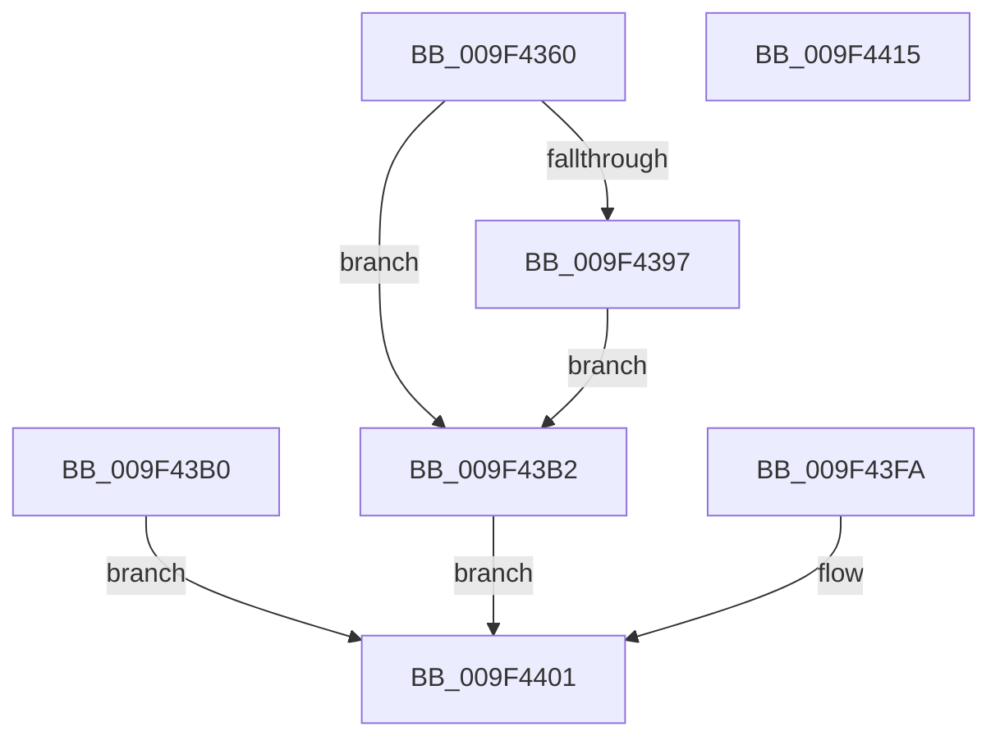

# NtOpenDirectoryObject

- RVA: `0x009F4360`–`0x009F4416` (길이 `182` bytes)
- VA: `0x00000001409F4360`
- 실행 섹션: `PAGE`
- PDB 이름 있음: `예`; PDB Function 태그: `아니요`
- unwind 정보 RVA: `0x000A64E0`
- 디코드: `46`개 명령, `182/182` bytes 표시
- 미해석 바이트: `0` (있으면 어셈블리에 `.byte`로 보존)

> 이 문서는 커널 이미지의 기계어와 PDB 기호를 분석해 생성했습니다. 4번과 5번은 함수 원형과 자료형을 바이너리 사용 방식에서 추정한 C 해석이며 원본 소스 복구 결과는 아닙니다.

## 1. Dependencies

- 직접 호출 지점: **2**; 고유 호출 대상: **2**
- 직접 호출자로 확인된 함수: **0**
- RIP 상대 이미지 참조: **1**

### Outgoing calls
- `0x009F43B9` → [PsGetCurrentSilo](../../text/40/PsGetCurrentSilo_function_004094A0.md) (function, `0x004094A0`)
- `0x009F43E4` → [ObOpenObjectByNameEx](../89/ObOpenObjectByNameEx_function_0089A8A0.md) (function, `0x0089A8A0`)

### Direct callers
- 이 함수 시작 RVA로 연결되는 직접 call은 확인되지 않았습니다. 간접 호출은 완전히 역산할 수 없습니다.

### Static image references
- `0x009F43B2` → RVA `0x00F0F650` (`.data`; read)

## 2. Other-region calls and transfers

- 다른 실행 섹션으로 향하는 call: **1**
  - `0x009F43B9` → [PsGetCurrentSilo](../../text/40/PsGetCurrentSilo_function_004094A0.md) (`PAGE` → `.text`)
- 별도 외부 분기/꼬리 이동을 확인하지 못했습니다.

## 3. Assembly (complete function range)

```asm
009F4360  48 89 5C 24 08                  mov qword ptr [rsp + 8], rbx
009F4365  48 89 74 24 10                  mov qword ptr [rsp + 0x10], rsi
009F436A  57                              push rdi
009F436B  41 56                           push r14
009F436D  41 57                           push r15
009F436F  48 83 EC 50                     sub rsp, 0x50
009F4373  4D 8B F0                        mov r14, r8
009F4376  44 8B FA                        mov r15d, edx
009F4379  48 8B F9                        mov rdi, rcx
009F437C  48 83 64 24 40 00               and qword ptr [rsp + 0x40], 0
009F4382  65 48 8B 04 25 88 01 00 00      mov rax, qword ptr gs:[0x188]
009F438B  40 8A B0 32 02 00 00            mov sil, byte ptr [rax + 0x232]
009F4392  40 84 F6                        test sil, sil
009F4395  74 1B                           je 0x1409f43b2
009F4397  48 BA 00 00 FF FF FF 7F 00 00   movabs rdx, 0x7fffffff0000
009F43A1  48 3B CA                        cmp rcx, rdx
009F43A4  48 0F 42 D1                     cmovb rdx, rcx
009F43A8  48 8B 02                        mov rax, qword ptr [rdx]
009F43AB  48 89 02                        mov qword ptr [rdx], rax
009F43AE  EB 02                           jmp 0x1409f43b2
009F43B0  EB 4F                           jmp 0x1409f4401
009F43B2  48 8B 1D 97 B2 51 00            mov rbx, qword ptr [rip + 0x51b297]
009F43B9  E8 E2 50 A1 FF                  call 0x1404094a0
009F43BE  48 8D 4C 24 40                  lea rcx, [rsp + 0x40]
009F43C3  48 89 4C 24 38                  mov qword ptr [rsp + 0x38], rcx
009F43C8  48 89 44 24 30                  mov qword ptr [rsp + 0x30], rax
009F43CD  48 83 64 24 28 00               and qword ptr [rsp + 0x28], 0
009F43D3  44 89 7C 24 20                  mov dword ptr [rsp + 0x20], r15d
009F43D8  45 33 C9                        xor r9d, r9d
009F43DB  44 8A C6                        mov r8b, sil
009F43DE  48 8B D3                        mov rdx, rbx
009F43E1  49 8B CE                        mov rcx, r14
009F43E4  E8 B7 64 EA FF                  call 0x14089a8a0
009F43E9  89 84 24 88 00 00 00            mov dword ptr [rsp + 0x88], eax
009F43F0  48 8B 4C 24 40                  mov rcx, qword ptr [rsp + 0x40]
009F43F5  48 89 0F                        mov qword ptr [rdi], rcx
009F43F8  EB 07                           jmp 0x1409f4401
009F43FA  8B 84 24 88 00 00 00            mov eax, dword ptr [rsp + 0x88]
009F4401  48 8B 5C 24 70                  mov rbx, qword ptr [rsp + 0x70]
009F4406  48 8B 74 24 78                  mov rsi, qword ptr [rsp + 0x78]
009F440B  48 83 C4 50                     add rsp, 0x50
009F440F  41 5F                           pop r15
009F4411  41 5E                           pop r14
009F4413  5F                              pop rdi
009F4414  C3                              ret
009F4415  CC                              int3
```

## 4. C-style interpretation (structured pseudocode)

```c
__int64 __fastcall NtOpenDirectoryObject(__int64 a1, int a2, __int64 a3, int a4)
{
    __int64 result;
    __int64 v_rsp;
    unsigned __int64 v_stack_m28;
    unsigned __int64 v_stack_m30;
    unsigned __int64 v_stack_m38;
    unsigned __int64 v_stack_m40;
    unsigned int v_stack_m48;
    unsigned __int64 v_stack_p10;
    unsigned int v_stack_p20;
    unsigned __int64 v_stack_p8;

    v_stack_p8 = v_rbx;
    v_stack_p10 = v_rsi;
    v_rsp = (v_rsp) - (80);
    if ((unsigned __int8)(*(unsigned __int8 *)(*(unsigned __int64 *)(gs_base + (0 + 392)) + 562)) == 0) goto loc_009F43B2;
    if (a1 < a2) { a2 = a1; }
    *(unsigned __int64 *)(a2) = *(unsigned __int64 *)(a2);
    goto loc_009F43B2;
loc_009F43B2:
    result = PsGetCurrentSilo(a1, a2, a3, a4);
    v_stack_m30 = v_stack_m28;
    v_stack_m38 = result;
    v_stack_m48 = (unsigned int)((unsigned int)(a2));
    a4 = 0;
    result = ObOpenObjectByNameEx(a3, *(unsigned __int64 *)(v_rip + 5354135), (unsigned __int8)(*(unsigned __int8 *)(*(unsigned __int64 *)(gs_base + (0 + 392)) + 562)), a4);
    v_stack_p20 = (unsigned int)(result);
    *(unsigned __int64 *)(a1) = v_stack_m28;
    goto loc_009F4401;
loc_009F4401:
    v_rsp = (v_rsp) + (80);
    return result;
}
```

## 5. (Beta) C Style

```c
int64_t NtOpenDirectoryObject(void *Arg1, int32_t Arg2, int64_t Arg3, int32_t Arg4)
{
    uint8_t *arg1 = (uint8_t *)Arg1;

    int64_t result;
    int64_t local_rsp;
    uint64_t v_stack_m28;
    uint64_t v_stack_m30;
    uint64_t v_stack_m38;
    uint64_t v_stack_m40;
    uint32_t v_stack_m48;
    uint64_t v_stack_p10;
    uint32_t v_stack_p20;
    uint64_t v_stack_p8;

    v_stack_p8 = local_rbx;
    v_stack_p10 = local_rsi;
    local_rsp = (local_rsp) - (80);
    if ((uint8_t)(*(uint8_t *)(*(uint64_t *)(gs_base + (0 + 0x188)) + 0x232)) == 0) goto loc_009F43B2;
    if (Arg1 < Arg2) { Arg2 = Arg1; }
    *(uint64_t *)(Arg2) = *(uint64_t *)(Arg2);
    goto loc_009F43B2;
loc_009F43B2:
    result = PsGetCurrentSilo(Arg1, Arg2, Arg3, Arg4);
    v_stack_m30 = v_stack_m28;
    v_stack_m38 = result;
    v_stack_m48 = (uint32_t)((uint32_t)(Arg2));
    Arg4 = 0;
    result = ObOpenObjectByNameEx(Arg3, *(uint64_t *)(v_rip + 0x51B297), (uint8_t)(*(uint8_t *)(*(uint64_t *)(gs_base + (0 + 0x188)) + 0x232)), Arg4);
    v_stack_p20 = (uint32_t)(result);
    *(uint64_t *)(arg1) = v_stack_m28;
    goto loc_009F4401;
loc_009F4401:
    local_rsp = (local_rsp) + (80);
    return result;
}
```

### 관측된 메모리 오프셋

구조체 형식이 확인되지 않은 접근은 인자 기준의 오프셋으로만 기록했습니다.

| 기준 인자 | 오프셋 표현 | 폭 (bit) | 접근 |
|---|---:|---:|---|
| `Arg1` | `+ 0x0` | `64` | `W` |

## 6. Execution-region graph

[열기: 2D/3D 그래프와 함수 탐색 컨트롤 패널](../../../control-panel.html?section=page&rva=0x009F4360&view=graph)

- 2D 그래프는 위에서 아래로 흐르고, 3D 그래프는 빈 공간을 드래그해 회전합니다. Shift+드래그는 이동, 휠은 확대·축소, 함수 노드 선택은 대상 보고서 이동입니다.

### Static fallback


