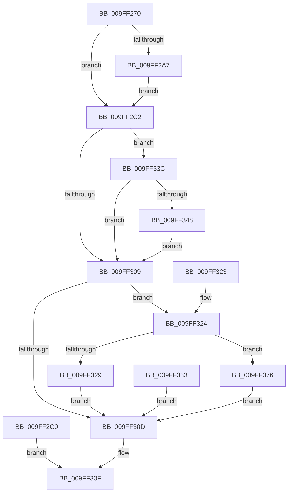

# NtOpenEvent

- RVA: `0x009FF270`–`0x009FF380` (길이 `272` bytes)
- VA: `0x00000001409FF270`
- 실행 섹션: `PAGE`
- PDB 이름 있음: `예`; PDB Function 태그: `아니요`
- unwind 정보 RVA: `0x000A77D0`
- 디코드: `72`개 명령, `272/272` bytes 표시
- 미해석 바이트: `0` (있으면 어셈블리에 `.byte`로 보존)

> 이 문서는 커널 이미지의 기계어와 PDB 기호를 분석해 생성했습니다. 4번과 5번은 함수 원형과 자료형을 바이너리 사용 방식에서 추정한 C 해석이며 원본 소스 복구 결과는 아닙니다.

## 1. Dependencies

- 직접 호출 지점: **3**; 고유 호출 대상: **3**
- 직접 호출자로 확인된 함수: **0**
- RIP 상대 이미지 참조: **2**

### Outgoing calls
- `0x009FF2C9` → [PsGetCurrentSilo](../../text/40/PsGetCurrentSilo_function_004094A0.md) (function, `0x004094A0`)
- `0x009FF2F4` → [ObOpenObjectByNameEx](../89/ObOpenObjectByNameEx_function_0089A8A0.md) (function, `0x0089A8A0`)
- `0x009FF366` → [ObOpenObjectByName](../89/ObOpenObjectByName_function_00899F50.md) (function, `0x00899F50`)

### Direct callers
- 이 함수 시작 RVA로 연결되는 직접 call은 확인되지 않았습니다. 간접 호출은 완전히 역산할 수 없습니다.

### Static image references
- `0x009FF2C2` → RVA `0x00FC6B80` (`ALMOSTRO`; read)
- `0x009FF33C` → RVA `0x00EFA110` (`.data`; read)

## 2. Other-region calls and transfers

- 다른 실행 섹션으로 향하는 call: **1**
  - `0x009FF2C9` → [PsGetCurrentSilo](../../text/40/PsGetCurrentSilo_function_004094A0.md) (`PAGE` → `.text`)
- 별도 외부 분기/꼬리 이동을 확인하지 못했습니다.

## 3. Assembly (complete function range)

```asm
009FF270  48 89 5C 24 08                  mov qword ptr [rsp + 8], rbx
009FF275  48 89 74 24 10                  mov qword ptr [rsp + 0x10], rsi
009FF27A  57                              push rdi
009FF27B  41 56                           push r14
009FF27D  41 57                           push r15
009FF27F  48 83 EC 50                     sub rsp, 0x50
009FF283  4D 8B F0                        mov r14, r8
009FF286  44 8B FA                        mov r15d, edx
009FF289  48 8B F9                        mov rdi, rcx
009FF28C  48 83 64 24 40 00               and qword ptr [rsp + 0x40], 0
009FF292  65 48 8B 04 25 88 01 00 00      mov rax, qword ptr gs:[0x188]
009FF29B  40 8A B0 32 02 00 00            mov sil, byte ptr [rax + 0x232]
009FF2A2  40 84 F6                        test sil, sil
009FF2A5  74 1B                           je 0x1409ff2c2
009FF2A7  48 BA 00 00 FF FF FF 7F 00 00   movabs rdx, 0x7fffffff0000
009FF2B1  48 3B CA                        cmp rcx, rdx
009FF2B4  48 0F 42 D1                     cmovb rdx, rcx
009FF2B8  48 8B 02                        mov rax, qword ptr [rdx]
009FF2BB  48 89 02                        mov qword ptr [rdx], rax
009FF2BE  EB 02                           jmp 0x1409ff2c2
009FF2C0  EB 4D                           jmp 0x1409ff30f
009FF2C2  48 8B 1D B7 78 5C 00            mov rbx, qword ptr [rip + 0x5c78b7]
009FF2C9  E8 D2 A1 A0 FF                  call 0x1404094a0
009FF2CE  48 8D 4C 24 40                  lea rcx, [rsp + 0x40]
009FF2D3  48 89 4C 24 38                  mov qword ptr [rsp + 0x38], rcx
009FF2D8  48 89 44 24 30                  mov qword ptr [rsp + 0x30], rax
009FF2DD  48 83 64 24 28 00               and qword ptr [rsp + 0x28], 0
009FF2E3  44 89 7C 24 20                  mov dword ptr [rsp + 0x20], r15d
009FF2E8  45 33 C9                        xor r9d, r9d
009FF2EB  44 8A C6                        mov r8b, sil
009FF2EE  48 8B D3                        mov rdx, rbx
009FF2F1  49 8B CE                        mov rcx, r14
009FF2F4  E8 A7 B5 E9 FF                  call 0x14089a8a0
009FF2F9  8B C8                           mov ecx, eax
009FF2FB  89 84 24 88 00 00 00            mov dword ptr [rsp + 0x88], eax
009FF302  3D 24 00 00 C0                  cmp eax, 0xc0000024
009FF307  74 33                           je 0x1409ff33c
009FF309  85 C9                           test ecx, ecx
009FF30B  79 17                           jns 0x1409ff324
009FF30D  8B C1                           mov eax, ecx
009FF30F  48 8B 5C 24 70                  mov rbx, qword ptr [rsp + 0x70]
009FF314  48 8B 74 24 78                  mov rsi, qword ptr [rsp + 0x78]
009FF319  48 83 C4 50                     add rsp, 0x50
009FF31D  41 5F                           pop r15
009FF31F  41 5E                           pop r14
009FF321  5F                              pop rdi
009FF322  C3                              ret
009FF323  CC                              int3
009FF324  40 84 F6                        test sil, sil
009FF327  74 4D                           je 0x1409ff376
009FF329  48 8B 44 24 40                  mov rax, qword ptr [rsp + 0x40]
009FF32E  48 89 07                        mov qword ptr [rdi], rax
009FF331  EB DA                           jmp 0x1409ff30d
009FF333  8B 8C 24 88 00 00 00            mov ecx, dword ptr [rsp + 0x88]
009FF33A  EB D1                           jmp 0x1409ff30d
009FF33C  48 8B 15 CD AD 4F 00            mov rdx, qword ptr [rip + 0x4fadcd]
009FF343  48 85 D2                        test rdx, rdx
009FF346  74 C1                           je 0x1409ff309
009FF348  48 8D 44 24 40                  lea rax, [rsp + 0x40]
009FF34D  48 89 44 24 30                  mov qword ptr [rsp + 0x30], rax
009FF352  48 83 64 24 28 00               and qword ptr [rsp + 0x28], 0
009FF358  44 89 7C 24 20                  mov dword ptr [rsp + 0x20], r15d
009FF35D  45 33 C9                        xor r9d, r9d
009FF360  44 8A C6                        mov r8b, sil
009FF363  49 8B CE                        mov rcx, r14
009FF366  E8 E5 AB E9 FF                  call 0x140899f50
009FF36B  8B C8                           mov ecx, eax
009FF36D  89 84 24 88 00 00 00            mov dword ptr [rsp + 0x88], eax
009FF374  EB 93                           jmp 0x1409ff309
009FF376  48 8B 44 24 40                  mov rax, qword ptr [rsp + 0x40]
009FF37B  48 89 07                        mov qword ptr [rdi], rax
009FF37E  EB 8D                           jmp 0x1409ff30d
```

## 4. C-style interpretation (structured pseudocode)

```c
__int64 __fastcall NtOpenEvent(__int64 a1, int a2, __int64 a3, int a4)
{
    __int64 result;
    __int64 v_rsp;
    unsigned __int64 v_stack_m28;
    unsigned __int64 v_stack_m30;
    unsigned __int64 v_stack_m38;
    unsigned __int64 v_stack_m40;
    unsigned int v_stack_m48;
    unsigned __int64 v_stack_p10;
    unsigned int v_stack_p20;
    unsigned __int64 v_stack_p28;
    unsigned __int64 v_stack_p30;
    unsigned __int64 v_stack_p40;
    unsigned __int64 v_stack_p8;
    unsigned int v_stack_p88;

    v_stack_p8 = v_rbx;
    v_stack_p10 = v_rsi;
    v_rsp = (v_rsp) - (80);
    if ((unsigned __int8)(*(unsigned __int8 *)(*(unsigned __int64 *)(gs_base + (0 + 392)) + 562)) == 0) goto loc_009FF2C2;
    if (a1 < a2) { a2 = a1; }
    *(unsigned __int64 *)(a2) = *(unsigned __int64 *)(a2);
    goto loc_009FF2C2;
loc_009FF2C2:
    result = PsGetCurrentSilo(a1, a2, a3, a4);
    v_stack_m30 = v_stack_m28;
    v_stack_m38 = result;
    v_stack_m48 = (unsigned int)((unsigned int)(a2));
    a4 = 0;
    result = ObOpenObjectByNameEx(a3, *(unsigned __int64 *)(v_rip + 6060215), (unsigned __int8)(*(unsigned __int8 *)(*(unsigned __int64 *)(gs_base + (0 + 392)) + 562)), a4);
    v_stack_p20 = (unsigned int)(result);
    if (((unsigned int)(result)) == 0xC0000024ULL) goto loc_009FF33C;
loc_009FF309:
    if (!sign_flag) goto loc_009FF324;
loc_009FF30D:
loc_009FF30F:
    v_rsp = (v_rsp) + (80);
    return (unsigned int)((unsigned int)((unsigned int)((unsigned int)(result))));
loc_009FF324:
    if ((unsigned __int8)(v_stack_p10) == 0) goto loc_009FF376;
    *(unsigned __int64 *)(a1) = v_stack_p40;
    goto loc_009FF30D;
loc_009FF33C:
    if (*(unsigned __int64 *)(v_rip + 5221837) == 0) goto loc_009FF309;
    v_stack_p30 = v_stack_p40;
    v_stack_p20 = (unsigned int)((unsigned int)(a2));
    a4 = 0;
    result = ObOpenObjectByName(a3, *(unsigned __int64 *)(v_rip + 5221837), (unsigned __int8)(v_stack_p10), a4);
    v_stack_p88 = (unsigned int)(result);
    goto loc_009FF309;
loc_009FF376:
    *(unsigned __int64 *)(a1) = v_stack_p40;
    goto loc_009FF30D;
}
```

## 5. (Beta) C Style

```c
int64_t NtOpenEvent(void *Arg1, int32_t Arg2, int64_t Arg3, int32_t Arg4)
{
    uint8_t *arg1 = (uint8_t *)Arg1;

    int64_t result;
    int64_t local_rsp;
    uint64_t v_stack_m28;
    uint64_t v_stack_m30;
    uint64_t v_stack_m38;
    uint64_t v_stack_m40;
    uint32_t v_stack_m48;
    uint64_t v_stack_p10;
    uint32_t v_stack_p20;
    uint64_t v_stack_p28;
    uint64_t v_stack_p30;
    uint64_t v_stack_p40;
    uint64_t v_stack_p8;
    uint32_t v_stack_p88;

    v_stack_p8 = local_rbx;
    v_stack_p10 = local_rsi;
    local_rsp = (local_rsp) - (80);
    if ((uint8_t)(*(uint8_t *)(*(uint64_t *)(gs_base + (0 + 0x188)) + 0x232)) == 0) goto loc_009FF2C2;
    if (Arg1 < Arg2) { Arg2 = Arg1; }
    *(uint64_t *)(Arg2) = *(uint64_t *)(Arg2);
    goto loc_009FF2C2;
loc_009FF2C2:
    result = PsGetCurrentSilo(Arg1, Arg2, Arg3, Arg4);
    v_stack_m30 = v_stack_m28;
    v_stack_m38 = result;
    v_stack_m48 = (uint32_t)((uint32_t)(Arg2));
    Arg4 = 0;
    result = ObOpenObjectByNameEx(Arg3, *(uint64_t *)(v_rip + 0x5C78B7), (uint8_t)(*(uint8_t *)(*(uint64_t *)(gs_base + (0 + 0x188)) + 0x232)), Arg4);
    v_stack_p20 = (uint32_t)(result);
    if (((uint32_t)(result)) == 0xC0000024ULL) goto loc_009FF33C;
loc_009FF309:
    if (!sign_flag) goto loc_009FF324;
loc_009FF30D:
loc_009FF30F:
    local_rsp = (local_rsp) + (80);
    return (uint32_t)((uint32_t)((uint32_t)((uint32_t)(result))));
loc_009FF324:
    if ((uint8_t)(v_stack_p10) == 0) goto loc_009FF376;
    *(uint64_t *)(arg1) = v_stack_p40;
    goto loc_009FF30D;
loc_009FF33C:
    if (*(uint64_t *)(v_rip + 0x4FADCD) == 0) goto loc_009FF309;
    v_stack_p30 = v_stack_p40;
    v_stack_p20 = (uint32_t)((uint32_t)(Arg2));
    Arg4 = 0;
    result = ObOpenObjectByName(Arg3, *(uint64_t *)(v_rip + 0x4FADCD), (uint8_t)(v_stack_p10), Arg4);
    v_stack_p88 = (uint32_t)(result);
    goto loc_009FF309;
loc_009FF376:
    *(uint64_t *)(arg1) = v_stack_p40;
    goto loc_009FF30D;
}
```

### 관측된 메모리 오프셋

구조체 형식이 확인되지 않은 접근은 인자 기준의 오프셋으로만 기록했습니다.

| 기준 인자 | 오프셋 표현 | 폭 (bit) | 접근 |
|---|---:|---:|---|
| `Arg1` | `+ 0x0` | `64` | `W` |

## 6. Execution-region graph

[열기: 2D/3D 그래프와 함수 탐색 컨트롤 패널](../../../control-panel.html?section=page&rva=0x009FF270&view=graph)

- 2D 그래프는 위에서 아래로 흐르고, 3D 그래프는 빈 공간을 드래그해 회전합니다. Shift+드래그는 이동, 휠은 확대·축소, 함수 노드 선택은 대상 보고서 이동입니다.

### Static fallback


