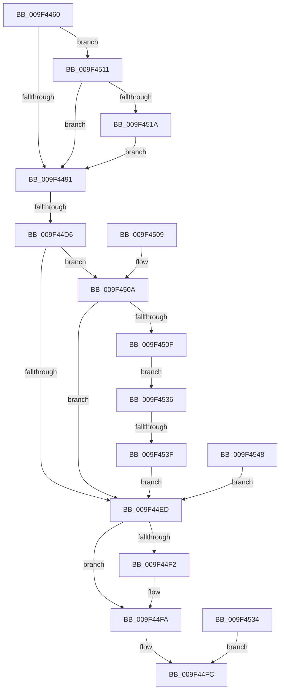

# NtPulseEvent

- RVA: `0x009F4460`–`0x009F4553` (길이 `243` bytes)
- VA: `0x00000001409F4460`
- 실행 섹션: `PAGE`
- PDB 이름 있음: `예`; PDB Function 태그: `예`
- unwind 정보 RVA: `0x000A6560`
- 디코드: `68`개 명령, `243/243` bytes 표시
- 미해석 바이트: `0` (있으면 어셈블리에 `.byte`로 보존)

> 이 문서는 커널 이미지의 기계어와 PDB 기호를 분석해 생성했습니다. 4번과 5번은 함수 원형과 자료형을 바이너리 사용 방식에서 추정한 C 해석이며 원본 소스 복구 결과는 아닙니다.

## 1. Dependencies

- 직접 호출 지점: **3**; 고유 호출 대상: **3**
- 직접 호출자로 확인된 함수: **0**
- RIP 상대 이미지 참조: **1**

### Outgoing calls
- `0x009F44B9` → [ObReferenceObjectByHandle](../86/ObReferenceObjectByHandle_function_00868DB0.md) (function, `0x00868DB0`)
- `0x009F44E0` → [KePulseEvent](../../text/35/KePulseEvent_function_00351EF0.md) (function, `0x00351EF0`)
- `0x009F44F5` → [ObfDereferenceObject](../../text/2F/ObfDereferenceObject_function_002F9350.md) (function, `0x002F9350`)

### Direct callers
- 이 함수 시작 RVA로 연결되는 직접 call은 확인되지 않았습니다. 간접 호출은 완전히 역산할 수 없습니다.

### Static image references
- `0x009F4491` → RVA `0x00FC6B80` (`ALMOSTRO`; read)

## 2. Other-region calls and transfers

- 다른 실행 섹션으로 향하는 call: **2**
  - `0x009F44E0` → [KePulseEvent](../../text/35/KePulseEvent_function_00351EF0.md) (`PAGE` → `.text`)
  - `0x009F44F5` → [ObfDereferenceObject](../../text/2F/ObfDereferenceObject_function_002F9350.md) (`PAGE` → `.text`)
- call이 아닌 외부 분기/꼬리 이동: **2**
  - `0x009F44D0` → [sub_00B3130A](../B3/Unknown_function_00B3130A.md) (`tail-transfer`)
  - `0x009F4539` → [sub_00B3130A + 0x71](../B3/Unknown_function_00B3130A.md) (`tail-transfer`)

## 3. Assembly (complete function range)

```asm
009F4460  40 56                           push rsi
009F4462  57                              push rdi
009F4463  41 54                           push r12
009F4465  41 56                           push r14
009F4467  41 57                           push r15
009F4469  48 83 EC 30                     sub rsp, 0x30
009F446D  4C 8B F2                        mov r14, rdx
009F4470  4C 8B E1                        mov r12, rcx
009F4473  83 64 24 68 00                  and dword ptr [rsp + 0x68], 0
009F4478  65 48 8B 04 25 88 01 00 00      mov rax, qword ptr gs:[0x188]
009F4481  44 8A B8 32 02 00 00            mov r15b, byte ptr [rax + 0x232]
009F4488  48 85 D2                        test rdx, rdx
009F448B  0F 85 80 00 00 00               jne 0x1409f4511
009F4491  4C 8B 05 E8 26 5D 00            mov r8, qword ptr [rip + 0x5d26e8]
009F4498  48 83 64 24 70 00               and qword ptr [rsp + 0x70], 0
009F449E  48 83 64 24 28 00               and qword ptr [rsp + 0x28], 0
009F44A4  48 8D 44 24 70                  lea rax, [rsp + 0x70]
009F44A9  48 89 44 24 20                  mov qword ptr [rsp + 0x20], rax
009F44AE  45 8A CF                        mov r9b, r15b
009F44B1  BA 02 00 00 00                  mov edx, 2
009F44B6  49 8B CC                        mov rcx, r12
009F44B9  E8 F2 48 E7 FF                  call 0x140868db0
009F44BE  8B F8                           mov edi, eax
009F44C0  48 8B 74 24 70                  mov rsi, qword ptr [rsp + 0x70]
009F44C5  48 89 74 24 78                  mov qword ptr [rsp + 0x78], rsi
009F44CA  89 44 24 70                     mov dword ptr [rsp + 0x70], eax
009F44CE  85 C0                           test eax, eax
009F44D0  0F 88 34 CE 13 00               js 0x140b3130a
009F44D6  45 33 C0                        xor r8d, r8d
009F44D9  41 8D 50 01                     lea edx, [r8 + 1]
009F44DD  48 8B CE                        mov rcx, rsi
009F44E0  E8 0B DA 95 FF                  call 0x140351ef0
009F44E5  89 44 24 68                     mov dword ptr [rsp + 0x68], eax
009F44E9  85 FF                           test edi, edi
009F44EB  79 1D                           jns 0x1409f450a
009F44ED  48 85 F6                        test rsi, rsi
009F44F0  74 08                           je 0x1409f44fa
009F44F2  48 8B CE                        mov rcx, rsi
009F44F5  E8 56 4E 90 FF                  call 0x1402f9350
009F44FA  8B C7                           mov eax, edi
009F44FC  48 83 C4 30                     add rsp, 0x30
009F4500  41 5F                           pop r15
009F4502  41 5E                           pop r14
009F4504  41 5C                           pop r12
009F4506  5F                              pop rdi
009F4507  5E                              pop rsi
009F4508  C3                              ret
009F4509  CC                              int3
009F450A  4D 85 F6                        test r14, r14
009F450D  74 DE                           je 0x1409f44ed
009F450F  EB 25                           jmp 0x1409f4536
009F4511  45 84 FF                        test r15b, r15b
009F4514  0F 84 77 FF FF FF               je 0x1409f4491
009F451A  48 B9 00 00 FF FF FF 7F 00 00   movabs rcx, 0x7fffffff0000
009F4524  4C 3B F1                        cmp r14, rcx
009F4527  49 0F 42 CE                     cmovb rcx, r14
009F452B  8B 01                           mov eax, dword ptr [rcx]
009F452D  89 01                           mov dword ptr [rcx], eax
009F452F  E9 5D FF FF FF                  jmp 0x1409f4491
009F4534  EB C6                           jmp 0x1409f44fc
009F4536  45 84 FF                        test r15b, r15b
009F4539  0F 84 3C CE 13 00               je 0x140b3137b
009F453F  8B 44 24 68                     mov eax, dword ptr [rsp + 0x68]
009F4543  41 89 06                        mov dword ptr [r14], eax
009F4546  EB A5                           jmp 0x1409f44ed
009F4548  48 8B 74 24 78                  mov rsi, qword ptr [rsp + 0x78]
009F454D  8B 7C 24 70                     mov edi, dword ptr [rsp + 0x70]
009F4551  EB 9A                           jmp 0x1409f44ed
```

## 4. C-style interpretation (structured pseudocode)

```c
__int64 __fastcall NtPulseEvent(__int64 a1, __int64 a2)
{
    __int64 result;
    __int64 v_rsp;
    unsigned __int64 v_stack_m30;
    unsigned __int64 v_stack_m38;
    unsigned int v_stack_p10;
    unsigned __int64 v_stack_p18;
    unsigned __int64 v_stack_p20;
    unsigned int v_stack_p68;
    unsigned int v_stack_p70;
    unsigned __int64 v_stack_p78;

    v_rsp = (v_rsp) - (48);
    if (a2 != 0) goto loc_009F4511;
loc_009F4491:
    v_stack_m38 = v_stack_p18;
    result = ObReferenceObjectByHandle(a1, 2, *(unsigned __int64 *)(v_rip + 6104808), (unsigned __int8)(*(unsigned __int8 *)(*(unsigned __int64 *)(gs_base + (0 + 392)) + 562)));
    v_stack_p20 = v_stack_p18;
    v_stack_p18 = (unsigned int)(result);
    a3 = 0;
    result = KePulseEvent(v_stack_p18, a3 + 1, a3, (unsigned __int8)(*(unsigned __int8 *)(*(unsigned __int64 *)(gs_base + (0 + 392)) + 562)));
    v_stack_p10 = (unsigned int)(result);
    if (!sign_flag) goto loc_009F450A;
loc_009F44ED:
    if (v_stack_p18 != 0) {
        a1 = v_stack_p18;
        result = ObfDereferenceObject(a1, a3 + 1, a3, (unsigned __int8)(*(unsigned __int8 *)(*(unsigned __int64 *)(gs_base + (0 + 392)) + 562)));
    }
loc_009F44FC:
    v_rsp = (v_rsp) + (48);
    return (unsigned int)((unsigned int)((unsigned int)((unsigned int)(result))));
loc_009F450A:
    if (a2 == 0) goto loc_009F44ED;
    goto loc_009F4536;
loc_009F4511:
    if ((unsigned __int8)(*(unsigned __int8 *)(*(unsigned __int64 *)(gs_base + (0 + 392)) + 562)) == 0) goto loc_009F4491;
    if (a2 < a1) { a1 = a2; }
    *(unsigned int *)(a1) = (unsigned int)((unsigned int)(*(unsigned int *)(a1)));
    goto loc_009F4491;
loc_009F4536:
    *(unsigned int *)(a2) = (unsigned int)((unsigned int)(v_stack_p68));
    goto loc_009F44ED;
}
```

## 5. (Beta) C Style

```c
int64_t NtPulseEvent(int64_t Arg1, int64_t Arg2)
{
    int64_t result;
    int64_t local_rsp;
    uint64_t v_stack_m30;
    uint64_t v_stack_m38;
    uint32_t v_stack_p10;
    uint64_t v_stack_p18;
    uint64_t v_stack_p20;
    uint32_t v_stack_p68;
    uint32_t v_stack_p70;
    uint64_t v_stack_p78;

    local_rsp = (local_rsp) - (48);
    if (Arg2 != 0) goto loc_009F4511;
loc_009F4491:
    v_stack_m38 = v_stack_p18;
    result = ObReferenceObjectByHandle(Arg1, 2, *(uint64_t *)(v_rip + 0x5D26E8), (uint8_t)(*(uint8_t *)(*(uint64_t *)(gs_base + (0 + 0x188)) + 0x232)));
    v_stack_p20 = v_stack_p18;
    v_stack_p18 = (uint32_t)(result);
    a3 = 0;
    result = KePulseEvent(v_stack_p18, a3 + 1, a3, (uint8_t)(*(uint8_t *)(*(uint64_t *)(gs_base + (0 + 0x188)) + 0x232)));
    v_stack_p10 = (uint32_t)(result);
    if (!sign_flag) goto loc_009F450A;
loc_009F44ED:
    if (v_stack_p18 != 0) {
        Arg1 = v_stack_p18;
        result = ObfDereferenceObject(Arg1, a3 + 1, a3, (uint8_t)(*(uint8_t *)(*(uint64_t *)(gs_base + (0 + 0x188)) + 0x232)));
    }
loc_009F44FC:
    local_rsp = (local_rsp) + (48);
    return (uint32_t)((uint32_t)((uint32_t)((uint32_t)(result))));
loc_009F450A:
    if (Arg2 == 0) goto loc_009F44ED;
    goto loc_009F4536;
loc_009F4511:
    if ((uint8_t)(*(uint8_t *)(*(uint64_t *)(gs_base + (0 + 0x188)) + 0x232)) == 0) goto loc_009F4491;
    if (Arg2 < Arg1) { Arg1 = Arg2; }
    *(uint32_t *)(Arg1) = (uint32_t)((uint32_t)(*(uint32_t *)(Arg1)));
    goto loc_009F4491;
loc_009F4536:
    *(uint32_t *)(Arg2) = (uint32_t)((uint32_t)(v_stack_p68));
    goto loc_009F44ED;
}
```

## 6. Execution-region graph

[열기: 2D/3D 그래프와 함수 탐색 컨트롤 패널](../../../control-panel.html?section=page&rva=0x009F4460&view=graph)

- 2D 그래프는 위에서 아래로 흐르고, 3D 그래프는 빈 공간을 드래그해 회전합니다. Shift+드래그는 이동, 휠은 확대·축소, 함수 노드 선택은 대상 보고서 이동입니다.

### Static fallback


