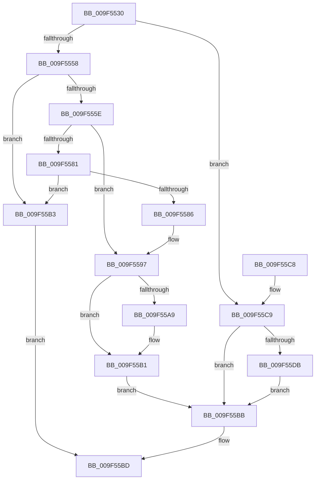

# NtQueryPerformanceCounter

- RVA: `0x009F5530`–`0x009F55E5` (길이 `181` bytes)
- VA: `0x00000001409F5530`
- 실행 섹션: `PAGE`
- PDB 이름 있음: `예`; PDB Function 태그: `아니요`
- unwind 정보 RVA: `0x000A682C`
- 디코드: `54`개 명령, `181/181` bytes 표시
- 미해석 바이트: `0` (있으면 어셈블리에 `.byte`로 보존)

> 이 문서는 커널 이미지의 기계어와 PDB 기호를 분석해 생성했습니다. 4번과 5번은 함수 원형과 자료형을 바이너리 사용 방식에서 추정한 C 해석이며 원본 소스 복구 결과는 아닙니다.

## 1. Dependencies

- 직접 호출 지점: **3**; 고유 호출 대상: **2**
- 직접 호출자로 확인된 함수: **0**
- RIP 상대 이미지 참조: **0**

### Outgoing calls
- `0x009F559C` → [KeQueryPerformanceCounter](../../text/37/KeQueryPerformanceCounter_function_0037E7E0.md) (function, `0x0037E7E0`)
- `0x009F55B3` → [ExRaiseDatatypeMisalignment](../89/ExRaiseDatatypeMisalignment_function_00899FD0.md) (function, `0x00899FD0`)
- `0x009F55CE` → [KeQueryPerformanceCounter](../../text/37/KeQueryPerformanceCounter_function_0037E7E0.md) (function, `0x0037E7E0`)

### Direct callers
- 이 함수 시작 RVA로 연결되는 직접 call은 확인되지 않았습니다. 간접 호출은 완전히 역산할 수 없습니다.

### Static image references
- 디코드된 RIP-relative 메모리 참조가 없습니다.

## 2. Other-region calls and transfers

- 다른 실행 섹션으로 향하는 call: **2**
  - `0x009F559C` → [KeQueryPerformanceCounter](../../text/37/KeQueryPerformanceCounter_function_0037E7E0.md) (`PAGE` → `.text`)
  - `0x009F55CE` → [KeQueryPerformanceCounter](../../text/37/KeQueryPerformanceCounter_function_0037E7E0.md) (`PAGE` → `.text`)
- 별도 외부 분기/꼬리 이동을 확인하지 못했습니다.

## 3. Assembly (complete function range)

```asm
009F5530  48 89 5C 24 08                  mov qword ptr [rsp + 8], rbx
009F5535  57                              push rdi
009F5536  48 83 EC 20                     sub rsp, 0x20
009F553A  48 8B DA                        mov rbx, rdx
009F553D  48 8B F9                        mov rdi, rcx
009F5540  48 83 64 24 40 00               and qword ptr [rsp + 0x40], 0
009F5546  65 48 8B 04 25 88 01 00 00      mov rax, qword ptr gs:[0x188]
009F554F  80 B8 32 02 00 00 00            cmp byte ptr [rax + 0x232], 0
009F5556  74 71                           je 0x1409f55c9
009F5558  40 F6 C7 03                     test dil, 3
009F555C  75 55                           jne 0x1409f55b3
009F555E  48 BA 00 00 FF FF FF 7F 00 00   movabs rdx, 0x7fffffff0000
009F5568  48 8B CA                        mov rcx, rdx
009F556B  48 3B FA                        cmp rdi, rdx
009F556E  48 0F 42 CF                     cmovb rcx, rdi
009F5572  8A 01                           mov al, byte ptr [rcx]
009F5574  88 01                           mov byte ptr [rcx], al
009F5576  8A 41 07                        mov al, byte ptr [rcx + 7]
009F5579  88 41 07                        mov byte ptr [rcx + 7], al
009F557C  48 85 DB                        test rbx, rbx
009F557F  74 16                           je 0x1409f5597
009F5581  F6 C3 03                        test bl, 3
009F5584  75 2D                           jne 0x1409f55b3
009F5586  48 3B DA                        cmp rbx, rdx
009F5589  48 0F 42 D3                     cmovb rdx, rbx
009F558D  8A 02                           mov al, byte ptr [rdx]
009F558F  88 02                           mov byte ptr [rdx], al
009F5591  8A 42 07                        mov al, byte ptr [rdx + 7]
009F5594  88 42 07                        mov byte ptr [rdx + 7], al
009F5597  48 8D 4C 24 40                  lea rcx, [rsp + 0x40]
009F559C  E8 3F 92 98 FF                  call 0x14037e7e0
009F55A1  48 89 07                        mov qword ptr [rdi], rax
009F55A4  48 85 DB                        test rbx, rbx
009F55A7  74 08                           je 0x1409f55b1
009F55A9  48 8B 44 24 40                  mov rax, qword ptr [rsp + 0x40]
009F55AE  48 89 03                        mov qword ptr [rbx], rax
009F55B1  EB 08                           jmp 0x1409f55bb
009F55B3  E8 18 4A EA FF                  call 0x140899fd0
009F55B8  90                              nop
009F55B9  EB 02                           jmp 0x1409f55bd
009F55BB  33 C0                           xor eax, eax
009F55BD  48 8B 5C 24 30                  mov rbx, qword ptr [rsp + 0x30]
009F55C2  48 83 C4 20                     add rsp, 0x20
009F55C6  5F                              pop rdi
009F55C7  C3                              ret
009F55C8  CC                              int3
009F55C9  48 8D 4C 24 40                  lea rcx, [rsp + 0x40]
009F55CE  E8 0D 92 98 FF                  call 0x14037e7e0
009F55D3  48 89 07                        mov qword ptr [rdi], rax
009F55D6  48 85 DB                        test rbx, rbx
009F55D9  74 E0                           je 0x1409f55bb
009F55DB  48 8B 44 24 40                  mov rax, qword ptr [rsp + 0x40]
009F55E0  48 89 03                        mov qword ptr [rbx], rax
009F55E3  EB D6                           jmp 0x1409f55bb
```

## 4. C-style interpretation (structured pseudocode)

```c
__int64 __fastcall NtQueryPerformanceCounter(__int64 a1, __int64 a2)
{
    __int64 result;
    __int64 v_rsp;
    unsigned __int64 v_stack_p18;
    unsigned __int64 v_stack_p40;
    unsigned __int64 v_stack_p8;

    v_stack_p8 = v_rbx;
    v_rsp = (v_rsp) - (32);
    if ((*(unsigned __int8 *)(*(unsigned __int64 *)(gs_base + (0 + 392)) + 562)) == 0) goto loc_009F55C9;
    if ((((unsigned __int8)(a1)) & (3)) != 0) goto loc_009F55B3;
    if (a1 < a2) { a2 = a1; }
    *(unsigned __int8 *)(a2) = (unsigned __int8)(*(unsigned __int8 *)(a2));
    *(unsigned __int8 *)(a2 + 7) = (unsigned __int8)(*(unsigned __int8 *)(a2 + 7));
    if (a2 == 0) goto loc_009F5597;
    if ((((unsigned __int8)(a2)) & (3)) != 0) goto loc_009F55B3;
    if (a2 < a2) { a2 = a2; }
    *(unsigned __int8 *)(a2) = (unsigned __int8)(*(unsigned __int8 *)(a2));
    *(unsigned __int8 *)(a2 + 7) = (unsigned __int8)(*(unsigned __int8 *)(a2 + 7));
loc_009F5597:
    result = KeQueryPerformanceCounter(v_stack_p18, a2, a3, a4);
    *(unsigned __int64 *)(a1) = result;
    if (a2 != 0) {
        result = v_stack_p18;
        *(unsigned __int64 *)(a2) = result;
    }
    goto loc_009F55BB;
loc_009F55B3:
    result = ExRaiseDatatypeMisalignment(v_stack_p18, a2, a3, a4);
    goto loc_009F55BD;
loc_009F55BB:
    result = 0;
loc_009F55BD:
    v_rsp = (v_rsp) + (32);
    return result;
loc_009F55C9:
    result = KeQueryPerformanceCounter(v_stack_p40, a2, a3, a4);
    *(unsigned __int64 *)(a1) = result;
    if (v_stack_p8 == 0) goto loc_009F55BB;
    *(unsigned __int64 *)(v_stack_p8) = v_stack_p40;
    goto loc_009F55BB;
}
```

## 5. (Beta) C Style

```c
int64_t NtQueryPerformanceCounter(void *Arg1, int64_t Arg2)
{
    uint8_t *arg1 = (uint8_t *)Arg1;

    int64_t result;
    int64_t local_rsp;
    uint64_t v_stack_p18;
    uint64_t v_stack_p40;
    uint64_t v_stack_p8;

    v_stack_p8 = local_rbx;
    local_rsp = (local_rsp) - (32);
    if ((*(uint8_t *)(*(uint64_t *)(gs_base + (0 + 0x188)) + 0x232)) == 0) goto loc_009F55C9;
    if ((((uint8_t)(Arg1)) & (3)) != 0) goto loc_009F55B3;
    if (Arg1 < Arg2) { Arg2 = Arg1; }
    *(uint8_t *)(Arg2) = (uint8_t)(*(uint8_t *)(Arg2));
    *(uint8_t *)(Arg2 + 0x7) = (uint8_t)(*(uint8_t *)(Arg2 + 0x7));
    if (Arg2 == 0) goto loc_009F5597;
    if ((((uint8_t)(Arg2)) & (3)) != 0) goto loc_009F55B3;
    if (Arg2 < Arg2) { Arg2 = Arg2; }
    *(uint8_t *)(Arg2) = (uint8_t)(*(uint8_t *)(Arg2));
    *(uint8_t *)(Arg2 + 0x7) = (uint8_t)(*(uint8_t *)(Arg2 + 0x7));
loc_009F5597:
    result = KeQueryPerformanceCounter(v_stack_p18, Arg2, a3, a4);
    *(uint64_t *)(arg1) = result;
    if (Arg2 != 0) {
        result = v_stack_p18;
        *(uint64_t *)(Arg2) = result;
    }
    goto loc_009F55BB;
loc_009F55B3:
    result = ExRaiseDatatypeMisalignment(v_stack_p18, Arg2, a3, a4);
    goto loc_009F55BD;
loc_009F55BB:
    result = 0;
loc_009F55BD:
    local_rsp = (local_rsp) + (32);
    return result;
loc_009F55C9:
    result = KeQueryPerformanceCounter(v_stack_p40, Arg2, a3, a4);
    *(uint64_t *)(arg1) = result;
    if (v_stack_p8 == 0) goto loc_009F55BB;
    *(uint64_t *)(v_stack_p8) = v_stack_p40;
    goto loc_009F55BB;
}
```

### 관측된 메모리 오프셋

구조체 형식이 확인되지 않은 접근은 인자 기준의 오프셋으로만 기록했습니다.

| 기준 인자 | 오프셋 표현 | 폭 (bit) | 접근 |
|---|---:|---:|---|
| `Arg1` | `+ 0x0` | `64` | `W` |

## 6. Execution-region graph

[열기: 2D/3D 그래프와 함수 탐색 컨트롤 패널](../../../control-panel.html?section=page&rva=0x009F5530&view=graph)

- 2D 그래프는 위에서 아래로 흐르고, 3D 그래프는 빈 공간을 드래그해 회전합니다. Shift+드래그는 이동, 휠은 확대·축소, 함수 노드 선택은 대상 보고서 이동입니다.

### Static fallback


