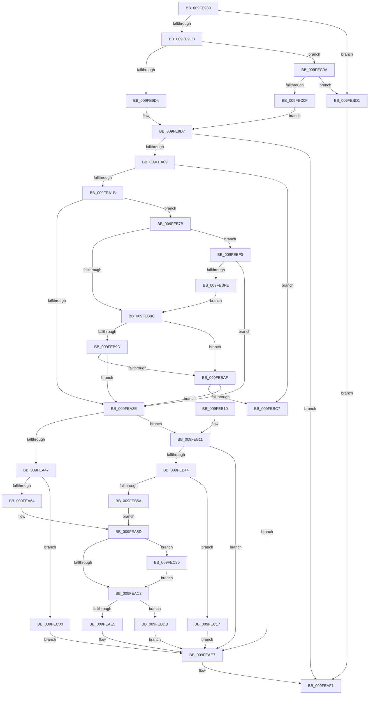

# NtQueueApcThreadEx2

- RVA: `0x009FE980`–`0x009FEC39` (길이 `697` bytes)
- VA: `0x00000001409FE980`
- 실행 섹션: `PAGE`
- PDB 이름 있음: `예`; PDB Function 태그: `아니요`
- unwind 정보 RVA: `0x000A7664`
- 디코드: `154`개 명령, `697/697` bytes 표시
- 미해석 바이트: `0` (있으면 어셈블리에 `.byte`로 보존)

> 이 문서는 커널 이미지의 기계어와 PDB 기호를 분석해 생성했습니다. 4번과 5번은 함수 원형과 자료형을 바이너리 사용 방식에서 추정한 C 해석이며 원본 소스 복구 결과는 아닙니다.

## 1. Dependencies

- 직접 호출 지점: **8**; 고유 호출 대상: **6**
- 직접 호출자로 확인된 함수: **2**
- RIP 상대 이미지 참조: **7**

### Outgoing calls
- `0x009FE9FC` → [ObReferenceObjectByHandle](../86/ObReferenceObjectByHandle_function_00868DB0.md) (function, `0x00868DB0`)
- `0x009FEA53` → [ExAllocatePool2](../../poolcode/B8/ExAllocatePool2_function_00B820F0.md) (function, `0x00B820F0`)
- `0x009FEAB2` → [KeInitializeApc](../../text/42/KeInitializeApc_function_00428510.md) (function, `0x00428510`)
- `0x009FEAD8` → [KeInsertQueueApc](../../text/20/KeInsertQueueApc_function_00203F10.md) (function, `0x00203F10`)
- `0x009FEAEA` → [ObfDereferenceObject](../../text/2F/ObfDereferenceObject_function_002F9350.md) (function, `0x002F9350`)
- `0x009FEB39` → [ObReferenceObjectByHandle](../86/ObReferenceObjectByHandle_function_00868DB0.md) (function, `0x00868DB0`)
- `0x009FEBE1` → [guard_dispatch_icall](../../text/6B/guard_dispatch_icall_function_006BAAD0.md) (function, `0x006BAAD0`)
- `0x009FEC1C` → [ObfDereferenceObject](../../text/2F/ObfDereferenceObject_function_002F9350.md) (function, `0x002F9350`)

### Direct callers
- [NtQueueApcThread](NtQueueApcThread_function_009FE8F0.md) at `0x009FE910`
- [NtQueueApcThreadEx](NtQueueApcThreadEx_function_009FE930.md) at `0x009FE968`

### Static image references
- `0x009FE9D7` → RVA `0x00FC6AC8` (`ALMOSTRO`; read)
- `0x009FEA67` → RVA `0x00AADF90` (`KeSpecialUserApcKernelRoutine`; read)
- `0x009FEA72` → RVA `0x009071C0` (`AlpcpFreeBuffer`; read)
- `0x009FEA7C` → RVA `0x00B82850` (`ExFreePool`; read)
- `0x009FEB11` → RVA `0x00FC7340` (`ALMOSTRO`; read)
- `0x009FEB5F` → RVA `0x00A56A50` (`PspUserApcReserveKernelRoutine`; read)
- `0x009FEB6B` → RVA `0x00A56A70` (`PspUserApcReserveRundownRoutine`; read)

## 2. Other-region calls and transfers

- 다른 실행 섹션으로 향하는 call: **6**
  - `0x009FEA53` → [ExAllocatePool2](../../poolcode/B8/ExAllocatePool2_function_00B820F0.md) (`PAGE` → `POOLCODE`)
  - `0x009FEAB2` → [KeInitializeApc](../../text/42/KeInitializeApc_function_00428510.md) (`PAGE` → `.text`)
  - `0x009FEAD8` → [KeInsertQueueApc](../../text/20/KeInsertQueueApc_function_00203F10.md) (`PAGE` → `.text`)
  - `0x009FEAEA` → [ObfDereferenceObject](../../text/2F/ObfDereferenceObject_function_002F9350.md) (`PAGE` → `.text`)
  - `0x009FEBE1` → [guard_dispatch_icall](../../text/6B/guard_dispatch_icall_function_006BAAD0.md) (`PAGE` → `.text`)
  - `0x009FEC1C` → [ObfDereferenceObject](../../text/2F/ObfDereferenceObject_function_002F9350.md) (`PAGE` → `.text`)
- 별도 외부 분기/꼬리 이동을 확인하지 못했습니다.

## 3. Assembly (complete function range)

```asm
009FE980  48 8B C4                        mov rax, rsp
009FE983  48 89 58 08                     mov qword ptr [rax + 8], rbx
009FE987  48 89 68 10                     mov qword ptr [rax + 0x10], rbp
009FE98B  48 89 70 18                     mov qword ptr [rax + 0x18], rsi
009FE98F  4C 89 60 20                     mov qword ptr [rax + 0x20], r12
009FE993  41 55                           push r13
009FE995  41 56                           push r14
009FE997  41 57                           push r15
009FE999  48 83 EC 50                     sub rsp, 0x50
009FE99D  65 48 8B 04 25 88 01 00 00      mov rax, qword ptr gs:[0x188]
009FE9A6  48 8B DA                        mov rbx, rdx
009FE9A9  BA 01 00 00 00                  mov edx, 1
009FE9AE  4D 8B E9                        mov r13, r9
009FE9B1  45 8B E0                        mov r12d, r8d
009FE9B4  44 8A FA                        mov r15b, dl
009FE9B7  40 8A A8 32 02 00 00            mov bpl, byte ptr [rax + 0x232]
009FE9BE  41 F7 C0 FE FF FE FF            test r8d, 0xfffefffe
009FE9C5  0F 85 06 02 00 00               jne 0x1409febd1
009FE9CB  44 84 E2                        test dl, r12b
009FE9CE  0F 85 36 02 00 00               jne 0x1409fec0a
009FE9D4  45 32 F6                        xor r14b, r14b
009FE9D7  4C 8B 05 EA 80 5C 00            mov r8, qword ptr [rip + 0x5c80ea]
009FE9DE  48 8D 44 24 40                  lea rax, [rsp + 0x40]
009FE9E3  48 83 64 24 28 00               and qword ptr [rsp + 0x28], 0
009FE9E9  44 8A CD                        mov r9b, bpl
009FE9EC  48 83 64 24 40 00               and qword ptr [rsp + 0x40], 0
009FE9F2  BA 10 00 00 00                  mov edx, 0x10
009FE9F7  48 89 44 24 20                  mov qword ptr [rsp + 0x20], rax
009FE9FC  E8 AF A3 E6 FF                  call 0x140868db0
009FEA01  85 C0                           test eax, eax
009FEA03  0F 88 E8 00 00 00               js 0x1409feaf1
009FEA09  48 8B 74 24 40                  mov rsi, qword ptr [rsp + 0x40]
009FEA0E  F7 46 74 00 04 00 00            test dword ptr [rsi + 0x74], 0x400
009FEA15  0F 85 AC 01 00 00               jne 0x1409febc7
009FEA1B  65 48 8B 04 25 88 01 00 00      mov rax, qword ptr gs:[0x188]
009FEA24  48 8B 74 24 40                  mov rsi, qword ptr [rsp + 0x40]
009FEA29  48 8B 88 B8 00 00 00            mov rcx, qword ptr [rax + 0xb8]
009FEA30  48 83 B9 10 03 00 00 00         cmp qword ptr [rcx + 0x310], 0
009FEA38  0F 85 3D 01 00 00               jne 0x1409feb7b
009FEA3E  48 85 DB                        test rbx, rbx
009FEA41  0F 85 CA 00 00 00               jne 0x1409feb11
009FEA47  8D 53 58                        lea edx, [rbx + 0x58]
009FEA4A  41 B8 50 73 61 70               mov r8d, 0x70617350
009FEA50  8D 4B 41                        lea ecx, [rbx + 0x41]
009FEA53  E8 98 36 18 00                  call 0x140b820f0
009FEA58  48 8B D8                        mov rbx, rax
009FEA5B  48 85 C0                        test rax, rax
009FEA5E  0F 84 9C 01 00 00               je 0x1409fec00
009FEA64  45 8A FE                        mov r15b, r14b
009FEA67  4C 8D 0D 22 F5 0A 00            lea r9, [rip + 0xaf522]
009FEA6E  41 80 F7 01                     xor r15b, 1
009FEA72  48 8D 05 47 87 F0 FF            lea rax, [rip - 0xf78b9]
009FEA79  45 84 F6                        test r14b, r14b
009FEA7C  48 8D 2D CD 3D 18 00            lea rbp, [rip + 0x183dcd]
009FEA83  41 BE 01 00 00 00               mov r14d, 1
009FEA89  4C 0F 44 C8                     cmove r9, rax
009FEA8D  48 8B 84 24 90 00 00 00         mov rax, qword ptr [rsp + 0x90]
009FEA95  45 33 C0                        xor r8d, r8d
009FEA98  48 89 44 24 38                  mov qword ptr [rsp + 0x38], rax
009FEA9D  48 8B D6                        mov rdx, rsi
009FEAA0  44 88 7C 24 30                  mov byte ptr [rsp + 0x30], r15b
009FEAA5  48 8B CB                        mov rcx, rbx
009FEAA8  4C 89 6C 24 28                  mov qword ptr [rsp + 0x28], r13
009FEAAD  48 89 6C 24 20                  mov qword ptr [rsp + 0x20], rbp
009FEAB2  E8 59 9A A2 FF                  call 0x140428510
009FEAB7  41 0F BA E4 10                  bt r12d, 0x10
009FEABC  0F 82 6E 01 00 00               jb 0x1409fec30
009FEAC2  4C 8B 84 24 A0 00 00 00         mov r8, qword ptr [rsp + 0xa0]
009FEACA  45 33 C9                        xor r9d, r9d
009FEACD  48 8B 94 24 98 00 00 00         mov rdx, qword ptr [rsp + 0x98]
009FEAD5  48 8B CB                        mov rcx, rbx
009FEAD8  E8 33 54 80 FF                  call 0x140203f10
009FEADD  84 C0                           test al, al
009FEADF  0F 84 F6 00 00 00               je 0x1409febdb
009FEAE5  33 DB                           xor ebx, ebx
009FEAE7  48 8B CE                        mov rcx, rsi
009FEAEA  E8 61 A8 8F FF                  call 0x1402f9350
009FEAEF  8B C3                           mov eax, ebx
009FEAF1  4C 8D 5C 24 50                  lea r11, [rsp + 0x50]
009FEAF6  49 8B 5B 20                     mov rbx, qword ptr [r11 + 0x20]
009FEAFA  49 8B 6B 28                     mov rbp, qword ptr [r11 + 0x28]
009FEAFE  49 8B 73 30                     mov rsi, qword ptr [r11 + 0x30]
009FEB02  4D 8B 63 38                     mov r12, qword ptr [r11 + 0x38]
009FEB06  49 8B E3                        mov rsp, r11
009FEB09  41 5F                           pop r15
009FEB0B  41 5E                           pop r14
009FEB0D  41 5D                           pop r13
009FEB0F  C3                              ret
009FEB10  CC                              int3
009FEB11  4C 8B 05 28 88 5C 00            mov r8, qword ptr [rip + 0x5c8828]
009FEB18  48 8D 44 24 48                  lea rax, [rsp + 0x48]
009FEB1D  48 83 64 24 28 00               and qword ptr [rsp + 0x28], 0
009FEB23  44 8A CD                        mov r9b, bpl
009FEB26  48 83 64 24 48 00               and qword ptr [rsp + 0x48], 0
009FEB2C  BA 02 00 00 00                  mov edx, 2
009FEB31  48 8B CB                        mov rcx, rbx
009FEB34  48 89 44 24 20                  mov qword ptr [rsp + 0x20], rax
009FEB39  E8 72 A2 E6 FF                  call 0x140868db0
009FEB3E  8B D8                           mov ebx, eax
009FEB40  85 C0                           test eax, eax
009FEB42  78 A3                           js 0x1409feae7
009FEB44  48 8B 4C 24 48                  mov rcx, qword ptr [rsp + 0x48]
009FEB49  33 C0                           xor eax, eax
009FEB4B  44 8D 70 01                     lea r14d, [rax + 1]
009FEB4F  F0 44 0F B1 31                  lock cmpxchg dword ptr [rcx], r14d
009FEB54  0F 85 BD 00 00 00               jne 0x1409fec17
009FEB5A  48 8B 5C 24 48                  mov rbx, qword ptr [rsp + 0x48]
009FEB5F  4C 8D 0D EA 7E 05 00            lea r9, [rip + 0x57eea]
009FEB66  48 8B 74 24 40                  mov rsi, qword ptr [rsp + 0x40]
009FEB6B  48 8D 2D FE 7E 05 00            lea rbp, [rip + 0x57efe]
009FEB72  48 83 C3 08                     add rbx, 8
009FEB76  E9 12 FF FF FF                  jmp 0x1409fea8d
009FEB7B  0F B7 81 EC 06 00 00            movzx eax, word ptr [rcx + 0x6ec]
009FEB82  B9 4C 01 00 00                  mov ecx, 0x14c
009FEB87  66 3B C1                        cmp ax, cx
009FEB8A  75 64                           jne 0x1409febf0
009FEB8C  48 8B 86 20 02 00 00            mov rax, qword ptr [rsi + 0x220]
009FEB93  48 83 B8 10 03 00 00 00         cmp qword ptr [rax + 0x310], 0
009FEB9B  74 12                           je 0x1409febaf
009FEB9D  B9 64 86 00 00                  mov ecx, 0x8664
009FEBA2  66 39 88 EC 06 00 00            cmp word ptr [rax + 0x6ec], cx
009FEBA9  0F 85 8F FE FF FF               jne 0x1409fea3e
009FEBAF  49 8B C5                        mov rax, r13
009FEBB2  B9 FF FF FF FF                  mov ecx, 0xffffffff
009FEBB7  48 C1 F8 02                     sar rax, 2
009FEBBB  48 F7 D8                        neg rax
009FEBBE  48 3B C1                        cmp rax, rcx
009FEBC1  0F 87 77 FE FF FF               ja 0x1409fea3e
009FEBC7  BB 08 00 00 C0                  mov ebx, 0xc0000008
009FEBCC  E9 16 FF FF FF                  jmp 0x1409feae7
009FEBD1  B8 0D 00 00 C0                  mov eax, 0xc000000d
009FEBD6  E9 16 FF FF FF                  jmp 0x1409feaf1
009FEBDB  48 8B CB                        mov rcx, rbx
009FEBDE  48 8B C5                        mov rax, rbp
009FEBE1  E8 EA BE CB FF                  call 0x1406baad0
009FEBE6  BB 01 00 00 C0                  mov ebx, 0xc0000001
009FEBEB  E9 F7 FE FF FF                  jmp 0x1409feae7
009FEBF0  B9 C4 01 00 00                  mov ecx, 0x1c4
009FEBF5  66 3B C1                        cmp ax, cx
009FEBF8  0F 85 40 FE FF FF               jne 0x1409fea3e
009FEBFE  EB 8C                           jmp 0x1409feb8c
009FEC00  BB 17 00 00 C0                  mov ebx, 0xc0000017
009FEC05  E9 DD FE FF FF                  jmp 0x1409feae7
009FEC0A  48 85 DB                        test rbx, rbx
009FEC0D  75 C2                           jne 0x1409febd1
009FEC0F  44 8A F2                        mov r14b, dl
009FEC12  E9 C0 FD FF FF                  jmp 0x1409fe9d7
009FEC17  48 8B 4C 24 48                  mov rcx, qword ptr [rsp + 0x48]
009FEC1C  E8 2F A7 8F FF                  call 0x1402f9350
009FEC21  48 8B 74 24 40                  mov rsi, qword ptr [rsp + 0x40]
009FEC26  BB F0 00 00 C0                  mov ebx, 0xc00000f0
009FEC2B  E9 B7 FE FF FF                  jmp 0x1409feae7
009FEC30  44 08 73 01                     or byte ptr [rbx + 1], r14b
009FEC34  E9 89 FE FF FF                  jmp 0x1409feac2
```

## 4. C-style interpretation (structured pseudocode)

```c
__int64 __fastcall NtQueueApcThreadEx2(__int64 a1, __int64 a2, int a3, __int64 a4, __int64 a5, __int64 a6, __int64 a7)
{
    __int64 result;
    __int64 v_r14;
    __int64 v_r15;
    __int64 v_rbx;
    __int64 v_rsp;
    unsigned __int64 v_stack_m10;
    unsigned __int64 v_stack_m18;
    unsigned __int64 v_stack_m28;
    unsigned __int64 v_stack_m30;
    unsigned __int8 v_stack_m38;
    unsigned __int64 v_stack_m40;
    unsigned __int64 v_stack_m48;
    unsigned __int64 v_stack_m8;

    *(unsigned __int64 *)(v_rsp + 8) = v_rbx;
    *(unsigned __int64 *)(v_rsp + 16) = v_rbp;
    *(unsigned __int64 *)(v_rsp + 24) = v_rsi;
    *(unsigned __int64 *)(v_rsp + 32) = v_r12;
    v_rsp = (v_rsp) - (80);
    if (((a3) & (0xFFFEFFFEULL)) != 0) goto loc_009FEBD1;
    if (((1) & ((unsigned __int8)((unsigned int)(a3)))) != 0) goto loc_009FEC0A;
    v_r14 = 0;
loc_009FE9D7:
    v_stack_m48 = v_stack_m28;
    result = ObReferenceObjectByHandle(a1, 16, *(unsigned __int64 *)(v_rip + 6062314), (unsigned __int8)(*(unsigned __int8 *)(*(unsigned __int64 *)(gs_base + (0 + 392)) + 562)));
    if (sign_flag) goto loc_009FEAF1;
    if (((*(unsigned int *)(v_stack_m28 + 116)) & (0x400ULL)) != 0) goto loc_009FEBC7;
    if ((*(unsigned __int64 *)(*(unsigned __int64 *)(*(unsigned __int64 *)(gs_base + (0 + 392)) + 184) + 784)) != 0) goto loc_009FEB7B;
loc_009FEA3E:
    if (a2 != 0) goto loc_009FEB11;
    result = ExAllocatePool2(a2 + 65, a2 + 88, (unsigned int)(0x70617350ULL), (unsigned __int8)(*(unsigned __int8 *)(*(unsigned __int64 *)(gs_base + (0 + 392)) + 562)));
    if (result == 0) goto loc_009FEC00;
    v_r15 = (unsigned __int8)((0) ^ (1));
    a4 = v_rip + 718114;
    if (0 == 0) { a4 = v_rip - 1013945; }
loc_009FEA8D:
    a3 = 0;
    v_stack_m30 = a5;
    v_stack_m38 = (unsigned __int8)(v_r15);
    v_stack_m40 = a4;
    v_stack_m48 = v_rip + 1588685;
    result = KeInitializeApc(result, v_stack_m28, a3, a4);
    if (condition_is_below) goto loc_009FEC30;
loc_009FEAC2:
    a4 = 0;
    result = KeInsertQueueApc(result, a6, a7, a4);
    if ((unsigned __int8)(result) == 0) goto loc_009FEBDB;
    v_rbx = 0;
loc_009FEAE7:
    result = ObfDereferenceObject(v_stack_m28, a6, a7, a4);
loc_009FEAF1:
    return 0;
loc_009FEB11:
    v_stack_m30 = v_stack_m8;
    result = ObReferenceObjectByHandle(*(unsigned __int64 *)(v_stack_m18 + 32), 2, *(unsigned __int64 *)(v_rip + 6064168), (unsigned __int8)(*(unsigned __int64 *)(v_stack_m18 + 40)));
    if (sign_flag) goto loc_009FEAE7;
    result = 0;
    if (condition_is_not_equal) goto loc_009FEC17;
    v_rbx = (v_stack_m8) + (8);
    goto loc_009FEA8D;
loc_009FEB7B:
    if (((unsigned __int16)(*(unsigned __int16 *)(v_stack_m8 + 1772))) != 332) goto loc_009FEBF0;
loc_009FEB8C:
    if ((*(unsigned __int64 *)(*(unsigned __int64 *)(v_stack_m10 + 544) + 784)) == 0) goto loc_009FEBAF;
    if ((*(unsigned __int16 *)(*(unsigned __int64 *)(v_stack_m10 + 544) + 1772)) != ((unsigned __int16)((unsigned int)(0x8664ULL)))) goto loc_009FEA3E;
loc_009FEBAF:
    result = (0) >> (2);
    result = -(result);
    if (result > ((unsigned int)(0xFFFFFFFFULL))) goto loc_009FEA3E;
loc_009FEBC7:
    goto loc_009FEAE7;
loc_009FEBD1:
    goto loc_009FEAF1;
loc_009FEBDB:
    result = guard_dispatch_icall((unsigned int)(0xC0000008ULL), 2, *(unsigned __int64 *)(v_rip + 6064168), v_rip + 360170);
    goto loc_009FEAE7;
loc_009FEBF0:
    if (((unsigned __int16)(result)) != 452) goto loc_009FEA3E;
    goto loc_009FEB8C;
loc_009FEC00:
    goto loc_009FEAE7;
loc_009FEC0A:
    if ((unsigned int)(0xC0000017ULL) != 0) goto loc_009FEBD1;
    goto loc_009FE9D7;
loc_009FEC17:
    result = ObfDereferenceObject(v_stack_m8, 2, *(unsigned __int64 *)(v_rip + 6064168), v_rip + 360170);
    goto loc_009FEAE7;
loc_009FEC30:
    goto loc_009FEAC2;
}
```

## 5. (Beta) C Style

```c
int64_t NtQueueApcThreadEx2(int64_t Arg1, int64_t Arg2, int32_t Arg3, int64_t Arg4, int64_t Arg5, int64_t Arg6, int64_t Arg7)
{
    int64_t result;
    int64_t local_r14;
    int64_t local_r15;
    int64_t local_rbx;
    int64_t local_rsp;
    uint64_t v_stack_m10;
    uint64_t v_stack_m18;
    uint64_t v_stack_m28;
    uint64_t v_stack_m30;
    uint8_t v_stack_m38;
    uint64_t v_stack_m40;
    uint64_t v_stack_m48;
    uint64_t v_stack_m8;

    *(uint64_t *)(local_rsp + 0x8) = local_rbx;
    *(uint64_t *)(local_rsp + 0x10) = local_rbp;
    *(uint64_t *)(local_rsp + 0x18) = local_rsi;
    *(uint64_t *)(local_rsp + 0x20) = local_r12;
    local_rsp = (local_rsp) - (80);
    if (((Arg3) & (0xFFFEFFFEULL)) != 0) goto loc_009FEBD1;
    if (((1) & ((uint8_t)((uint32_t)(Arg3)))) != 0) goto loc_009FEC0A;
    local_r14 = 0;
loc_009FE9D7:
    v_stack_m48 = v_stack_m28;
    result = ObReferenceObjectByHandle(Arg1, 16, *(uint64_t *)(v_rip + 0x5C80EA), (uint8_t)(*(uint8_t *)(*(uint64_t *)(gs_base + (0 + 0x188)) + 0x232)));
    if (sign_flag) goto loc_009FEAF1;
    if (((*(uint32_t *)(v_stack_m28 + 0x74)) & (0x400ULL)) != 0) goto loc_009FEBC7;
    if ((*(uint64_t *)(*(uint64_t *)(*(uint64_t *)(gs_base + (0 + 0x188)) + 0xB8) + 0x310)) != 0) goto loc_009FEB7B;
loc_009FEA3E:
    if (Arg2 != 0) goto loc_009FEB11;
    result = ExAllocatePool2(Arg2 + 65, Arg2 + 88, (uint32_t)(0x70617350ULL), (uint8_t)(*(uint8_t *)(*(uint64_t *)(gs_base + (0 + 0x188)) + 0x232)));
    if (result == 0) goto loc_009FEC00;
    local_r15 = (uint8_t)((0) ^ (1));
    Arg4 = v_rip + 718114;
    if (0 == 0) { Arg4 = v_rip - 1013945; }
loc_009FEA8D:
    Arg3 = 0;
    v_stack_m30 = Arg5;
    v_stack_m38 = (uint8_t)(local_r15);
    v_stack_m40 = Arg4;
    v_stack_m48 = v_rip + 1588685;
    result = KeInitializeApc(result, v_stack_m28, Arg3, Arg4);
    if (condition_is_below) goto loc_009FEC30;
loc_009FEAC2:
    Arg4 = 0;
    result = KeInsertQueueApc(result, Arg6, Arg7, Arg4);
    if ((uint8_t)(result) == 0) goto loc_009FEBDB;
    local_rbx = 0;
loc_009FEAE7:
    result = ObfDereferenceObject(v_stack_m28, Arg6, Arg7, Arg4);
loc_009FEAF1:
    return 0;
loc_009FEB11:
    v_stack_m30 = v_stack_m8;
    result = ObReferenceObjectByHandle(*(uint64_t *)(v_stack_m18 + 0x20), 2, *(uint64_t *)(v_rip + 0x5C8828), (uint8_t)(*(uint64_t *)(v_stack_m18 + 0x28)));
    if (sign_flag) goto loc_009FEAE7;
    result = 0;
    if (condition_is_not_equal) goto loc_009FEC17;
    local_rbx = (v_stack_m8) + (8);
    goto loc_009FEA8D;
loc_009FEB7B:
    if (((uint16_t)(*(uint16_t *)(v_stack_m8 + 0x6EC))) != 332) goto loc_009FEBF0;
loc_009FEB8C:
    if ((*(uint64_t *)(*(uint64_t *)(v_stack_m10 + 0x220) + 0x310)) == 0) goto loc_009FEBAF;
    if ((*(uint16_t *)(*(uint64_t *)(v_stack_m10 + 0x220) + 0x6EC)) != ((uint16_t)((uint32_t)(0x8664ULL)))) goto loc_009FEA3E;
loc_009FEBAF:
    result = (0) >> (2);
    result = -(result);
    if (result > ((uint32_t)(0xFFFFFFFFULL))) goto loc_009FEA3E;
loc_009FEBC7:
    goto loc_009FEAE7;
loc_009FEBD1:
    goto loc_009FEAF1;
loc_009FEBDB:
    result = guard_dispatch_icall((uint32_t)(0xC0000008ULL), 2, *(uint64_t *)(v_rip + 0x5C8828), v_rip + 360170);
    goto loc_009FEAE7;
loc_009FEBF0:
    if (((uint16_t)(result)) != 452) goto loc_009FEA3E;
    goto loc_009FEB8C;
loc_009FEC00:
    goto loc_009FEAE7;
loc_009FEC0A:
    if ((uint32_t)(0xC0000017ULL) != 0) goto loc_009FEBD1;
    goto loc_009FE9D7;
loc_009FEC17:
    result = ObfDereferenceObject(v_stack_m8, 2, *(uint64_t *)(v_rip + 0x5C8828), v_rip + 360170);
    goto loc_009FEAE7;
loc_009FEC30:
    goto loc_009FEAC2;
}
```

## 6. Execution-region graph

[열기: 2D/3D 그래프와 함수 탐색 컨트롤 패널](../../../control-panel.html?section=page&rva=0x009FE980&view=graph)

- 2D 그래프는 위에서 아래로 흐르고, 3D 그래프는 빈 공간을 드래그해 회전합니다. Shift+드래그는 이동, 휠은 확대·축소, 함수 노드 선택은 대상 보고서 이동입니다.

### Static fallback


