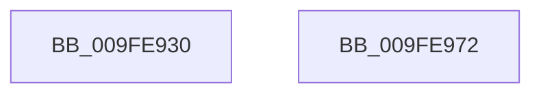

# NtQueueApcThreadEx

- RVA: `0x009FE930`–`0x009FE973` (길이 `67` bytes)
- VA: `0x00000001409FE930`
- 실행 섹션: `PAGE`
- PDB 이름 있음: `예`; PDB Function 태그: `아니요`
- unwind 정보 RVA: `0x00063458`
- 디코드: `18`개 명령, `67/67` bytes 표시
- 미해석 바이트: `0` (있으면 어셈블리에 `.byte`로 보존)

> 이 문서는 커널 이미지의 기계어와 PDB 기호를 분석해 생성했습니다. 4번과 5번은 함수 원형과 자료형을 바이너리 사용 방식에서 추정한 C 해석이며 원본 소스 복구 결과는 아닙니다.

## 1. Dependencies

- 직접 호출 지점: **1**; 고유 호출 대상: **1**
- 직접 호출자로 확인된 함수: **0**
- RIP 상대 이미지 참조: **0**

### Outgoing calls
- `0x009FE968` → [NtQueueApcThreadEx2](NtQueueApcThreadEx2_function_009FE980.md) (function, `0x009FE980`)

### Direct callers
- 이 함수 시작 RVA로 연결되는 직접 call은 확인되지 않았습니다. 간접 호출은 완전히 역산할 수 없습니다.

### Static image references
- 디코드된 RIP-relative 메모리 참조가 없습니다.

## 2. Other-region calls and transfers

- 다른 실행 섹션으로 향하는 call: **0**
- 별도 외부 분기/꼬리 이동을 확인하지 못했습니다.

## 3. Assembly (complete function range)

```asm
009FE930  48 83 EC 48                     sub rsp, 0x48
009FE934  48 8B 44 24 78                  mov rax, qword ptr [rsp + 0x78]
009FE939  45 33 D2                        xor r10d, r10d
009FE93C  48 83 FA 01                     cmp rdx, 1
009FE940  48 89 44 24 30                  mov qword ptr [rsp + 0x30], rax
009FE945  48 8B 44 24 70                  mov rax, qword ptr [rsp + 0x70]
009FE94A  4D 8B D8                        mov r11, r8
009FE94D  45 8B C2                        mov r8d, r10d
009FE950  48 89 44 24 28                  mov qword ptr [rsp + 0x28], rax
009FE955  4C 0F 45 D2                     cmovne r10, rdx
009FE959  4C 89 4C 24 20                  mov qword ptr [rsp + 0x20], r9
009FE95E  4D 8B CB                        mov r9, r11
009FE961  49 8B D2                        mov rdx, r10
009FE964  41 0F 94 C0                     sete r8b
009FE968  E8 13 00 00 00                  call 0x1409fe980
009FE96D  48 83 C4 48                     add rsp, 0x48
009FE971  C3                              ret
009FE972  CC                              int3
```

## 4. C-style interpretation (structured pseudocode)

```c
__int64 __fastcall NtQueueApcThreadEx(__int64 a1, __int64 a2, __int64 a3, __int64 a4, __int64 a5, __int64 a6)
{
    __int64 result;
    __int64 v_r10;
    __int64 v_rsp;
    unsigned __int64 v_stack_m18;
    unsigned __int64 v_stack_m20;
    unsigned __int64 v_stack_m28;

    v_rsp = (v_rsp) - (72);
    v_r10 = 0;
    v_stack_m18 = a6;
    v_stack_m20 = a5;
    if (a2 != 1) { v_r10 = a2; }
    v_stack_m28 = a4;
    a3 = (a2 == 1) ? 1 : 0;
    result = NtQueueApcThreadEx2(a1, v_r10, a3, a3);
    v_rsp = (v_rsp) + (72);
    return result;
}
```

## 5. (Beta) C Style

```c
int64_t NtQueueApcThreadEx(int64_t Arg1, int64_t Arg2, int64_t Arg3, int64_t Arg4, int64_t Arg5, int64_t Arg6)
{
    int64_t result;
    int64_t local_r10;
    int64_t local_rsp;
    uint64_t v_stack_m18;
    uint64_t v_stack_m20;
    uint64_t v_stack_m28;

    local_rsp = (local_rsp) - (72);
    local_r10 = 0;
    v_stack_m18 = Arg6;
    v_stack_m20 = Arg5;
    if (Arg2 != 1) { local_r10 = Arg2; }
    v_stack_m28 = Arg4;
    Arg3 = (Arg2 == 1) ? 1 : 0;
    result = NtQueueApcThreadEx2(Arg1, local_r10, Arg3, Arg3);
    local_rsp = (local_rsp) + (72);
    return result;
}
```

## 6. Execution-region graph

[열기: 2D/3D 그래프와 함수 탐색 컨트롤 패널](../../../control-panel.html?section=page&rva=0x009FE930&view=graph)

- 2D 그래프는 위에서 아래로 흐르고, 3D 그래프는 빈 공간을 드래그해 회전합니다. Shift+드래그는 이동, 휠은 확대·축소, 함수 노드 선택은 대상 보고서 이동입니다.

### Static fallback


