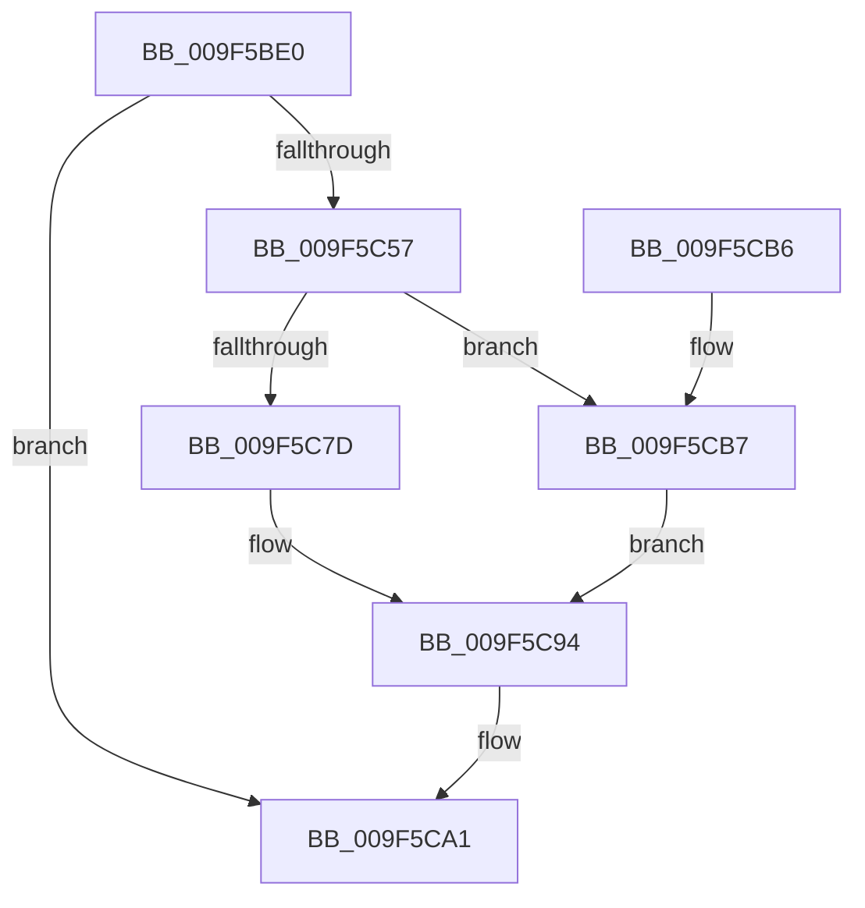

# NtReplyPort

- RVA: `0x009F5BE0`–`0x009F5CE9` (길이 `265` bytes)
- VA: `0x00000001409F5BE0`
- 실행 섹션: `PAGE`
- PDB 이름 있음: `예`; PDB Function 태그: `아니요`
- unwind 정보 RVA: `0x000A6B14`
- 디코드: `55`개 명령, `265/265` bytes 표시
- 미해석 바이트: `0` (있으면 어셈블리에 `.byte`로 보존)

> 이 문서는 커널 이미지의 기계어와 PDB 기호를 분석해 생성했습니다. 4번과 5번은 함수 원형과 자료형을 바이너리 사용 방식에서 추정한 C 해석이며 원본 소스 복구 결과는 아닙니다.

## 1. Dependencies

- 직접 호출 지점: **6**; 고유 호출 대상: **6**
- 직접 호출자로 확인된 함수: **0**
- RIP 상대 이미지 참조: **1**

### Outgoing calls
- `0x009F5BFB` → [memset](../../text/6C/memset_function_006C6C40.md) (function, `0x006C6C40`)
- `0x009F5C4C` → [ObReferenceObjectByHandle](../86/ObReferenceObjectByHandle_function_00868DB0.md) (function, `0x00868DB0`)
- `0x009F5C8D` → [AlpcpReplyLegacySynchronousRequest](AlpcpReplyLegacySynchronousRequest_function_009F5CF0.md) (function, `0x009F5CF0`)
- `0x009F5C9C` → [ObfDereferenceObject](../../text/2F/ObfDereferenceObject_function_002F9350.md) (function, `0x002F9350`)
- `0x009F5CA1` → [KeLeaveCriticalRegion](../../text/25/KeLeaveCriticalRegion_function_0025D8B0.md) (function, `0x0025D8B0`)
- `0x009F5CD2` → [AlpcpSendMessage](../88/AlpcpSendMessage_function_0088BD40.md) (function, `0x0088BD40`)

### Direct callers
- 이 함수 시작 RVA로 연결되는 직접 call은 확인되지 않았습니다. 간접 호출은 완전히 역산할 수 없습니다.

### Static image references
- `0x009F5C28` → RVA `0x00FC6C18` (`ALMOSTRO`; read)

## 2. Other-region calls and transfers

- 다른 실행 섹션으로 향하는 call: **3**
  - `0x009F5BFB` → [memset](../../text/6C/memset_function_006C6C40.md) (`PAGE` → `.text`)
  - `0x009F5C9C` → [ObfDereferenceObject](../../text/2F/ObfDereferenceObject_function_002F9350.md) (`PAGE` → `.text`)
  - `0x009F5CA1` → [KeLeaveCriticalRegion](../../text/25/KeLeaveCriticalRegion_function_0025D8B0.md) (`PAGE` → `.text`)
- 별도 외부 분기/꼬리 이동을 확인하지 못했습니다.

## 3. Assembly (complete function range)

```asm
009F5BE0  48 89 5C 24 08                  mov qword ptr [rsp + 8], rbx
009F5BE5  57                              push rdi
009F5BE6  48 83 EC 70                     sub rsp, 0x70
009F5BEA  48 8B FA                        mov rdi, rdx
009F5BED  48 8B D9                        mov rbx, rcx
009F5BF0  33 D2                           xor edx, edx
009F5BF2  48 8D 4C 24 30                  lea rcx, [rsp + 0x30]
009F5BF7  44 8D 42 40                     lea r8d, [rdx + 0x40]
009F5BFB  E8 40 10 CD FF                  call 0x1406c6c40
009F5C00  65 48 8B 04 25 88 01 00 00      mov rax, qword ptr gs:[0x188]
009F5C09  BA 01 00 00 00                  mov edx, 1
009F5C0E  48 83 64 24 28 00               and qword ptr [rsp + 0x28], 0
009F5C14  48 8B CB                        mov rcx, rbx
009F5C17  66 FF 88 E4 01 00 00            dec word ptr [rax + 0x1e4]
009F5C1E  90                              nop
009F5C1F  65 48 8B 04 25 88 01 00 00      mov rax, qword ptr gs:[0x188]
009F5C28  4C 8B 05 E9 0F 5D 00            mov r8, qword ptr [rip + 0x5d0fe9]
009F5C2F  48 83 A4 24 90 00 00 00 00      and qword ptr [rsp + 0x90], 0
009F5C38  44 8A 88 32 02 00 00            mov r9b, byte ptr [rax + 0x232]
009F5C3F  48 8D 84 24 90 00 00 00         lea rax, [rsp + 0x90]
009F5C47  48 89 44 24 20                  mov qword ptr [rsp + 0x20], rax
009F5C4C  E8 5F 31 E7 FF                  call 0x140868db0
009F5C51  8B D8                           mov ebx, eax
009F5C53  85 C0                           test eax, eax
009F5C55  78 4A                           js 0x1409f5ca1
009F5C57  48 8B 84 24 90 00 00 00         mov rax, qword ptr [rsp + 0x90]
009F5C5F  48 8D 4C 24 30                  lea rcx, [rsp + 0x30]
009F5C64  83 64 24 60 00                  and dword ptr [rsp + 0x60], 0
009F5C69  48 8B D7                        mov rdx, rdi
009F5C6C  48 89 44 24 30                  mov qword ptr [rsp + 0x30], rax
009F5C71  F7 80 A0 01 00 00 00 20 00 00   test dword ptr [rax + 0x1a0], 0x2000
009F5C7B  74 3A                           je 0x1409f5cb7
009F5C7D  65 48 8B 04 25 88 01 00 00      mov rax, qword ptr gs:[0x188]
009F5C86  44 8A 80 32 02 00 00            mov r8b, byte ptr [rax + 0x232]
009F5C8D  E8 5E 00 00 00                  call 0x1409f5cf0
009F5C92  8B D8                           mov ebx, eax
009F5C94  48 8B 8C 24 90 00 00 00         mov rcx, qword ptr [rsp + 0x90]
009F5C9C  E8 AF 36 90 FF                  call 0x1402f9350
009F5CA1  E8 0A 7C 86 FF                  call 0x14025d8b0
009F5CA6  8B C3                           mov eax, ebx
009F5CA8  48 8B 9C 24 80 00 00 00         mov rbx, qword ptr [rsp + 0x80]
009F5CB0  48 83 C4 70                     add rsp, 0x70
009F5CB4  5F                              pop rdi
009F5CB5  C3                              ret
009F5CB6  CC                              int3
009F5CB7  C7 44 24 60 01 00 01 00         mov dword ptr [rsp + 0x60], 0x10001
009F5CBF  45 33 C0                        xor r8d, r8d
009F5CC2  65 48 8B 04 25 88 01 00 00      mov rax, qword ptr gs:[0x188]
009F5CCB  44 8A 88 32 02 00 00            mov r9b, byte ptr [rax + 0x232]
009F5CD2  E8 69 60 E9 FF                  call 0x14088bd40
009F5CD7  8B D8                           mov ebx, eax
009F5CD9  B8 37 00 00 C0                  mov eax, 0xc0000037
009F5CDE  81 FB 03 07 00 C0               cmp ebx, 0xc0000703
009F5CE4  0F 44 D8                        cmove ebx, eax
009F5CE7  EB AB                           jmp 0x1409f5c94
```

## 4. C-style interpretation (structured pseudocode)

```c
__int64 __fastcall NtReplyPort(__int64 a1, __int64 a2)
{
    __int64 result;
    __int64 v_rbx;
    __int64 v_rsp;
    unsigned int v_stack_m18;
    unsigned __int64 v_stack_m48;
    unsigned __int64 v_stack_m50;
    unsigned __int64 v_stack_m58;
    unsigned __int64 v_stack_p18;
    unsigned int v_stack_p60;
    unsigned __int64 v_stack_p8;

    v_stack_p8 = v_rbx;
    v_rsp = (v_rsp) - (112);
    a2 = 0;
    result = memset(v_stack_m48, a2, a2 + 64, a4);
    v_stack_m58 = v_stack_p18;
    result = ObReferenceObjectByHandle(a1, 1, *(unsigned __int64 *)(v_rip + 6098921), *(unsigned __int8 *)(*(unsigned __int64 *)(gs_base + (0 + 392)) + 562));
    if (sign_flag) goto loc_009F5CA1;
    v_stack_m48 = v_stack_p18;
    if (((*(unsigned int *)(v_stack_p18 + 416)) & (0x2000ULL)) == 0) goto loc_009F5CB7;
    result = AlpcpReplyLegacySynchronousRequest(v_stack_m48, 0, *(unsigned __int8 *)(*(unsigned __int64 *)(gs_base + (0 + 392)) + 562), *(unsigned __int8 *)(*(unsigned __int64 *)(gs_base + (0 + 392)) + 562));
loc_009F5C94:
    result = ObfDereferenceObject(v_stack_p18, 0, *(unsigned __int8 *)(*(unsigned __int64 *)(gs_base + (0 + 392)) + 562), *(unsigned __int8 *)(*(unsigned __int64 *)(gs_base + (0 + 392)) + 562));
loc_009F5CA1:
    result = KeLeaveCriticalRegion(v_stack_p18, 0, *(unsigned __int8 *)(*(unsigned __int64 *)(gs_base + (0 + 392)) + 562), *(unsigned __int8 *)(*(unsigned __int64 *)(gs_base + (0 + 392)) + 562));
    v_rsp = (v_rsp) + (112);
    return (unsigned int)((unsigned int)((unsigned int)((unsigned int)(result))));
loc_009F5CB7:
    v_stack_p60 = 0x10001ULL;
    a3 = 0;
    result = AlpcpSendMessage(v_stack_p18, 0, a3, *(unsigned __int8 *)(*(unsigned __int64 *)(gs_base + (0 + 392)) + 562));
    v_rbx = (unsigned int)((unsigned int)(result));
    if (((unsigned int)((unsigned int)((unsigned int)(result)))) == 0xC0000703ULL) { v_rbx = (unsigned int)((unsigned int)(0xC0000037ULL)); }
    goto loc_009F5C94;
}
```

## 5. (Beta) C Style

```c
int64_t NtReplyPort(int64_t Arg1, int64_t Arg2)
{
    int64_t result;
    int64_t local_rbx;
    int64_t local_rsp;
    uint32_t v_stack_m18;
    uint64_t v_stack_m48;
    uint64_t v_stack_m50;
    uint64_t v_stack_m58;
    uint64_t v_stack_p18;
    uint32_t v_stack_p60;
    uint64_t v_stack_p8;

    v_stack_p8 = local_rbx;
    local_rsp = (local_rsp) - (112);
    Arg2 = 0;
    result = memset(v_stack_m48, Arg2, Arg2 + 64, a4);
    v_stack_m58 = v_stack_p18;
    result = ObReferenceObjectByHandle(Arg1, 1, *(uint64_t *)(v_rip + 0x5D0FE9), *(uint8_t *)(*(uint64_t *)(gs_base + (0 + 0x188)) + 0x232));
    if (sign_flag) goto loc_009F5CA1;
    v_stack_m48 = v_stack_p18;
    if (((*(uint32_t *)(v_stack_p18 + 0x1A0)) & (0x2000ULL)) == 0) goto loc_009F5CB7;
    result = AlpcpReplyLegacySynchronousRequest(v_stack_m48, 0, *(uint8_t *)(*(uint64_t *)(gs_base + (0 + 0x188)) + 0x232), *(uint8_t *)(*(uint64_t *)(gs_base + (0 + 0x188)) + 0x232));
loc_009F5C94:
    result = ObfDereferenceObject(v_stack_p18, 0, *(uint8_t *)(*(uint64_t *)(gs_base + (0 + 0x188)) + 0x232), *(uint8_t *)(*(uint64_t *)(gs_base + (0 + 0x188)) + 0x232));
loc_009F5CA1:
    result = KeLeaveCriticalRegion(v_stack_p18, 0, *(uint8_t *)(*(uint64_t *)(gs_base + (0 + 0x188)) + 0x232), *(uint8_t *)(*(uint64_t *)(gs_base + (0 + 0x188)) + 0x232));
    local_rsp = (local_rsp) + (112);
    return (uint32_t)((uint32_t)((uint32_t)((uint32_t)(result))));
loc_009F5CB7:
    v_stack_p60 = 0x10001ULL;
    a3 = 0;
    result = AlpcpSendMessage(v_stack_p18, 0, a3, *(uint8_t *)(*(uint64_t *)(gs_base + (0 + 0x188)) + 0x232));
    local_rbx = (uint32_t)((uint32_t)(result));
    if (((uint32_t)((uint32_t)((uint32_t)(result)))) == 0xC0000703ULL) { local_rbx = (uint32_t)((uint32_t)(0xC0000037ULL)); }
    goto loc_009F5C94;
}
```

## 6. Execution-region graph

[열기: 2D/3D 그래프와 함수 탐색 컨트롤 패널](../../../control-panel.html?section=page&rva=0x009F5BE0&view=graph)

- 2D 그래프는 위에서 아래로 흐르고, 3D 그래프는 빈 공간을 드래그해 회전합니다. Shift+드래그는 이동, 휠은 확대·축소, 함수 노드 선택은 대상 보고서 이동입니다.

### Static fallback


