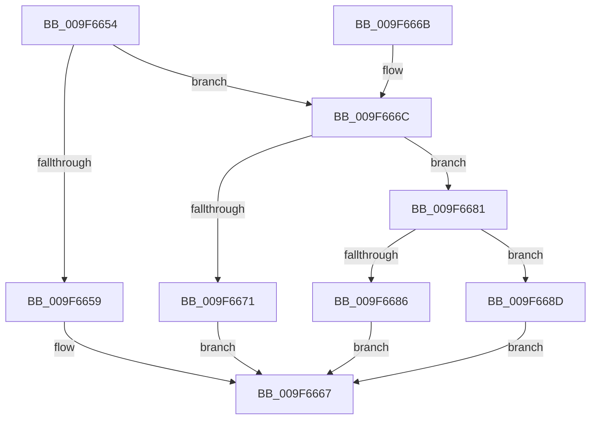

# PiDmGetCacheKeys

- RVA: `0x009F6654`–`0x009F669D` (길이 `73` bytes)
- VA: `0x00000001409F6654`
- 실행 섹션: `PAGE`
- PDB 이름 있음: `예`; PDB Function 태그: `아니요`
- unwind 정보 RVA: `0x000DB714`
- 디코드: `20`개 명령, `73/73` bytes 표시
- 미해석 바이트: `0` (있으면 어셈블리에 `.byte`로 보존)

> 이 문서는 커널 이미지의 기계어와 PDB 기호를 분석해 생성했습니다. 4번과 5번은 함수 원형과 자료형을 바이너리 사용 방식에서 추정한 C 해석이며 원본 소스 복구 결과는 아닙니다.

## 1. Dependencies

- 직접 호출 지점: **0**; 고유 호출 대상: **0**
- 직접 호출자로 확인된 함수: **1**
- RIP 상대 이미지 참조: **3**

### Outgoing calls
- 직접 디코드된 call 명령이 없습니다.

### Direct callers
- [sub_00B1D1F6](../B1/Unknown_function_00B1D1F6.md) at `0x00B1D203`

### Static image references
- `0x009F6660` → RVA `0x00001A70` (`.rdata`; read)
- `0x009F6678` → RVA `0x00001B60` (`.rdata`; read)
- `0x009F6694` → RVA `0x00001B90` (`.rdata`; read)

## 2. Other-region calls and transfers

- 다른 실행 섹션으로 향하는 call: **0**
- 별도 외부 분기/꼬리 이동을 확인하지 못했습니다.

## 3. Assembly (complete function range)

```asm
009F6654  83 E9 01                        sub ecx, 1
009F6657  75 13                           jne 0x1409f666c
009F6659  41 C7 00 0A 00 00 00            mov dword ptr [r8], 0xa
009F6660  48 8D 05 09 B4 60 FF            lea rax, [rip - 0x9f4bf7]
009F6667  48 89 02                        mov qword ptr [rdx], rax
009F666A  C3                              ret
009F666B  CC                              int3
009F666C  83 E9 02                        sub ecx, 2
009F666F  75 10                           jne 0x1409f6681
009F6671  41 C7 00 01 00 00 00            mov dword ptr [r8], 1
009F6678  48 8D 05 E1 B4 60 FF            lea rax, [rip - 0x9f4b1f]
009F667F  EB E6                           jmp 0x1409f6667
009F6681  83 F9 02                        cmp ecx, 2
009F6684  74 07                           je 0x1409f668d
009F6686  33 C0                           xor eax, eax
009F6688  41 89 00                        mov dword ptr [r8], eax
009F668B  EB DA                           jmp 0x1409f6667
009F668D  41 C7 00 03 00 00 00            mov dword ptr [r8], 3
009F6694  48 8D 05 F5 B4 60 FF            lea rax, [rip - 0x9f4b0b]
009F669B  EB CA                           jmp 0x1409f6667
```

## 4. C-style interpretation (structured pseudocode)

```c
__int64 __fastcall PiDmGetCacheKeys(int a1, __int64 a2, __int64 a3)
{
    __int64 result;

    a1 = (unsigned int)((a1) - (1));
    if (condition_is_not_equal) goto loc_009F666C;
    *(unsigned int *)(a3) = 10;
loc_009F6667:
    *(unsigned __int64 *)(a2) = v_rip - 10439671;
    return v_rip - 10439671;
loc_009F666C:
    a1 = (unsigned int)((a1) - (2));
    if (condition_is_not_equal) goto loc_009F6681;
    *(unsigned int *)(a3) = 1;
    goto loc_009F6667;
loc_009F6681:
    if (a1 == 2) goto loc_009F668D;
    result = 0;
    *(unsigned int *)(a3) = 0;
    goto loc_009F6667;
loc_009F668D:
    *(unsigned int *)(a3) = 3;
    goto loc_009F6667;
}
```

## 5. (Beta) C Style

```c
int64_t PiDmGetCacheKeys(int32_t Arg1, void *Arg2, void *Arg3)
{
    uint8_t *arg2 = (uint8_t *)Arg2;
    uint8_t *arg3 = (uint8_t *)Arg3;

    int64_t result;

    Arg1 = (uint32_t)((Arg1) - (1));
    if (condition_is_not_equal) goto loc_009F666C;
    *(uint32_t *)(arg3) = 10;
loc_009F6667:
    *(uint64_t *)(arg2) = v_rip - 10439671;
    return v_rip - 10439671;
loc_009F666C:
    Arg1 = (uint32_t)((Arg1) - (2));
    if (condition_is_not_equal) goto loc_009F6681;
    *(uint32_t *)(arg3) = 1;
    goto loc_009F6667;
loc_009F6681:
    if (Arg1 == 2) goto loc_009F668D;
    result = 0;
    *(uint32_t *)(arg3) = 0;
    goto loc_009F6667;
loc_009F668D:
    *(uint32_t *)(arg3) = 3;
    goto loc_009F6667;
}
```

### 관측된 메모리 오프셋

구조체 형식이 확인되지 않은 접근은 인자 기준의 오프셋으로만 기록했습니다.

| 기준 인자 | 오프셋 표현 | 폭 (bit) | 접근 |
|---|---:|---:|---|
| `Arg2` | `+ 0x0` | `64` | `W` |
| `Arg3` | `+ 0x0` | `32` | `W` |

## 6. Execution-region graph

[열기: 2D/3D 그래프와 함수 탐색 컨트롤 패널](../../../control-panel.html?section=page&rva=0x009F6654&view=graph)

- 2D 그래프는 위에서 아래로 흐르고, 3D 그래프는 빈 공간을 드래그해 회전합니다. Shift+드래그는 이동, 휠은 확대·축소, 함수 노드 선택은 대상 보고서 이동입니다.

### Static fallback


